# Page: Overview

# Overview

<details>
<summary>Relevant source files</summary>

The following files were used as context for generating this wiki page:

- [CITATION.cff](CITATION.cff)
- [LICENSE](LICENSE)
- [README.md](README.md)
- [res/hf-logo.png](res/hf-logo.png)
- [res/logo.png](res/logo.png)

</details>


The **peS2o** (Pretraining Effectively on [S2ORC](https://github.com/allenai/s2orc)) dataset is a curated collection of approximately 40 million open-access academic papers [README.md:7-9](). It is designed specifically for the pre-training of large language models, providing a cleaned, filtered, and formatted version of the Semantic Scholar Open Research Corpus [README.md:24-24]().

The project provides both the final dataset (available on Hugging Face) and the end-to-end pipeline used to transform raw Semantic Scholar data into a high-quality corpus [README.md:11-17]().

### Purpose and Scope
The primary goal of peS2o is to provide a massive, high-quality scientific corpus that minimizes "noise" typical in raw academic data—such as OCR errors, non-textual elements (tables/figures), and non-English content [README.md:61-76](). By applying rigorous filtering heuristics based on perplexity and structural criteria, peS2o aims to be a more effective pre-training source than raw web crawls or unfiltered academic dumps.

### Dataset Consumption
The dataset is published on the Hugging Face Hub and can be consumed using the `datasets` library:

```python
from datasets import load_dataset

# Load the latest version (v2) of the training split
dataset = load_dataset("allenai/peS2o", "v2", split="train")
```
[README.md:14-17]()

### Core Components and Entities

The following diagram illustrates how the logical concepts of the peS2o dataset map to the underlying data sources and code-level attributes.

**peS2o Entity Mapping**
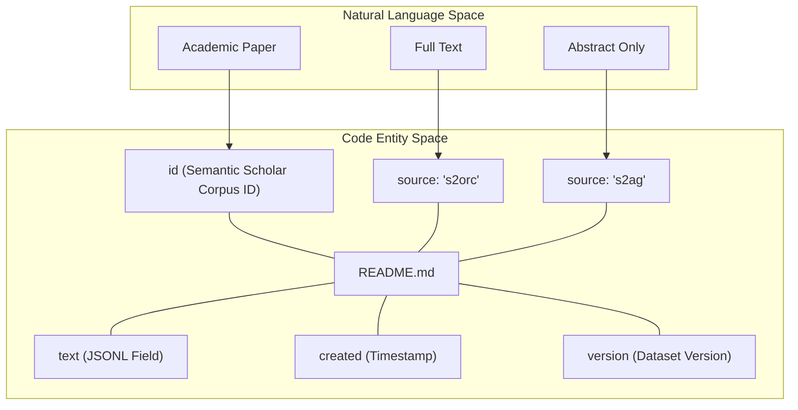
**Sources:** [README.md:34-45]()

---

### Dataset Description and Schema
The peS2o corpus is released in versions, with **V2** being the current standard [README.md:19-20](). It contains roughly 38.97M documents and 42.01B whitespace-separated tokens [README.md:115-116]().

Each document follows a standardized schema:
*   `id`: The Semantic Scholar Corpus ID [README.md:40-40]().
*   `text`: The cleaned text content, with paragraphs separated by `\n\n` [README.md:44-44]().
*   `source`: Indicates if the document came from the full-text `s2orc` pipeline or the title/abstract `s2ag` pipeline [README.md:41-43]().
*   `added` / `created`: Temporal metadata for versioning and splitting [README.md:38-39]().

For a detailed breakdown of version history and the internal structure of these files, see **[Dataset Description and Schema](#1.1)**.

---

### Filtering and Quality Logic
The value of peS2o lies in its multi-stage filtering. The pipeline removes documents based on:
1.  **Language**: Using `pycld3` to ensure English-only content [README.md:67-70]().
2.  **Quality**: Removing sections with an average log word probability (perplexity) below `-20` [README.md:74-75]().
3.  **Structure**: Enforcing minimum word counts and paragraph counts [README.md:71-73]().
4.  **Heuristics**: Identifying OCR errors in V2 through regex-based subsequence matching [README.md:120-123]().

The relationship between these filters and the processing scripts is shown below:

**Filter Implementation Flow**
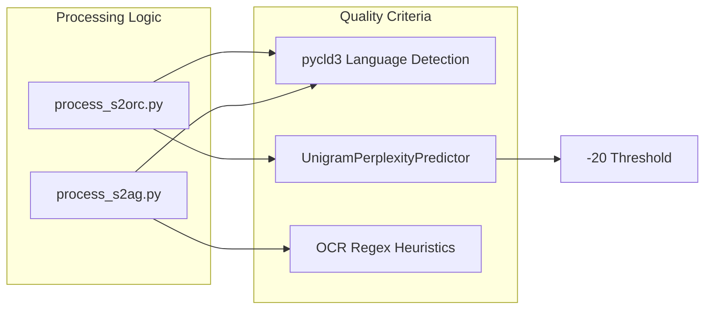
**Sources:** [README.md:68-75](), [README.md:120-123]()

For the comprehensive reference of all quality filters and the logic behind temporal splits, see **[Filtering Heuristics and Quality Criteria](#1.2)**.

---

### Pipeline Architecture
The peS2o dataset is the result of a four-stage production recipe:
1.  **Extraction**: SQL queries against AWS Athena tables [Stage 2.1]().
2.  **Processing**: Python scripts for cleaning and scoring [Stage 2.2]().
3.  **Registration**: Loading processed data back into Athena [Stage 2.3]().
4.  **Mixing**: Final filtering and deduplication [Stage 2.4]().

For an overview of the architecture and links to stage-specific details, see **[Data Pipeline Architecture](#2)**.

---
**Sources:** [README.md:1-134](), [CITATION.cff:1-25]()

---

# Page: Dataset Description and Schema

# Dataset Description and Schema

<details>
<summary>Relevant source files</summary>

The following files were used as context for generating this wiki page:

- [CITATION.cff](CITATION.cff)
- [LICENSE](LICENSE)
- [README.md](README.md)

</details>


The peS2o dataset is a large-scale collection of open-access academic papers designed for the pre-training of language models. It is derived from the [Semantic Scholar Open Research Corpus (S2ORC)](https://github.com/allenai/s2orc) and undergoes extensive cleaning, filtering, and formatting to ensure high data quality [README.md:7-9]().

## Dataset Statistics and Versioning

The dataset is released in versions, each reflecting improvements in processing heuristics or updated knowledge cutoffs.

| Version | Knowledge Cutoff | Documents | Tokens (approx.) | Primary Improvements |
| :--- | :--- | :--- | :--- | :--- |
| **v1** | 2023-01-03 | 67.56M | 47.37B | Initial release; basic language and quality filters. |
| **v2** | 2023-01-03 | 38.97M | 42.01B | Added OCR error detection for S2AG abstracts. |

**Sources:** [README.md:49-56](), [README.md:109-116](), [README.md:120-123]()

### Source Pipelines
The corpus is constructed from two primary sources within the Semantic Scholar ecosystem:
1.  **s2orc**: Full-text papers where section headers and paragraphs are extracted via [Grobid](https://github.com/kermitt2/grobid). Non-textual elements like figures, tables, and references are stripped [README.md:61-66]().
2.  **s2ag**: Titles and abstracts from the Semantic Scholar Academic Graph. This source provides broad coverage for papers where full text is unavailable or restricted [README.md:82-85]().

## Document Schema

Each document in peS2o is represented as a dictionary with a consistent set of fields across both `s2orc` and `s2ag` sources.

| Field | Type | Description |
| :--- | :--- | :--- |
| `id` | String | Semantic Scholar Corpus ID. Can be used with the S2 API to fetch metadata (e.g., authors, FOS) [README.md:40](). |
| `text` | String | The document content. Paragraphs are delimited by double newlines (`\n\n`) [README.md:44](). |
| `source` | String | Origin of the data: either `s2orc` (full-text) or `s2ag` (abstracts) [README.md:41-43](). |
| `added` | String | ISO date the document was added to the peS2o corpus [README.md:38](). |
| `created` | String | Best-guess publication date (resolution varies from YYYY to YYYY-MM-DD) [README.md:39](). |
| `version` | String | The peS2o version (e.g., "v2") [README.md:45](). |

**Sources:** [README.md:34-46]()

## Data Flow and Source Mapping

The following diagram illustrates how raw Semantic Scholar data sources are transformed into the final peS2o schema.

### Data Origin to Schema Mapping
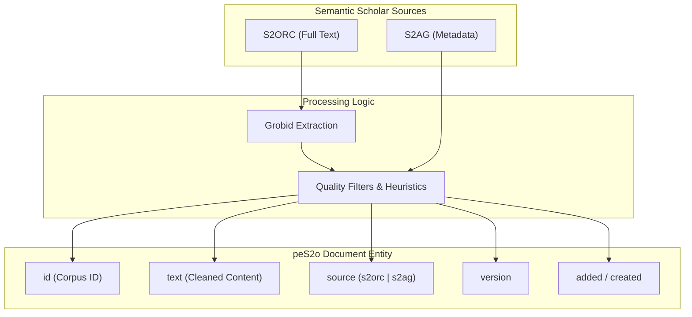
**Sources:** [README.md:34-46](), [README.md:61-66](), [README.md:82-85]()

## Loading the Dataset

The dataset is hosted on the Hugging Face Hub and can be consumed using the `datasets` library. Users can specify the version (e.g., `v2`) as the configuration name.

```python
from datasets import load_dataset

# Load the train split of peS2o v2
dataset = load_dataset("allenai/peS2o", "v2", split="train")

# Example of accessing a document
print(dataset[0]["text"])
```
**Sources:** [README.md:11-17]()

## System Architecture: Source to Output

This diagram maps the logical data flow to the conceptual code entities that manage the transformation from source collections to the unified output format.

### Conceptual Pipeline Entities
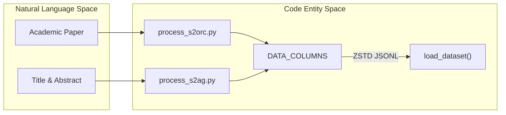
**Sources:** [README.md:14-17](), [README.md:59-60](), [README.md:120-123]()

---

# Page: Filtering Heuristics and Quality Criteria

# Filtering Heuristics and Quality Criteria

<details>
<summary>Relevant source files</summary>

The following files were used as context for generating this wiki page:

- [LICENSE](LICENSE)
- [README.md](README.md)
- [recipe/4_mix_final/s2ag.sql](recipe/4_mix_final/s2ag.sql)
- [recipe/4_mix_final/s2orc.sql](recipe/4_mix_final/s2orc.sql)

</details>


This page provides a comprehensive technical reference for the quality filters and heuristics applied to the peS2o dataset. These filters ensure that the resulting corpus is suitable for language model pre-training by removing low-quality OCR, non-English content, and structural anomalies from both the `s2orc` (full-text) and `s2ag` (title and abstract) pipelines.

## Filtering Logic Overview

The filtering process is split between Stage 2 (Python-based signal generation) and Stage 4 (SQL-based final selection). The Python scripts calculate metrics like perplexity and language, while the Athena SQL queries apply the definitive thresholds and structural constraints.

### Quality Criteria Data Flow

The following diagram illustrates how raw text is transformed into filtered documents by passing through various heuristic checks.

**Title: Quality Filtering Pipeline Flow**
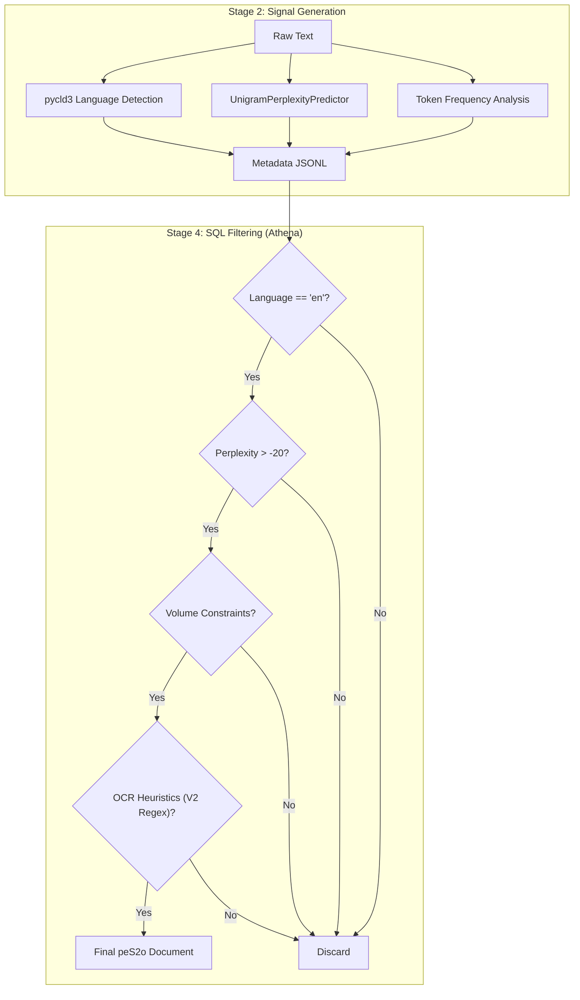
**Sources:** [README.md:57-81](), [recipe/4_mix_final/s2orc.sql:1-101](), [recipe/4_mix_final/s2ag.sql:1-85]()

---

## Language Detection

PeS2o is primarily an English corpus. Language detection is performed using the `pycld3` library.

*   **S2ORC Implementation:** Language is detected at the paragraph level. The system runs `pycld3` on the first 2000 characters of each paragraph [README.md:68-70](). The document-level language is determined by the most frequent paragraph language [recipe/4_mix_final/s2orc.sql:40-60]().
*   **S2AG Implementation:** Both the title and abstract must be identified as English (`en`) [recipe/4_mix_final/s2ag.sql:56-57](). However, a title may bypass the language check if it has a high unigram log probability (>-20) [README.md:89]().

**Sources:** [README.md:67-70](), [README.md:87-91](), [recipe/4_mix_final/s2ag.sql:56-57](), [recipe/4_mix_final/s2orc.sql:40-60]()

---

## Perplexity and Unigram Probability

To filter out "gibberish" or poorly formatted text, peS2o uses an average log word probability threshold of **-20**.

*   **Model:** Probabilities are derived from the [1T Web Ngram corpus](https://catalog.ldc.upenn.edu/LDC2006T13) [README.md:75]().
*   **S2ORC:** Applied at the paragraph level. Any paragraph with a perplexity score below -20 is removed before the final text reconstruction [recipe/4_mix_final/s2orc.sql:18-21](). A document must retain at least 5 "valid" paragraphs to be included [recipe/4_mix_final/s2orc.sql:97]().
*   **S2AG:** Applied to both title and abstract. If the abstract's average log probability is below -20, the document is discarded [recipe/4_mix_final/s2ag.sql:58]().

**Sources:** [README.md:74-75](), [recipe/4_mix_final/s2orc.sql:18-21](), [recipe/4_mix_final/s2ag.sql:58]()

---

## Volume and Temporal Constraints

The pipeline enforces limits on document length and publication dates to ensure content density and avoid early OCR-heavy eras.

| Metric | S2ORC Requirement | S2AG Requirement |
| :--- | :--- | :--- |
| **Minimum Length** | > 500 words [README.md:71]() | > 50 words (abstract) [README.md:92]() |
| **Maximum Length** | < 50,000 words [recipe/4_mix_final/s2orc.sql:94]() | < 1000 words (abstract) [README.md:93]() |
| **Minimum Date** | $\ge$ 1970 [recipe/4_mix_final/s2orc.sql:100]() | $\ge$ 1970 [recipe/4_mix_final/s2ag.sql:62]() |
| **Paragraph Count** | $\ge$ 5 valid paragraphs [README.md:73]() | N/A |

**Sources:** [README.md:71-73](), [README.md:92-95](), [recipe/4_mix_final/s2orc.sql:94-100](), [recipe/4_mix_final/s2ag.sql:60-62]()

---

## OCR Error Heuristics (V2 Regex)

Introduced in peS2o V2, specific heuristics target "exploded" words caused by erroneous space insertion during OCR (e.g., `A b stra ct`).

The system uses a regular expression to find sequences of individual alpha letters separated by spaces: `\b([A-Za-z]\s)([a-z]\s)*[A-Za-z]\b` [README.md:122]().

*   **Logic:** For abstracts derived from sources known to contain OCR content (e.g., `Unpaywall`, `ScienceParse`, `Crawler`), the pipeline counts these matching subsequences [recipe/4_mix_final/s2ag.sql:43-53]().
*   **Threshold:** Any abstract with more than 4 such sequences is removed [README.md:123]().

**Sources:** [README.md:120-123](), [recipe/4_mix_final/s2ag.sql:41-53](), [recipe/4_mix_final/s2ag.sql:77-85]()

---

## Top-Word Frequency Cap

To prevent documents dominated by repetitive boilerplate or extraction artifacts, peS2o limits the frequency of the most common word.

*   **S2ORC:** The most frequent alpha-only word must appear in less than 7.5% of the document (for docs > 500 words) or less than 30% (for docs $\le$ 500 words) [recipe/4_mix_final/s2orc.sql:22-39]().
*   **S2AG:** The most frequent word must be a 2+ character alpha word, or the word "a" followed by a 2+ character alpha word [README.md:94](). This is enforced via regex on `metadata.top_frequencies` in SQL [recipe/4_mix_final/s2ag.sql:63-75]().

**Sources:** [README.md:76](), [README.md:94](), [recipe/4_mix_final/s2orc.sql:22-39](), [recipe/4_mix_final/s2ag.sql:63-75]()

---

## Train/Validation Temporal Split

The dataset is split into `train` and `valid` sets based on a temporal cutoff to ensure the validation set represents the most recent knowledge.

*   **Cutoff Logic:** Documents published before 2024-08-01 are assigned to `train`. Documents published on or after that date (within the 2024 window) are assigned to `valid` [recipe/4_mix_final/s2orc.sql:82-90]().
*   **Implementation:** The `split` column is used as a partition key during the Athena `UNLOAD` process [recipe/4_mix_final/s2ag.sql:147]().

**Title: Temporal Split Implementation**
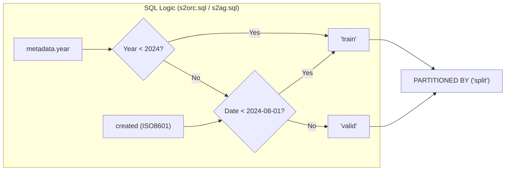

**Sources:** [README.md:79-80](), [recipe/4_mix_final/s2orc.sql:82-90](), [recipe/4_mix_final/s2ag.sql:29-37](), [recipe/4_mix_final/s2ag.sql:147]()

---

# Page: Data Pipeline Architecture

# Data Pipeline Architecture

<details>
<summary>Relevant source files</summary>

The following files were used as context for generating this wiki page:

- [recipe/README.md](recipe/README.md)

</details>


The peS2o dataset is produced through a four-stage production recipe that transforms raw internal Semantic Scholar data into a cleaned, filtered, and deduplicated corpus suitable for LLM pre-training. This pipeline bridges massive data stores in AWS Athena with local Python-based heuristic processing to ensure high linguistic quality.

### Pipeline Overview

The architecture is designed to handle multi-terabyte datasets by alternating between massive parallel SQL operations in AWS Athena and high-throughput Python multiprocessing. The flow moves from raw internal tables to intermediate Parquet extracts, then to cleaned JSONL documents, and finally to a unified, mixed dataset.

### High-Level Data Flow

The following diagram illustrates the progression of data from Semantic Scholar's internal "Espresso" ecosystem to the final published ZSTD-compressed JSONL files.

**System Data Flow: Raw to Published**
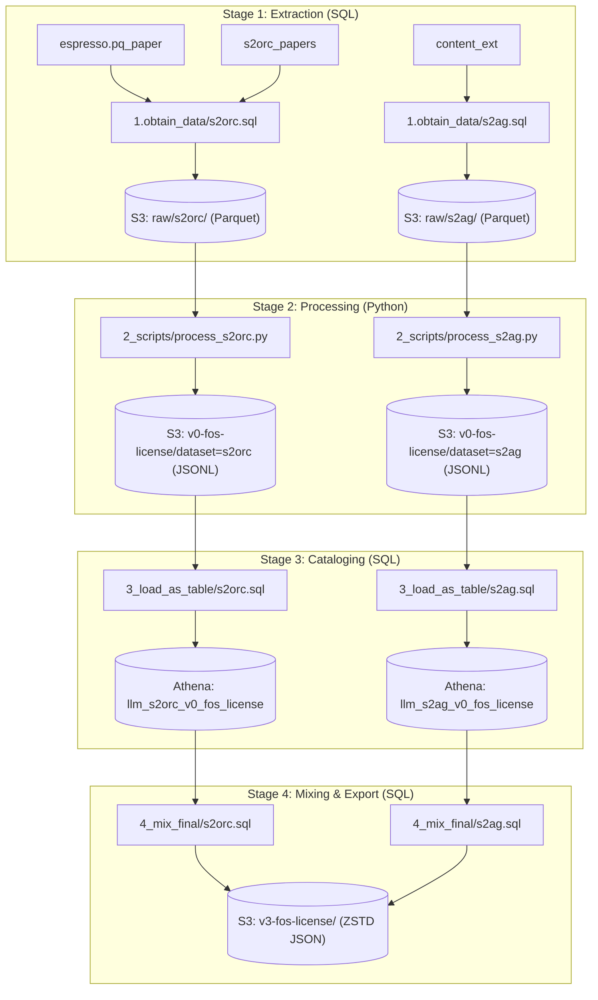
Sources: [recipe/README.md:1-62]()

---

### Stage 1: Data Extraction
The first stage involves querying Semantic Scholar's internal data lake via AWS Athena. These queries align partitions across different internal tables, such as `espresso.pq_paper` and `content_ext`, to extract text content, metadata, and Grobid-processed annotations. 

*   **S2ORC Extraction:** Scans approximately 2.60 TB of data to extract full-text and bibliography information.
*   **S2AG Extraction:** Scans approximately 155 GB to extract abstracts and associated metadata for papers without full-text availability.

The output of this stage is partitioned Parquet files stored on S3, which serve as the raw input for the Python processing layer.

For details, see [Stage 1 – Data Extraction (SQL Queries)](#2.1).

Sources: [recipe/README.md:3-18]()

---

### Stage 2: Python Processing Scripts
Raw Parquet data is processed using `2_scripts/process_s2ag.py` and `2_scripts/process_s2orc.py`. These scripts apply heavy-duty cleaning and quality estimation that is difficult to perform in SQL.

*   **Heuristics:** Implements NFC normalization, merges section headers, and applies a parenthetical-spanning heuristic to clean Grobid artifacts.
*   **Quality Signals:** Calculates document perplexity using the `UnigramPerplexityPredictor` and performs language detection via `pycld3`.
*   **Performance:** Utilizes a multiprocessing architecture (using `spawn` and `Pool.imap_unordered`) to process the multi-terabyte dataset in under an hour.

The output is compressed JSONL files containing the cleaned text and a `metadata` struct for every document.

For details, see [Stage 2 – Python Processing Scripts](#2.2).

Sources: [recipe/README.md:19-41]()

---

### Stage 3: Loading Data as Athena Tables
The processed JSONL files are registered back into AWS Athena as external Hive tables using DDL scripts found in `3_load_as_table/`. This stage allows the pipeline to use SQL for the final, complex mixing and deduplication logic.

*   **Schema Registration:** Uses `org.openx.data.jsonserde.JsonSerDe` to map the nested JSON metadata (perplexity, language, frequencies) into queryable columns.
*   **Partitioning:** Uses `MSCK REPAIR TABLE` to discover the S3 partitions created by the Stage 2 scripts.

For details, see [Stage 3 – Loading Data as Athena Tables](#2.3).

Sources: [recipe/README.md:44-53]()

---

### Stage 4: Final Mixing and Dataset Production
The final stage uses Athena to perform the definitive "mixing" of the corpus. This includes applying final quality thresholds, deduplicating papers that appear in both S2ORC and S2AG sources, and assigning documents to `train` or `validation` splits based on temporal metadata.

*   **Filtering:** Filters documents based on the signals generated in Stage 2 (e.g., perplexity < -20).
*   **Deduplication:** Uses `ARBITRARY() GROUP BY` logic to ensure each paper ID only appears once in the final corpus.
*   **Export:** The results are `UNLOAD`ed to S3 as ZSTD-compressed JSON files, which constitute the published peS2o dataset.

For details, see [Stage 4 – Final Mixing and Dataset Production](#2.4).

Sources: [recipe/README.md:54-62]()

---

# Page: Stage 1 – Data Extraction (SQL Queries)

# Stage 1 – Data Extraction (SQL Queries)

<details>
<summary>Relevant source files</summary>

The following files were used as context for generating this wiki page:

- [recipe/1_obtain_data/s2ag.sql](recipe/1_obtain_data/s2ag.sql)
- [recipe/1_obtain_data/s2orc.sql](recipe/1_obtain_data/s2orc.sql)
- [recipe/README.md](recipe/README.md)

</details>


The first stage of the peS2o pipeline involves extracting raw academic data from Semantic Scholar's internal data lake using AWS Athena. This stage targets two primary sources: **S2ORC** (full-text papers with Grobid annotations) and **S2AG** (abstracts and metadata). The goal is to align disparate internal tables, normalize temporal data, and export the results into a partitioned Parquet format for downstream Python processing.

## Data Sources and Volumes

The extraction process queries three main internal Semantic Scholar schemas:
1.  `espresso.pq_paper`: The primary metadata table containing paper IDs, fields of study, and acquisition dates [recipe/1_obtain_data/s2orc.sql:2-10]().
2.  `s2orc_papers.oa_releases`: Contains the full-text content and Grobid-derived structural annotations [recipe/1_obtain_data/s2orc.sql:73-79]().
3.  `content_ext.papers`: Used for high-fidelity publication date normalization [recipe/1_obtain_data/s2ag.sql:115-118]().

| Source | Query File | Data Scanned | Runtime (Approx) |
| :--- | :--- | :--- | :--- |
| **S2ORC** | `s2orc.sql` | 2.60 TB | 26.5 minutes |
| **S2AG** | `s2ag.sql` | 155.21 GB | 13 minutes |

Sources: [recipe/README.md:7-10]()

## S2ORC Extraction Logic

The S2ORC extraction is complex because it must reconstruct the document structure from Grobid annotations. Instead of exporting a single text blob, the query extracts specific byte offsets for paragraphs and section headers to maintain structural integrity during filtering.

### Grobid Annotation Processing
The query parses JSON-encoded annotations from the `content.grobid.annotations` column. It extracts `paragraph` and `section_header` locations, converting them into a unified `ROW(bos INTEGER, eos INTEGER, type VARCHAR)` format [recipe/1_obtain_data/s2orc.sql:47-72](). These locations are then used with `SUBSTR` to slice the `full_text` into an array of typed paragraphs [recipe/1_obtain_data/s2orc.sql:103-111]().

### Data Flow: S2ORC Raw to Parquet
The following diagram illustrates how internal Athena tables are joined and transformed into the `extracted_paragraphs` structure.

**Diagram: S2ORC Extraction Pipeline**
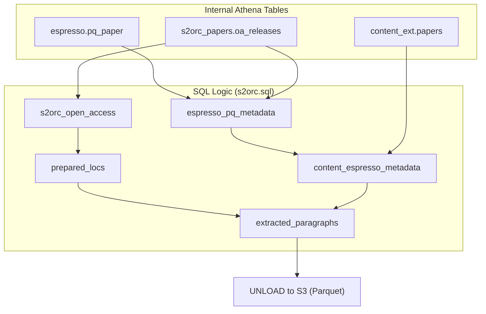
Sources: [recipe/1_obtain_data/s2orc.sql:1-136]()

## S2AG Extraction Logic

The S2AG query focuses on extracting abstracts for papers that do not have full-text available in S2ORC. It includes specific logic for publisher filtering and de-duplication.

### Publisher Filtering (Springer)
To comply with data usage restrictions, the query explicitly filters out abstracts from Springer-related DOI prefixes. If a DOI matches prefixes like `10.1007/%` or `10.1038/%` (Nature), the `abstract` field is set to `NULL` [recipe/1_obtain_data/s2ag.sql:48-83]().

### S2ORC De-duplication
To avoid redundancy, S2AG extraction performs a `LEFT OUTER JOIN` against the `s2orc_papers.oa_releases` table. Any `corpusId` already present in the S2ORC release is excluded from the S2AG dump [recipe/1_obtain_data/s2ag.sql:131-134]().

### External ID Mapping
The query aggregates various external identifiers (DOI, ArXiv, ACL, PubMedCentral, MAG) into a standardized map [recipe/1_obtain_data/s2ag.sql:36-47](). This is later transformed into an array of rows containing `source` and `id` for the final schema [recipe/1_obtain_data/s2ag.sql:9-18]().

## Date Normalization and Partitioning

Both queries implement a standardized date normalization strategy to ensure consistency across the dataset.

1.  **`added`**: Derived from `earliestacquisitiondate` in the Espresso metadata, converted to ISO8601 format [recipe/1_obtain_data/s2ag.sql:84](), [recipe/1_obtain_data/s2orc.sql:7-9]().
2.  **`created`**: A fallback-based publication date. It prioritizes `pub_date` from `content_ext.papers`. If null, it uses the `year` field; if both are null, it defaults to `0001-01-01` [recipe/1_obtain_data/s2ag.sql:101-114](), [recipe/1_obtain_data/s2orc.sql:17-30]().

### Output Partitioning
To facilitate parallel processing in Stage 2, the data is partitioned using a modulo of the paper ID:
*   **S2AG**: `corpusId % 50` creates 50 partitions [recipe/1_obtain_data/s2ag.sql:129-140]().
*   **S2ORC**: `id % 100` creates 100 partitions [recipe/1_obtain_data/s2orc.sql:126-134]().

**Diagram: Entity Mapping (SQL to Parquet)**
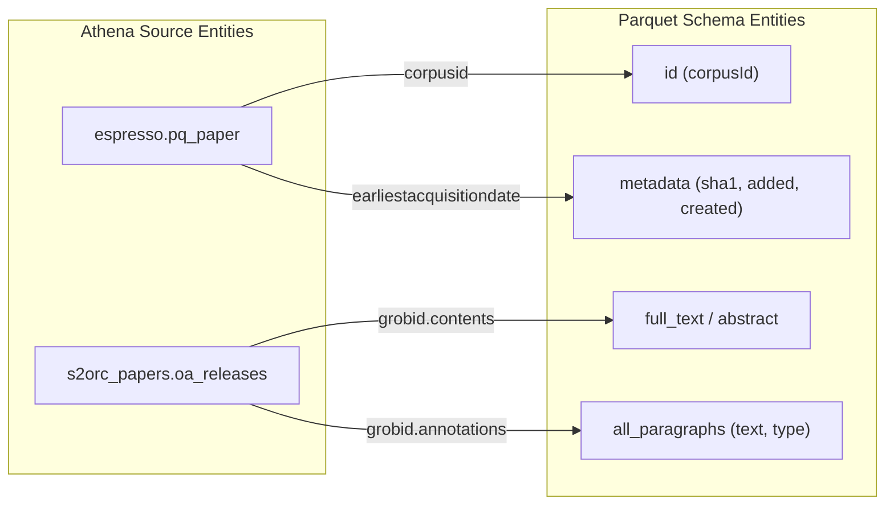
Sources: [recipe/1_obtain_data/s2orc.sql:1-136](), [recipe/1_obtain_data/s2ag.sql:1-141]()

---

# Page: Stage 2 – Python Processing Scripts

# Stage 2 – Python Processing Scripts

<details>
<summary>Relevant source files</summary>

The following files were used as context for generating this wiki page:

- [recipe/2_scripts/process_s2ag.py](recipe/2_scripts/process_s2ag.py)
- [recipe/2_scripts/process_s2orc.py](recipe/2_scripts/process_s2orc.py)
- [recipe/requirements.txt](recipe/requirements.txt)

</details>


Stage 2 of the peS2o pipeline transforms the raw Parquet files extracted in Stage 1 into enriched, compressed JSONL files. This stage is handled by two primary scripts: `process_s2ag.py` for metadata-only records and `process_s2orc.py` for full-text documents. These scripts perform language detection, perplexity calculation, text normalization, and structural merging of document fragments.

## Processing Architecture

Both scripts utilize a multiprocessing architecture to handle large-scale data transformation. The execution follows a "spawn" start method to ensure clean process isolation, particularly when dealing with C-extensions like `pycld3`.

### Parallel Execution Flow
The pipeline uses `multiprocessing.Pool.imap_unordered` to process Parquet files in parallel. A `Manager.Queue` is used to synchronize progress tracking across worker processes via `tqdm`.

| Component | Entity | Role |
| :--- | :--- | :--- |
| **Config** | `ProcessTextConfig` | Defines `src`, `dst`, and `parallel` process counts [recipe/2_scripts/process_s2ag.py:46-51](). |
| **Orchestrator** | `main` | Discovers files using `io_utils.recursively_list_files` and initializes the process pool [recipe/2_scripts/process_s2ag.py:270-310](). |
| **Worker** | `process_single` | The primary unit of work that processes a single Parquet file into a `.jsonl.gz` file [recipe/2_scripts/process_s2ag.py:143-169](). |
| **Progress** | `Queue` | Collects completion signals from workers to update a global progress bar [recipe/2_scripts/process_s2ag.py:277-290](). |

### Data Flow Diagram: Stage 2 Worker
The following diagram illustrates the transformation of a single data shard within the `process_single` function.

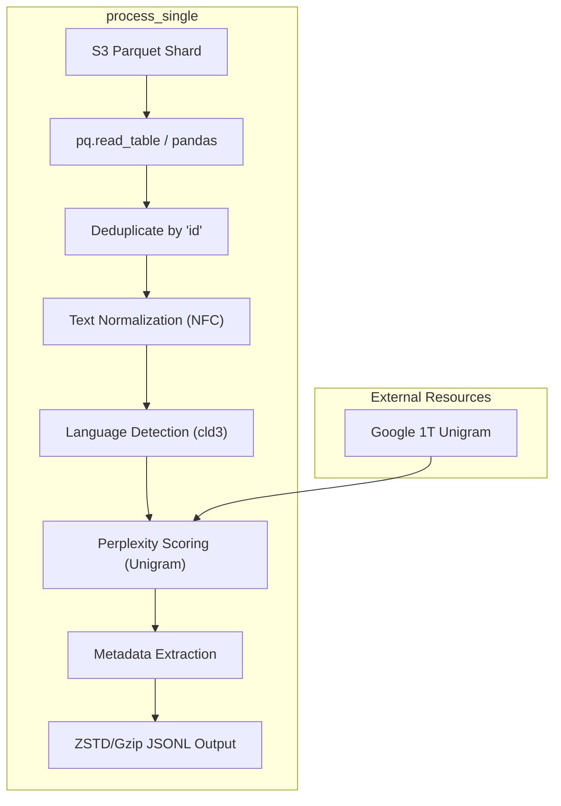
**Sources:** [recipe/2_scripts/process_s2ag.py:143-260](), [recipe/2_scripts/process_s2orc.py:136-240]()

## Text Enrichment and Quality Signals

### Unigram Perplexity Predictor
The `UnigramPerplexityPredictor` class estimates the "naturalness" of the text based on word frequencies from the Google 1T Web Unigram corpus [recipe/2_scripts/process_s2ag.py:41-43]().

*   **Initialization**: Loads unigram counts and calculates log probabilities. It assigns a fictional count to the `<unk>` token based on the square root of the vocabulary size [recipe/2_scripts/process_s2ag.py:60-72]().
*   **Prediction**: Tokenizes text using `blingfire.text_to_words` and returns the average log probability of the words [recipe/2_scripts/process_s2ag.py:77-82]().

### Language Detection
Language identification is performed using `cld3`. To optimize performance, only the first 2,000 characters of a document are used for detection [recipe/2_scripts/process_s2ag.py:39](), [recipe/2_scripts/process_s2ag.py:137-141]().

### Structural Heuristics (S2ORC)
In `process_s2orc.py`, specific heuristics are applied to reconstruct clean text from the `all_paragraphs` JSON structure:
1.  **Section Header Merging**: Section headers are identified and prepended to the subsequent paragraph to maintain context [recipe/2_scripts/process_s2orc.py:168-174]().
2.  **Parenthetical Spanning**: The `is_parenthetical_spanning_two_paragraphs` function detects if a paragraph break incorrectly splits a parenthetical statement (e.g., a citation or math formula) and merges them [recipe/2_scripts/process_s2orc.py:77-113]().
3.  **Punctuation-based Merging**: Paragraphs not ending in `.`, `?`, or `!` are merged with the following paragraph, assuming a premature break [recipe/2_scripts/process_s2orc.py:186-189]().

## Output Schema (`DATA_COLUMNS`)

The scripts enforce a standardized schema for the processed JSONL files. Any column present in the input Parquet that is not in the `DATA_COLUMNS` set is moved into a nested `metadata` dictionary.

| Field | Description | Source |
| :--- | :--- | :--- |
| `id` | Unique identifier (stringified) | [recipe/2_scripts/process_s2ag.py:204]() |
| `text` | The main content (Title + Abstract + Body) | [recipe/2_scripts/process_s2orc.py:115-119]() |
| `source` | Source identifier (e.g., `pes2o/s2ag`) | [recipe/2_scripts/process_s2ag.py:195]() |
| `added` | ISO8601 timestamp of processing | [recipe/2_scripts/process_s2ag.py:122-127]() |
| `created` | Estimated creation date (normalized to YYYY-01-01) | [recipe/2_scripts/process_s2ag.py:130-134]() |
| `version` | Dataset version (e.g., `v0-fos-license`) | [recipe/2_scripts/process_s2ag.py:194]() |
| `metadata` | Nested struct containing perplexity, language, and original columns | [recipe/2_scripts/process_s2ag.py:119-120]() |

**Sources:** [recipe/2_scripts/process_s2ag.py:116-120](), [recipe/2_scripts/process_s2orc.py:108-112]()

## Code Entity Map

The following diagram maps the logical processing steps to the specific Python classes and functions responsible for them.

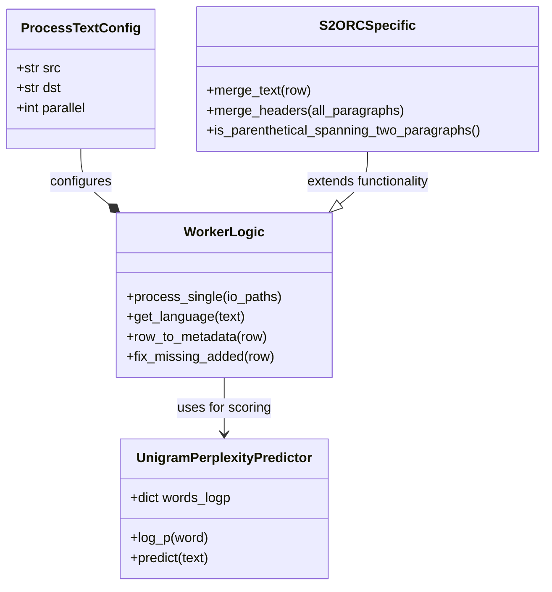
**Sources:** [recipe/2_scripts/process_s2ag.py:46-83](), [recipe/2_scripts/process_s2orc.py:77-119]()

---

# Page: Stage 3 – Loading Data as Athena Tables

# Stage 3 – Loading Data as Athena Tables

<details>
<summary>Relevant source files</summary>

The following files were used as context for generating this wiki page:

- [recipe/3_load_as_table/s2ag.sql](recipe/3_load_as_table/s2ag.sql)
- [recipe/3_load_as_table/s2orc.sql](recipe/3_load_as_table/s2orc.sql)

</details>


The third stage of the peS2o pipeline involves registering the processed JSONL files generated in Stage 2 as queryable external tables in AWS Athena. This step bridges the gap between raw S3 storage and SQL-based data manipulation, allowing the pipeline to perform final quality filtering and data mixing in Stage 4 using standard Hive DDL and SQL.

### Overview of Table Registration

The pipeline uses Hive Data Definition Language (DDL) to create external tables that point to specific S3 prefixes. These tables utilize the `org.apache.hive.hcatalog.data.JsonSerDe` [recipe/3_load_as_table/s2ag.sql:24-24](), [recipe/3_load_as_table/s2orc.sql:25-25]() to parse the compressed JSONL objects into a structured schema. 

Two primary tables are registered during this stage:
1.  `llm_s2ag_v0-fos-license`: Contains metadata and text extracted from the Semantic Scholar Academic Graph.
2.  `llm_s2orc_v0-fos-license`: Contains full-text paragraphs and metadata from the S2ORC corpus.

### System Architecture and Data Flow

The following diagram illustrates how the SQL scripts interact with the S3 data produced in Stage 2 to create a structured interface for Stage 4.

**Data Registration Flow**
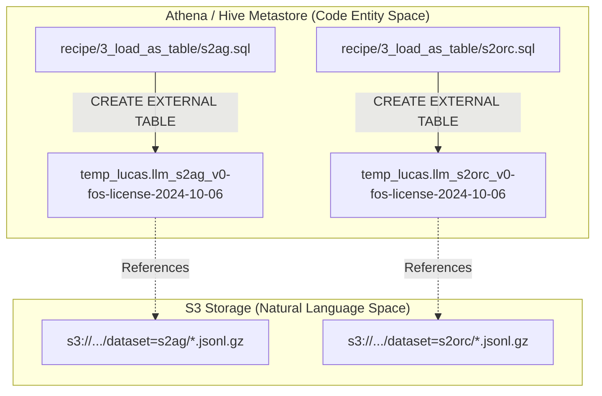
**Sources:** [recipe/3_load_as_table/s2ag.sql:1-25](), [recipe/3_load_as_table/s2orc.sql:2-26]()

### Schema Definitions

The tables share a common top-level structure (id, source, text, version, added, created) but differ significantly in their nested `metadata` structs to accommodate the specific attributes of S2AG and S2ORC.

#### S2AG Table Schema
The S2AG table focuses on bibliographic metadata and quality signals for titles and abstracts.

| Column | Type | Description |
| :--- | :--- | :--- |
| `id` | STRING | Unique identifier for the document. |
| `source` | STRING | Originating source (s2ag). |
| `text` | STRING | The concatenated text content. |
| `metadata` | STRUCT | Complex object containing paper details. |
| `metadata.external_ids` | ARRAY<STRUCT> | Mapping of source name to ID (e.g., DOI, PubMed). |
| `metadata.top_frequencies` | ARRAY<STRUCT> | Most frequent tokens and their counts for filtering. |
| `metadata.title_perplexity` | DOUBLE | Perplexity score for the title. |

**Sources:** [recipe/3_load_as_table/s2ag.sql:1-23]()

#### S2ORC Table Schema
The S2ORC table includes detailed paragraph-level information and Open Access (OA) licensing data.

| Column | Type | Description |
| :--- | :--- | :--- |
| `metadata.paragraphs` | ARRAY<STRUCT> | List of objects containing `text`, `language`, and `perplexity`. |
| `metadata.fields_of_study`| ARRAY<STRING> | High-level academic disciplines. |
| `metadata.oa_license` | STRING | The specific license (e.g., CC-BY). |
| `metadata.pdf_hash` | STRING | Hash of the source PDF file. |

**Sources:** [recipe/3_load_as_table/s2orc.sql:9-23]()

### Implementation Details

#### JsonSerDe Configuration
The tables are defined with `ROW FORMAT serde 'org.apache.hive.hcatalog.data.JsonSerDe'` [recipe/3_load_as_table/s2ag.sql:24-24](). This allows Athena to map JSON keys directly to table columns. Because the Stage 2 processing scripts output one JSON object per line, this SerDe can efficiently scan the files without requiring a full load into a database.

#### Metadata Structs
The use of `STRUCT` and `ARRAY<STRUCT>` is critical for maintaining the relationship between text segments and their quality scores. For instance, in S2ORC, each paragraph's language and perplexity are stored alongside its text within the `paragraphs` array [recipe/3_load_as_table/s2orc.sql:15-15](). This enables Stage 4 queries to filter out individual low-quality paragraphs while retaining the rest of the document.

**Entity Mapping: SQL Schema to Data Structure**
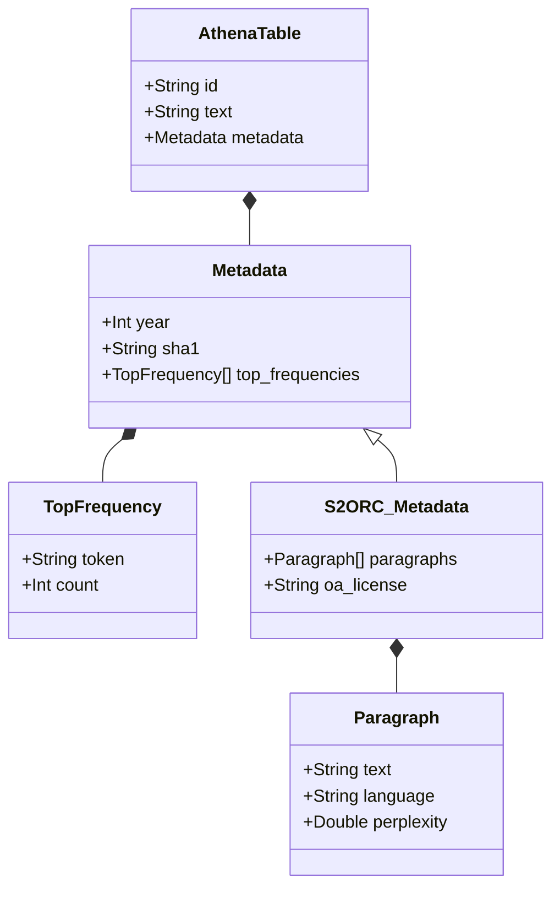
**Sources:** [recipe/3_load_as_table/s2ag.sql:8-22](), [recipe/3_load_as_table/s2orc.sql:9-23]()

### Partitioning and Repair
While the provided DDL scripts define the table structure and location [recipe/3_load_as_table/s2ag.sql:25-25](), the data is often partitioned by date or dataset type. After running the `CREATE EXTERNAL TABLE` command, users must typically run:

```sql
MSCK REPAIR TABLE `temp_lucas`.`llm_s2ag_v0-fos-license-2024-10-06`;
```

This command updates the Hive Metastore with the partitions present on S3, making the data available for querying in Stage 4.

**Sources:** [recipe/3_load_as_table/s2ag.sql:1-25](), [recipe/3_load_as_table/s2orc.sql:2-26]()

---

# Page: Stage 4 – Final Mixing and Dataset Production

# Stage 4 – Final Mixing and Dataset Production

<details>
<summary>Relevant source files</summary>

The following files were used as context for generating this wiki page:

- [recipe/4_mix_final/s2ag.sql](recipe/4_mix_final/s2ag.sql)
- [recipe/4_mix_final/s2orc.sql](recipe/4_mix_final/s2orc.sql)
- [recipe/README.md](recipe/README.md)

</details>


Stage 4 is the final phase of the peS2o pipeline. It uses AWS Athena to execute complex SQL queries that perform the definitive quality filtering, metadata enrichment, and dataset partitioning. During this stage, documents from the intermediate tables (created in Stage 3) are joined with the Semantic Scholar `espresso.pq_paper` table to acquire Field of Study (FoS) information, deduplicated, and finally exported as ZSTD-compressed JSON files.

## Overview of Production Logic

The production phase is split into two primary SQL workflows: one for the S2AG (Abstracts) stream and one for the S2ORC (Full-text) stream. While both follow a similar pattern of filtering and enrichment, they apply different heuristics suited to their content types.

### Key Objectives:
1.  **Enrichment**: Join with `espresso.pq_paper` to add `s2FieldsOfStudy` and `fieldsOfStudy` [recipe/4_mix_final/s2ag.sql:87-95](), [recipe/4_mix_final/s2orc.sql:102-110]().
2.  **Filtering**: Apply final thresholds for perplexity, language, and length [recipe/4_mix_final/s2ag.sql:55-62](), [recipe/4_mix_final/s2orc.sql:92-100]().
3.  **Deduplication**: Use `GROUP BY id` with `ARBITRARY()` aggregations to ensure unique Corpus IDs [recipe/4_mix_final/s2ag.sql:131-141](), [recipe/4_mix_final/s2orc.sql:132-176]().
4.  **Partitioning**: Assign documents to `train` or `valid` splits based on a temporal cutoff (August 1, 2024) [recipe/4_mix_final/s2ag.sql:29-37](), [recipe/4_mix_final/s2orc.sql:82-90]().

### Data Flow: Stage 3 to Final Production

The following diagram illustrates how data moves from the intermediate Hive tables into the final S3 destination.

**Diagram: Final Mixing Data Flow**
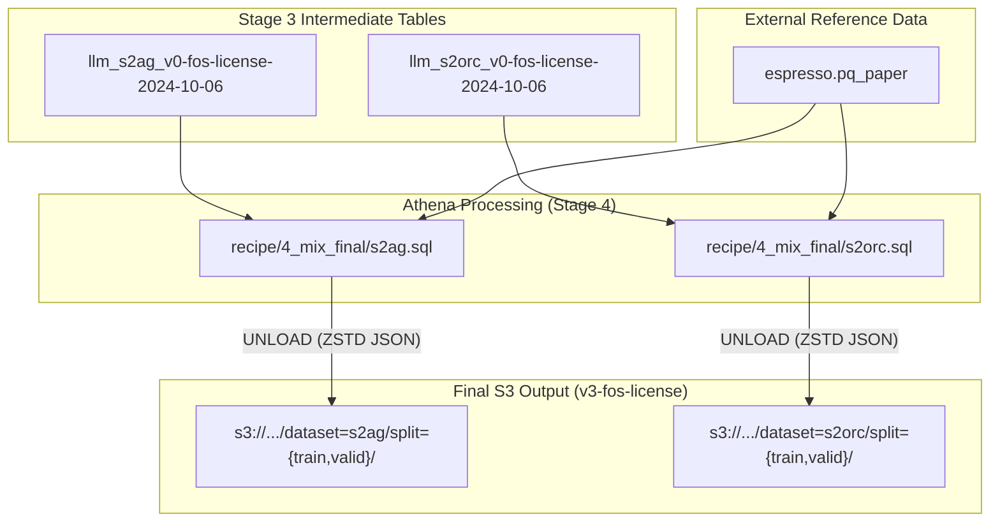
Sources: [recipe/4_mix_final/s2ag.sql:1-148](), [recipe/4_mix_final/s2orc.sql:1-184](), [recipe/README.md:54-62]()

---

## S2ORC Final Processing

The S2ORC pipeline focuses on reconstructing the full-text document from valid paragraphs.

### Quality Heuristics and Filtering
The `s2orc_stats` Common Table Expression (CTE) performs paragraph-level filtering:
*   **Perplexity Filter**: Only paragraphs with a perplexity $\ge -20$ are retained in the `valid_paragraphs` array [recipe/4_mix_final/s2orc.sql:18-21]().
*   **Top-Word Frequency**: Implements a cap on the most frequent token to catch "spammy" or repetitive documents. For docs > 500 tokens, the top word must be $\le 7.5\%$ of the total; for smaller docs, $\le 30\%$ [recipe/4_mix_final/s2orc.sql:22-39]().
*   **Language Majority**: The document language is determined by the most frequent language across all paragraphs [recipe/4_mix_final/s2orc.sql:40-60]().

### Text Reconstruction
The final text blob is assembled by concatenating the title, abstract, and all `valid_paragraphs` using double newlines (`CHR(10) || CHR(10)`) [recipe/4_mix_final/s2orc.sql:77-81]().

Sources: [recipe/4_mix_final/s2orc.sql:1-101]()

---

## S2AG Final Processing

The S2AG pipeline focuses on metadata cleaning and title/abstract quality.

### External ID Parsing
The query includes complex `regexp_replace` logic to clean and parse the `metadata.external_ids` string into a structured JSON array of `source` and `id` pairs [recipe/4_mix_final/s2ag.sql:9-26]().

### Source Filtering and OCR Heuristics
S2AG applies specific filters to exclude low-quality extraction sources:
*   **Source Exclusion**: Filters out sources like `Unpaywall`, `ScienceParse`, and `MAG` [recipe/4_mix_final/s2ag.sql:47-53]().
*   **Single Letter Sequences**: Detects OCR failures by checking for sequences of single letters (e.g., "a b c d"). Documents with `max_single_letter_sequence >= 4` are excluded unless they come from specific trusted sources [recipe/4_mix_final/s2ag.sql:41-46](), [recipe/4_mix_final/s2ag.sql:77-85]().

Sources: [recipe/4_mix_final/s2ag.sql:1-86]()

---

## Field of Study (FoS) Enrichment

Both pipelines perform a `RIGHT JOIN` (for S2AG) or `INNER JOIN` (for S2ORC) against the `espresso.pq_paper` table using the `corpusid` [recipe/4_mix_final/s2ag.sql:93-94](), [recipe/4_mix_final/s2orc.sql:107-109](). This allows the final dataset to include Semantic Scholar's internal Field of Study classifications.

**Diagram: Metadata Schema Reconstruction**
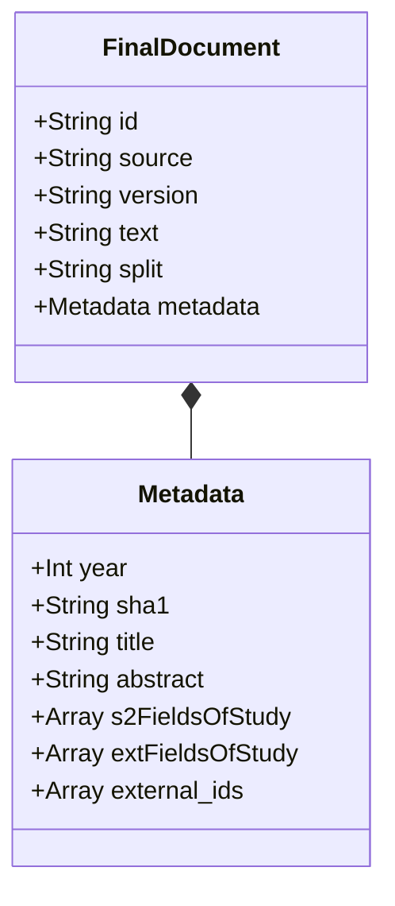
Sources: [recipe/4_mix_final/s2ag.sql:104-126](), [recipe/4_mix_final/s2orc.sql:150-173]()

---

## Export and Partitioning

The final step uses the Athena `UNLOAD` command to write the data to S3.

| Feature | Configuration |
| :--- | :--- |
| **Format** | JSON [recipe/4_mix_final/s2ag.sql:145]() |
| **Compression** | ZSTD [recipe/4_mix_final/s2ag.sql:146]() |
| **Partitioning** | `split` (train/valid) [recipe/4_mix_final/s2ag.sql:147]() |
| **Destination Path** | `s3://ai2-llm/pretraining-data/sources/s2/v3-fos-license/documents/...` [recipe/4_mix_final/s2ag.sql:143]() |

### Temporal Split Logic
The `split` column is assigned dynamically:
*   **Train**: `year < 2024` OR (`year == 2024` AND `created < 2024-08-01`) [recipe/4_mix_final/s2ag.sql:29-37]().
*   **Valid**: All documents created on or after August 1, 2024 [recipe/4_mix_final/s2ag.sql:36]().

Sources: [recipe/4_mix_final/s2ag.sql:142-148](), [recipe/4_mix_final/s2orc.sql:178-184]()

---

# Page: Quality Metrics and Statistics

# Quality Metrics and Statistics

<details>
<summary>Relevant source files</summary>

The following files were used as context for generating this wiki page:

- [recipe/get_stats.py](recipe/get_stats.py)
- [recipe/requirements.txt](recipe/requirements.txt)

</details>


The peS2o pipeline incorporates several mechanisms to measure, monitor, and enforce data quality across the corpus. These range from real-time language detection and perplexity scoring during document processing to post-hoc statistical auditing of token counts and document distributions.

### Statistical Auditing and Counting
The pipeline provides specialized tooling to audit the scale of the dataset. Because peS2o scales to tens of billions of tokens, standard counting methods are often insufficient for data stored in S3. The utility script `recipe/get_stats.py` is used to stream processed JSONL files and calculate precise document and token counts using the project's standard tokenizer [recipe/get_stats.py:57-68]().

This utility is designed for high-throughput environments, utilizing a multiprocessing "spawn" architecture and `smart_open` for streaming data directly from cloud storage [recipe/get_stats.py:121-133]().

For details, see [get_stats.py – Token and Document Counting](#3.1).

### Quality Signals and Language Detection
Quality is enforced through a combination of linguistic and statistical signals calculated during the transformation stages. These signals are embedded into the document metadata and used for downstream filtering in Athena.

Key metrics include:
*   **Language Detection:** Identification of document language using `pycld3` to ensure the corpus remains primarily English-centric [recipe/requirements.txt:7-7]().
*   **Unigram Perplexity:** A measure of "naturalness" calculated via the `UnigramPerplexityPredictor`. Documents with an average log word probability below -20 are typically flagged as low quality or non-prose.
*   **Frequency Heuristics:** Monitoring the frequency of top words to identify OCR failures or repetitive boilerplate.

For details, see [Perplexity and Language Quality Signals](#3.2).

### System Integration Diagram
The following diagram illustrates how quality metrics flow from the raw data processing stage into the final statistical reporting.

**Data Quality Flow: From Processing to Statistics**
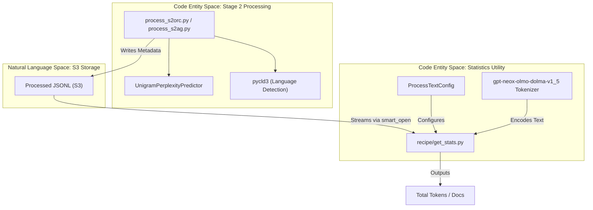
Sources: [recipe/get_stats.py:30-34](), [recipe/get_stats.py:57-63](), [recipe/get_stats.py:121-137](), [recipe/requirements.txt:7-14]()

### Metric Collection Architecture
The statistical auditing tool uses a threaded progress management system to track multi-process work without overwhelming the system I/O.

**Process Architecture for Statistics Collection**
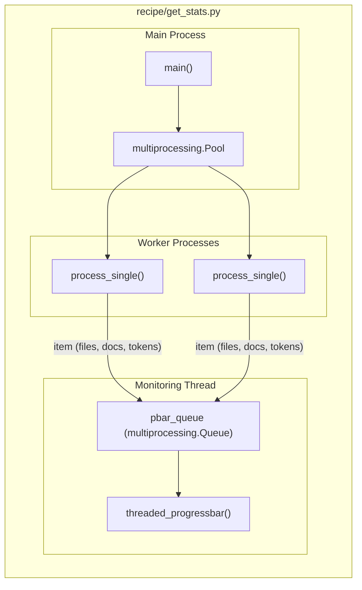
Sources: [recipe/get_stats.py:78-101](), [recipe/get_stats.py:123-138]()

### Summary of Metrics

| Metric | Tool / Class | Purpose |
| :--- | :--- | :--- |
| **Token Count** | `Tokenizer` (GPT-NeoX) | Measuring corpus size for training budgets [recipe/get_stats.py:57-63](). |
| **Perplexity** | `UnigramPerplexityPredictor` | Filtering out "gibberish" or OCR errors. |
| **Language** | `pycld3` | Ensuring document language matches target (English) [recipe/requirements.txt:7-7](). |
| **Document Count** | `get_stats.py` | Auditing S3 prefixes for file/document integrity [recipe/get_stats.py:144-146](). |

---
## Child Pages
*   [get_stats.py – Token and Document Counting](#3.1)
*   [Perplexity and Language Quality Signals](#3.2)

---

# Page: get_stats.py – Token and Document Counting

# get_stats.py – Token and Document Counting

<details>
<summary>Relevant source files</summary>

The following files were used as context for generating this wiki page:

- [recipe/get_stats.py](recipe/get_stats.py)

</details>


The `get_stats.py` utility is a specialized tool designed to audit the size of the peS2o corpus by calculating precise document and token counts across large-scale datasets stored on S3 or local filesystems. It utilizes the same tokenizer used in the OLMo/Dolma models to ensure that statistics reflect the actual tokenization behavior of the downstream language models.

### CLI Interface and Configuration

The script uses the `springs` framework to manage configuration through the `ProcessTextConfig` dataclass [recipe/get_stats.py:29-33](). This provides a structured CLI interface for specifying input paths and execution parameters.

| Parameter | Type | Default | Description |
| :--- | :--- | :--- | :--- |
| `src` | `str` | `MISSING` | The S3 prefix or local directory containing the JSONL files to audit. |
| `parallel` | `int` | `cpu_count()` | Number of worker processes to spawn for tokenization. |
| `debug` | `int` | `0` | If > 0, limits processing to the first N files and runs in the main process. |

The script is invoked via the `@sp.cli` decorator, which parses these fields into the `main` function [recipe/get_stats.py:103-104]().

**Sources:**
- [recipe/get_stats.py:29-33]()
- [recipe/get_stats.py:103-104]()

---

### Multiprocessing Architecture

To handle tens of millions of documents efficiently, `get_stats.py` employs a multiprocessing architecture based on the `spawn` start method [recipe/get_stats.py:121](). This ensures a clean memory environment for each worker, which is critical when loading large tokenizer models in parallel.

#### Data Flow and Process Coordination

The architecture consists of three main components:
1.  **Main Process**: Discovers files using `io_utils.recursively_list_files` [recipe/get_stats.py:109]() and manages the `Pool` [recipe/get_stats.py:123]().
2.  **Worker Processes**: Execute `process_single` to stream files, parse JSON, and tokenize text [recipe/get_stats.py:43-75]().
3.  **Progress Thread**: A dedicated `threading.Thread` that manages three `tqdm` progress bars (Files, Docs, Tokens) [recipe/get_stats.py:78-101]().

**System Architecture Diagram**

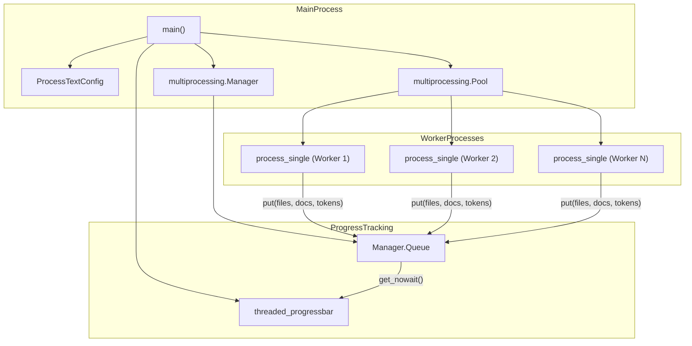

**Sources:**
- [recipe/get_stats.py:121-133]()
- [recipe/get_stats.py:78-101]()

---

### Implementation Details

#### Tokenization and Streaming
The utility uses the `allenai/gpt-neox-olmo-dolma-v1_5` tokenizer via the `tokenizers` library [recipe/get_stats.py:57](). It leverages `smart_open` to stream data directly from S3, avoiding the need to download files to disk [recipe/get_stats.py:59]().

Each worker processes a single file at a time. To mitigate the "thundering herd" problem (where all workers attempt to hit S3/Network simultaneously at startup), the script introduces a random jitter using `sleep(random.random() * 2)` [recipe/get_stats.py:48]().

#### Performance Optimization
Instead of reporting to the progress bar for every single document, which would create a bottleneck on the `Manager.Queue`, the script buffers statistics. It only sends updates to the queue once it has processed more than 100,000 tokens [recipe/get_stats.py:64-68]().

**Worker Execution Flow**

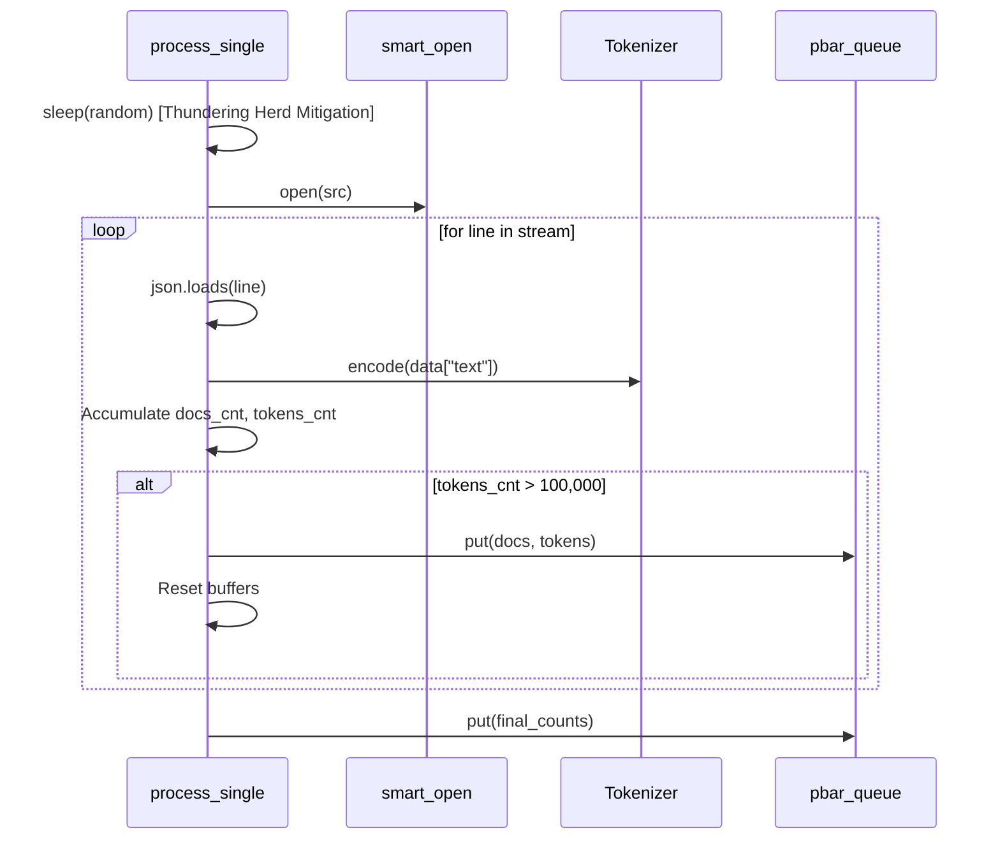

**Sources:**
- [recipe/get_stats.py:48]()
- [recipe/get_stats.py:57-68]()
- [recipe/get_stats.py:124-130]()

---

### Progress Tracking and Reporting

The `threaded_progressbar` function manages three distinct `tqdm` bars [recipe/get_stats.py:84-86]():
*   **Files**: Tracks the number of completed S3 objects.
*   **Docs**: Tracks the total number of documents parsed (scaled for readability).
*   **Tokens**: Tracks the total number of tokens generated (scaled for readability).

The thread runs a loop that polls the `Queue` every 0.01 seconds [recipe/get_stats.py:87-101](). It terminates when it receives a `None` sentinel value from the main process [recipe/get_stats.py:93-94]().

Upon completion of all workers, the script prints the final totals to the console [recipe/get_stats.py:144-146]().

**Sources:**
- [recipe/get_stats.py:84-86]()
- [recipe/get_stats.py:87-101]()
- [recipe/get_stats.py:144-146]()

---

# Page: Perplexity and Language Quality Signals

# Perplexity and Language Quality Signals

<details>
<summary>Relevant source files</summary>

The following files were used as context for generating this wiki page:

- [recipe/2_scripts/process_s2ag.py](recipe/2_scripts/process_s2ag.py)
- [recipe/2_scripts/process_s2orc.py](recipe/2_scripts/process_s2orc.py)
- [recipe/4_mix_final/s2ag.sql](recipe/4_mix_final/s2ag.sql)
- [recipe/4_mix_final/s2orc.sql](recipe/4_mix_final/s2orc.sql)

</details>


This page documents the technical implementation of quality filtering in the peS2o pipeline. It focuses on the calculation of unigram perplexity, language detection, and how these metrics are used to filter low-quality or non-English content across different processing stages.

## Unigram Perplexity Prediction

The `UnigramPerplexityPredictor` class is the primary mechanism for scoring the "naturalness" of text. It uses a unigram language model derived from the Google 1T Web Corpus to estimate how likely a sequence of words is to appear in standard English text.

### Implementation Details

The predictor is initialized using a CSV of word counts from the Google 1T unigram corpus [recipe/2_scripts/process_s2ag.py:41-43]().

1.  **Probability Calculation**: During initialization, word counts are converted to log-probabilities. The total count is logged as `word_total_log`, and each word's log-probability is calculated as `np.log2(count) - word_total_log` [recipe/2_scripts/process_s2ag.py:68-69]().
2.  **The UNK Token**: To handle out-of-vocabulary (OOV) words, a special `<unk>` token is assigned a fictional count equal to the square root of the vocabulary size plus one [recipe/2_scripts/process_s2ag.py:71-72]().
3.  **Scoring Logic**: The `predict` method tokenizes input text using `blingfire.text_to_words` [recipe/2_scripts/process_s2ag.py:79](). The final score is the average log-probability of the tokens: $\frac{1}{N} \sum_{i=1}^{N} \log_2(P(w_i))$ [recipe/2_scripts/process_s2ag.py:81]().

### Perplexity Predictor Data Flow

The following diagram illustrates how the `UnigramPerplexityPredictor` transforms raw text into a quality signal within the Stage 2 processing scripts.

**Title: Perplexity Calculation Flow**
```mermaid
graph TD
    subgraph "Natural Language Space"
        [Raw_Text] --> [Blingfire_Tokenizer]
        [Blingfire_Tokenizer] --> [Token_Sequence]
    end

    subgraph "Code Entity Space: UnigramPerplexityPredictor"
        [GOOGLE_1T_CORPUS] -- "cached_path" --> [Local_CSV]
        [Local_CSV] -- "__init__" --> [words_logp_Dict]
        [Token_Sequence] -- "predict()" --> [log_p_Lookup]
        [words_logp_Dict] --> [log_p_Lookup]
        [log_p_Lookup] -- "sum / len" --> [Perplexity_Score]
    end

    [Perplexity_Score] -- "Store in Metadata" --> [JSONL_Output]
```
Sources: [recipe/2_scripts/process_s2ag.py:54-83](), [recipe/2_scripts/process_s2orc.py:46-75]()

## Language Detection

Language identification is performed using the `pycld3` (Compact Language Detector v3) library.

-   **Truncation**: To optimize performance, only the first 2000 characters of a text segment are used for language identification (`LANG_ID_CUT = 2000`) [recipe/2_scripts/process_s2ag.py:39, 139]().
-   **Error Handling**: If the detector fails or an exception occurs, the language is defaulted to `"unk"` [recipe/2_scripts/process_s2ag.py:141]().
-   **Granularity**: 
    -   In `process_s2ag.py`, detection is performed on the `title` and `abstract` separately [recipe/2_scripts/process_s2ag.py:228, 233]().
    -   In `process_s2orc.py`, detection is performed at the individual paragraph level within the `all_paragraphs` list [recipe/2_scripts/process_s2orc.py:214]().

Sources: [recipe/2_scripts/process_s2ag.py:137-142](), [recipe/2_scripts/process_s2orc.py:214]()

## Scoring Granularity: Paragraph vs. Document

The pipeline applies quality signals at different levels of granularity depending on the data source.

| Feature | S2AG (Metadata Only) | S2ORC (Full Text) |
| :--- | :--- | :--- |
| **Primary Unit** | Document (Title/Abstract) | Paragraph |
| **Perplexity Scope** | Scored per Title and Abstract [recipe/2_scripts/process_s2ag.py:229, 234]() | Scored per Paragraph [recipe/2_scripts/process_s2orc.py:215]() |
| **Language Scope** | Detected per Title and Abstract [recipe/2_scripts/process_s2ag.py:228, 233]() | Detected per Paragraph [recipe/2_scripts/process_s2orc.py:214]() |
| **Aggregation** | Document-level filtering in SQL | Paragraphs filtered individually before document assembly |

### Paragraph Merging Heuristics
In S2ORC processing, before scoring, paragraphs are cleaned and merged. A key heuristic is `is_parenthetical_spanning_two_paragraphs`, which prevents breaking paragraphs if a parenthesis is opened in one and closed in the next [recipe/2_scripts/process_s2orc.py:77-105]().

Sources: [recipe/2_scripts/process_s2ag.py:220-240](), [recipe/2_scripts/process_s2orc.py:162-220]()

## Signal Flow and Filtering (Stages 2-4)

The quality signals generated in Stage 2 flow through the database schema into final Stage 4 filtering.

### 1. Stage 2: Generation
Scripts `process_s2ag.py` and `process_s2orc.py` calculate `perplexity` and `language` and store them in a `metadata` dictionary for each record.

### 2. Stage 3: Schema Registration
The processed JSONL files are registered in Athena. The schema includes the nested metadata fields:
-   `metadata.title_perplexity` (S2AG)
-   `metadata.abstract_perplexity` (S2AG)
-   `metadata.paragraphs` (S2ORC - an array of structs containing `text`, `language`, and `perplexity`)

### 3. Stage 4: Threshold Filtering
Final dataset production occurs in SQL queries that apply the **-20 threshold**.

-   **S2AG Filtering**: Documents must have an abstract perplexity > -20 and be detected as English (`en`) [recipe/4_mix_final/s2ag.sql:56-58]().
-   **S2ORC Filtering**: 
    1.  The query uses `FILTER` on the `metadata.paragraphs` array to keep only those where `perplexity >= -20` [recipe/4_mix_final/s2orc.sql:18-21]().
    2.  The document-level language is determined by the most frequent language across all valid paragraphs [recipe/4_mix_final/s2orc.sql:40-60]().
    3.  The document is kept only if the aggregate language is `en` and there are at least 5 valid paragraphs [recipe/4_mix_final/s2orc.sql:93-97]().

**Title: Quality Signal Propagation**
```mermaid
graph LR
    subgraph "Stage 2: Python"
        [UnigramPerplexityPredictor] -- "predict()" --> [S2_JSONL]
        [cld3] -- "get_language()" --> [S2_JSONL]
    end

    subgraph "Stage 3: Athena DDL"
        [S2_JSONL] -- "JsonSerDe" --> [External_Table]
    end

    subgraph "Stage 4: SQL Filtering"
        [External_Table] -- "WHERE perplexity > -20" --> [Final_Dataset]
        [External_Table] -- "WHERE language = 'en'" --> [Final_Dataset]
    end
```
Sources: [recipe/4_mix_final/s2ag.sql:54-76](), [recipe/4_mix_final/s2orc.sql:1-61](), [recipe/4_mix_final/s2orc.sql:91-101]()

---

# Page: Development Environment and Tooling

# Development Environment and Tooling

<details>
<summary>Relevant source files</summary>

The following files were used as context for generating this wiki page:

- [.gitignore](.gitignore)
- [.vscode/settings.json](.vscode/settings.json)
- [recipe/requirements.txt](recipe/requirements.txt)

</details>


This section provides an overview of the development environment, dependency management, and IDE configurations required to contribute to the peS2o pipeline. The project relies on a specific stack of data processing and NLP libraries to handle large-scale scientific document extraction and filtering.

## Overview of the Development Stack

The peS2o development environment is designed to handle high-throughput data processing, often involving large Parquet and JSONL files stored in cloud environments (AWS S3). The tooling is centered around Python, utilizing a mix of high-performance serialization formats (Apache Arrow, Zstandard) and specialized NLP utilities (Blingfire, CLD3).

### Key Components

*   **Data Orchestration**: Uses `smashed` and `springs` for managing data transformations and configurations.
*   **High-Performance IO**: Leverages `pyarrow`, `orjson`, and `smart_open` to stream and parse massive datasets without exhausting local memory.
*   **NLP & Filtering**: Employs `pycld3` for language identification and `blingfire` for rapid text tokenization and normalization.
*   **Cloud Integration**: Deeply integrated with AWS S3 via `s3fs` and `fsspec` for seamless remote file access.

For details on specific library versions and their roles in the pipeline, see [Dependencies and Environment Setup](#4.1).

## Environment and Dependency Mapping

The following diagram bridges the high-level functional requirements of the pipeline to the specific libraries defined in the project's requirements.

### Library-to-Function Mapping
```mermaid
graph TD
    subgraph "Data Handling"
        A["smashed"] -->|"Data Loading/Transform"| B["Data Pipeline"]
        C["pyarrow"] -->|"Parquet Support"| B
        D["orjson"] -->|"Fast JSON Parsing"| B
        E["smart_open"] -->|"S3 Streaming"| B
    end

    subgraph "NLP Processing"
        F["pycld3"] -->|"Language Detection"| G["Filtering Heuristics"]
        H["blingfire"] -->|"Fast Tokenization"| G
        I["uniseg"] -->|"Unicode Segmentation"| G
        J["tokenizers"] -->|"GPT-NeoX/OLMo Support"| G
    end

    subgraph "Infrastructure"
        K["springs"] -->|"Config Management"| L["CLI Tools"]
        M["s3fs/fsspec"] -->|"Filesystem Abstraction"| L
    end

    B & G & L --> N["peS2o Pipeline"]
```
**Sources:** [recipe/requirements.txt:1-16]()

## IDE and Repository Configuration

To maintain consistency across development environments and prevent performance degradation when handling large-scale data scripts, the repository includes specific configurations for VS Code and Git.

### Workspace Optimization
The repository includes a `.vscode/settings.json` file that explicitly disables the default Python language server: `{"python.languageServer": "None"}` [[.vscode/settings.json:1-3]()] . This is a strategic choice for repositories dealing with large generated files or massive data schemas, where background indexing can lead to high CPU usage and IDE instability.

### Git Maintenance
The `.gitignore` configuration is comprehensive, ensuring that environment-specific artifacts (like `.venv`, `__pycache__`, and `.pytest_cache`) do not enter version control [[.gitignore:2-164]()] . This keeps the repository clean and focused on the core processing logic.

For details on how to configure your local editor and manage virtual environments, see [IDE and Repository Configuration](#4.2).

## Child Pages

*   [Dependencies and Environment Setup](#4.1)
    Documents the `recipe/requirements.txt` stack, explaining the role of each library (e.g., `smashed`, `pycld3`, `zstandard`) and the installation process.
*   [IDE and Repository Configuration](#4.2)
    Covers the `.vscode/settings.json` workspace configuration, `.gitignore` exclusions, and general contributor workflow notes for maintaining a performant development environment.

**Sources:** [.vscode/settings.json:1-3](), [.gitignore:1-164](), [recipe/requirements.txt:1-16]()

---

# Page: Dependencies and Environment Setup

# Dependencies and Environment Setup

<details>
<summary>Relevant source files</summary>

The following files were used as context for generating this wiki page:

- [.gitignore](.gitignore)
- [recipe/requirements.txt](recipe/requirements.txt)

</details>


This page documents the software requirements and environment configuration necessary to run and develop the peS2o data pipeline. The project relies on a specialized stack of libraries for high-performance data processing, linguistic filtering, and cloud-native I/O.

## 1. Core Dependency Stack

The peS2o pipeline is built on a set of Python libraries defined in `recipe/requirements.txt` [recipe/requirements.txt:1-16](). These dependencies facilitate every stage from raw data extraction to final quality scoring.

### Data Processing & Serialization
| Library | Role in peS2o |
| :--- | :--- |
| `pyarrow` | Handles high-performance reading and writing of Parquet files during Stage 1 and Stage 2 [recipe/requirements.txt:9](). |
| `orjson` | Used for fast JSON serialization and deserialization when processing document streams [recipe/requirements.txt:10](). |
| `zstandard` | Provides compression for the final JSONL output files, ensuring efficient storage and transfer [recipe/requirements.txt:15](). |
| `pandas` | Used for intermediate data manipulation and schema management [recipe/requirements.txt:1](). |

### Linguistic & Text Utilities
| Library | Role in peS2o |
| :--- | :--- |
| `pycld3` | Provides Google's Compact Language Detector v3 for identifying document languages [recipe/requirements.txt:7](). |
| `blingfire` | High-speed text tokenization and segmentation used in text cleaning [recipe/requirements.txt:11](). |
| `uniseg` | Handles Unicode text segmentation, ensuring correct handling of multi-byte characters [recipe/requirements.txt:6](). |
| `tokenizers` | Provides the backend for the `allenai/gpt-neox-olmo-dolma-v1_5` tokenizer used in statistics gathering [recipe/requirements.txt:13](). |

### Cloud Infrastructure & I/O
| Library | Role in peS2o |
| :--- | :--- |
| `s3fs` / `fsspec` | Provides a filesystem interface for interacting directly with AWS S3 buckets [recipe/requirements.txt:4-5](). |
| `smart_open` | Enables seamless streaming of large files from S3, crucial for processing TB-scale datasets without local disk exhaustion [recipe/requirements.txt:14](). |
| `cached_path` | Manages local caching of remote resources, such as model weights or unigram frequency files [recipe/requirements.txt:8](). |
| `smashed[remote]` | A toolkit for data transformation pipelines, supporting remote execution and dataset mapping [recipe/requirements.txt:2](). |
| `springs` | A configuration management library used to parameterize the Python scripts [recipe/requirements.txt:3](). |

**Sources:** [recipe/requirements.txt:1-16]()

---

## 2. Environment Configuration

### Virtual Environment Management
The project is designed to run in a clean Python environment. Standard environment directories like `.venv`, `venv`, and `env` are excluded from version control to prevent local binary contamination [ .gitignore:124-127]().

### IDE Integration
For developers using VS Code, the repository includes specific configurations to handle the scale of the codebase.
* **Language Server:** The configuration often sets `python.languageServer: None` to avoid performance degradation when the IDE attempts to index large generated files or massive data samples.
* **Ignored Artifacts:** The `.gitignore` file excludes common build artifacts (`build/`, `dist/`), Python cache (`__pycache__`), and test reports (`.pytest_cache/`, `coverage.xml`) [ .gitignore:2-51]().

**Sources:** [ .gitignore:2-127]()

---

## 3. Data Flow and Library Interaction

The following diagram illustrates how the primary libraries interact within the Python processing scripts (Stage 2) and the statistics utility (Stage 3.1).

### Library Interaction Map
```mermaid
graph TD
    subgraph "I/O Layer"
        S3["AWS S3"]
        SO["smart_open / s3fs"]
        CP["cached_path"]
    end

    subgraph "Processing Engine (Stage 2)"
        PA["pyarrow (Read Parquet)"]
        CLD["pycld3 (Lang ID)"]
        BF["blingfire (Cleaning)"]
        OJ["orjson (JSONL Write)"]
        ZS["zstandard (Compression)"]
    end

    subgraph "Analysis (Stage 3.1)"
        TK["tokenizers (OLMo)"]
        GS["get_stats.py"]
    end

    S3 --> SO
    SO --> PA
    PA --> CLD
    CLD --> BF
    BF --> OJ
    OJ --> ZS
    ZS --> S3
    
    S3 --> CP
    CP --> TK
    TK --> GS
```

**Sources:** [recipe/requirements.txt:1-16]()

---

## 4. Entity Mapping: From Requirements to Code

This diagram bridges the libraries defined in `requirements.txt` to the specific modules and logic implemented in the peS2o pipeline.

### Dependency-to-Entity Association
```mermaid
graph LR
    subgraph "Requirement"
        REQ_CLD["pycld3"]
        REQ_SO["smart_open"]
        REQ_PA["pyarrow"]
        REQ_SPR["springs"]
    end

    subgraph "Code Entity Space"
        PROC_S2AG["process_s2ag.py"]
        PROC_S2ORC["process_s2orc.py"]
        STATS["get_stats.py"]
        UNIGRAM["UnigramPerplexityPredictor"]
    end

    REQ_CLD --> PROC_S2AG
    REQ_CLD --> PROC_S2ORC
    REQ_SO --> STATS
    REQ_PA --> PROC_S2AG
    REQ_PA --> PROC_S2ORC
    REQ_SPR --> STATS
    UNIGRAM -.-> PROC_S2AG
```

**Sources:** [recipe/requirements.txt:1-16]()

---

## 5. Installation

To set up the environment, it is recommended to use a virtual environment and install the requirements using `pip`:

```bash
# Create and activate environment
python -m venv .venv
source .venv/bin/activate

# Install dependencies
pip install -r recipe/requirements.txt
```

Note that `pycld3` requires C++ compilation headers for Google's CLD3 library, and `smashed[remote]` includes additional dependencies for S3/cloud interaction.

**Sources:** [recipe/requirements.txt:1-16]()

---

# Page: IDE and Repository Configuration

# IDE and Repository Configuration

<details>
<summary>Relevant source files</summary>

The following files were used as context for generating this wiki page:

- [.gitignore](.gitignore)
- [.vscode/settings.json](.vscode/settings.json)

</details>


This page details the development environment settings and repository management configurations for the `peS2o` project. Maintaining a consistent environment is critical for ensuring that the data processing pipelines, which handle terabytes of scholarly data, remain reproducible and performant.

## VS Code Workspace Configuration

The repository includes a workspace-specific configuration for Visual Studio Code to optimize editor performance.

### Language Server Optimization
The primary configuration in the workspace settings is the disabling of the Python Language Server:

| Setting | Value | Rationale |
| :--- | :--- | :--- |
| `python.languageServer` | `"None"` | Prevents IDE performance degradation caused by indexing large volumes of generated data or high-throughput processing scripts. |

In many data engineering projects involving large-scale datasets (like the ~40M documents in `peS2o`), standard IDE features such as "Go to Definition" or "Find All References" can become sluggish or cause the editor to crash if the language server attempts to index local data caches, temporary Parquet files, or deeply nested JSONL outputs. By setting this to `"None"`, contributors ensure that the editor remains responsive during heavy data processing tasks.

**Sources:**
- [.vscode/settings.json:1-3]()

---

## Repository Exclusions (.gitignore)

The `.gitignore` file is configured to prevent large data artifacts, environment-specific files, and build metadata from being committed to version control. This is essential for a project that interfaces with AWS S3 and local high-performance computing (HPC) environments.

### Environment and Virtualization
The project excludes all standard Python virtual environment directories to ensure that contributors do not accidentally commit local binary dependencies or platform-specific interpreter paths.

- **Standard Environments:** `.env`, `.venv`, `env/`, `venv/` [[.gitignore:123-127]()]
- **Package Manager Artifacts:** `__pypackages__/`, `.pdm.toml` [[.gitignore:110-113]()]
- **Build/Distribution:** `build/`, `dist/`, `*.egg-info/`, `wheels/` [[.gitignore:11-24]()]

### Test and Cache Management
To maintain a clean repository state, all caches generated by testing frameworks and static analysis tools are ignored:

- **Testing:** `.pytest_cache/`, `.tox/`, `.coverage`, `htmlcov/` [[.gitignore:39-52]()]
- **Type Checking:** `.mypy_cache/`, `.pyre/`, `.pytype/` [[.gitignore:141-150]()]
- **Python Internal:** `__pycache__/`, `*.pyc`, `*.pyo` [[.gitignore:1-4]()]

### Data and Notebook Artifacts
Given the data-centric nature of `peS2o`, specific exclusions are in place for data exploration and logging:

- **Jupyter:** `.ipynb_checkpoints` [[.gitignore:79]()]
- **Logs:** `*.log`, `pip-log.txt` [[.gitignore:36-59]()]
- **Local DBs:** `db.sqlite3`, `db.sqlite3-journal` [[.gitignore:61-62]()]

**Sources:**
- [.gitignore:1-164]()

---

## Contributor Workflow

The following diagram illustrates the relationship between the repository configuration, the developer's local environment, and the execution of the processing scripts.

### Workspace Data Flow and Environment
Title: Development Environment and Tooling Flow
```mermaid
graph TD
    subgraph "Local_Developer_Machine"
        VSCode[".vscode/settings.json"]
        GitIgnore[".gitignore"]
        Venv["Virtual Environment (.venv)"]
        Src["Source Code (process_s2orc.py, etc.)"]
    end

    subgraph "External_Resources"
        S3["AWS S3 (Raw/Processed Data)"]
        PyPI["PyPI (Requirements)"]
    end

    VSCode -->|Disables| LS["Python Language Server"]
    GitIgnore -->|Excludes| Venv
    GitIgnore -->|Excludes| Cache["__pycache__ / .pytest_cache"]
    Venv -->|Installs from| PyPI
    Src -->|Reads/Writes| S3
    Src -.->|Execution Context| Venv
```
**Sources:**
- [.vscode/settings.json:1-3]()
- [.gitignore:1-164]()

---

## Code Entity Mapping

To bridge the gap between repository configuration and the actual codebase, the following diagram maps the configuration files to the entities they govern during the execution of the pipeline stages.

### Configuration to Code Entity Mapping
Title: Configuration Governance over Code Entities
```mermaid
graph LR
    subgraph "Configuration_Entities"
        VSSET[".vscode/settings.json"]
        GIG[".gitignore"]
    end

    subgraph "Code_Entities"
        PROC_S2ORC["process_s2orc.py"]
        PROC_S2AG["process_s2ag.py"]
        STATS["get_stats.py"]
        UNIGRAM["UnigramPerplexityPredictor"]
    end

    subgraph "Ignored_Entities"
        PYC["*.pyc / __pycache__"]
        VENV_DIR["venv/"]
        LOGS["*.log"]
    end

    VSSET -.->|Optimizes Editor for| PROC_S2ORC
    VSSET -.->|Optimizes Editor for| PROC_S2AG
    GIG -->|Blocks| PYC
    GIG -->|Blocks| VENV_DIR
    GIG -->|Blocks| LOGS
    
    PROC_S2ORC -->|Uses| UNIGRAM
    PROC_S2AG -->|Uses| UNIGRAM
    STATS -->|Audits Output of| PROC_S2ORC
```
**Sources:**
- [.vscode/settings.json:1-3]()
- [.gitignore:1-164]()

---

# Page: Glossary

# Glossary

<details>
<summary>Relevant source files</summary>

The following files were used as context for generating this wiki page:

- [CITATION.cff](CITATION.cff)
- [LICENSE](LICENSE)
- [README.md](README.md)
- [recipe/1_obtain_data/s2ag.sql](recipe/1_obtain_data/s2ag.sql)
- [recipe/1_obtain_data/s2orc.sql](recipe/1_obtain_data/s2orc.sql)
- [recipe/2_scripts/process_s2ag.py](recipe/2_scripts/process_s2ag.py)
- [recipe/2_scripts/process_s2orc.py](recipe/2_scripts/process_s2orc.py)
- [recipe/3_load_as_table/s2ag.sql](recipe/3_load_as_table/s2ag.sql)
- [recipe/3_load_as_table/s2orc.sql](recipe/3_load_as_table/s2orc.sql)
- [recipe/4_mix_final/s2ag.sql](recipe/4_mix_final/s2ag.sql)
- [recipe/4_mix_final/s2orc.sql](recipe/4_mix_final/s2orc.sql)
- [recipe/get_stats.py](recipe/get_stats.py)
- [recipe/requirements.txt](recipe/requirements.txt)

</details>


This page provides a comprehensive reference for the terms, abbreviations, and domain-specific concepts used throughout the peS2o codebase. It bridges the gap between high-level dataset concepts and their specific implementations in SQL and Python.

## Core Concepts

### S2ORC (Semantic Scholar Open Research Corpus)
The primary source for the peS2o dataset. It contains full-text papers extracted from PDFs using Grobid. In the pipeline, S2ORC data is accessed via the `s2orc_papers` schema in Athena [recipe/1_obtain_data/s2orc.sql:73-77]().

### S2AG (Semantic Scholar Academic Graph)
A source containing metadata, titles, and abstracts for a much larger set of papers than S2ORC. It is used to supplement the corpus when full text is unavailable. In the pipeline, it is extracted from the `espresso.pq_paper` table [recipe/1_obtain_data/s2ag.sql:85]().

### Grobid
An invisible but critical dependency; a machine learning library for extracting and structuring content from PDF documents. The pipeline consumes Grobid's output in the form of `annotations` (paragraphs and section headers) [recipe/1_obtain_data/s2orc.sql:41-72]().

### Perplexity (Unigram)
A quality metric used to filter out "garbage" text (e.g., OCR errors, non-linguistic sequences). It is calculated by the `UnigramPerplexityPredictor` class [recipe/2_scripts/process_s2orc.py:46-75](). A threshold of `-20` is generally applied to determine if a paragraph or abstract is high-quality [recipe/4_mix_final/s2orc.sql:20]().

---

## Technical Terms and Entities

### Dataset Versions
*   **v0-fos-license**: The intermediate processing stage where data is enriched with Field of Study (FOS) and license information but not yet final-filtered [recipe/3_load_as_table/s2orc.sql:2]().
*   **v3-fos-license**: The final production version of the dataset after all quality filters and deduplication have been applied [recipe/4_mix_final/s2orc.sql:134]().

### Data Fields
| Field | Description | Code Pointer |
| :--- | :--- | :--- |
| `corpusId` | The unique integer identifier from Semantic Scholar. | [recipe/1_obtain_data/s2ag.sql:4]() |
| `sha1` | The hash of the original PDF, used for tracking and deduplication. | [recipe/1_obtain_data/s2ag.sql:20]() |
| `added` | ISO8601 timestamp of when the paper was first seen by Semantic Scholar. | [recipe/2_scripts/process_s2ag.py:123-127]() |
| `created` | Best-guess publication date, often normalized to the first of the year if specific date is unknown. | [recipe/2_scripts/process_s2ag.py:130-134]() |

### Code Entities

#### `UnigramPerplexityPredictor`
A class that loads the Google 1T Web Ngram word frequencies to calculate the log probability of a text sequence.
*   **Implementation**: Uses `np.log2` for probability calculations and handles unknown tokens with a fictional count [recipe/2_scripts/process_s2orc.py:61-72]().
*   **Sources**: [recipe/2_scripts/process_s2orc.py:46-75](), [recipe/2_scripts/process_s2ag.py:54-83]().

#### `is_parenthetical_spanning_two_paragraphs`
A heuristic function used during S2ORC processing to decide if two blocks of text separated by a newline should be merged. It checks if the first block ends with an open parenthesis and the second starts with a closing one.
*   **Source**: [recipe/2_scripts/process_s2orc.py:77-105]().

#### `process_single`
The entry point for worker processes in the Stage 2 Python scripts. It handles reading Parquet, applying normalization (NFC), calculating metrics, and writing compressed JSONL.
*   **Sources**: [recipe/2_scripts/process_s2ag.py:143-210](), [recipe/2_scripts/process_s2orc.py:136-210]().

---

## System Mapping Diagrams

### Data Flow: Raw to Processed
The following diagram maps the transformation of data from SQL-defined source tables into Python-processed entities.

**Diagram: Pipeline Entity Mapping**
```mermaid
graph TD
    subgraph "Athena SQL Space"
        S2ORC_RAW["s2orc_papers.oa_releases"]
        S2AG_RAW["espresso.pq_paper"]
        UNLOAD_CMD["UNLOAD TO S3 (PARQUET)"]
    end

    subgraph "Python Code Space (Stage 2)"
        PROC_S2ORC["process_s2orc.py"]
        PROC_S2AG["process_s2ag.py"]
        UPP["UnigramPerplexityPredictor"]
        NORM["unicodedata.normalize('NFC')"]
    end

    S2ORC_RAW --> UNLOAD_CMD
    S2AG_RAW --> UNLOAD_CMD
    UNLOAD_CMD -- "s3://.../raw/" --> PROC_S2ORC
    UNLOAD_CMD -- "s3://.../raw/" --> PROC_S2AG
    
    PROC_S2ORC --> UPP
    PROC_S2AG --> UPP
    PROC_S2ORC --> NORM
    
    PROC_S2ORC -- "JSONL.GZ" --> S3_V0["s3://.../v0-fos-license/"]
```
**Sources**: [recipe/1_obtain_data/s2orc.sql:131](), [recipe/2_scripts/process_s2orc.py:143-150](), [recipe/3_load_as_table/s2orc.sql:26]().

### Logic Mapping: Filtering Heuristics
This diagram associates specific filtering requirements with the SQL logic used in the final "Mixing" stage (Stage 4).

**Diagram: Quality Filter Implementation**
```mermaid
graph LR
    subgraph "Heuristic Requirements"
        H1["English Language Only"]
        H2["High Text Quality"]
        H3["Valid Length"]
        H4["No OCR 'Space' Errors"]
    end

    subgraph "SQL Logic (recipe/4_mix_final/s2ag.sql)"
        F1["metadata.abstract_language = 'en'"]
        F2["metadata.abstract_perplexity > -20"]
        F3["metadata.abstract_count BETWEEN 50 AND 1000"]
        F4["regexp_extract_all(abstract, '\b([A-Za-z]\s)...')"]
    end

    H1 --> F1
    H2 --> F2
    H3 --> F3
    H4 --> F4
```
**Sources**: [recipe/4_mix_final/s2ag.sql:43-62](), [recipe/4_mix_final/s2orc.sql:92-101]().

---

## Statistical Terms

### Top Word Frequency
A heuristic to detect repetitive or non-natural text. The pipeline calculates the frequency of the most common word. For S2ORC, if the document has >500 words, the top word must constitute ≤7.5% of the total text [recipe/4_mix_final/s2orc.sql:28-32]().

### Knowledge Cutoff
The temporal boundary for the dataset. For peS2o v3, papers published or added after **2024-08-01** are assigned to the `valid` split, while earlier papers are assigned to `train` [recipe/4_mix_final/s2ag.sql:29-37]().

### Field of Study (FOS)
Subject matter classifications (e.g., "Biology", "Computer Science"). These are retrieved from the `espresso.pq_paper` table and joined back to the documents in the final stage to allow for category-based filtering by consumers [recipe/4_mix_final/s2ag.sql:87-95]().

**Sources**: [README.md:34-45](), [recipe/4_mix_final/s2ag.sql:1-149](), [recipe/4_mix_final/s2orc.sql:1-185](), [recipe/2_scripts/process_s2orc.py:1-210]().