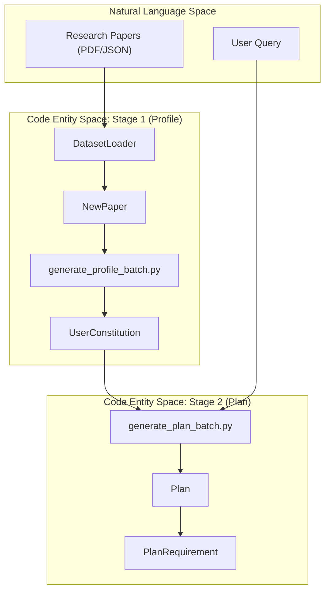
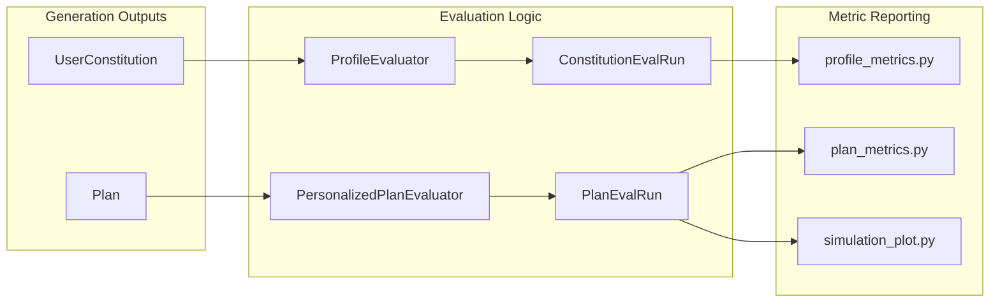

<!-- source: DeepWiki mcp.deepwiki.com · repo allenai/personalized-scholarqa-eval · page 1 Overview · fetched 2026-10-26 -->

# Overview

Relevant source files

The following files were used as context for generating this wiki page:

- [.gitignore](.gitignore)
- [LICENSE](LICENSE)
- [README.md](README.md)

The **Personalized ScholarQA Evaluation** framework provides a robust pipeline for generating and evaluating researcher-centric personalization in Deep Research systems. It is designed to bridge the gap between generic Large Language Model (LLM) responses and the specific needs of academic researchers by inferring "constitutions" (user profiles) from publication history and using them to ground research plans.

## Purpose and Scope

This framework implements the evaluation logic introduced in the paper *"Language Models Don't Know What You Want: Evaluating Personalization in Deep Research Needs Real Users"* [README.md:5-9](). It focuses on three core capabilities:
1.  **Personalization Generation**: Inferring researcher preferences (e.g., research style, audience, epistemology) from their published work and generating query-specific research plans [README.md:19-20]().
2.  **Synthetic Evaluation**: Using LLM-as-a-judge metrics to score the accuracy, specificity, and relevance of inferred profiles and plans [README.md:21-22]().
3.  **User Simulation**: Predicting user preferences based on qualitative interview data to validate system reliability [README.md:23-24]().

For installation and environment setup, see **[Getting Started](#1.1)**. For a breakdown of the codebase organization, see **[Repository Structure](#1.2)**.

Sources: [README.md:1-24]()

---

## Two-Stage Generation Pipeline

The system operates in two primary stages: **Profile Generation** and **Plan Generation**. This pipeline transforms raw researcher data (papers) into actionable, personalized research instructions.

### Pipeline Architecture
The diagram below illustrates how code entities within the `model/` and `data/` packages interact to transform "Natural Language Space" (Papers and Queries) into "Code Entity Space" (UserConstitutions and Plans).

**Personalization Data Flow**

Sources: [README.md:100-114](), [README.md:148-154]()

---

## Evaluation Framework

The framework includes a comprehensive evaluation suite that validates the outputs of the generation pipeline. It uses specialized evaluator classes to compare generated entities against ground truth or rubrics.

### System Interaction Diagram
This diagram maps the evaluation logic to specific classes and scripts within the `evaluation/` and `metric_scores/` directories.

**Evaluation and Scoring Logic**

Sources: [README.md:118-141](), [README.md:149-151]()

---

## Key Concepts

*   **Constitution (User Profile)**: A structured inference of a researcher's preferences, including knowledge, research style, writing style, positions, epistemology, audience, and conclusions [README.md:19-20]().
*   **Plan (Action)**: A query-specific set of instructions (search, organization, generation) conditioned on a user's constitution [README.md:20]().
*   **LLM Abstraction**: A unified interface for interacting with various providers (OpenAI, Anthropic, Gemini, LiteLLM) through a central `ModelFactory` [README.md:150-151]().
*   **Simulated Profile Inputs**: Real Deep Research queries used to validate how well personalization strategies perform in realistic scenarios [README.md:88-93]().

Sources: [README.md:15-24](), [README.md:86-93]()

---

## Navigation Guide

To explore the framework in detail, refer to the following sections:

*   **[Getting Started](#1.1)**: Setup instructions, API key configuration, and how to download the required `paper_objects`.
*   **[Repository Structure](#1.2)**: A map of the directory layout and the ownership of each package (`data/`, `evaluation/`, `llms/`, `model/`, etc.).
*   **Data Layer**: Documentation on core dataclasses like `UserConstitution` and the `DatasetLoader`.
*   **Generation Pipeline**: Deep dive into the logic for batch profile and plan generation.
*   **Evaluation Framework**: Detailed breakdown of the rubrics and scoring mechanisms used to validate personalization.

Sources: [README.md:145-159]()

---

