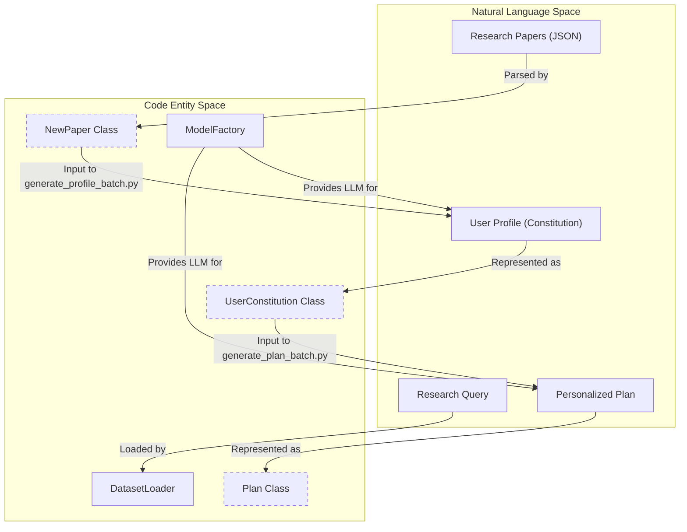
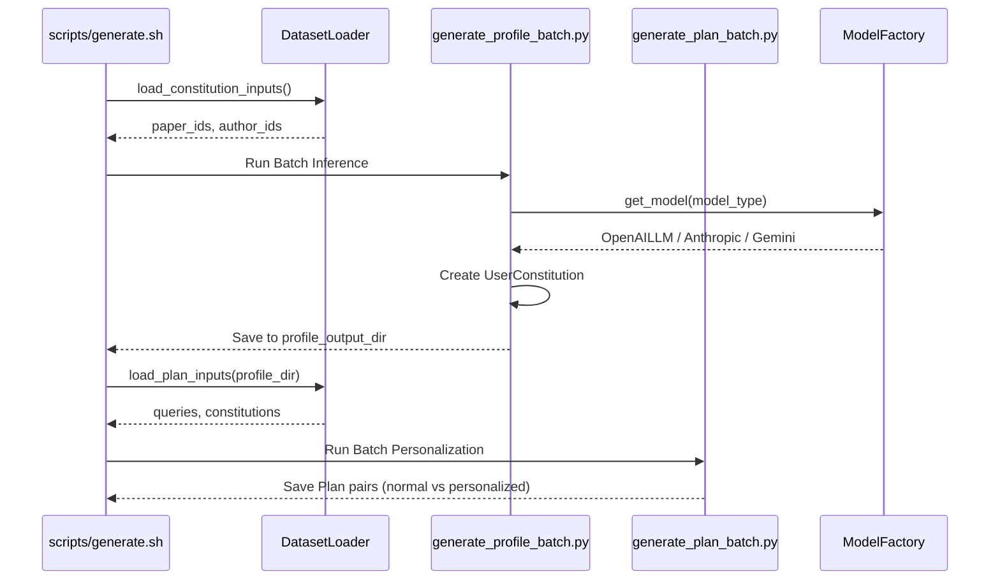

<!-- source: DeepWiki mcp.deepwiki.com · repo allenai/personalized-scholarqa-eval · page 1.1 Getting Started · fetched 2026-10-26 -->

# Getting Started

<details>
<summary>Relevant source files</summary>

The following files were used as context for generating this wiki page:

- [.gitignore](.gitignore)
- [README.md](README.md)
- [data/dataset_loader.py](data/dataset_loader.py)

</details>


This page provides the technical setup instructions and an overview of the execution pipeline for the Personalized ScholarQA Evaluation framework. This framework is designed to generate and evaluate researcher profiles (constitutions) and personalized deep research plans based on publication history and synthetic research queries.

## Environment Setup

The repository requires **Python 3.12.8** and **pip 25.0**. It uses a virtual environment to manage dependencies and a `.env` file for API authentication.

### 1. Installation
First, clone the repository and install the required Python packages:

```bash
git clone https://github.com/nbalepur/personalized-scholarqa-eval.git
cd personalized-scholarqa-eval
python3 -m venv .venv
source .venv/bin/activate
pip install -r requirements.txt
```
*Sources: [README.md:44-59]()*

### 2. API Configuration
The system supports multiple LLM providers via an abstraction layer. Copy the template and populate it with your specific API keys:

```bash
cp example.env .env
```

| Variable | Provider | Usage |
| :--- | :--- | :--- |
| `OPEN_AI_TOKEN` | OpenAI | GPT-4o, etc. |
| `ANTHROPIC_TOKEN` | Anthropic | Claude 3.5 Sonnet, etc. |
| `GEMINI_TOKEN` | Google | Gemini 1.5 Pro, etc. |

*Sources: [README.md:75-82](), [llms/model_factory.py:1-40]()*

---

## Local Dataset Layout

The pipeline expects data to be organized within the `data/local_datasets/` directory.

### Paper Objects
Profile generation requires the full text and metadata of papers. These are stored as individual JSON files indexed by paper ID.
1. Download `paper_objects.zip`.
2. Unzip into `data/local_datasets/paper_objects/`.
3. Verify layout: `data/local_datasets/paper_objects/<paper_id>.json`.

### Evaluation Data
- **`simulated_profile_inputs/`**: Contains deep research queries used to trigger plan generation.
- **`qualitative_coding_data/`**: A validation set derived from qualitative interviews for simulation reliability testing.

*Sources: [README.md:61-73](), [README.md:86-94](), [.gitignore:7-8]()*

---

## Data Flow and Pipeline Orchestration

The system operates in a two-stage generation pipeline followed by an evaluation stage. The flow transitions from raw paper data to researcher "Constitutions," then to "Plans," and finally to "Metrics."

### System Architecture Diagram


*Sources: [data/dataset_loader.py:8-124](), [README.md:100-114](), [llms/model_factory.py:7-15]()*

---

## Execution via Shell Scripts

The framework provides entry-point scripts in the `scripts/` directory to orchestrate the Python modules.

### 1. Generation Pipeline
The `generate.sh` script executes both profile and plan generation.
- **Profile Generation**: `model.user_profile.generate_profile_batch` reads paper collections and infers researcher preferences (knowledge, research style, etc.).
- **Plan Generation**: `model.plan.generate_plan_batch` uses the generated profiles to create query-specific search and organization plans.

```bash
# Edit scripts/generate.sh to set model_name and paths
./scripts/generate.sh
```
*Sources: [README.md:100-114]()*

### 2. Evaluation Pipeline
Evaluation is split into profile-specific and plan-specific runs.
- **Profile Eval**: Runs `evaluation.eval_profile` to score specificity and accuracy, then `metric_scores.profile_metrics` for summaries.
- **Plan Eval**: Runs `evaluation.eval_plans` to assess personalization alignment and `metric_scores.plan_metrics`.

```bash
./scripts/eval_profile.sh
./scripts/eval_plan.sh
```
*Sources: [README.md:116-132]()*

### Execution Logic Diagram


*Sources: [data/dataset_loader.py:48-63](), [data/dataset_loader.py:104-124](), [README.md:109-114](), [llms/model_factory.py:7-15]()*

---

## Dataset Loading Details

The `DatasetLoader` class handles the retrieval of data from Hugging Face `datasets` objects stored on disk. It manages author similarity tiers (`high`, `medium`, `low`) to ensure evaluation covers various degrees of researcher profile strength.

| Function | Return Type | Purpose |
| :--- | :--- | :--- |
| `load_constitution_inputs` | `tuple[list[list[str]], list[str]]` | Gets paper collections for profile generation. |
| `load_constitution_outputs` | `tuple[list[UserConstitution], list[str]]` | Loads generated profiles for evaluation. |
| `load_plan_inputs` | `tuple[list[str], list[str], list[UserConstitution], list[str]]` | Pairs queries with researcher profiles. |
| `load_plan_pairs` | `dict` | Retrieves both normal and personalized plans for A/B testing. |

*Sources: [data/dataset_loader.py:48-153]()*

---

