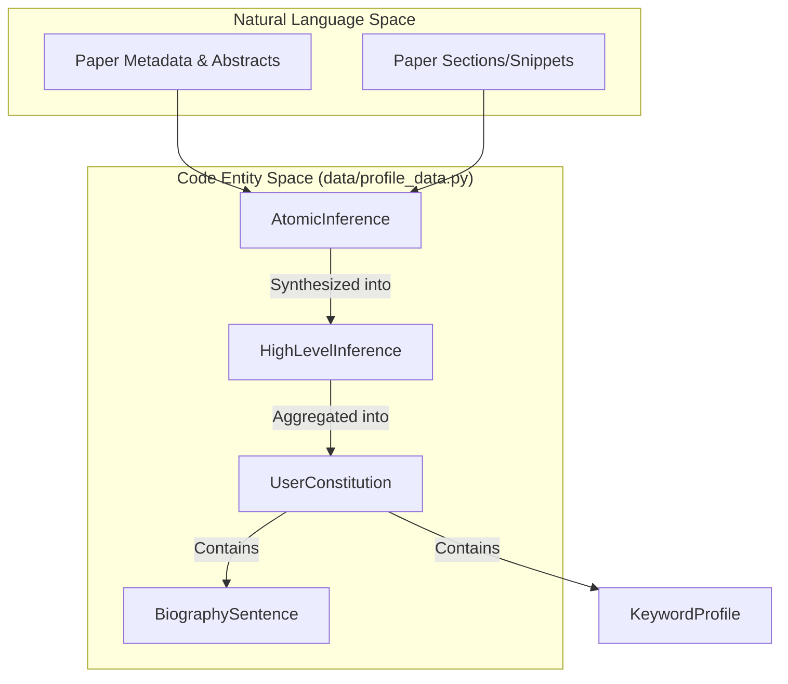
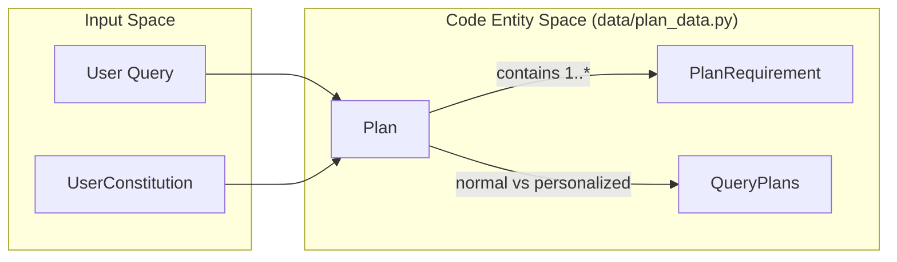

<!-- source: DeepWiki mcp.deepwiki.com · repo allenai/personalized-scholarqa-eval · page 2.1 Core Data Models · fetched 2026-10-26 -->

# Core Data Models

Relevant source files

The following files were used as context for generating this wiki page:

- [data/__init__.py](data/__init__.py)
- [data/dataset_loader.py](data/dataset_loader.py)

This page provides a detailed technical reference for the dataclasses located in the `data/` package. These models form the backbone of the Personalized ScholarQA Evaluation framework, handling everything from paper metadata and user profile inferences to complex multi-step research plans.

## Overview and Serialization
All core models are implemented as Python dataclasses and include standard serialization methods:
*   `to_json()`: Serializes the object into a JSON file or dictionary.
*   `from_json()`: Reconstitutes the object from a JSON file stored on disk.

The data flow generally moves from raw paper metadata (`Paper`) to synthesized user profiles (`UserConstitution`), which are then used to generate personalized research strategies (`Plan`).

Sources: [data/__init__.py:1-20](), [data/profile_data.py:1-5]()

---

## Paper Metadata Models

These models represent the source material used to generate user profiles.

### Paper
Represents a full academic paper with metadata and content.
*   **Fields**: `paper_id`, `title`, `abstract`, `venue`, `year`, `authors` (list of strings), and `sections` (list of dictionaries containing section titles and text).

### PaperSnippet
A lightweight representation of a paper, often used when only specific excerpts or abstracts are required for context.
*   **Fields**: `paper_id`, `title`, `abstract`.

Sources: [data/paper_data.py:5-25]()

---

## User Profile Models

The user profile is hierarchical, moving from specific "Atomic Inferences" derived from papers to "High-Level Inferences" that synthesize broader research personas.

### User Profile Hierarchy
The following diagram illustrates how raw paper data is transformed into a structured `UserConstitution`.

**Diagram: Profile Data Flow**

Sources: [data/profile_data.py:10-150](), [model/user_profile/generate_profile_batch.py:20-45]()

### AtomicInference
A single observation about a user based on their authored papers.
*   **Fields**: `inference` (the text), `evidence` (citations/snippets), and `category` (e.g., knowledge, research style).

### HighLevelInference
A synthesized summary of multiple atomic inferences.
*   **Fields**: `inference`, `supporting_atomic_inferences` (list of `AtomicInference` objects).

### UserConstitution
The top-level container for a simulated user profile.
*   **Fields**: 
    *   `user_id`: Unique identifier for the author.
    *   `atomic_inferences`: List of `AtomicInference`.
    *   `high_level_inferences`: List of `HighLevelInference`.
    *   `biography`: List of `BiographySentence`.
    *   `keyword_profile`: A `KeywordProfile` object.

Sources: [data/profile_data.py:58-132]()

---

## Research Plan Models

Plans represent the model's response to a research query, potentially personalized using a `UserConstitution`.

### PlanRequirement
A specific constraint or step within a plan.
*   **Fields**: `requirement` (description) and `importance` (integer scale).

### Plan
A structured research strategy.
*   **Fields**:
    *   `query_id`: Links the plan to a specific user query.
    *   `user_id`: Links the plan to a specific `UserConstitution`.
    *   `steps`: A list of strings describing the execution steps.
    *   `requirements`: A list of `PlanRequirement` objects.
    *   `is_personalized`: Boolean flag indicating if the plan was generated using personalization logic.

### QueryPlans
A container used to pair a `normal_plan` with a `personalized_plan` for the same query to facilitate A/B testing and evaluation.

**Diagram: Plan Generation Logic**

Sources: [data/plan_data.py:5-60](), [model/plan/generate_plan_batch.py:40-65]()

---

## Support and Simulation Models

### User
A high-level wrapper used in simulation tasks to group a `user_id` with its associated `UserConstitution`.

### BiographySentence & KeywordProfile
*   **BiographySentence**: A single sentence describing a user's background with a `category` label.
*   **KeywordProfile**: A collection of technical keywords associated with the user's research domain.

Sources: [data/user_data.py:5-15](), [data/profile_data.py:10-30]()

---

## Dataset Loading and Mapping

The `DatasetLoader` class in `data/dataset_loader.py` acts as the bridge between disk-based Hugging Face datasets and the dataclasses described above.

| Function | Return Type | Purpose |
| :--- | :--- | :--- |
| `load_constitution_inputs` | `tuple[list[list[str]], list[str]]` | Retrieves collections of paper IDs and author IDs for profile generation. |
| `load_constitution_outputs`| `list[UserConstitution]` | Loads generated profiles from JSON using `UserConstitution.from_json`. |
| `load_plan_pairs` | `dict` | Pairs `normal` and `personalized` plans for evaluation. |
| `load_author_map` | `dict[str, str]` | Maps `author_id` to similarity tiers (`high`, `medium`, `low`). |

Sources: [data/dataset_loader.py:48-63](), [data/dataset_loader.py:70-95](), [data/dataset_loader.py:134-153]()

---

