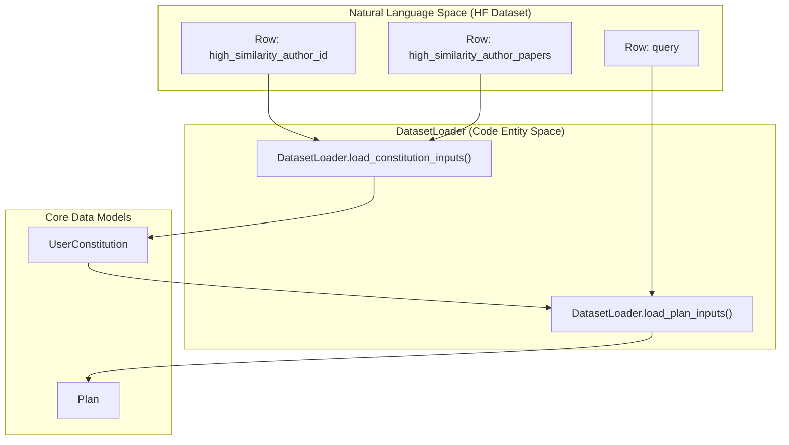
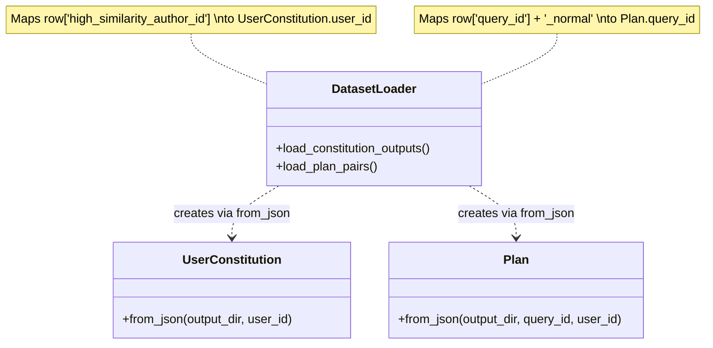

<!-- source: DeepWiki mcp.deepwiki.com · repo allenai/personalized-scholarqa-eval · page 2.2 Dataset Loader · fetched 2026-10-26 -->

# Dataset Loader

Relevant source files

The following files were used as context for generating this wiki page:

- [data/dataset_loader.py](data/dataset_loader.py)
- [data/local_datasets/qualitative_coding_data/all_text/dataset_dict.json](data/local_datasets/qualitative_coding_data/all_text/dataset_dict.json)

The `DatasetLoader` class is the central utility for interfacing with the Hugging Face `datasets` library and the local filesystem to provide structured data for the generation and evaluation pipelines. It manages the complexities of author similarity tiers, joins disparate data sources (like paper collections and queries), and handles the serialization of core data models like `UserConstitution` and `Plan`.

Sources: [data/dataset_loader.py:8-124]()

## Core Implementation

The loader is designed to work with datasets stored in the Apache Arrow format via `datasets.load_from_disk`. It supports loading single datasets or composite datasets from multiple subsets.

### Initialization and Loading
The class provides two primary ways to initialize:
1.  **Standard Initialization**: Loads a single dataset directory [data/dataset_loader.py:13-16]().
2.  **Subset Initialization**: Uses `from_subsets` to load multiple directories into a dictionary mapping subset names to dataset objects [data/dataset_loader.py:18-25]().

### Author Similarity Tiers
A key feature of the ScholarQA evaluation is the use of different similarity tiers to evaluate how well models generalize or personalize based on varying levels of author relevance. The `DatasetLoader` recognizes three tiers: `high`, `medium`, and `low`.
*   **`load_author_map`**: Iterates through all dataset rows to create a mapping of `author_id` to their respective similarity tier [data/dataset_loader.py:31-40]().

Sources: [data/dataset_loader.py:13-40]()

## Data Flow: Natural Language to Code Entities

The following diagram illustrates how the `DatasetLoader` bridges raw Hugging Face dataset rows (Natural Language/JSON space) to the structured Python objects used throughout the evaluation framework (Code Entity space).

### Simulation Data Reconstruction
The `load_simulation_data` method performs a join operation between two distinct data sources to reconstruct simulation inputs.

**Simulation Join Logic**
| Entity | Source | Key Field |
| :--- | :--- | :--- |
| **Profile Data** | `self.ds['profile']` | `source_id` |
| **Simulation Inputs** | `self.ds['simulated_profile_inputs']` | `id` |

Sources: [data/dataset_loader.py:48-63](), [data/dataset_loader.py:104-124]()

## Key Loading Methods

### Constitution Data Loading
These methods facilitate the generation and evaluation of user profiles.
*   **`load_constitution_inputs`**: Extracts lists of `paper_collection_ids` and `author_ids`. This is the entry point for `generate_profile_batch.py` [data/dataset_loader.py:48-63]().
*   **`load_constitution_outputs`**: Loads existing `UserConstitution` objects from disk using `UserConstitution.from_json`. It handles potential parsing errors and provides a summary of successfully loaded profiles [data/dataset_loader.py:70-95]().

### Plan Data Loading
These methods prepare data for generating or evaluating search plans.
*   **`load_plan_inputs`**: Aggregates queries, query IDs, and their corresponding `UserConstitution` objects. This is used when generating plans that must be personalized to a specific user profile [data/dataset_loader.py:104-124]().
*   **`load_plan_pairs`**: Specifically designed for A/B evaluation. It loads a "normal" (generic) plan and a "personalized" plan for the same query and user, returning them in a dictionary format suitable for comparison [data/dataset_loader.py:134-153]().

### Internal Logic for Plan Pairs
When calling `load_plan_pairs`, the loader assumes a specific naming convention for files on disk:
*   Generic Plan ID: `{query_id}_normal` [data/dataset_loader.py:144]()
*   Personalized Plan ID: `{query_id}_personalized` [data/dataset_loader.py:145]()

## Entity Relationship: Dataset to Models

This diagram shows how `DatasetLoader` methods map specific Hugging Face dataset fields to the constructor arguments of the system's core Data Models.

Sources: [data/dataset_loader.py:84-86](), [data/dataset_loader.py:144-146]()

---

