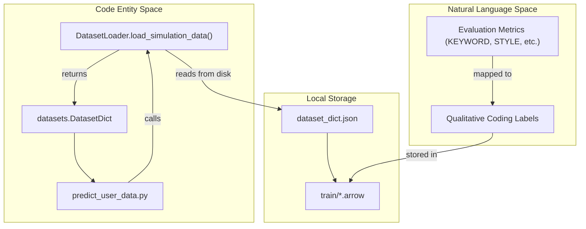
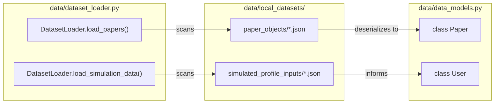

<!-- source: DeepWiki mcp.deepwiki.com · repo allenai/personalized-scholarqa-eval · page 2.3 Local Datasets and Qualitative Coding Data · fetched 2026-10-26 -->

# Local Datasets and Qualitative Coding Data

Relevant source files

The following files were used as context for generating this wiki page:

- [data/local_datasets/qualitative_coding_data/all_text/dataset_dict.json](data/local_datasets/qualitative_coding_data/all_text/dataset_dict.json)
- [data/local_datasets/qualitative_coding_data/all_text/train/cache-00db1cfd048ad1d3.arrow](data/local_datasets/qualitative_coding_data/all_text/train/cache-00db1cfd048ad1d3.arrow)
- [data/local_datasets/qualitative_coding_data/all_text/train/cache-012b2577db402683.arrow](data/local_datasets/qualitative_coding_data/all_text/train/cache-012b2577db402683.arrow)
- [data/local_datasets/qualitative_coding_data/all_text/train/cache-015ddb3086431be5.arrow](data/local_datasets/qualitative_coding_data/all_text/train/cache-015ddb3086431be5.arrow)

This page describes the local data storage architecture within the `personalized-scholarqa-eval` repository. The system relies on a specific directory structure under `data/local_datasets/` to manage cached Hugging Face datasets, paper metadata, and qualitative coding examples used for simulation and evaluation.

## Overview of data/local_datasets/

The `data/local_datasets/` directory acts as the primary storage for ground-truth data and pre-processed corpora. Unlike the dynamic outputs generated by LLMs (which are stored in `model/` or `metric_scores/`), this directory contains the foundational data used to drive the simulation and evaluation pipelines.

### Directory Structure

| Path | Description |
| :--- | :--- |
| `qualitative_coding_data/` | Contains the manual qualitative coding corpus stored in Apache Arrow format. |
| `simulated_profile_inputs/` | Stores JSON files representing the inputs for user profile simulation. |
| `paper_objects/` | A collection of serialized `Paper` objects (JSON) used to provide context for profile generation. |

**Sources:** `data/local_datasets/` directory structure.

---

## Qualitative Coding Data Corpus

The `qualitative_coding_data` is a local Hugging Face dataset used primarily by the simulation evaluation branch [evaluation/predict_user_data.py](). It contains hand-coded examples of how models succeed or fail at personalization tasks.

### Hugging Face Dataset Caching
The dataset is stored using the Hugging Face `datasets` library's local caching mechanism. This allows the `DatasetLoader` to load the corpus efficiently without network access [data/dataset_loader.py:102-104]().

*   **`dataset_dict.json`**: A manifest file defining the available splits. In this repository, only the `train` split is utilized [data/local_datasets/qualitative_coding_data/all_text/dataset_dict.json:1]().
*   **Apache Arrow Files**: The actual data is stored in `.arrow` files (e.g., `cache-00db1cfd048ad1d3.arrow`). These files are memory-mapped for high-performance access [data/local_datasets/qualitative_coding_data/all_text/train/cache-00db1cfd048ad1d3.arrow:5]().
*   **Fingerprinting**: Each arrow file contains a `fingerprint` (e.g., `00db1cfd048ad1d3`) that ensures data integrity and allows the Hugging Face library to track versions of the cached data [data/local_datasets/qualitative_coding_data/all_text/train/cache-012b2577db402683.arrow:5]().

### Data Flow: Qualitative Coding to Simulation
The following diagram illustrates how the local Arrow files are consumed by the evaluation system.

**Simulation Data Loading Flow**

**Sources:** [data/dataset_loader.py:102-110](), [evaluation/predict_user_data.py:10-25]().

---

## Simulated Profile Inputs and Paper Objects

The framework uses two specific types of local JSON data to facilitate the "Two-Stage Pipeline" (Profile Generation -> Plan Generation).

### Paper Objects
The `paper_objects/` directory contains JSON files where each file represents a `Paper` dataclass instance [data/data_models.py:13-25](). These objects include:
*   `paper_id`: Unique identifier.
*   `title`: The title of the research paper.
*   `abstract`: The summary of the work.
*   `authors`: A list of author names.

These objects are loaded by the `DatasetLoader` to provide the raw text context needed for the `MultiPaperAuthorInferencesPromptThirdParty` prompt [prompt/template.py:112-130]().

### Simulated Profile Inputs
The `simulated_profile_inputs/` directory contains the source data for creating `User` objects. These inputs are used to reconstruct simulation scenarios by joining source IDs with the paper corpus [data/dataset_loader.py:112-125]().

**Data Association Diagram**

**Sources:** [data/data_models.py:13-35](), [data/dataset_loader.py:10-40]().

---

## Technical Implementation Details

### Fingerprinting and Features
The Arrow files in the `qualitative_coding_data` corpus include metadata that defines the schema for the Hugging Face `datasets` library. Specifically, they define `indices` as `uint64` values to track row positions within the cache [data/local_datasets/qualitative_coding_data/all_text/train/cache-015ddb3086431be5.arrow:5]().

### Dataset Loading Logic
The `DatasetLoader` class (specifically the `load_from_disk` method) is responsible for resolving the paths to these local directories. It expects a specific hierarchy:
1.  It checks for the existence of `dataset_dict.json` [data/local_datasets/qualitative_coding_data/all_text/dataset_dict.json:1]().
2.  It uses the `datasets.load_from_disk()` utility to map the Arrow files into a `Dataset` object.
3.  It filters or splits the data based on the `train` key defined in the manifest.

**Sources:** [data/dataset_loader.py:102-105](), [data/local_datasets/qualitative_coding_data/all_text/dataset_dict.json:1]().

---

