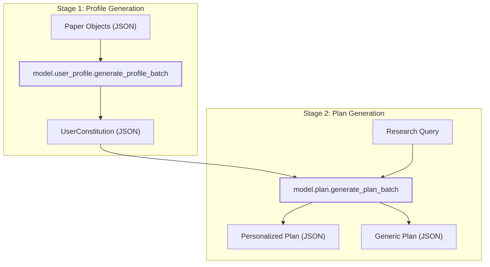
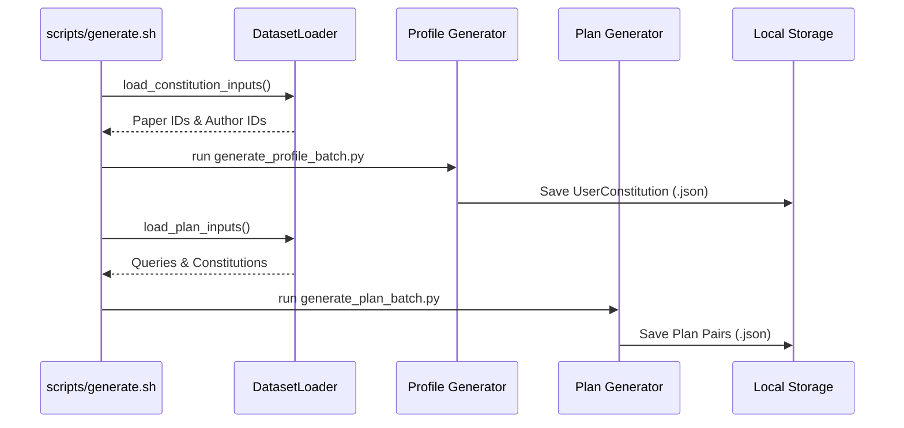

<!-- source: DeepWiki mcp.deepwiki.com · repo allenai/personalized-scholarqa-eval · page 3 Generation Pipeline · fetched 2026-10-26 -->

# Generation Pipeline

Relevant source files

The following files were used as context for generating this wiki page:

- [README.md](README.md)
- [data/dataset_loader.py](data/dataset_loader.py)

The Personalized ScholarQA generation pipeline is a two-stage process designed to transform a researcher's publication history into a personalized research plan. The pipeline first infers a comprehensive **User Profile** (or "Constitution") from paper collections and then uses that profile to generate a **Personalized Plan** for a specific research query.

This process is orchestrated by shell scripts that chain these Python modules together, ensuring that the necessary data artifacts (JSON files) are passed correctly between stages.

### Pipeline Overview

The generation workflow follows a linear path from raw paper data to structured research strategies.

**Sources:** [README.md:109-112](), [scripts/generate.sh:1-50]()

---

### Stage 1: User Profile Generation
The first stage involves analyzing a collection of papers authored by a specific user to infer their research persona. The system uses the `MultiPaperAuthorInferencesPromptThirdParty` template to prompt an LLM to generate high-level and atomic inferences across several categories defined in the `CONSTITUTION_DEFINITION_RUBRIC`.

The resulting `UserConstitution` object acts as a persistent representation of the user's:
*   **Knowledge & Expertise:** Technical domains and specific concepts.
*   **Research & Writing Style:** Methodological preferences and linguistic tone.
*   **Epistemology & Audience:** How they evaluate evidence and who they write for.

For a deep dive into the inference hierarchy and JSON parsing, see **[User Profile Generation](#3.1)**.

**Sources:** [model/user_profile/generate_profile_batch.py:1-50](), [prompt/template.py:12-40]()

---

### Stage 2: Plan Generation
The second stage uses the generated `UserConstitution` to ground a research plan for a new query. The pipeline generates two types of plans for evaluation purposes:
1.  **Personalized Plan:** Uses `PlanGenerationPromptQualitative` or `PlanGenerationPromptImplementation` to incorporate the user's profile into search and organization strategies.
2.  **Generic (Non-personalized) Plan:** Uses "Nonpersonalized" prompt variants to provide a baseline without user-specific context.

The output consists of `Plan` objects containing specific `PlanRequirement` items, each tagged with a `PersonalizationStrategy` (e.g., "Filtering", "Re-ranking") to track how the profile influenced the result.

For details on the plan taxonomies and prompt selection logic, see **[Plan Generation](#3.2)**.

**Sources:** [model/plan/generate_plan_batch.py:1-60](), [data/core_types.py:180-220]()

---

### Orchestration and Execution
The pipeline is primarily executed via `scripts/generate.sh`. This script manages the environment variables and CLI arguments required by the Python modules.

#### Key Components and Code Entities

| Entity | Role | File Reference |
| :--- | :--- | :--- |
| `generate.sh` | Orchestrates the two-stage flow via shell commands. | [scripts/generate.sh:1-50]() |
| `DatasetLoader` | Loads paper collections and input queries from disk. | [data/dataset_loader.py:48-63]() |
| `generate_profile_batch.py` | Entry point for Stage 1 (Profile Generation). | [model/user_profile/generate_profile_batch.py:1-20]() |
| `generate_plan_batch.py` | Entry point for Stage 2 (Plan Generation). | [model/plan/generate_plan_batch.py:1-20]() |

#### Execution Flow Diagram

**Sources:** [scripts/generate.sh:25-45](), [data/dataset_loader.py:48-124]()

---

### Related Pages
*   **[User Profile Generation](#3.1)**: Detailed look at paper analysis and the `UserConstitution` model.
*   **[Plan Generation](#3.2)**: Detailed look at personalization strategies and `Plan` requirements.
*   **[Generation Scripts](#8.1)**: Reference for CLI arguments and directory configurations in `generate.sh`.

---

