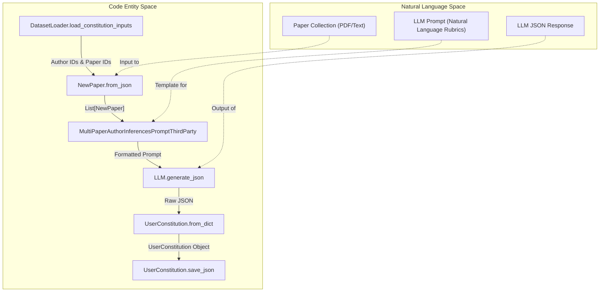
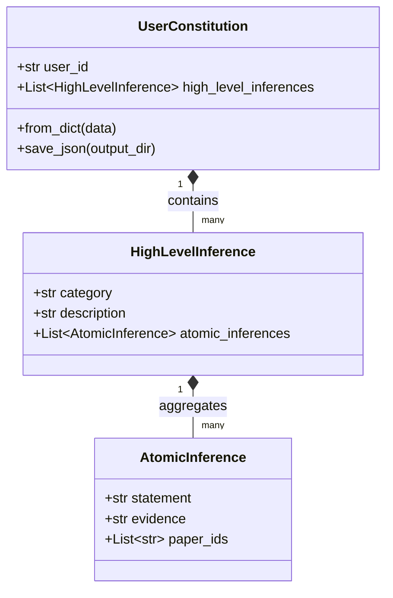

<!-- source: DeepWiki mcp.deepwiki.com · repo allenai/personalized-scholarqa-eval · page 3.1 User Profile Generation · fetched 2026-10-26 -->

# User Profile Generation

Relevant source files

The following files were used as context for generating this wiki page:

- [README.md](README.md)
- [data/__init__.py](data/__init__.py)
- [data/dataset_loader.py](data/dataset_loader.py)

The User Profile Generation stage is the first phase of the personalized evaluation pipeline. It transforms a collection of an author's research papers into a structured **User Constitution** (also referred to as a "profile"). This profile captures specific researcher preferences across dimensions such as epistemology, writing style, and domain knowledge, which are later used to condition plan generation.

The logic is primarily contained within `model/user_profile/generate_profile_batch.py` [model/user_profile/generate_profile_batch.py:1-125](), which orchestrates reading paper data, calling LLMs via specialized prompts, and persisting the resulting structured objects.

### Data Flow and Architecture

The generation process follows a batch-processing pattern. It reads author identifiers and their associated paper IDs from a source dataset, fetches the full paper content from local storage, and uses a "Third Party" inference prompt to ask an LLM to act as an observer characterizing the author.

#### Profile Generation Sequence
The following diagram illustrates the flow from raw paper files to the persisted `UserConstitution` JSON.

**Diagram: Paper-to-Constitution Transformation**

**Sources:** [model/user_profile/generate_profile_batch.py:47-98](), [data/dataset_loader.py:48-63](), [prompt/template.py:53-76]()

### The User Constitution Structure

The output of this process is a `UserConstitution` object [data/profile_data.py:126-128](). This object is a hierarchical container for two types of inferences:

1.  **AtomicInference**: Specific, granular observations derived directly from the papers, including supporting evidence (citations) [data/profile_data.py:12-22]().
2.  **HighLevelInference**: Synthesized, broader characterizations that group atomic inferences into semantic categories [data/profile_data.py:65-76]().

#### CONSTITUTION_DEFINITION_RUBRIC Categories
The LLM is instructed to categorize every inference into one of the following seven categories defined in the `CONSTITUTION_DEFINITION_RUBRIC` [prompt/shared_instructions.py:11-26]():

| Category | Description |
| :--- | :--- |
| `knowledge` | Specific domains, concepts, or technical expertise. |
| `research_style` | Methodological preferences (e.g., empirical vs. theoretical). |
| `writing_style` | Linguistic traits (e.g., formal, concise, use of metaphors). |
| `positions` | Specific stances or arguments taken in the field. |
| `epistemology` | How the author validates truth or value in research. |
| `audience` | The intended level of technicality or background of readers. |
| `conclusions` | Typical ways the author frames results or future work. |

**Sources:** [prompt/shared_instructions.py:11-26](), [data/profile_data.py:65-76]()

### Implementation Details

#### Batch Generation Loop
The main entry point is `generate_profile_batch` [model/user_profile/generate_profile_batch.py:47-47](). It performs the following steps:
1.  **Input Loading**: Uses `DatasetLoader.load_constitution_inputs` to get lists of author IDs and their respective paper IDs [model/user_profile/generate_profile_batch.py:58-58]().
2.  **Paper Retrieval**: For each author, it loads `NewPaper` objects from the `paper_dir` [model/user_profile/generate_profile_batch.py:73-77]().
3.  **Prompt Construction**: It instantiates `MultiPaperAuthorInferencesPromptThirdParty`, passing the paper content and the required number of inferences [model/user_profile/generate_profile_batch.py:82-84]().
4.  **LLM Call**: Invokes `model.generate_json` to ensure the output adheres to the expected schema [model/user_profile/generate_profile_batch.py:86-86]().
5.  **Parsing & Persistence**: Converts the JSON response into a `UserConstitution` and calls `constitution.save_json(output_dir)` [model/user_profile/generate_profile_batch.py:88-98]().

#### Class Mapping
This diagram maps the logical components of the profile to the specific Python classes that handle them.

**Diagram: Constitution Object Model**

**Sources:** [data/profile_data.py:12-140]()

### Personalization Requirements
The generation prompt enforces specific constraints to ensure the profile is useful for downstream personalization:
*   **Evidence-Based**: Every `AtomicInference` must include an `evidence` string and a list of `paper_ids` [data/profile_data.py:12-22]().
*   **Distinct Categories**: The LLM must organize inferences according to the `CONSTITUTION_DEFINITION_RUBRIC` to ensure a balanced view of the author [prompt/shared_instructions.py:11-26]().
*   **JSON Enforcement**: The system uses `validate_json_structure` in the LLM base class to ensure the response can be successfully cast into the `AtomicInference` and `HighLevelInference` dataclasses [llms/base.py:61-91]().

**Sources:** [model/user_profile/generate_profile_batch.py:82-98](), [llms/base.py:61-91](), [prompt/template.py:53-76]()

---

