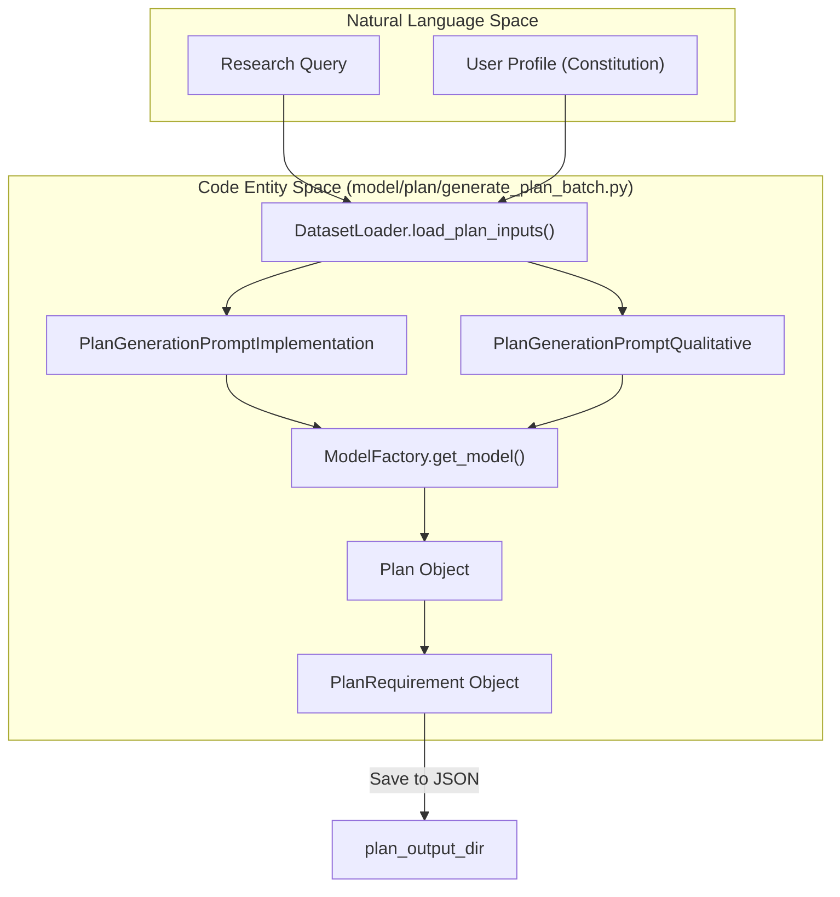
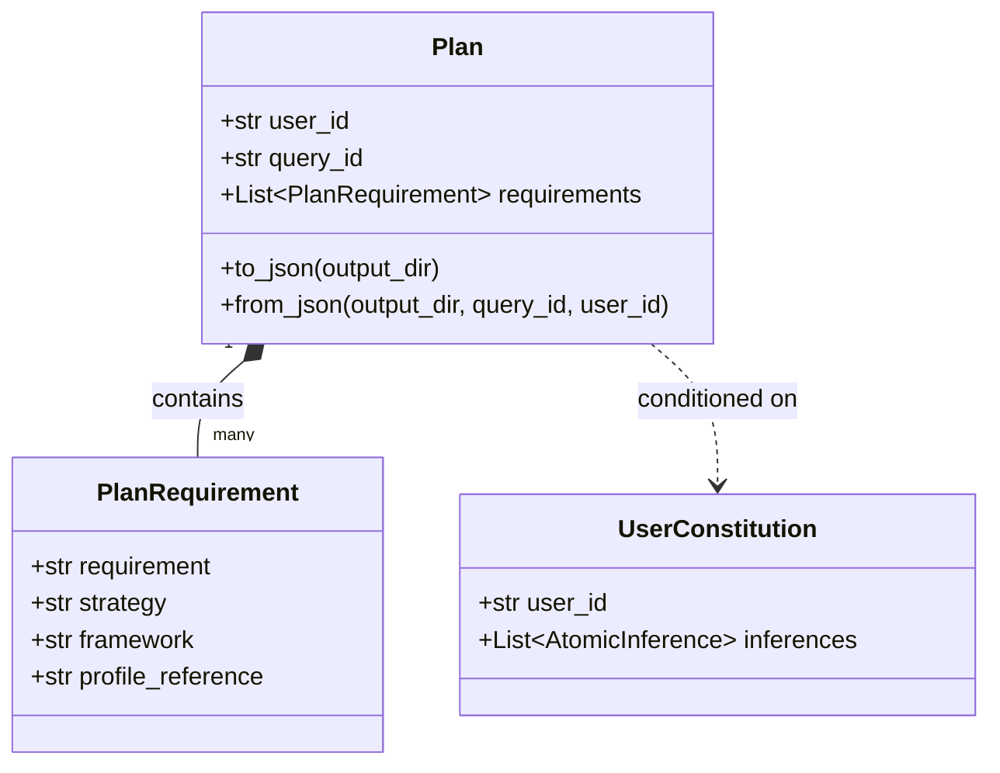

<!-- source: DeepWiki mcp.deepwiki.com · repo allenai/personalized-scholarqa-eval · page 3.2 Plan Generation · fetched 2026-10-26 -->

# Plan Generation

<details>
<summary>Relevant source files</summary>

The following files were used as context for generating this wiki page:

- [README.md](README.md)
- [data/__init__.py](data/__init__.py)
- [data/dataset_loader.py](data/dataset_loader.py)

</details>


The **Plan Generation** stage is the second phase of the MyScholarQA generation pipeline. It takes a generated **User Profile** (also known as a `UserConstitution`) and a research query as input to produce a structured, multi-step **Plan**. These plans are designed to guide a deep research system in executing search, organization, and generation tasks that are specifically tailored to a researcher's inferred preferences and background.

### 1. Overview and Purpose

The core logic for generating plans resides in `model/plan/generate_plan_batch.py`. The system generates two types of plans for every query to enable comparative evaluation:
1.  **Personalized Plan**: Conditioned on the `UserConstitution`.
2.  **Normal (Non-Personalized) Plan**: Conditioned only on the query, serving as a baseline.

Each plan consists of a sequence of `PlanRequirement` objects, which categorize the personalization strategy used (e.g., Narrowing, Off-topic mitigation, or Style adjustments).

### 2. Implementation and Data Flow

The generation process follows a batch-processing pattern, loading inputs via the `DatasetLoader`, selecting appropriate prompt templates, and persisting results to disk as JSON files.

#### Plan Generation Architecture
The following diagram illustrates how the `generate_plan_batch.py` script bridges the high-level research query with the specific code entities used to represent the plan.

**Title: Plan Generation Data Flow**

Sources: `[model/plan/generate_plan_batch.py:1-125]()`, `[data/dataset_loader.py:104-124]()`, `[data/plan_data.py:34-70]()`

### 3. Key Classes and Functions

#### 3.1 Personalization Strategy Taxonomy
The system classifies every requirement in a personalized plan using two taxonomies defined in `model/plan/generate_plan_batch.py`:

*   **`PersonalizationStrategy`**: Describes the logical relationship between the user profile and the query (e.g., `NARROW`, `OFFTOPIC`, `OVERGENERAL`). [model/plan/generate_plan_batch.py:15-24]()
*   **`PersonalizationFramework`**: Describes the action taken (e.g., `SEARCH`, `ORGANIZE`, `GENERATE`). [model/plan/generate_plan_batch.py:26-30]()

#### 3.2 Prompt Selection Logic
The script selects prompt variants based on whether personalization is enabled and which prompt "flavor" is requested via the CLI:

| Mode | Personalized Class | Non-Personalized Class |
| :--- | :--- | :--- |
| **Qualitative** | `PlanGenerationPromptQualitative` | `PlanGenerationPromptQualitativeNonpersonalized` |
| **Implementation** | `PlanGenerationPromptImplementation` | `PlanGenerationPromptImplementationNonpersonalized` |

Sources: `[model/plan/generate_plan_batch.py:80-95]()`, `[prompt/template.py:126-174]()`

### 4. Detailed Execution Logic

The main entry point is the `generate` function in `model/plan/generate_plan_batch.py`.

1.  **Input Loading**: It calls `DatasetLoader.load_plan_inputs` to retrieve queries, query IDs, and the corresponding `UserConstitution` objects from the `profile_dir`. [model/plan/generate_plan_batch.py:73-74]()
2.  **Batch Generation Loop**:
    *   For each query, it first generates a **Personalized Plan**. It constructs the prompt using the `UserConstitution` and the query string. [model/plan/generate_plan_batch.py:98-106]()
    *   It then generates a **Normal Plan**. It uses the non-personalized prompt variant, which ignores the constitution. [model/plan/generate_plan_batch.py:113-118]()
3.  **JSON Parsing**: The LLM output is expected to be a JSON list of requirements. The script iterates through these and constructs `PlanRequirement` objects. [model/plan/generate_plan_batch.py:103-105]()
4.  **Persistence**: Plans are saved using `Plan.to_json`. Personalized plans are suffixed with `_personalized` and normal plans with `_normal` in their filenames to prevent collisions. [model/plan/generate_plan_batch.py:111,123]()

**Title: Plan Entity Mapping**

Sources: `[data/plan_data.py:1-70]()`, `[data/profile_data.py:75-90]()`

### 5. Running the Pipeline

Plan generation is typically triggered via the `scripts/generate.sh` wrapper.

```bash
# Example invocation within generate.sh
python3 -m model.plan.generate_plan_batch \
    --profile_dir "data/outputs/profiles" \
    --output_dir "data/outputs/plans" \
    --model_name "gpt-4o" \
    --model_type "openai" \
    --num_actions 5
```

The `--num_actions` flag controls the `limit` parameter, determining how many query-plan pairs are processed from the input dataset. [model/plan/generate_plan_batch.py:61,75]()

Sources: `[scripts/generate.sh:1-40]()`, `[model/plan/generate_plan_batch.py:53-68]()`

---

