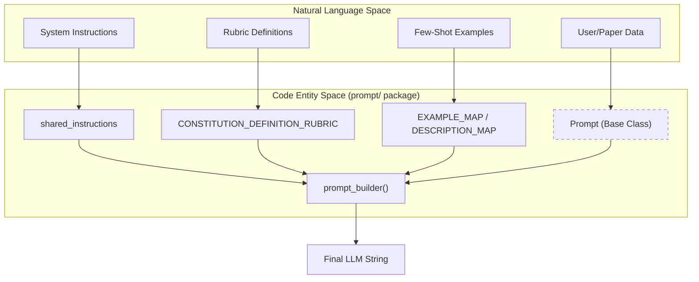
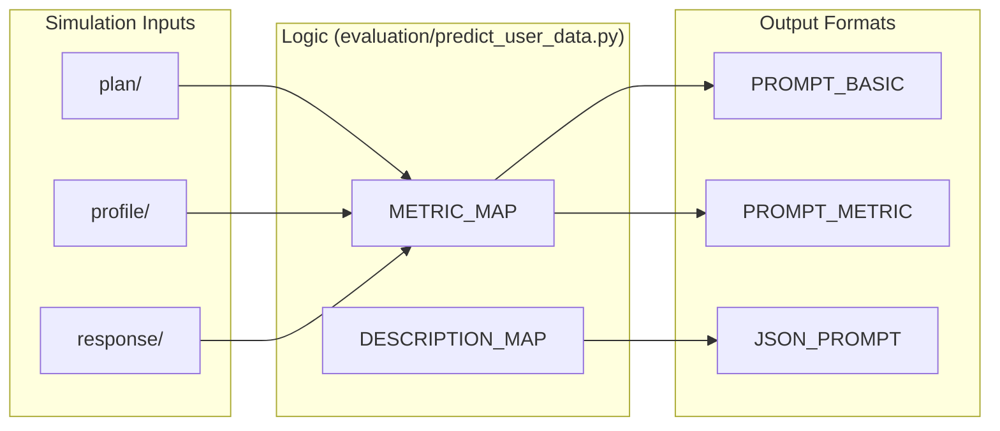

<!-- source: DeepWiki mcp.deepwiki.com · repo allenai/personalized-scholarqa-eval · page 4 Prompt System · fetched 2026-10-26 -->

# Prompt System

Relevant source files

The following files were used as context for generating this wiki page:

- [README.md](README.md)
- [__init__.py](__init__.py)

The `prompt/` package serves as the central repository for all LLM instructions and templates used throughout the Personalized ScholarQA Evaluation framework. It manages the complexity of constructing multi-part prompts that include system instructions, research rubrics, few-shot examples, and specific user data.

The system is divided into two primary areas: template-based generation (for creating profiles and plans) and simulation prompts (for predicting user preferences based on qualitative coding data).

### Core Components

The prompt system is built around a flexible base class and a builder utility to ensure consistency across different LLM calls.

| Component | File | Role |
| :--- | :--- | :--- |
| `Prompt` | [prompt/template.py:11-28]() | Abstract base class defining the `to_prompt()` interface for all generation templates. |
| `prompt_builder` | [prompt/template.py:31-50]() | Utility function that joins instruction strings with newlines and handles optional prefixing. |
| `shared_instructions` | [prompt/template.py:53-57]() | Common formatting and behavioral constraints applied to all generation tasks. |

### Prompt Architecture Diagram

The following diagram illustrates how natural language instructions are mapped to code entities and composed into final LLM strings.

**Sources:** [prompt/template.py:11-57](), [prompt/user_prediction_prompts/profile/profile_prompts.py:6-25]()

---

### Generation Templates

The generation pipeline uses specialized subclasses of `Prompt` to handle two distinct phases: inferring user profiles (constitutions) and creating research plans. These templates often incorporate `NUMBER_WORDS` [prompt/template.py:60-72]() to ensure LLMs follow specific count constraints for generated items.

#### Constitution Generation
These prompts are designed to analyze a collection of papers and infer a researcher's "constitution"—a set of atomic and high-level inferences regarding their research style, epistemology, and target audience.
*   **Primary Class:** `MultiPaperAuthorInferencesPromptThirdParty` [prompt/template.py:75-121]()
*   **Key Input:** `CONSTITUTION_DEFINITION_RUBRIC` [prompt/template.py:534-550]()

#### Plan Generation
These prompts generate research plans consisting of search, organization, and generation requirements. They support both personalized (conditioned on a constitution) and non-personalized (baseline) variants.
*   **Personalized:** `PlanGenerationPromptQualitative`, `PlanGenerationPromptImplementation` [prompt/template.py:204-325]()
*   **Non-Personalized:** `PlanGenerationPromptQualitativeNonpersonalized`, `PlanGenerationPromptImplementationNonpersonalized` [prompt/template.py:328-444]()

For details on how these templates are composed, see [Constitution and Plan Prompt Templates](#4.1).

---

### User Prediction Prompts (Simulation)

The simulation branch uses a different structure, relying on pre-defined text files and mapping dictionaries to evaluate how well LLMs can predict real-world qualitative coding outcomes. These are located in the `prompt/user_prediction_prompts/` directory.

The system uses three primary prompt types for simulation:
1.  **`PROMPT_BASIC`**: Standard instruction set for the prediction task.
2.  **`PROMPT_METRIC`**: Instructions focused on specific evaluation metrics (e.g., specificity, accuracy).
3.  **`JSON_PROMPT`**: Forces the LLM to output predictions in a structured JSON format for automated parsing.

#### Simulation Data Mapping
The simulation prompts bridge the gap between qualitative research labels and LLM inputs using several mapping entities:

| Entity | Description |
| :--- | :--- |
| `DESCRIPTION_MAP` | Maps internal metric codes to natural language descriptions. |
| `EXAMPLE_MAP` | Provides few-shot examples for specific qualitative categories. |
| `METRIC_MAP` | Maps specific metrics to their corresponding instruction sets. |

For details on simulation prompts and few-shot examples, see [User Prediction Prompts (Simulation)](#4.2).

**Sources:** [prompt/user_prediction_prompts/profile/profile_prompts.py:6-45](), [evaluation/predict_user_data.py:25-60]()

---

