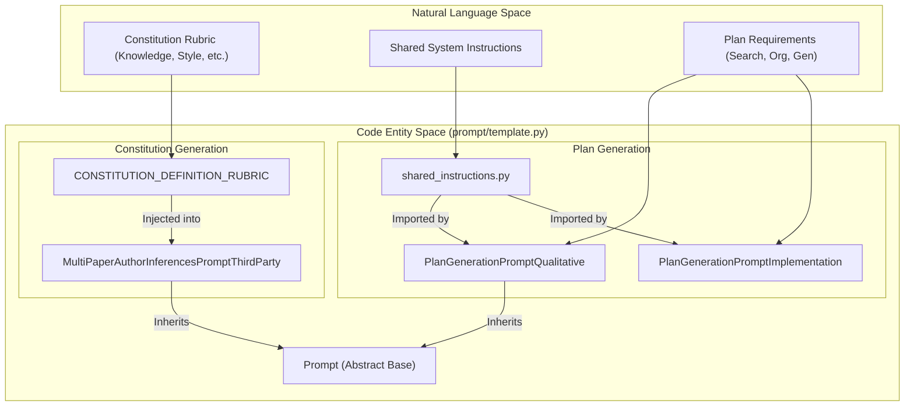
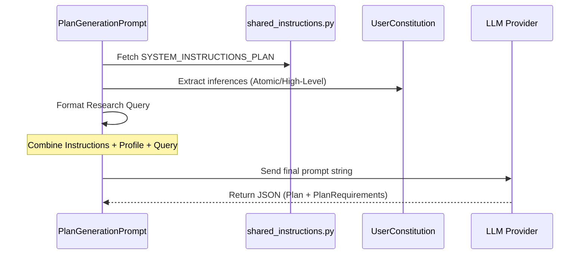

<!-- source: DeepWiki mcp.deepwiki.com · repo allenai/personalized-scholarqa-eval · page 4.1 Constitution and Plan Prompt Templates · fetched 2026-10-26 -->

# Constitution and Plan Prompt Templates

Relevant source files

The following files were used as context for generating this wiki page:

- [README.md](README.md)
- [__init__.py](__init__.py)

This page provides a technical reference for the concrete `Prompt` subclasses defined in `prompt/template.py` [prompt/template.py:1-356](). These templates are the core of the Personalized ScholarQA generation pipeline, responsible for transforming raw data (paper snippets, user profiles, and research queries) into structured LLM prompts for generating **User Constitutions** and **Personalized Research Plans**.

## Overview of the Prompt Hierarchy

All templates inherit from the abstract `Prompt` base class [prompt/prompt_builder.py:6-27](). The system uses a composition-based approach where shared instructions, rubrics, and formatting constraints are injected into the final string via the `build_prompt` method.

### Data Flow: Natural Language to Code Space

The following diagram illustrates how natural language concepts (Rubrics, Instructions) are mapped to specific class attributes and methods within the codebase.

**Prompt Composition Mapping**

**Sources:** [prompt/template.py:10-356](), [prompt/prompt_builder.py:6-27](), [prompt/shared_instructions.py:1-42]()

---

## Constitution Generation Templates

The primary template for profile generation is `MultiPaperAuthorInferencesPromptThirdParty`. It is designed to analyze a collection of papers and infer a researcher's profile (Constitution).

### MultiPaperAuthorInferencesPromptThirdParty
This class handles the transformation of multiple `PaperSnippet` objects into a `UserConstitution` [prompt/template.py:10-93]().

*   **Key Constants**:
    *   `CONSTITUTION_DEFINITION_RUBRIC`: Defines the seven categories for inferences: `knowledge`, `research_style`, `writing_style`, `positions`, `epistemology`, `audience`, and `conclusions` [prompt/template.py:11-40]().
    *   `NUMBER_WORDS`: A mapping (e.g., 1 -> "one") used to dynamically set the required number of inferences in the prompt text [prompt/template.py:42-53]().
*   **Prompt Composition**:
    *   It utilizes `shared_instructions.py` to set the persona of a "highly skilled research assistant" [prompt/shared_instructions.py:1-6]().
    *   The `build_prompt` method iterates through `PaperSnippet` objects, formatting their titles and abstracts for the LLM [prompt/template.py:73-86]().
    *   It enforces a JSON output format containing `atomic_inferences` and `high_level_inferences` [prompt/template.py:88-91]().

**Sources:** [prompt/template.py:10-93](), [prompt/shared_instructions.py:1-6]()

---

## Plan Generation Templates

Plan templates are split into two categories: **Qualitative** (high-level research goals) and **Implementation** (concrete execution steps). Each category has a personalized and non-personalized variant.

### Logic Flow for Plan Prompts
The following diagram shows how the `build_prompt` method assembles the final string for personalized plan generation.

**Plan Generation Logic**

**Sources:** [prompt/template.py:96-356](), [model/plan/generate_plan_batch.py:74-115]()

### 1. Qualitative Plan Templates
Used to generate high-level research strategies.

*   **PlanGenerationPromptQualitative**: The personalized version. It takes a `UserConstitution` and a query string. It explicitly instructs the LLM to use the profile to "tailor the research plan to the user's specific needs" [prompt/template.py:96-155]().
*   **PlanGenerationPromptQualitativeNonpersonalized**: The baseline version. It excludes the `UserConstitution` and asks for a general high-level plan for the query [prompt/template.py:158-219]().

### 2. Implementation Plan Templates
Used to generate detailed, actionable steps (Search, Organization, Generation).

*   **PlanGenerationPromptImplementation**: The personalized version. It requires a `UserConstitution` and focuses on producing a "detailed and personalized implementation plan" [prompt/template.py:222-290]().
*   **PlanGenerationPromptImplementationNonpersonalized**: The baseline version. It generates a detailed plan without user-specific context [prompt/template.py:293-356]().

### Common Requirements for Plans
All plan templates enforce a JSON schema defined in the `build_prompt` methods:
1.  **Search**: Specific queries or data sources to look for.
2.  **Organization**: How the gathered information should be structured.
3.  **Generation**: Constraints or focus areas for the final output.
4.  **Requirements**: A list of `PlanRequirement` objects that justify the plan's components [prompt/template.py:145-152]().

**Sources:** [prompt/template.py:96-356](), [data/core_data_models.py:127-148]()

---

## Shared Instruction Components

The templates rely on `prompt/shared_instructions.py` to maintain consistency across different model calls.

| Variable | Purpose |
| :--- | :--- |
| `SYSTEM_INSTRUCTIONS` | Base persona for constitution generation [prompt/shared_instructions.py:1-6](). |
| `SYSTEM_INSTRUCTIONS_PLAN` | Base persona for plan generation, emphasizing structural rigor [prompt/shared_instructions.py:8-13](). |
| `CONSTITUTION_INSTRUCTIONS` | Formatting instructions for atomic and high-level inferences [prompt/shared_instructions.py:15-32](). |
| `PLAN_INSTRUCTIONS` | Instructions for breaking plans into Search, Organization, and Generation phases [prompt/shared_instructions.py:34-42](). |

**Sources:** [prompt/shared_instructions.py:1-42]()

---

