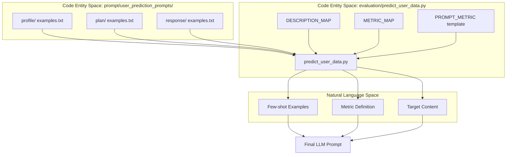
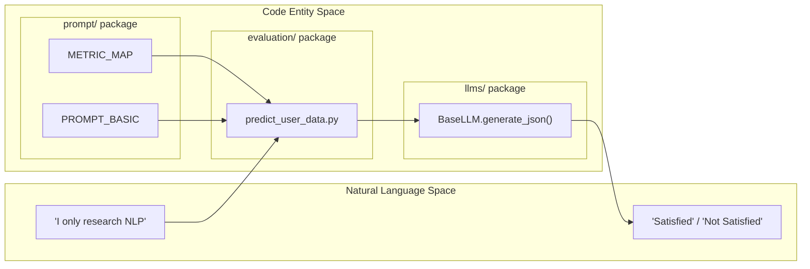

<!-- source: DeepWiki mcp.deepwiki.com · repo allenai/personalized-scholarqa-eval · page 4.2 User Prediction Prompts (Simulation) · fetched 2026-10-26 -->

# User Prediction Prompts (Simulation)

Relevant source files

The following files were used as context for generating this wiki page:

- [README.md](README.md)
- [__init__.py](__init__.py)

The `prompt/user_prediction_prompts/` directory contains the templates and few-shot examples required for the **Simulation Evaluation** pipeline. This branch of the evaluation framework aims to predict whether a specific user preference or metric is satisfied by a generated output, effectively using an LLM to simulate real user data derived from qualitative interviews [README.md:11-12]().

### Overview of the Simulation Prompt System

The simulation evaluation is organized into three distinct subdirectories, each corresponding to a specific evaluation split. These subdirectories contain `.txt` files that serve as few-shot examples for the LLM judge.

| Subdirectory | Purpose |
| :--- | :--- |
| `plan/` | Prompts for evaluating generated research plans. |
| `profile/` | Prompts for evaluating generated user constitutions/profiles. |
| `response/` | Prompts for evaluating the final personalized research response. |

Sources: [README.md:155-155]()

### Core Prompt Components

The simulation logic relies on several mapping dictionaries and template strings to construct the final prompt sent to the LLM. These components bridge the gap between abstract metric codes and natural language instructions.

#### 1. Metric and Description Mappings
The system uses `DESCRIPTION_MAP` and `METRIC_MAP` to translate internal metric identifiers into human-readable definitions for the LLM.

*   **`DESCRIPTION_MAP`**: Maps a split name (profile, plan, response) to a high-level description of what the LLM is evaluating.
*   **`METRIC_MAP`**: Maps specific error/quality codes to their definitions. Examples include:
    *   `KEYWORD`: Checks for the presence of specific researcher keywords.
    *   `OVERGENERAL`: Detects if the profile is too broad.
    *   `NEGATION`: Checks if the model ignored a negative constraint.
    *   `OFFTOPIC`: Identifies content irrelevant to the user's actual research area.

#### 2. Prompt Templates
The simulation utilizes three primary template types:

*   **`PROMPT_BASIC`**: The standard prompt structure that includes the task description, the content to be evaluated, and the specific metric to check.
*   **`PROMPT_METRIC`**: An augmented version of the basic prompt that includes detailed definitions of the metric being tested to improve judge accuracy.
*   **`JSON_PROMPT`**: A wrapper used when `generate_json` is called, ensuring the LLM returns a structured object (e.g., `{"is_satisfied": boolean}`).

### Data Flow: From Files to LLM Input

The following diagram illustrates how the `DatasetLoader` and the prompt directory contents are combined to create the simulation input.

**Simulation Prompt Construction Flow**

Sources: [README.md:134-141](), [README.md:149-149](), [README.md:155-155]()

### Implementation Details

The simulation evaluation is orchestrated by `evaluation/predict_user_data.py`. It follows a structured pipeline to generate predictions for the `qualitative_coding_data` corpus.

#### Key Functions and Logic
1.  **Data Loading**: The pipeline calls `DatasetLoader.load_simulation_data()` to retrieve the qualitative interview-derived dataset [README.md:134-141]().
2.  **Prompt Assembly**: For each example in the dataset, the script:
    *   Identifies the split (profile, plan, or response).
    *   Retrieves the corresponding few-shot examples from the `.txt` files in `prompt/user_prediction_prompts/`.
    *   Injects the `METRIC_MAP` definition into the `PROMPT_METRIC` string.
3.  **Execution**: The assembled prompt is passed to the `llms/` abstraction layer (typically using `generate_json` to ensure a boolean `is_satisfied` field is returned).
4.  **Persistence**: Results are written to a JSONL file, which is later processed by `metric_scores/simulation_plot.py` to generate accuracy visualizations [README.md:134-141]().

### Metric Codes and Definitions
The following table describes the primary metrics used within the simulation prompts to evaluate LLM performance against real user expectations:

| Metric Code | Logic in Prompt |
| :--- | :--- |
| `KEYWORD` | Does the text contain specific technical keywords identified by the user? |
| `OVERGENERAL` | Is the generated profile or plan too generic to be useful for a specialist? |
| `NARROW` | Is the scope of the generation too restricted compared to the user's breadth? |
| `STYLE` | Does the writing style (tone, formatting) match the user's requirements? |
| `UNINFORMATIVE` | Does the output lack substantive content or provide "fluff"? |

**System Component Mapping**

Sources: [README.md:149-159](), [README.md:134-141]()

---

