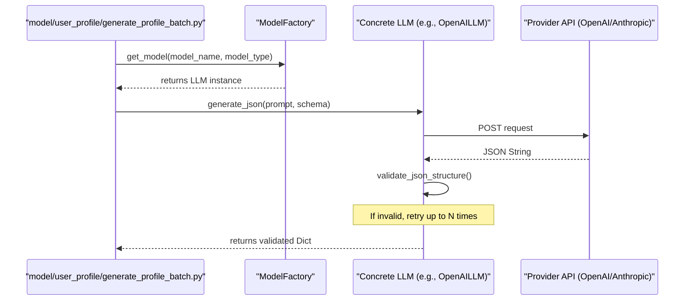

<!-- source: DeepWiki mcp.deepwiki.com · repo allenai/personalized-scholarqa-eval · page 5 LLM Abstraction Layer · fetched 2026-10-26 -->

# LLM Abstraction Layer

<details>
<summary>Relevant source files</summary>

The following files were used as context for generating this wiki page:

- [README.md](README.md)
- [__init__.py](__init__.py)

</details>


The `llms/` package provides a unified interface for interacting with various Large Language Model (LLM) providers. It abstracts away provider-specific API details, offering a consistent API for text generation, JSON generation with schema validation, and retrieval tasks. This layer is central to the framework, powering profile generation, plan generation, and the LLM-as-a-judge evaluation pipelines.

### System Architecture

The abstraction layer is built around an Abstract Base Class (ABC) that defines the interface for all models, a factory for instantiation, and concrete implementations for major providers.

**LLM Abstraction Logic Flow**
```mermaid
graph TD
    subgraph "Code Entity Space"
        MF["ModelFactory.get_model()"]
        ABC["LLM (Abstract Base Class)"]
        GPT["OpenAILLM"]
        CLD["AnthropicLLM"]
        GEM["GeminiLLM"]
        LIT["LiteLLM"]
        
        MF -->|instantiates| ABC
        ABC <|-- GPT
        ABC <|-- CLD
        ABC <|-- GEM
        ABC <|-- LIT
    end

    subgraph "Natural Language Space"
        PR["Prompt String"]
        CF["JSON Schema / Config"]
        RESP["Generated Text / JSON"]
    end

    PR --> MF
    CF --> MF
    MF --> RESP
```
**Sources:** [llms/base.py:25-27](), [llms/model_factory.py:16-37]()

---

### Core Components

#### The LLM Base Class
The `LLM` class in `llms/base.py` is the foundation of the abstraction layer. It defines the core lifecycle of an LLM request, including:
*   **`generate_text`**: The primary method for standard text completion.
*   **`generate_json`**: A specialized method that includes retry logic and validation to ensure the LLM output conforms to a specific JSON structure.
*   **Retry Logic**: The base class handles malformed JSON by re-prompting the model, ensuring robustness in automated pipelines.

For details, see [LLM Base Classes and ModelFactory](#5.1).

#### ModelFactory and Configuration
The `ModelFactory` acts as the entry point for the rest of the codebase. It uses the `ModelType` enum to map string identifiers (e.g., "gpt-4o", "claude-3-5-sonnet") to their respective concrete implementations. It also handles the wiring of environment variables (like `OPEN_AI_TOKEN` or `ANTHROPIC_TOKEN`) into the model constructors.

For details, see [LLM Base Classes and ModelFactory](#5.1).

#### Provider Implementations
The framework includes built-in support for four major provider paths:
*   **OpenAI**: Implementation in `llms/gpt.py` using the `openai` library.
*   **Anthropic**: Implementation in `llms/claude.py` using the `anthropic` library.
*   **Gemini**: Implementation in `llms/gemini.py` using the `google-generativeai` library.
*   **LiteLLM**: A pass-through implementation in `llms/litellm.py` that allows the framework to support any model compatible with the LiteLLM proxy.

For details, see [Provider Implementations](#5.2).

---

### Interaction with the Generation Pipeline

The LLM layer is utilized by the generation scripts to transform paper data into structured user profiles and plans. The following diagram illustrates how the `model/` package interacts with the `llms/` abstraction.

**LLM Usage in Generation**

**Sources:** [llms/base.py:45-78](), [llms/model_factory.py:16-37](), [README.md:109-114]()

---

### Child Pages

| Page | Description |
|------|-------------|
| [LLM Base Classes and ModelFactory](#5.1) | Deep dive into `llms/base.py` (LLM ABC, `validate_json_structure`, `generate_json` retry loop, `RetrieverResult`, `Retriever` ABC) and `llms/model_factory.py` (`ModelFactory.get_model`, `ModelType` enum, environment variable wiring). |
| [Provider Implementations](#5.2) | Detailed documentation of concrete provider wrappers: `llms/gpt.py` (`OpenAILLM`), `llms/claude.py` (`Anthropic`), `llms/gemini.py` (`Gemini`), and `llms/litellm.py` (`LiteLLM`). |

**Sources:** [README.md:149-150](), [llms/base.py:1-100](), [llms/model_factory.py:1-40]()

---

