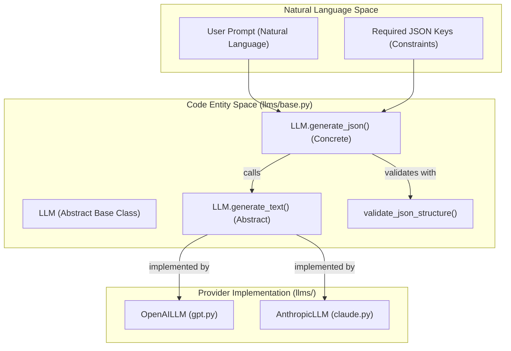
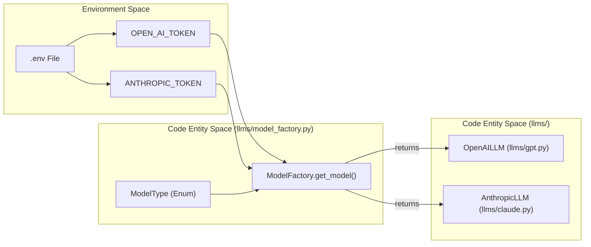

<!-- source: DeepWiki mcp.deepwiki.com · repo allenai/personalized-scholarqa-eval · page 5.1 LLM Base Classes and ModelFactory · fetched 2026-10-26 -->

# LLM Base Classes and ModelFactory

<details>
<summary>Relevant source files</summary>

The following files were used as context for generating this wiki page:

- [README.md](README.md)
- [__init__.py](__init__.py)

</details>


This page provides a deep dive into the foundational abstraction layer for Large Language Models (LLMs) and retrieval systems within the Personalized ScholarQA evaluation framework. The codebase uses a provider-agnostic approach to interface with various model families (OpenAI, Anthropic, Gemini, LiteLLM) while enforcing structured JSON outputs and robust retry mechanisms.

## Overview of llms/base.py

The `llms/base.py` file defines the core interfaces and utility functions that ensure consistency across different LLM providers. It handles the complexity of JSON validation, retry logic, and defines the contract for retrieval-augmented generation.

### Core Data Structures and Interfaces

The system defines two primary abstract base classes (ABCs) and a data structure for retrieval results.

| Class / Type | Role |
| :--- | :--- |
| `LLM` | Abstract base class for all text and JSON generation models [llms/base.py:11-37](). |
| `RetrieverResult` | A `NamedTuple` containing a `text` snippet and its `source` metadata [llms/base.py:8-9](). |
| `Retriever` | Abstract base class for document retrieval systems [llms/base.py:89-93](). |

### The LLM Abstract Base Class

The `LLM` class requires subclasses to implement a `generate_text` method. It provides a built-in `generate_json` method that wraps text generation with validation and retry logic.

**Key Methods:**
- `generate_text(prompt: str, ...)`: Abstract method to be implemented by providers (e.g., `OpenAILLM`, `AnthropicLLM`) [llms/base.py:16-17]().
- `generate_json(prompt: str, ...)`: Orchestrates the generation of structured data. It utilizes a loop to retry up to 5 times if the LLM output fails to parse as valid JSON or does not match the expected keys [llms/base.py:19-37]().

### JSON Validation and Retry Loop

The `validate_json_structure` function is a critical utility used by `generate_json` to ensure the model adheres to the requested schema. It checks if the parsed JSON is a dictionary and contains all required keys [llms/base.py:75-86]().

**Implementation Logic:**
1. **Initial Attempt**: `generate_json` calls `generate_text` with the provided prompt [llms/base.py:25]().
2. **Parsing**: It attempts to extract JSON from the string using `json.loads` [llms/base.py:27]().
3. **Validation**: It calls `validate_json_structure` [llms/base.py:28]().
4. **Retry**: If validation fails or an exception occurs, it logs the error and retries until `max_retries` (default 5) is reached [llms/base.py:31-37]().

**Sources:**
- `llms/base.py:8-37` (LLM ABC and RetrieverResult)
- `llms/base.py:75-86` (validate_json_structure)
- `llms/base.py:89-93` (Retriever ABC)

---

## ModelFactory and Environment Wiring

The `ModelFactory` serves as the central entry point for instantiating LLM wrappers. It maps string identifiers to specific provider implementations and handles the injection of API tokens from environment variables.

### ModelType Enumeration

The `ModelType` enum defines the supported provider categories:
- `OPENAI`
- `ANTHROPIC`
- `GEMINI`
- `LITELLM`
[llms/model_factory.py:11-15]()

### ModelFactory.get_model

The `get_model` static method acts as a dispatcher. It reads the `.env` configuration (via `os.getenv`) to retrieve the necessary API tokens for the requested `ModelType`.

| ModelType | Wrapper Class | Environment Variable |
| :--- | :--- | :--- |
| `OPENAI` | `OpenAILLM` | `OPEN_AI_TOKEN` |
| `ANTHROPIC` | `AnthropicLLM` | `ANTHROPIC_TOKEN` |
| `GEMINI` | `GeminiLLM` | `GEMINI_TOKEN` |
| `LITELLM` | `LiteLLM` | N/A (Internal routing) |

**Sources:**
- `llms/model_factory.py:11-15` (ModelType Enum)
- `llms/model_factory.py:18-42` (ModelFactory implementation)

---

## Technical Diagrams

### Natural Language to Code Entity Space: LLM Generation

This diagram bridges the conceptual "Prompting" space to the specific code entities responsible for text and JSON generation.


**Sources:**
- `llms/base.py:11-37`
- `llms/base.py:75-86`

### Model Instantiation Data Flow

This diagram illustrates how the `ModelFactory` bridges environment configuration to the initialization of concrete model wrappers.


**Sources:**
- `llms/model_factory.py:11-42`
- `llms/gpt.py`
- `llms/claude.py`

---

## Detailed Logic: generate_json Retry Loop

The `generate_json` method in `llms/base.py` implements a specific recovery flow for non-deterministic LLM outputs:

1. **Attempt Execution**: A `for` loop runs from `0` to `max_retries` [llms/base.py:24]().
2. **Text Generation**: The `generate_text` method of the concrete subclass is called [llms/base.py:25]().
3. **Cleaning**: The implementation assumes the LLM might return Markdown blocks. It attempts to strip ` ```json ` and ` ``` ` markers if the raw string isn't valid JSON [llms/base.py:27]().
4. **Validation Check**:
   - If `required_keys` is provided, `validate_json_structure` checks for their existence [llms/base.py:28]().
   - If valid, the dictionary is returned immediately [llms/base.py:29]().
5. **Error Handling**: Any `Exception` (Parsing error, Key error, etc.) is caught. The error is printed, and the loop continues to the next attempt [llms/base.py:31-35]().
6. **Failure**: If all retries are exhausted, the method returns an empty dictionary `{}` [llms/base.py:37]().

**Sources:**
- `llms/base.py:19-37` (generate_json logic)

---

