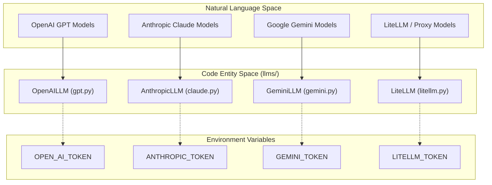
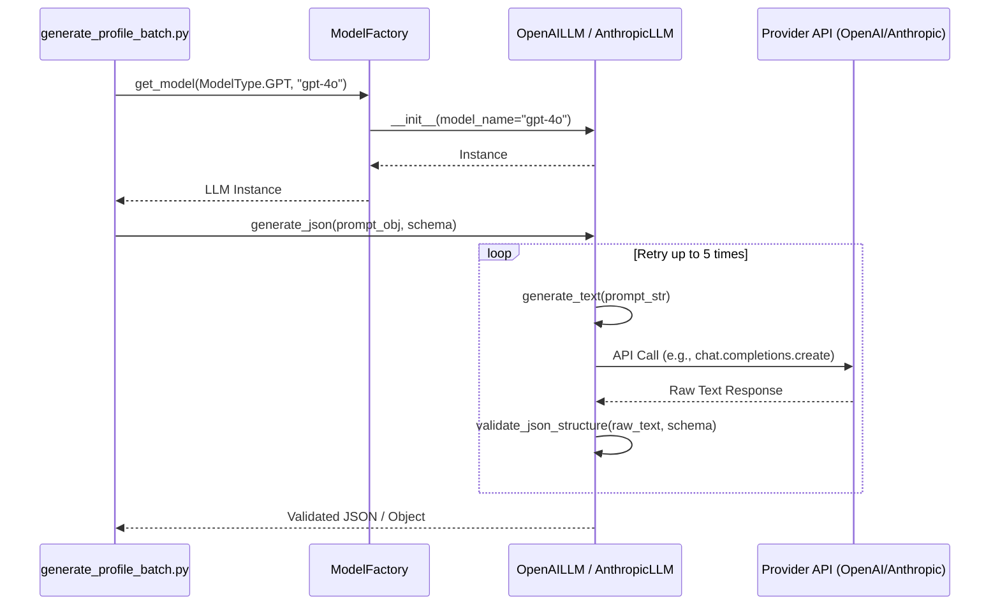

<!-- source: DeepWiki mcp.deepwiki.com · repo allenai/personalized-scholarqa-eval · page 5.2 Provider Implementations · fetched 2026-10-26 -->

# Provider Implementations

Relevant source files

The following files were used as context for generating this wiki page:

- [README.md](README.md)
- [__init__.py](__init__.py)

The `llms/` package provides a unified interface for interacting with various Large Language Model (LLM) providers. This section covers the concrete implementations for OpenAI, Anthropic, Google Gemini, and the LiteLLM proxy. Each provider implementation inherits from the abstract `LLM` base class and handles specific API requirements, authentication, and error handling.

## Provider Architecture

The system uses a factory pattern to instantiate the appropriate provider wrapper based on the `ModelType` enum. Each concrete class implements `generate_text` to handle raw string output and inherits `generate_json` (with its associated retry and validation logic) from the base class.

### Natural Language to Code Entity Mapping

The following diagram bridges the conceptual provider types to their specific code implementations and the environment variables required to authenticate them.

**Provider Implementation Mapping**

**Sources:** [llms/gpt.py:1-10](), [llms/claude.py:1-10](), [llms/gemini.py:1-10](), [llms/litellm.py:1-10](), [llms/model_factory.py:12-40]()

---

## Concrete Implementations

### OpenAI (OpenAILLM)
The `OpenAILLM` class wraps the official `openai` Python SDK. It is primarily used for GPT-4o and GPT-4o-mini models.

*   **File:** `llms/gpt.py`
*   **Constructor Parameters:** `model_name` (e.g., "gpt-4o"), `system_prompt` (optional).
*   **Authentication:** Requires `OPEN_AI_TOKEN` in the environment [llms/model_factory.py:23-25]().
*   **Implementation Details:** 
    *   Initializes an `OpenAI` client using the token retrieved from environment variables [llms/gpt.py:14-18]().
    *   The `generate_text` method calls `client.chat.completions.create` with a default `max_tokens` of 4096 [llms/gpt.py:27-38]().

### Anthropic (AnthropicLLM)
The `AnthropicLLM` class wraps the `anthropic` SDK, supporting the Claude 3 family (Opus, Sonnet, Haiku).

*   **File:** `llms/claude.py`
*   **Constructor Parameters:** `model_name` (e.g., "claude-3-5-sonnet-20240620"), `system_prompt` (optional).
*   **Authentication:** Requires `ANTHROPIC_TOKEN` [llms/model_factory.py:27-29]().
*   **Implementation Details:**
    *   Initializes the `Anthropic` client [llms/claude.py:14-18]().
    *   Note: Anthropic requires the `system` parameter to be passed separately from the `messages` list in the `messages.create` call [llms/claude.py:30-40]().

### Google Gemini (GeminiLLM)
The `GeminiLLM` class wraps the `google-generativeai` SDK.

*   **File:** `llms/gemini.py`
*   **Constructor Parameters:** `model_name` (e.g., "gemini-1.5-pro"), `system_prompt` (optional).
*   **Authentication:** Requires `GEMINI_TOKEN` [llms/model_factory.py:31-33]().
*   **Implementation Details:**
    *   Configures the global `genai` object with the API key [llms/gemini.py:15-16]().
    *   Instantiates `GenerativeModel` with the provided `system_instruction` [llms/gemini.py:17-20]().
    *   Uses `model.generate_content` for text generation [llms/gemini.py:28-32]().

### LiteLLM (LiteLLM)
The `LiteLLM` class provides a standardized interface for various models (including local models or smaller providers) via the `litellm` library.

*   **File:** `llms/litellm.py`
*   **Constructor Parameters:** `model_name`, `system_prompt` (optional).
*   **Authentication:** Requires `LITELLM_TOKEN` [llms/model_factory.py:35-37]().
*   **Implementation Details:**
    *   Uses `litellm.completion` to route requests [llms/litellm.py:26-37]().
    *   This wrapper is particularly useful for testing against multiple providers with a single API key or using proxy servers.

**Sources:** [llms/gpt.py:1-40](), [llms/claude.py:1-42](), [llms/gemini.py:1-34](), [llms/litellm.py:1-39]()

---

## Data Flow: Generation Request

The following sequence diagram illustrates how a request flows from a generation script through the `ModelFactory` to a specific provider implementation.

**LLM Provider Execution Flow**

**Sources:** [llms/base.py:55-85](), [llms/model_factory.py:12-40](), [model/user_profile/generate_profile_batch.py:80-95]()

---

## Provider-Specific Quirks

| Provider | System Prompt Handling | Default Max Tokens | Key Implementation Class |
| :--- | :--- | :--- | :--- |
| **OpenAI** | Included in `messages` as `{"role": "system"}` | 4096 | `OpenAILLM` |
| **Anthropic** | Passed as a top-level `system` argument to `messages.create` | 4096 | `AnthropicLLM` |
| **Gemini** | Passed as `system_instruction` during `GenerativeModel` init | Not explicitly capped in wrapper | `GeminiLLM` |
| **LiteLLM** | Handled internally by `litellm.completion` | 4096 | `LiteLLM` |

**Sources:** [llms/gpt.py:30-35](), [llms/claude.py:30-40](), [llms/gemini.py:17-20](), [llms/litellm.py:26-37]()

---

