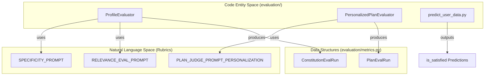
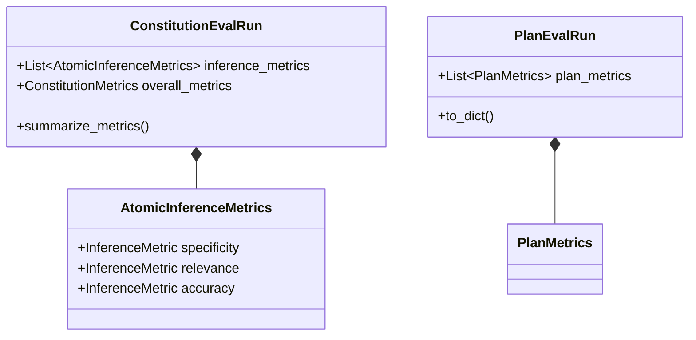

<!-- source: DeepWiki mcp.deepwiki.com · repo allenai/personalized-scholarqa-eval · page 6 Evaluation Framework · fetched 2026-10-26 -->

# Evaluation Framework

Relevant source files

The following files were used as context for generating this wiki page:

- [README.md](README.md)
- [__init__.py](__init__.py)

The `evaluation/` package provides a multi-faceted framework for assessing the quality and personalization of deep research systems. It is designed to validate the two-stage pipeline: the inference of user profiles (constitutions) and the generation of personalized research plans. The framework uses LLM-as-a-judge rubrics and simulation logic to compare generated outputs against ground truth data and user preferences.

### Core Evaluation Components

The framework is divided into three primary evaluation tracks, each handled by specific classes and scripts within the `evaluation/` directory [README.md:149-149]().

| Component | Target Entity | Key Metrics |
| :--- | :--- | :--- |
| **Profile Evaluation** | `UserConstitution` | Specificity, Relevance, Accuracy, Categorization, Coverage |
| **Plan Evaluation** | `Plan` / `QueryPlans` | Personalization Alignment, Query Relevance, Category Fit |
| **Simulation** | Qualitative Data | User Preference Prediction (Satisfied/Not Satisfied) |

### High-Level Evaluation Architecture

The following diagram illustrates how the evaluation entities in the code interact with the Natural Language rubrics and the generation pipeline.

**Evaluation Pipeline Overview**

Sources: [README.md:15-23](), [evaluation/metrics.py:1-50]()

---

### [Profile Evaluation](#6.1)

The `ProfileEvaluator` class is responsible for assessing `UserConstitution` objects inferred from researcher papers. It measures how well the system captured a researcher's knowledge, style, and positions. It executes a series of batch scoring methods, including `score_specificity_batch` and `score_accuracy_batch`, using predefined rubrics like `SPECIFICITY_PROMPT` and `CITATION_EVAL_PROMPT`. The final results are aggregated into a `ConstitutionEvalRun` for persistence.

For details, see [Profile Evaluation](#6.1).

### [Plan Evaluation](#6.2)

The `PersonalizedPlanEvaluator` assesses how well a research `Plan` adapts to a specific user profile compared to a non-personalized baseline. It utilizes an A/B judge pattern with position swapping (`score_comparison_batch_personalization`) to mitigate LLM bias. It also checks for conflicts between the plan and the user's query using the `PLAN_CONTRADICT_QUERY` prompt.

For details, see [Plan Evaluation](#6.2).

### [Simulation Evaluation (User Prediction)](#6.3)

Located in `predict_user_data.py`, this branch of the framework attempts to simulate real-world user preferences derived from qualitative interviews. It uses the `DatasetLoader` to ingest `qualitative_coding_data` and applies few-shot prompts (`PROMPT_BASIC`, `PROMPT_METRIC`) to predict whether a specific system output (profile, plan, or response) would satisfy a user's requirement. It maps results to specific error codes like `OVERGENERAL`, `OFFTOPIC`, or `UNINFORMATIVE`.

For details, see [Simulation Evaluation (User Prediction)](#6.3).

### [Evaluation Metrics Data Structures](#6.4)

All evaluation results are standardized using dataclasses defined in `evaluation/metrics.py`. These structures, such as `InferenceMetric`, `AtomicInferenceMetrics`, and `PlanMetrics`, provide consistent serialization (`to_dict`/`from_dict`) and aggregation logic (`summarize_metrics`). These classes ensure that evaluation runs are easily portable and can be processed by the reporting scripts in `metric_scores/`.

**Metric Entity Relationships**

For details, see [Evaluation Metrics Data Structures](#6.4).

Sources: [evaluation/metrics.py:1-150](), [README.md:149-151]()

---

