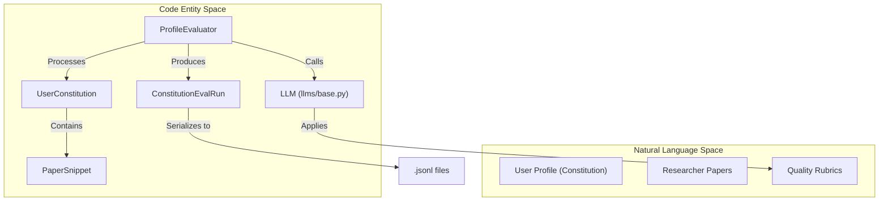
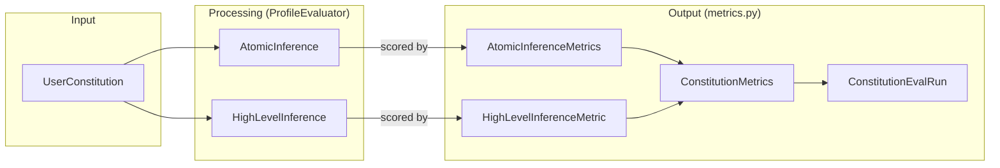

<!-- source: DeepWiki mcp.deepwiki.com · repo allenai/personalized-scholarqa-eval · page 6.1 Profile Evaluation · fetched 2026-10-26 -->

# Profile Evaluation

<details>
<summary>Relevant source files</summary>

The following files were used as context for generating this wiki page:

- [README.md](README.md)
- [__init__.py](__init__.py)
- [data/dataset_loader.py](data/dataset_loader.py)

</details>


The **Profile Evaluation** module provides the technical infrastructure for scoring generated user profiles (also referred to as "constitutions") against a set of qualitative rubrics. It assesses how well a profile captures a researcher's attributes based on their published papers, focusing on specificity, relevance, accuracy, and coverage.

## Overview of ProfileEvaluator

The `ProfileEvaluator` class in `evaluation/eval_profile.py` is the central engine for profile assessment. It uses LLM-as-a-judge prompts to evaluate both `AtomicInference` and `HighLevelInference` objects within a `UserConstitution`.

### Key Evaluation Functions

The evaluator implements several batch processing methods to score different dimensions of a profile:

| Method | Description | Metric Mapping |
|:---|:---|:---|
| `score_specificity_batch` | Measures how detailed and non-generic an inference is. | `specificity` |
| `score_relevance_batch` | Measures how relevant an inference is to the researcher's background. | `relevance` |
| `score_accuracy_batch` | Checks if the inference is supported by the cited paper snippets. | `accuracy` |
| `score_categorization_batch` | Validates if the inference correctly fits its assigned rubric category. | `categorization` |
| `score_prop_covered_batch` | Calculates the proportion of source papers represented in the profile. | `prop_covered` |
| `score_num_covered_batch` | Counts the total number of unique papers cited across all inferences. | `num_covered` |

**Sources:**
- `evaluation/eval_profile.py`: [evaluation/eval_profile.py:34-190]() (Class and method definitions)
- `evaluation/metrics.py`: [evaluation/metrics.py:8-66]() (Metric data structures)

---

## Data Flow and Implementation

The evaluation process follows a structured pipeline where raw `UserConstitution` objects are transformed into `ConstitutionEvalRun` objects containing detailed metrics.

### System Architecture Diagram

This diagram maps the natural language evaluation concepts to the specific code entities responsible for execution.



**Sources:**
- `evaluation/eval_profile.py`: [evaluation/eval_profile.py:192-234]() (evaluate function logic)
- `data/core_data_models.py`: [data/core_data_models.py:202-225]() (UserConstitution structure)

---

## Evaluation Rubrics

The evaluation relies on specific prompt templates defined in `evaluation/eval_profile.py` to guide the LLM judge.

### Rubric Definitions

*   **`SPECIFICITY_PROMPT`**: Asks the judge to rate an inference from 1 (generic/vague) to 5 (highly specific to the author). [evaluation/eval_profile.py:10-14]()
*   **`CITATION_EVAL_PROMPT`**: Used for `score_accuracy_batch`. It provides the LLM with the inference and the corresponding `PaperSnippet` text to determine if the claim is factually supported. [evaluation/eval_profile.py:16-20]()
*   **`RELEVANCE_EVAL_PROMPT`**: Evaluates if the inferred attribute (e.g., a specific research position) is actually relevant to the researcher's domain. [evaluation/eval_profile.py:22-26]()
*   **`CATEGORY_EVAL_PROMPT`**: Validates the `HighLevelInference` against the `CONSTITUTION_DEFINITION_RUBRIC` (e.g., Knowledge, Research Style, Epistemology). [evaluation/eval_profile.py:28-32]()

---

## The `evaluate()` Pipeline

The `evaluate()` function orchestrates the full batch process for a collection of authors.

### Execution Steps

1.  **Initialization**: Loads the `ProfileEvaluator` with a specified `LLM` instance.
2.  **Inference Aggregation**: Flattens all `AtomicInference` and `HighLevelInference` objects from the list of `UserConstitution` inputs.
3.  **Batch Scoring**:
    *   Calls `score_specificity_batch` and `score_relevance_batch` for all inferences. [evaluation/eval_profile.py:206-207]()
    *   Calls `score_accuracy_batch` specifically for `AtomicInference` objects using their `snippets`. [evaluation/eval_profile.py:208-208]()
    *   Calls `score_categorization_batch` for `HighLevelInference` objects. [evaluation/eval_profile.py:209-209]()
4.  **Metric Assembly**: Maps the scores back to individual `InferenceMetric` objects and aggregates them into a `ConstitutionMetrics` container. [evaluation/eval_profile.py:214-230]()
5.  **Persistence**: Wraps the results in a `ConstitutionEvalRun` and saves it to a JSONL file in the output directory. [evaluation/eval_profile.py:231-234]()

### Data Structure Mapping



**Sources:**
- `evaluation/eval_profile.py`: [evaluation/eval_profile.py:192-234]()
- `evaluation/metrics.py`: [evaluation/metrics.py:8-135]()

---

## Usage in Scripts

Profile evaluation is typically invoked via the `scripts/eval_profile.sh` shell script, which calls the `evaluation.eval_profile` module.

```bash
# Example execution from eval_profile.sh
python3 -m evaluation.eval_profile \
    --profile_dir $PROFILE_DIR \
    --input_dir $INPUT_DIR \
    --output_dir $OUTPUT_DIR \
    --model_name $MODEL_NAME \
    --limit $LIMIT
```

This script ensures that the `DatasetLoader` correctly fetches the generated profiles from the `profile_dir` before passing them to the `evaluate()` function.

**Sources:**
- `scripts/eval_profile.sh`: [scripts/eval_profile.sh:1-25]()
- `data/dataset_loader.py`: [data/dataset_loader.py:70-95]() (load_constitution_outputs)

---

