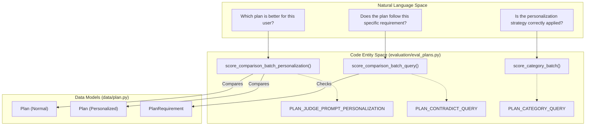
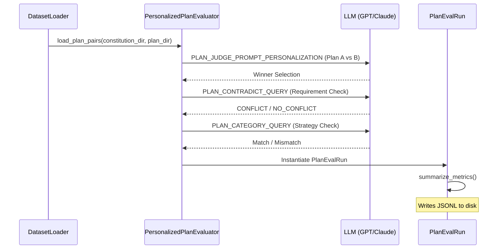

<!-- source: DeepWiki mcp.deepwiki.com · repo allenai/personalized-scholarqa-eval · page 6.2 Plan Evaluation · fetched 2026-10-26 -->

# Plan Evaluation

Relevant source files

The following files were used as context for generating this wiki page:

- [README.md](README.md)
- [__init__.py](__init__.py)
- [data/dataset_loader.py](data/dataset_loader.py)

The **Plan Evaluation** module assesses the quality and personalization alignment of query-specific research plans generated by the system. It employs an LLM-as-a-judge framework to compare personalized plans against generic baselines, verify adherence to specific user profile requirements, and validate the categorization of personalization strategies.

## Overview of PersonalizedPlanEvaluator

The `PersonalizedPlanEvaluator` class in [evaluation/eval_plans.py:17-18]() is the central entity for plan assessment. It utilizes three primary scoring mechanisms to evaluate how well a plan incorporates a `UserConstitution` into a research strategy for a given query.

### Core Evaluation Logic

The evaluation process follows a structured batch processing flow:

1.  **A/B Personalization Comparison**: A head-to-head comparison between a "normal" (generic) plan and a "personalized" plan.
2.  **Requirement Conflict Check**: A per-requirement analysis to see if the plan follows or contradicts specific profile instructions.
3.  **Strategy Category Match**: Verification that the generated plan matches the intended `PersonalizationStrategy`.

### System Architecture: Natural Language to Code Mapping

The following diagram maps the conceptual evaluation requirements to the specific code entities and prompts that implement them.

**Plan Evaluation Mapping**

**Sources:** [evaluation/eval_plans.py:17-158](), [data/plan.py:6-50]()

---

## Scoring Mechanisms

### 1. A/B Judge with Position Swap
The `score_comparison_batch_personalization` method [evaluation/eval_plans.py:38-76]() performs a blind A/B test. To mitigate LLM position bias, it executes two calls per pair, swapping the order of plans.

*   **Prompt**: `PLAN_JUDGE_PROMPT_PERSONALIZATION` [evaluation/eval_plans.py:145-158]().
*   **Input**: User query, user profile, and two candidate plans.
*   **Logic**: It calculates a win rate for the personalized plan. A "win" is recorded if the judge prefers the personalized plan in both positions or indicates no significant difference while favoring it in one.

### 2. Conflict Detection (Query-Level)
The `score_comparison_batch_query` method [evaluation/eval_plans.py:78-120]() iterates through each `PlanRequirement` within a personalized plan. It determines if the plan's actions conflict with the specific profile-derived requirement.

*   **Prompt**: `PLAN_CONTRADICT_QUERY` [evaluation/eval_plans.py:160-170]().
*   **Labels**: `CONFLICT` (plan violates requirement) or `NO_CONFLICT` (plan adheres to or is neutral toward requirement).
*   **Output**: A list of conflict flags corresponding to each requirement in the `Plan` object.

### 3. Strategy Category Validation
The `score_category_batch` method [evaluation/eval_plans.py:122-143]() checks if the LLM-generated plan aligns with the `PersonalizationStrategy` label assigned during generation (e.g., `Specificity`, `Terminology`, `Topic`).

*   **Prompt**: `PLAN_CATEGORY_QUERY` [evaluation/eval_plans.py:172-181]().
*   **Labels**: `Match` or `Mismatch`.

**Sources:** [evaluation/eval_plans.py:38-181]()

---

## Data Flow and Serialization

The evaluation results are encapsulated in the `PlanEvalRun` dataclass [evaluation/metrics.py:84-93](), which stores the raw scores and provides methods for aggregation.

### Evaluation Data Flow

**Sources:** [data/dataset_loader.py:134-153](), [evaluation/eval_plans.py:183-228](), [evaluation/metrics.py:95-125]()

### Result Storage
The `evaluate()` function in [evaluation/eval_plans.py:183-228]() orchestrates the full batch run. It collects `PlanMetrics` for each query and serializes the entire `PlanEvalRun` to a JSONL file. 

The `PlanMetrics` object [evaluation/metrics.py:73-82]() includes:
*   `personalization_score`: Result of the A/B comparison.
*   `requirement_conflict_scores`: List of booleans for each `PlanRequirement`.
*   `category_match_score`: Boolean indicating strategy alignment.

**Sources:** [evaluation/metrics.py:73-93](), [evaluation/eval_plans.py:220-228]()

---

