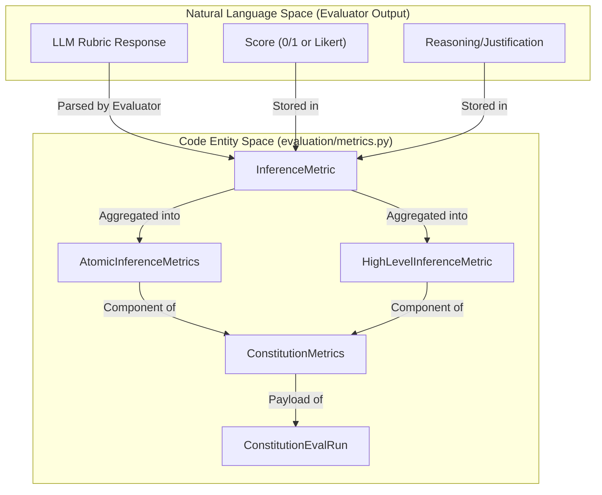
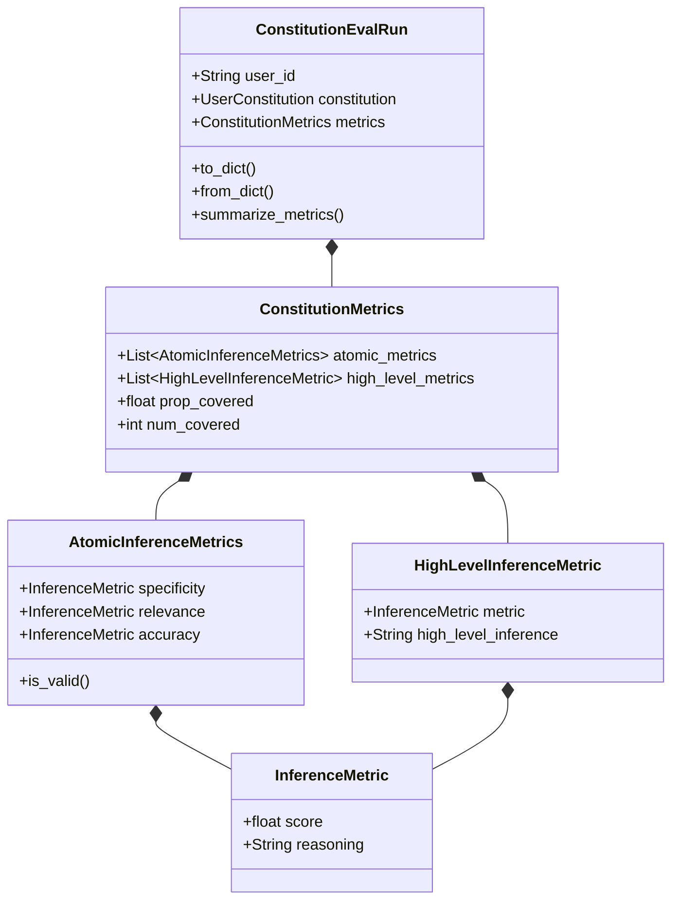

<!-- source: DeepWiki mcp.deepwiki.com · repo allenai/personalized-scholarqa-eval · page 6.4 Evaluation Metrics Data Structures · fetched 2026-10-26 -->

# Evaluation Metrics Data Structures

Relevant source files

The following files were used as context for generating this wiki page:

- [README.md](README.md)
- [__init__.py](__init__.py)

This page provides a technical reference for the dataclasses and utility functions defined in `evaluation/metrics.py`. These structures are used to store, serialize, and aggregate the results of LLM-as-a-judge evaluations for both researcher profiles (constitutions) and personalized research plans.

## Overview of Evaluation Metrics

The evaluation framework relies on structured dataclasses to ensure consistency across different evaluation runs. These classes handle the transition from raw LLM scores to structured metrics that can be persisted as JSON and eventually aggregated into performance reports.

### Metric Hierarchy and Data Flow

The following diagram illustrates how raw evaluation data flows into the metric structures defined in [evaluation/metrics.py]().

**Data Flow: From Evaluator to Metrics**

**Sources:** [evaluation/metrics.py:1-137]()

---

## Constitution Evaluation Structures

These structures represent the metrics for a **User Constitution** (profile), which is composed of atomic inferences (specific claims derived from papers) and high-level inferences (categorical summaries).

### InferenceMetric
The base unit for a single evaluation dimension (e.g., specificity, relevance).
*   **Fields**: `score` (float), `reasoning` (str).
*   **Implementation**: [evaluation/metrics.py:9-16]()

### AtomicInferenceMetrics
Encapsulates all metrics for a single `AtomicInference` object.
*   **Fields**: `specificity`, `relevance`, `accuracy`.
*   **Method `is_valid()`**: Returns `True` if all three metrics have non-null scores [evaluation/metrics.py:27-28]().
*   **Implementation**: [evaluation/metrics.py:19-33]()

### HighLevelInferenceMetric
Encapsulates metrics for a `HighLevelInference` object.
*   **Fields**: `metric` (an `InferenceMetric` representing categorization quality), `high_level_inference` (the original text).
*   **Implementation**: [evaluation/metrics.py:36-46]()

### ConstitutionMetrics
The top-level container for a full profile evaluation.
*   **Fields**: 
    *   `atomic_metrics`: List of `AtomicInferenceMetrics`.
    *   `high_level_metrics`: List of `HighLevelInferenceMetric`.
    *   `prop_covered`: Proportion of source papers covered by the inferences.
    *   `num_covered`: Absolute count of source papers covered.
*   **Implementation**: [evaluation/metrics.py:49-65]()

### ConstitutionEvalRun
The serialization wrapper for a profile evaluation task.
*   **Fields**: `user_id`, `constitution`, `metrics`.
*   **Methods**: Includes `to_dict()` and `from_dict()` for JSONL persistence [evaluation/metrics.py:73-100]().
*   **Summarization**: `summarize_metrics()` computes averages across all atomic and high-level inferences for reporting [evaluation/metrics.py:102-137]().

**Sources:** [evaluation/metrics.py:9-137]()

---

## Plan Evaluation Structures

These structures represent the metrics for a **Personalized Plan**, comparing it against a non-personalized baseline or checking alignment with user requirements.

### PlanMetrics
Stores the comparative and absolute scores for a plan.
*   **Fields**:
    *   `personalization_score`: A binary or Likert score indicating if the personalized plan is better than the baseline.
    *   `personalization_reasoning`: LLM justification for the personalization score.
    *   `query_scores`: A dictionary mapping requirement IDs to boolean scores (Conflict vs. No Conflict).
    *   `query_reasoning`: A dictionary mapping requirement IDs to LLM justifications.
    *   `category_scores`: A dictionary mapping strategy categories to boolean scores.
*   **Implementation**: [evaluation/metrics.py:140-157]()

### PlanEvalRun
The serialization wrapper for a plan evaluation task.
*   **Fields**: `user_id`, `plan_id`, `personalized_plan`, `normal_plan`, `metrics`.
*   **Methods**: Includes `to_dict()` and `from_dict()` for JSONL persistence [evaluation/metrics.py:165-190]().

**Sources:** [evaluation/metrics.py:140-190]()

---

## Key Utility Methods

### Serialization (to_dict / from_dict)
Every major metric class implements `to_dict()` and `from_dict()`. This is critical for the pipeline because:
1.  **Evaluators** (e.g., `ProfileEvaluator`) generate these objects in memory.
2.  **Scripts** (e.g., `eval_profile.sh`) save them to `.jsonl` files.
3.  **Metric Scripts** (e.g., `profile_metrics.py`) load them back to generate tables.

### Metric Aggregation
The `ConstitutionEvalRun.summarize_metrics()` function provides a dictionary of averages:
| Metric | Calculation Logic |
| :--- | :--- |
| `avg_specificity` | Mean of `atomic_metrics.specificity.score` |
| `avg_relevance` | Mean of `atomic_metrics.relevance.score` |
| `avg_accuracy` | Mean of `atomic_metrics.accuracy.score` |
| `avg_categorization` | Mean of `high_level_metrics.metric.score` |

**Sources:** [evaluation/metrics.py:102-137]()

---

## Implementation Diagram: Metric Relationships

This diagram shows the composition of the metrics classes in [evaluation/metrics.py]().

**Class Composition Diagram**

**Sources:** [evaluation/metrics.py:9-137]()

---

