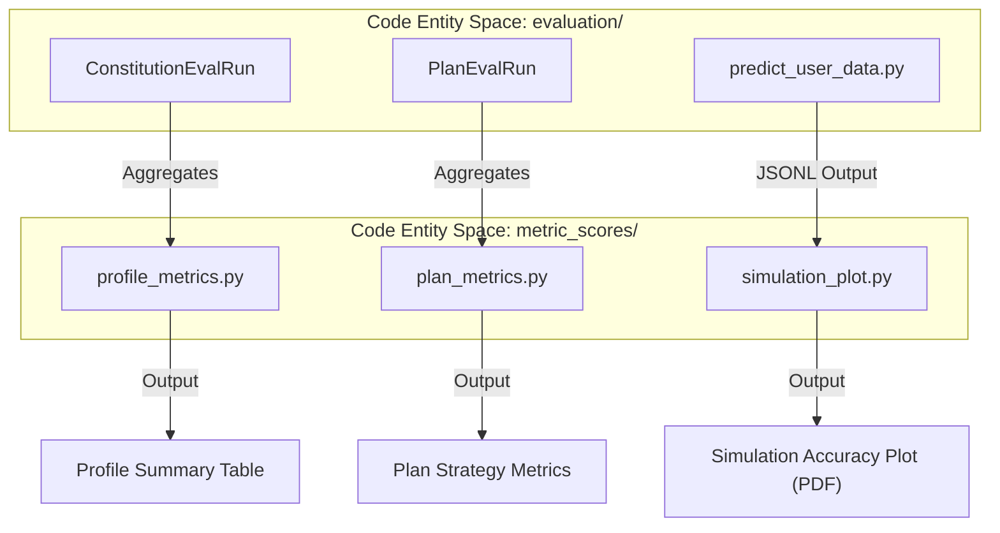
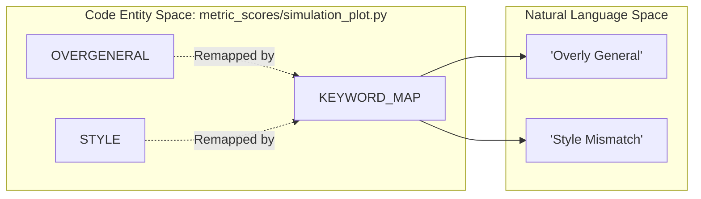

<!-- source: DeepWiki mcp.deepwiki.com · repo allenai/personalized-scholarqa-eval · page 7 Metric Scores and Reporting · fetched 2026-10-26 -->

# Metric Scores and Reporting

Relevant source files

The following files were used as context for generating this wiki page:

- [README.md](README.md)
- [__init__.py](__init__.py)

The `metric_scores/` package provides the final layer of the evaluation pipeline. After the `evaluation/` module produces raw inference-level scores and JSONL logs, the reporting scripts aggregate these results into human-readable summary tables and publication-ready visualizations. This stage transforms individual LLM-as-a-judge outputs into systemic insights regarding model performance across personalization strategies.

### System Flow: From Raw Eval to Reporting

The reporting layer consumes `ConstitutionEvalRun` and `PlanEvalRun` objects (serialized as JSONL) to calculate aggregate statistics such as mean accuracy, specificity, and personalization alignment.

**Metric Reporting Architecture**

Sources: [README.md:149-151](), [README.md:123-141]()

---

### Profile and Plan Metric Summaries

The reporting scripts for profiles and plans focus on model comparison and strategy effectiveness. They are typically invoked via shell scripts after the evaluation phase completes.

*   **Profile Metrics**: Processes `ConstitutionEvalRun` data to generate averages for specificity, relevance, and accuracy. It also calculates the average length of generated inferences to track verbosity. For details, see [Profile and Plan Metric Summaries](#7.1).
*   **Plan Metrics**: Analyzes `PlanEvalRun` results to determine how often a personalized plan was preferred over a generic one. It breaks down performance across different `PersonalizationStrategy` types. For details, see [Profile and Plan Metric Summaries](#7.1).

| Script | Input Class | Primary Output |
| :--- | :--- | :--- |
| `profile_metrics.py` | `ConstitutionEvalRun` | Averages for Specificity, Relevance, Accuracy, and Coverage |
| `plan_metrics.py` | `PlanEvalRun` | Win-rates vs Non-personalized plans per Strategy |

Sources: [README.md:123-132](), [README.md:149-151]()

---

### Simulation Results Plotting

The simulation reporting module, `simulation_plot.py`, is responsible for visualizing the reliability of LLM judges in predicting real user preferences (derived from qualitative coding).

It maps raw metric codes (e.g., `KEYWORD`, `NEGATION`, `STYLE`) to descriptive labels and generates grouped bar charts comparing LLM predictions against ground-truth user data across three splits: **Profile**, **Plan**, and **Response**. For details, see [Simulation Results Plot](#7.2).

**Simulation Data Mapping**

Sources: [README.md:134-141](), [README.md:151-151]()

---

### Child Pages

*   **[Profile and Plan Metric Summaries](#7.1)**: Deep dive into `profile_metrics.py` and `plan_metrics.py`. Covers the `MODELS_TO_EVALUATE` configuration, directory structures, and the logic for calculating `ConstitutionEvalRun.summarize_metrics`.
*   **[Simulation Results Plot](#7.2)**: Detailed breakdown of `simulation_plot.py`. Explains the use of `matplotlib` for rendering, the `KEYWORD_MAP` for label remapping, and how the majority-class baseline is calculated and displayed.

---

