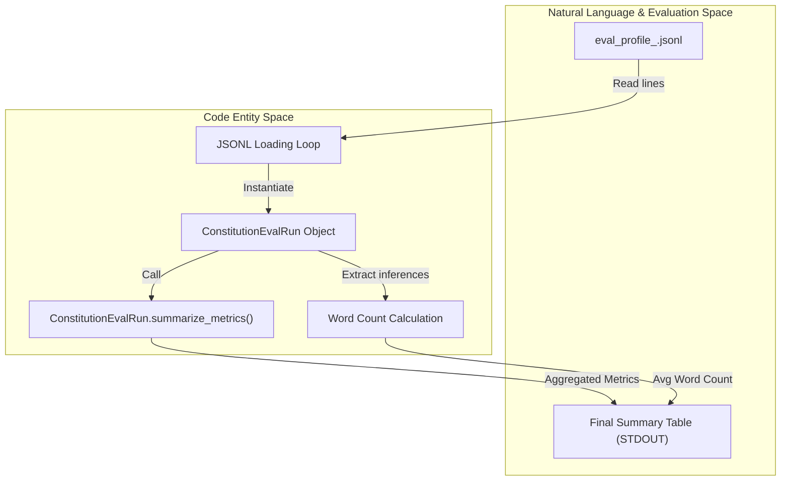
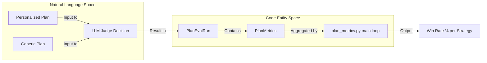

<!-- source: DeepWiki mcp.deepwiki.com · repo allenai/personalized-scholarqa-eval · page 7.1 Profile and Plan Metric Summaries · fetched 2026-10-26 -->

# Profile and Plan Metric Summaries

Relevant source files

The following files were used as context for generating this wiki page:

- [README.md](README.md)
- [__init__.py](__init__.py)

The `metric_scores/` package provides the final aggregation layer for the Personalized ScholarQA evaluation framework. After the `evaluation/` modules generate raw evaluation runs (JSONL files containing scores for individual profiles and plans), the metric scripts process these files to produce human-readable summary tables and comparative statistics across different LLMs and personalization strategies.

## Overview and Configuration

The summarization logic relies on a set of shared constants to identify which models to include in reports and where to locate the raw evaluation data.

### Evaluation Constants
The file `metric_scores/profile_metrics.py` defines the scope of the summary reports:
*   **`MODELS_TO_EVALUATE`**: A list of model identifiers (e.g., `gpt-4o-2024-08-06`, `claude-3-5-sonnet-20240620`) used to filter and organize results in the final tables [metric_scores/profile_metrics.py:10-17]().
*   **Directory Constants**: `EVAL_DIR` and `PLAN_EVAL_DIR` point to the directories containing the JSONL output from the profile and plan evaluators [metric_scores/profile_metrics.py:19-20]().

---
Sources: [metric_scores/profile_metrics.py:10-20]()

## Profile Metric Summarization

The profile summarization process transforms individual `ConstitutionEvalRun` objects into a comparative table focusing on specificity, relevance, accuracy, and citation coverage.

### Implementation Logic
The script `metric_scores/profile_metrics.py` iterates through the models defined in `MODELS_TO_EVALUATE` and performs the following steps:
1.  **Data Loading**: It reads the JSONL file for each model from the `EVAL_DIR` [metric_scores/profile_metrics.py:30-34]().
2.  **Aggregation**: It utilizes the `ConstitutionEvalRun.summarize_metrics` method to aggregate scores across all users in the dataset [metric_scores/profile_metrics.py:36-36]().
3.  **Inference Length**: It calculates the average number of words in the generated profile inferences to provide context for the specificity scores [metric_scores/profile_metrics.py:38-46]().

### The summarize_metrics Method
The `ConstitutionEvalRun.summarize_metrics` function is the core aggregation engine. It computes averages for:
*   **Specificity**: How detailed the inferred preferences are.
*   **Relevance**: How applicable the inferences are to the research domain.
*   **Accuracy**: Correctness relative to the source papers.
*   **Coverage**: The proportion of the user's research history represented in the profile.

### Profile Data Flow
The following diagram illustrates how raw evaluation data is aggregated into the final summary table.

**Diagram: Profile Metric Aggregation Flow**

Sources: [metric_scores/profile_metrics.py:22-54](), [evaluation/metrics.py:145-168]()

---
Sources: [metric_scores/profile_metrics.py:22-54](), [evaluation/metrics.py:145-168]()

## Plan Metric Summarization

Plan metrics focus on the effectiveness of personalization. The script `metric_scores/plan_metrics.py` aggregates `PlanEvalRun` data to determine if personalized plans are significantly better than non-personalized baselines.

### Personalization Strategy Aggregation
The script categorizes plan evaluation results based on the `PersonalizationStrategy` (e.g., `SPECIFIC`, `GENERAL`) and `PersonalizationFramework` used during generation. It specifically calculates the proportion of cases where the LLM-as-a-judge preferred the personalized plan over the generic one.

### Key Metrics Tracked
*   **Personalization Win Rate**: The percentage of times the personalized plan was judged superior [metric_scores/plan_metrics.py:44-51]().
*   **Query Relevance**: Proportion of plans that successfully addressed the user's query requirements [metric_scores/plan_metrics.py:53-56]().
*   **Category Fit**: How well the plan aligned with the intended personalization strategy [metric_scores/plan_metrics.py:58-61]().

### Plan Metric Processing
The script uses a nested dictionary structure to group results by model and strategy before printing a formatted summary.

**Diagram: Plan Personalization Comparison**

Sources: [metric_scores/plan_metrics.py:24-70](), [evaluation/metrics.py:218-245]()

---
Sources: [metric_scores/plan_metrics.py:24-70](), [evaluation/metrics.py:218-245]()

## Summary Tables Format

Both scripts output results to the console in a tabular format. 

### Profile Summary Table Structure
| Model | Specificity | Relevance | Accuracy | Prop. Covered | Avg. Length |
| :--- | :--- | :--- | :--- | :--- | :--- |
| gpt-4o | 0.85 | 0.92 | 0.88 | 0.75 | 45.2 |
| claude-3.5 | 0.82 | 0.90 | 0.86 | 0.72 | 42.1 |

### Plan Summary Table Structure
| Model | Strategy | Personalization Pref % | Query Relevance % | Category Fit % |
| :--- | :--- | :--- | :--- | :--- |
| gpt-4o | SPECIFIC | 72.5% | 95.0% | 88.0% |
| gpt-4o | GENERAL | 65.0% | 94.0% | 90.0% |

---
Sources: [metric_scores/profile_metrics.py:48-54](), [metric_scores/plan_metrics.py:63-70]()

---

