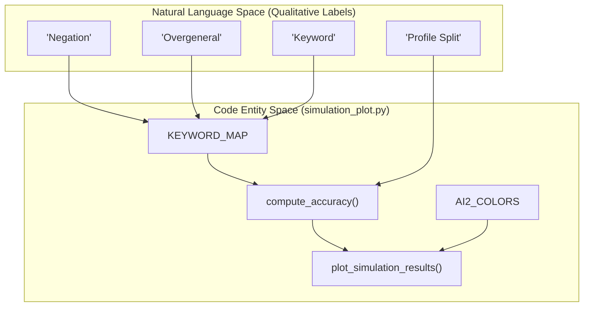
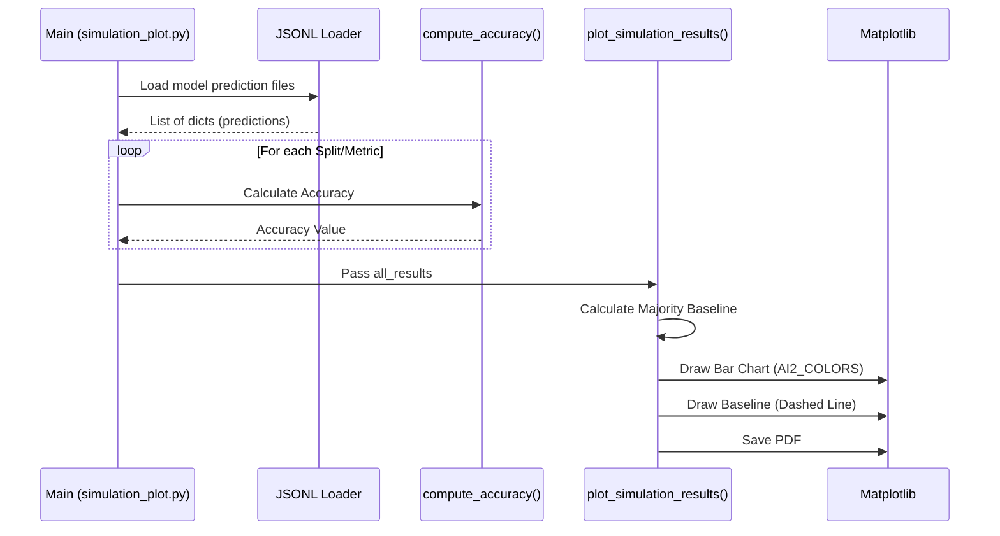

<!-- source: DeepWiki mcp.deepwiki.com · repo allenai/personalized-scholarqa-eval · page 7.2 Simulation Results Plot · fetched 2026-10-26 -->

# Simulation Results Plot

Relevant source files

The following files were used as context for generating this wiki page:

- [README.md](README.md)
- [__init__.py](__init__.py)

The `simulation_plot.py` module is the final stage of the simulation evaluation pipeline. It processes the JSONL output from the user-prediction stage to generate high-quality visualizations of model performance against human qualitative coding data. It specifically computes accuracy across different evaluation splits (Profile, Plan, Response) and specific error metrics (e.g., Negation, Overgeneralization), producing a grouped bar chart formatted for academic publication.

### Purpose and Data Flow

The script serves as a reporting tool to compare how well different LLM judges simulate real user preferences derived from qualitative interviews. It transforms raw prediction files into a structured comparison of accuracy metrics, including a majority-class baseline.

**Data Flow:**
1.  **Input:** Reads `.jsonl` files generated by `evaluation/predict_user_data.py` [evaluation/predict_user_data.py:1-10]().
2.  **Processing:** Filters data by split, remaps internal metric codes to human-readable labels, and calculates the percentage of correct `is_satisfied` predictions.
3.  **Visualization:** Uses `matplotlib` to render a grouped bar chart using the AI2 color palette and exports the result as a PDF.

Sources: [metric_scores/simulation_plot.py:1-20](), [evaluation/predict_user_data.py:1-10]()

### System Entity Mapping

The following diagram illustrates how the simulation plotting logic bridges the "Natural Language Space" (Qualitative Metrics) with the "Code Entity Space" (Data Structures and Plotting Logic).

**Simulation Visualization Mapping**

Sources: [metric_scores/simulation_plot.py:12-25](), [metric_scores/simulation_plot.py:44-80]()

### Implementation Details

#### Metric Label Remapping
The script uses `KEYWORD_MAP` to translate short, technical metric codes used in the simulation pipeline into descriptive labels for the final plot.

| Code | Label (in Plot) |
| :--- | :--- |
| `KEYWORD` | Keyword |
| `OVERGENERAL` | Overgeneral |
| `NEGATION` | Negation |
| `GENERAL` | General |
| `NARROW` | Narrow |
| `OFFTOPIC` | Off-Topic |
| `UNINFORMATIVE` | Uninformative |
| `STYLE` | Style |

Sources: [metric_scores/simulation_plot.py:12-21]()

#### Core Functions

*   **`compute_accuracy(data, split, keyword)`**: Filters the input dataset for a specific `split` (e.g., "profile", "plan", or "response") and a specific `keyword` (metric type). It calculates the accuracy by comparing the LLM's `is_satisfied` prediction against the ground truth from the qualitative coding data [metric_scores/simulation_plot.py:44-59]().
*   **`plot_simulation_results(all_results, output_path)`**: The main rendering function. It iterates through the results for each model, calculates a majority-class baseline (the accuracy achieved by always predicting the most frequent class), and generates a grouped bar chart [metric_scores/simulation_plot.py:62-150]().

#### Visualization Logic
The plot uses the standard AI2 color palette (`#2045F1` for primary, `#A4A9B3` for secondary) to ensure consistency with Allen Institute branding [metric_scores/simulation_plot.py:23-25]().

**Plotting Execution Flow**

Sources: [metric_scores/simulation_plot.py:44-165]()

### Execution via Scripts
The simulation plotting is typically triggered via `scripts/simulation.sh`, which runs the prediction pipeline followed by the plotting script.

**Workflow Orchestration:**
1.  `scripts/simulation.sh` calls `evaluation.predict_user_data` [scripts/simulation.sh:35-43]().
2.  `scripts/simulation.sh` then calls `metric_scores.simulation_plot` to generate the PDF report in the specified output directory [scripts/simulation.sh:45-49]().

Sources: [scripts/simulation.sh:35-49](), [README.md:134-141]()

---

