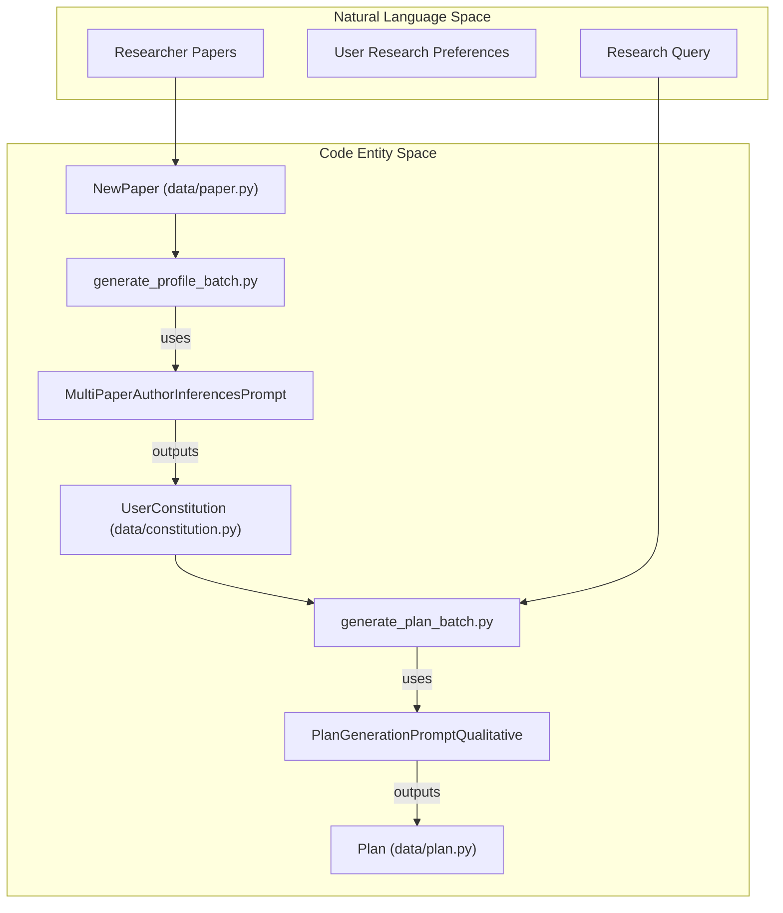
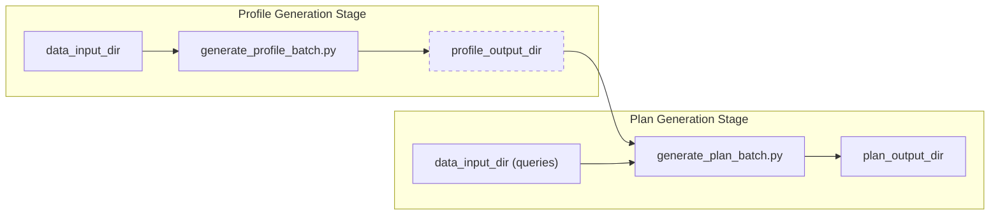

<!-- source: DeepWiki mcp.deepwiki.com · repo allenai/personalized-scholarqa-eval · page 8.1 Generation Scripts · fetched 2026-10-26 -->

# Generation Scripts

Relevant source files

The following files were used as context for generating this wiki page:

- [README.md](README.md)
- [data/dataset_loader.py](data/dataset_loader.py)

The generation pipeline is the primary entry point for creating the synthetic researcher profiles (constitutions) and personalized research plans used in the MyScholarQA evaluation framework. This process is orchestrated by `scripts/generate.sh`, which chains two distinct Python modules to transform raw paper data into structured, personalized research instructions.

## Overview of `scripts/generate.sh`

The `scripts/generate.sh` script provides a unified interface for the two-stage generation pipeline. It handles environment setup, parameter passing, and the sequential execution of profile inference followed by plan generation.

### Key Parameters and Flags

The script utilizes several variables to control the data flow and model behavior:

| Parameter | Description |
|:---|:---|
| `model_name` | The specific model identifier (e.g., `gpt-4o`, `claude-3-5-sonnet-20240620`) used for both stages. |
| `model_type` | The provider type (e.g., `openai`, `anthropic`, `gemini`, `litellm`) which determines the class instantiated by `ModelFactory` [llms/model_factory.py:12-29](). |
| `paper_dir` | Path to the directory containing preprocessed `NewPaper` JSON objects [README.md:63-74](). |
| `data_input_dir` | The Hugging Face dataset directory containing simulated profile inputs (queries and author metadata) [README.md:88-92](). |
| `profile_output_dir` | Directory where generated `UserConstitution` JSON files are stored. |
| `plan_output_dir` | Directory where generated `Plan` JSON files (both normal and personalized) are stored. |
| `num_inferences` | The number of atomic inferences to generate per constitution category [model/user_profile/generate_profile_batch.py:28-29](). |
| `num_actions` | The number of plan requirements (actions) to generate per plan [model/plan/generate_plan_batch.py:30-31](). |
| `limit` | An optional flag to restrict the number of examples processed for testing purposes. |

Sources: [scripts/generate.sh](), [README.md:100-114]()

---

## Pipeline Data Flow

The generation workflow operates in two phases. First, it analyzes a researcher's publication history to build a "Constitution." Second, it uses that Constitution to personalize a research plan for a specific query.

### Stage 1: User Profile Generation
The script calls `model.user_profile.generate_profile_batch`. This module uses the `DatasetLoader` to fetch paper collections and author IDs [data/dataset_loader.py:48-63](). It then retrieves full paper metadata from the `paper_dir` to populate `NewPaper` objects.

The LLM is prompted via `MultiPaperAuthorInferencesPromptThirdParty` to generate `AtomicInference` and `HighLevelInference` objects across categories like knowledge, research style, and writing style [prompt/template.py:12-25](). These are serialized into a `UserConstitution` and saved to `profile_output_dir`.

### Stage 2: Plan Generation
The script calls `model.plan.generate_plan_batch`. This stage reads the previously generated profiles from `profile_output_dir` [data/dataset_loader.py:104-124](). For each query, it generates two plans:
1.  **Normal Plan**: A generic plan generated without user context.
2.  **Personalized Plan**: A plan conditioned on the `UserConstitution`.

The output consists of `Plan` objects containing specific `PlanRequirement` items, saved to `plan_output_dir`.

### System Entity Mapping

The following diagram maps the conceptual generation stages to the specific code entities and data structures involved.

**Generation Pipeline Logic Flow**

Sources: [model/user_profile/generate_profile_batch.py:1-50](), [model/plan/generate_plan_batch.py:1-60](), [data/dataset_loader.py:48-124]()

---

## Script Implementation Detail

The `scripts/generate.sh` script chains these processes by passing the output directory of the first command as an input directory for the second.

**Data Chaining in scripts/generate.sh**

### Profile Generation Logic
`generate_profile_batch.py` implements a retry loop and JSON validation logic to ensure the LLM output conforms to the `UserConstitution` schema. It utilizes the `LLM.generate_json` method [llms/base.py:56-94]() which handles the `AtomicInference` structure.

### Plan Generation Logic
`generate_plan_batch.py` orchestrates the creation of plan pairs. It specifically uses the `DatasetLoader.load_plan_inputs` method [data/dataset_loader.py:104-124]() to align queries with their corresponding generated profiles using `user_id` keys.

Sources: [scripts/generate.sh](), [model/user_profile/generate_profile_batch.py:20-80](), [model/plan/generate_plan_batch.py:20-90](), [data/dataset_loader.py:104-124]()

---

