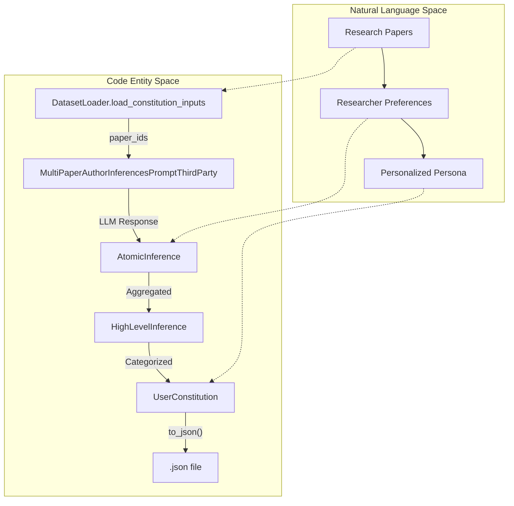
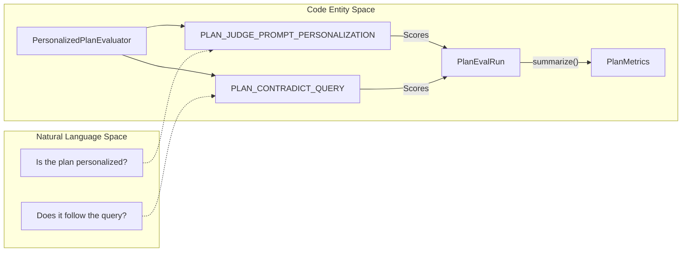

<!-- source: DeepWiki mcp.deepwiki.com · repo allenai/personalized-scholarqa-eval · page 9 Glossary · fetched 2026-10-26 -->

# Glossary

Relevant source files

The following files were used as context for generating this wiki page:

- [README.md](README.md)
- [data/__init__.py](data/__init__.py)
- [data/dataset_loader.py](data/dataset_loader.py)
- [data/local_datasets/qualitative_coding_data/all_text/dataset_dict.json](data/local_datasets/qualitative_coding_data/all_text/dataset_dict.json)
- [data/local_datasets/qualitative_coding_data/all_text/train/cache-00db1cfd048ad1d3.arrow](data/local_datasets/qualitative_coding_data/all_text/train/cache-00db1cfd048ad1d3.arrow)

This page provides definitions and technical context for codebase-specific terms, abbreviations, and domain concepts used in the Personalized ScholarQA Evaluation framework. It serves as a reference for onboarding engineers to understand how academic research personalization is modeled in code.

## Core Concepts

### User Constitution (Profile)
A **User Constitution** is a structured representation of a researcher's preferences, inferred from their publication history. It is used interchangeably with the term **Profile** in the codebase.
*   **Implementation**: Defined by the `UserConstitution` class [[data/profile_data.py:127-130]]().
*   **Structure**: It consists of a collection of `AtomicInference` and `HighLevelInference` objects, categorized by a `CONSTITUTION_DEFINITION_RUBRIC` [[model/user_profile/generate_profile_batch.py:20-33]]().
*   **Data Flow**: Generated in `model.user_profile.generate_profile_batch` [[model/user_profile/generate_profile_batch.py:108-154]]() and stored as JSON.

### Plan (Action)
A **Plan** is a sequence of research steps (search, organization, generation) generated in response to a user query. It is often referred to as an **Action** in the documentation and internal scripts.
*   **Implementation**: Defined by the `Plan` class [[data/plan_data.py:22-25]]().
*   **Personalization**: A plan is considered "personalized" if it is conditioned on a `UserConstitution` to satisfy specific `PlanRequirement` items [[data/plan_data.py:7-14]]().
*   **Data Flow**: Generated in `model.plan.generate_plan_batch` [[model/plan.generate_plan_batch.py:84-142]]().

### Inference Hierarchy
The system breaks down a user's research persona into two levels of abstraction:
1.  **Atomic Inference**: A low-level observation derived from a specific paper snippet, including a citation to the source paper [[data/profile_data.py:7-12]]().
2.  **High-Level Inference**: A synthesized summary that aggregates multiple atomic inferences into a broader researcher preference (e.g., "Prefers Bayesian methods") [[data/profile_data.py:28-33]]().

---

## Technical Terms & Implementation Pointers

| Term | Definition | Code Pointer |
| :--- | :--- | :--- |
| **Author Similarity Tier** | Categorization of authors in the dataset based on their similarity to the target profile (`low`, `medium`, `high`). | `DatasetLoader.load_author_map` [[data/dataset_loader.py:31-40]]() |
| **Paper Object** | A JSON representation of a research paper, including metadata and full-text snippets. | `Paper` [[data/paper_data.py:20-23]]() |
| **Simulation** | The process of using an LLM to predict real user preferences based on qualitative interview data. | `evaluation/predict_user_data.py` [[evaluation/predict_user_data.py:112-146]]() |
| **Rubric** | A set of scoring criteria (Specificity, Relevance, Accuracy) used by LLM judges during evaluation. | `evaluation/eval_profile.py` [[evaluation/eval_profile.py:20-55]]() |
| **Metric Summary** | An aggregation of raw evaluation scores into a single report for a specific model run. | `ConstitutionEvalRun.summarize_metrics` [[evaluation/metrics.py:87-105]]() |

**Sources**: [data/profile_data.py:7-130](), [data/plan_data.py:7-25](), [model/user_profile/generate_profile_batch.py:20-154](), [data/dataset_loader.py:31-40](), [evaluation/metrics.py:87-105]()

---

## Data Flow Diagrams

### Profile Generation Data Flow
This diagram bridges the Natural Language concept of a "Researcher Persona" to the specific code entities responsible for profile generation.

**Sources**: [data/dataset_loader.py:48-63](), [model/user_profile/generate_profile_batch.py:108-154](), [data/profile_data.py:127-150]()

### Plan Evaluation Pipeline
This diagram maps the evaluation of a research plan from the abstract concept of "Relevance" to the code entities that perform the scoring.

**Sources**: [evaluation/eval_plans.py:1-50](), [evaluation/metrics.py:136-170](), [metric_scores/plan_metrics.py:1-30]()

---

## Abbreviations

*   **LLM**: Large Language Model (e.g., GPT-4, Claude 3.5).
*   **JSONL**: JSON Lines format, used for persisting evaluation runs where each line is a valid JSON object.
*   **S2**: Semantic Scholar (often referring to the source of paper metadata).
*   **ABC**: Abstract Base Class (referring to `llms/base.py` components).

**Sources**: [llms/base.py:10-30](), [evaluation/eval_profile.py:150-165](), [README.md:1-25]()