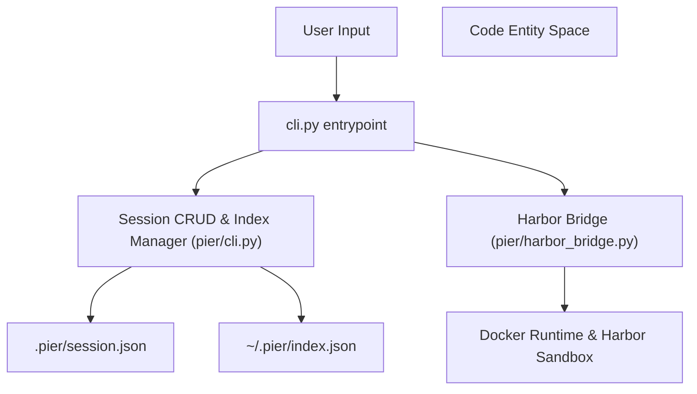

<!-- source: DeepWiki mcp.deepwiki.com · repo allenai/pier · page 1 Overview · fetched 2026-10-26 -->

# Overview

Relevant source files

The following files were used as context for generating this wiki page:

- [README.md](README.md)
- [pier/__init__.py](pier/__init__.py)
- [pier/cli.py](pier/cli.py)

## Purpose and Scope

Pier is an interactive workspace manager for coding agents (such as Claude Code, Codex, Gemini CLI, OpenHands, and Aider) built on top of [Harbor](https://github.com/laude-institute/harbor) [README.md:1-3](). It provides developers with a streamlined way to launch, manage, and interact with containerized or host-managed coding environments, execute tasks, capture agent trajectories, and run automated verifiers [README.md:1-3]().

This page serves as a high-level architectural overview of Pier. For detailed installation guides, quickstart workflows, and core structural concepts, refer to the child pages:
- For installation and execution workflows, see [Getting Started](#1.1).
- For workspace structures, session tracking, and execution modes, see [Core Concepts: Workspaces, Sessions, Modes](#1.2).

Sources: [`README.md:1-3`]()

---

## High-Level Architecture

Pier's architecture bridges user-facing command-line operations with Harbor's container execution and agent integration layer. The system is structured around several primary code modules and state stores:

1. **CLI Layer (`pier/cli.py`)**: Handles user commands (`start`, `exec`, `verify`, `capture`, `traces`, etc.) via Click [pier/cli.py:1-34]().
2. **Session and Workspace Management (`pier/cli.py`)**: Manages local workspace directories, `.pier/session.json` state files, and the global workspace index at `~/.pier/index.json` [pier/cli.py:38-173]().
3. **Harbor Bridge (`pier/harbor_bridge.py`)**: Manages container runtimes, docker-compose overrides, agent installations, and result assembly [pier/cli.py:36-36]().

Sources: [`pier/cli.py:1-173`](), [`README.md:1-3`](), [`pier/__init__.py:1-2`]()

---

## Child Pages

For deeper technical dives, please refer to the following child sections:

- **[Getting Started](#1.1)**: Covers installation commands via `uv tool install`, dependencies, Python version requirements, and standard quickstart workflows including container initialization, execution, and verification [README.md:5-96]().
- **[Core Concepts: Workspaces, Sessions, Modes](#1.2)**: Explains the internal layout of the `.pier` directory, `session.json` schema, the global index tracking mechanism, and the behavioral differences between container mode, host mode, and task-free execution [README.md:28-36](), [pier/cli.py:38-173]().

Sources: [`README.md:5-96`](), [`pier/cli.py:38-173`]()

---

