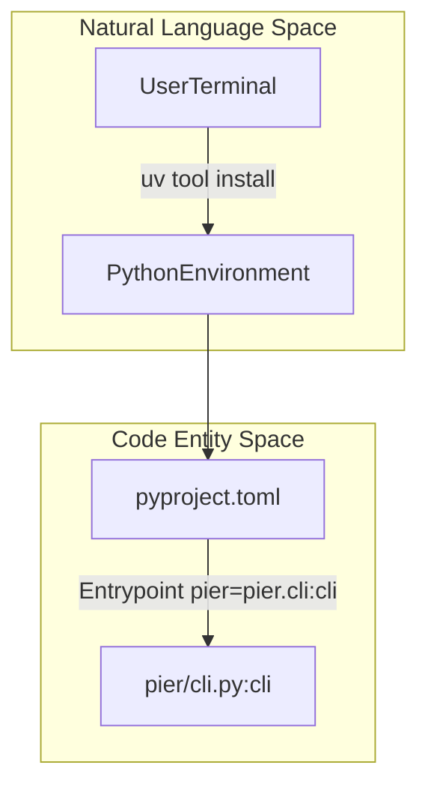
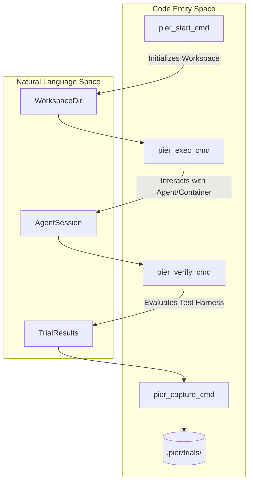

<!-- source: DeepWiki mcp.deepwiki.com · repo allenai/pier · page 1.1 Getting Started · fetched 2026-10-26 -->

# Getting Started

<details>
<summary>Relevant source files</summary>

The following files were used as context for generating this wiki page:

- [README.md](README.md)
- [pyproject.toml](pyproject.toml)
- [uv.lock](uv.lock)

</details>


## Purpose and Scope

This page covers the foundational requirements and quickstart workflows for **Pier**, an interactive workspace manager for coding agents built on top of [Harbor](https://github.com/laude-institute/harbor) [README.md:1-3](). It outlines Python version constraints, package dependencies, installation procedures, and primary execution workflows including workspace initialization (`pier start`), interactive/non-interactive execution (`pier exec`), task verification (`pier verify`), and trajectory capture (`pier capture`).

Sources: `README.md:1-3`, `pyproject.toml:1-12`

---

## Installation and Prerequisites

Pier requires Python 3.12 or newer [pyproject.toml:8]() and relies on [Click](https://palletsprojects.com/p/click/) for command-line parsing alongside core libraries from Harbor [pyproject.toml:9-12](). 

### System Requirements
- **Python**: `>=3.12` [pyproject.toml:8]()
- **Docker**: Required for containerized workspace isolation and agent execution (optional if using host-only mode via `--host`) [README.md:28-36]()
- **Package Manager**: `uv` recommended for tool installation

### Installing Pier
The standard installation method uses `uv` to install directly from the repository [README.md:8-9]():

```bash
uv tool install git+https://github.com/allenai/pier
```

The package defines its console script entry point in `pyproject.toml` pointing directly to the Click command group `cli` defined in `pier/cli.py`:

```toml
[project.scripts]
pier = "pier.cli:cli"
```


Sources: `pyproject.toml:5-24`, `README.md:5-10`

---

## Quickstart Workflows

Once installed, Pier operates through a series of workspace lifecycle commands. Workspaces can be instantiated either from a bare Docker image or from an existing Harbor benchmark task [README.md:18-30]().

### 1. Starting a Workspace
Create and enter a workspace directory using `pier start` [README.md:15]():

```bash
# From a base image (task-free mode):
pier start -d ./workspace --image ubuntu:24.04 --agent claude-code \
  -e ANTHROPIC_API_KEY=$ANTHROPIC_API_KEY
cd ./workspace

# From a Harbor task:
pier start ./tasks/my-task -d ./workspace --agent claude-code \
  -e ANTHROPIC_API_KEY=$ANTHROPIC_API_KEY
cd ./workspace

# Host mode (without container isolation):
pier start ./tasks/my-task --host -d ./workspace
cd ./workspace
```

Parameters accepted by `pier start` include:
- `--agent`: Installs and configures a supported coding agent [README.md:34]().
- `--image`: Specifies the base Docker image (task-free mode) [README.md:35]().
- `--host`: Skips container creation and runs directly on the host [README.md:154]().
- `-e` / `--env-file`: Manages container-level environment variables [README.md:150-151]().

Sources: `README.md:13-38`, `README.md:127-154`

### 2. Execution and Interaction
Interact with the running container or agent using `pier exec` [README.md:45-46]():

```bash
# Run the registered agent interactively
pier exec claude

# Drop into a container shell
pier exec bash

# Non-interactive script execution
pier exec -- claude -p "Read .task/instruction.md and do the task" --dangerously-skip-permissions

# Run background services
pier exec -d -- quarto preview --port 8888 --host 0.0.0.0 --no-browse
```

Sources: `README.md:39-57`

### 3. Verification and Trajectory Capture
For Harbor tasks, validate results using the test harness [README.md:61-65]():

```bash
pier verify
```

For task-free environments, extract and capture the trajectory manually [README.md:67-72]():

```bash
pier capture
pier traces -o trace.tar.gz
pier view
pier summarize
```


Sources: `README.md:59-84`, `README.md:105-126`

---

