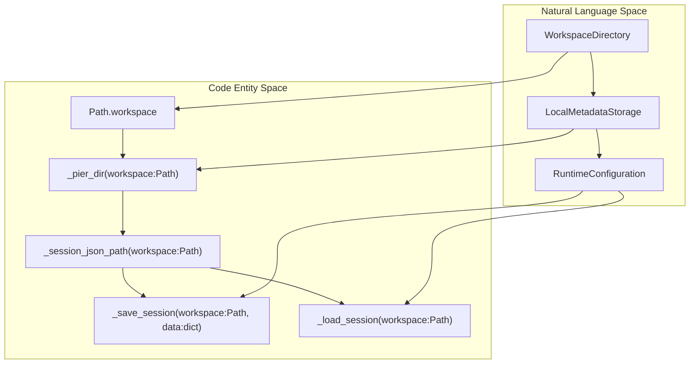
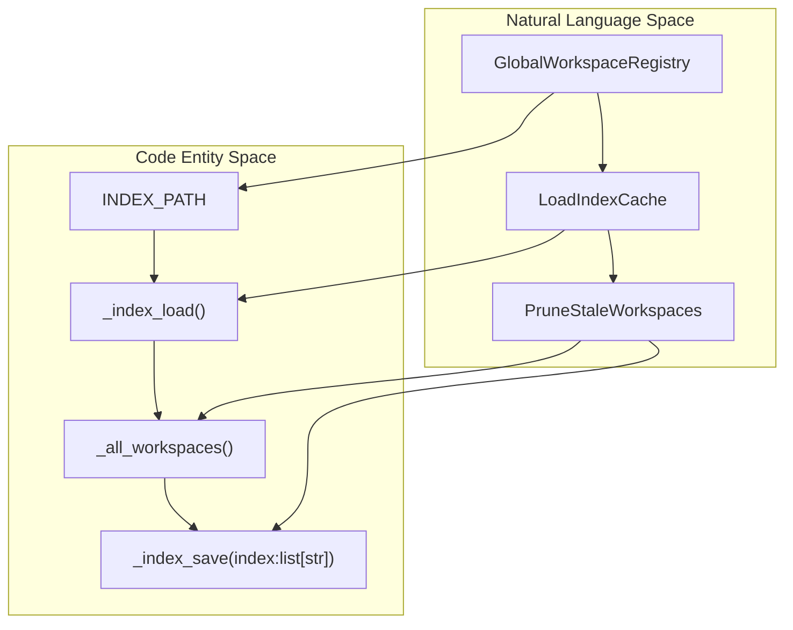
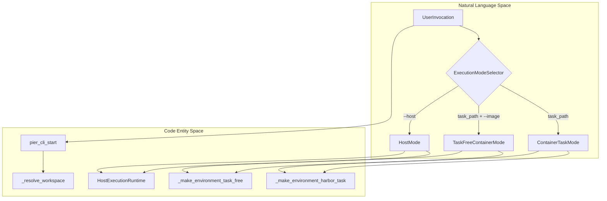
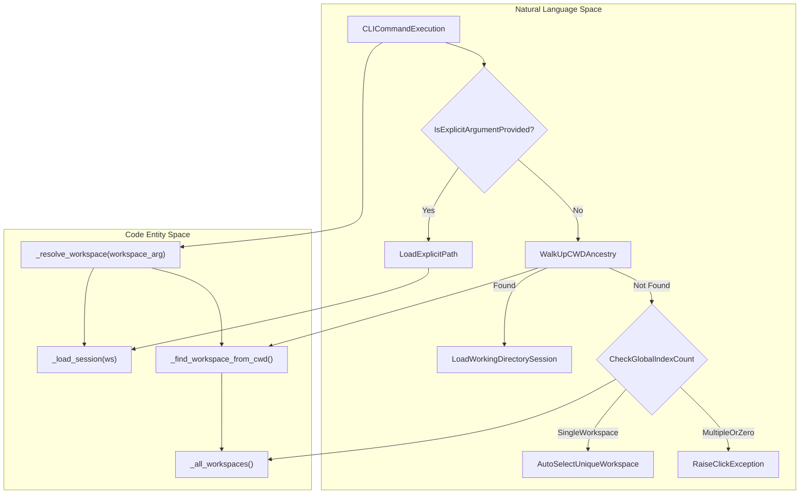

<!-- source: DeepWiki mcp.deepwiki.com · repo allenai/pier · page 1.2 Core Concepts: Workspaces, Sessions, Modes · fetched 2026-10-26 -->

# Core Concepts: Workspaces, Sessions, Modes

<details>
<summary>Relevant source files</summary>

The following files were used as context for generating this wiki page:

- [README.md](README.md)
- [pier/cli.py](pier/cli.py)

</details>


## Purpose and Scope

This section documents the foundational architecture of Pier workspaces, session persistence structures, global indexing mechanisms, and execution modes (`container`, `host`, and `task-free`). It covers how metadata is stored within workspace-local `.pier/` directories and the global index registry, detailing the functions responsible for session lifecycle management and workspace resolution.

Sources: `[pier/cli.py:38-173]`, `[README.md:1-154]`

---

## Workspace Layout and `.pier` Metadata

When a workspace is initialized via `pier start`, Pier creates a hidden `.pier/` directory at the root of the workspace path defined by `PIER_DIR` `[pier/cli.py:38]`. This directory encapsulates all operational state required to bridge Pier commands with underlying container runtimes or host sessions.

```
workspace/
├── .pier/
│   ├── session.json       # Active runtime state and configuration
│   └── trials/            # Captured trial results and trajectories
└── <project_files>
```

The core metadata artifact is `session.json`, managed via `_session_json_path(workspace)` `[pier/cli.py:54]`. It stores configuration parameters such as the active coding agent, container identifiers, environment variables, Harbor task paths, and bind-mount specifications.

- `_pier_dir(workspace)`: Resolves the `.pier` subdirectory for a given workspace `[pier/cli.py:50-51]`.
- `_save_session(workspace, data)`: Serializes runtime configuration dictionaries into `session.json` with indentation and registers the workspace globally `[pier/cli.py:58-63]`.
- `_load_session(workspace)`: Reads and parses `session.json`, raising a `click.ClickException` if no active session is found `[pier/cli.py:64-73]`.



Sources: `[pier/cli.py:38-74]`

---

## Global Index Registry (`~/.pier/index.json`)

To support multi-workspace discovery and global operations like `pier list` or auto-selection, Pier maintains a global registry located at `INDEX_PATH` (`~/.pier/index.json`) `[pier/cli.py:41]`. 

The global index keeps track of all active workspace paths across the host system. The index subsystem implements automatic health checks and stale entry pruning:

- `_index_load()`: Reads the global index file, supporting legacy dictionary formats and modern JSON lists `[pier/cli.py:150-159]`.
- `_index_save(index)`: Writes the sorted, deduplicated list of absolute workspace paths to `INDEX_PATH` `[pier/cli.py:161-163]`.
- `_index_register(workspace)`: Appends a newly initialized workspace path to the index `[pier/cli.py:166-172]`.
- `_all_workspaces()`: Iterates over registered index entries, validating that `session.json` still exists for each. Stale entries where session metadata is missing or corrupted are automatically pruned from the index `[pier/cli.py:75-98]`.



Sources: `[pier/cli.py:41-98], [pier/cli.py:150-173]`

---

## Execution Modes: Container vs. Host vs. Task-free

Pier supports three primary execution paradigms depending on how `pier start` is invoked:

1. **Container Mode (Harbor Task)**: Launched with a Harbor task path (e.g., `pier start ./tasks/my-task`) `[README.md:24]`. Pier builds or pulls the task's Dockerfile, mounts the workspace, installs the requested agent (`--agent`), and executes commands inside an isolated container runtime via `pier exec`.
2. **Task-free Container Mode**: Launched with an arbitrary base image using `-d . --image <image>` (`[README.md:19]`). This bypasses Harbor task definitions, providing a generic container workspace with optional port exposure (`--ports`) and volume mounts (`--mounts-json`) `[README.md:148-149]`.
3. **Host Mode**: Triggered with the `--host` flag (`[README.md:28]`). Bypasses container creation entirely, running the workspace locally on the host machine. Skills are installed locally via `pier skills` (`[README.md:31]`), and agents run natively.



Sources: `[README.md:18-32]`, `[pier/cli.py:110-143]`

---

## Session Resolution and Workspace Discovery Data Flow

When executing CLI commands (such as `pier exec`, `pier verify`, or `pier capture`), Pier must determine which workspace context applies. This is handled by a set of resolution functions that inspect explicit paths, current working directory ancestry, or fall back to the global index.

- `_find_workspace_from_cwd()`: Walks upward from `Path.cwd()` searching for the nearest parent directory containing `.pier/session.json` `[pier/cli.py:101-107]`.
- `_resolve_workspace(workspace_arg)`: Resolves a workspace using an explicit argument, working directory ancestry, or auto-selecting if exactly one workspace is registered globally `[pier/cli.py:110-135]`.
- `_resolve_workspace_from_cwd_only()`: Restricts resolution strictly to the current working directory ancestry, raising an error if the user is not inside a workspace `[pier/cli.py:137-143]`.



Sources: `[pier/cli.py:101-143]`

---

