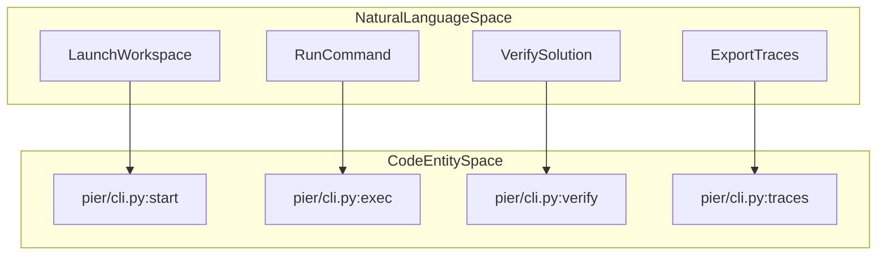
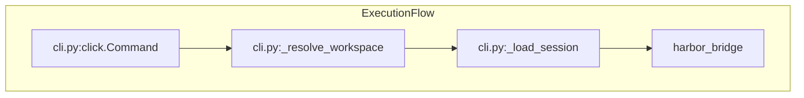

<!-- source: DeepWiki mcp.deepwiki.com · repo allenai/pier · page 2 CLI Reference and Command Layer · fetched 2026-10-26 -->

# CLI Reference and Command Layer

Relevant source files

The following files were used as context for generating this wiki page:

- [README.md](README.md)
- [pier/cli.py](pier/cli.py)

## Purpose and Scope

The CLI reference and command layer, rooted in `pier/cli.py`, provides the Click-based command-line interface for Pier [pier/cli.py:1-34]. It acts as the primary user-facing orchestration layer over Harbor and local container runtimes, handling workspace initialization, session state management via `.pier/session.json` and `~/.pier/index.json`, process execution, and agent trajectory capture [pier/cli.py:38-144]. 

As a parent page, this section introduces the high-level command groups. Detailed technical breakdowns for specific command behaviors, option parsers, and runtime flags are delegated to the child pages.

Sources: [pier/cli.py:1-144](), [README.md:1-35]()

### Diagram: Natural Language CLI Space to Code Entities

Sources: [pier/cli.py:1-17](), [README.md:105-154]()

---

## 2.1 Workspace Lifecycle Commands (`start`, `stop`, `list`)

Workspace lifecycle commands manage the creation, persistence, restoration, and teardown of Pier workspaces. When invoking `pier start`, the CLI resolves the task specification (local path, git remote reference, or task-free image mode), builds or restarts container instances, and initializes the local session metadata under the `.pier/` directory [pier/cli.py:50-73]. `pier stop` handles container teardown and state preservation, while `pier list` queries active sessions using the global index cache [pier/cli.py:75-98].

For complete details on option parsing, container restart logic, and index pruning, see [Workspace Lifecycle Commands (start, stop, list)](#2.1).

Sources: [pier/cli.py:50-144](), [README.md:126-154]()

---

## 2.2 Execution and Verification (`exec`, `verify`, `capture`)

The execution and verification layer handles command dispatch inside active workspaces. `pier exec` routes commands to either the running Docker container or the host environment, injecting configured environment variables and PATH prefixes [pier/cli.py:8-9]. `pier verify` triggers test runners (such as Harbor verifiers) and extracts rewards, while `pier capture` packages agent interaction trajectories into structured trial directories [pier/cli.py:4-9].

For deep dives into container versus host execution modes, log teeing via `script(1)`, and reward extraction, see [Execution and Verification (exec, verify, capture)](#2.2).

Sources: [pier/cli.py:1-9](), [README.md:39-72]()

---

## 2.3 Trace, View and Summarize Commands

Post-execution analytics and inspection are managed through trace exporting, dashboard launching, and AI summarization. `pier traces` allows listing and tarball export of captured trial trajectories from `.pier/trials/`. `pier view` spins up a web dashboard, and `pier summarize` invokes Harbor summarizers to generate natural language evaluations of agent performance [pier/cli.py:5-11].

For details on trace bundle structures and dashboard integration, see [Trace, View and Summarize Commands](#2.3).

Sources: [pier/cli.py:5-11](), [README.md:74-81]()

---

## 2.4 Skills Management

Pier supports the installation and composition of specialized agent capabilities via skill bundles. The `pier skills` subcommand installs task skills into host-mode agents or merges multiple skill directories using `pier skills compose` [pier/cli.py:14-15]. These skills are defined via `SKILL.md` specifications and injected directly into containerized or host-based coding agents during workspace startup [README.md:28-34].

For specifications on skill bundle composition and agent injection vectors, see [Skills Management](#2.4).

Sources: [pier/cli.py:14-16](), [README.md:28-34]()

### Diagram: Command Execution and State Resolution Flow

Sources: [pier/cli.py:34-144](), [pier/cli.py:2164]()

---

