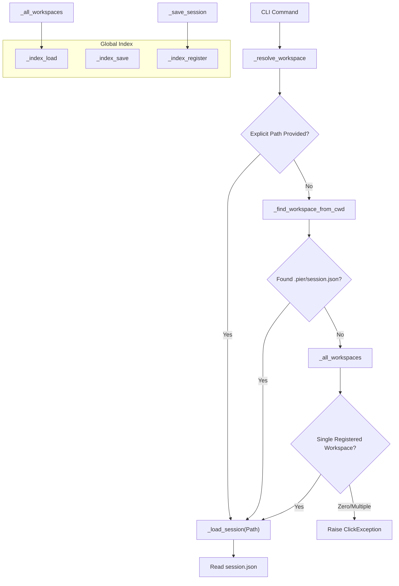
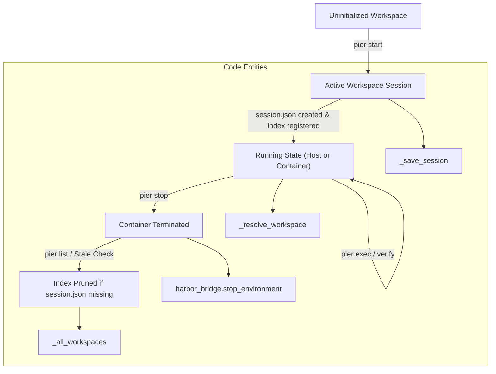

<!-- source: DeepWiki mcp.deepwiki.com · repo allenai/pier · page 2.1 Workspace Lifecycle Commands (start, stop, list) · fetched 2026-10-26 -->

# Workspace Lifecycle Commands (start, stop, list)

Relevant source files

The following files were used as context for generating this wiki page:

- [pier/cli.py](pier/cli.py)
- [pier/tests/test_pier_cli.py](pier/tests/test_pier_cli.py)

## Purpose and Scope

This page details the implementation, data flow, option parsing, and state management for workspace lifecycle commands in `pier`: `start`, `stop`, and `list`. It covers how workspaces are initialized locally or cloned from remote repositories, how session state is persisted (`session.json` and the global `index.json`), how workspaces are automatically resolved from the file system or current working directory, and how container teardown and stale index pruning are handled.

Sources: `[pier/cli.py:1-17](), [pier/tests/test_pier_cli.py:1-16]()`

---

## Session Persistence and Global Index

The `pier` workspace manager tracks active sessions using a dual-layer persistence model:
1. **Workspace-local state**: Each workspace contains a `.pier/session.json` file that stores metadata about the running session (e.g., execution mode, task directory, container IDs, ports, and timestamps) `[pier/cli.py:38-63](), [pier/tests/test_pier_cli.py:80-91]()`.
2. **Global index cache**: A user-level index stored at `~/.pier/index.json` maintains a registry of all active workspace paths across the system, enabling rapid enumeration via `pier list` `[pier/cli.py:41](), [pier/cli.py:146-172]()`.

### Key Functions

* `_pier_dir(workspace: Path)`: Returns the `.pier` subdirectory for a given workspace path `[pier/cli.py:50-51]()`.
* `_session_json_path(workspace: Path)`: Returns the full path to `session.json` inside a workspace `[pier/cli.py:54-55]()`.
* `_save_session(workspace: Path, data: dict)`: Serializes session dictionaries into `session.json` (with indentation) and registers the workspace in the global index `[pier/cli.py:58-63]()`.
* `_load_session(workspace: Path)`: Reads and parses `session.json`, raising a `click.ClickException` if no active session is found `[pier/cli.py:65-73]()`.
* `_index_load()`, `_index_save()`, and `_index_register()`: Manage the global `index.json` registry file with robust fallback and deduplication logic `[pier/cli.py:150-172]()`.

Sources: `[pier/cli.py:38-172](), [pier/tests/test_pier_cli.py:80-91]()`

---

## Workspace Resolution Logic

Commands that operate on existing workspaces (`stop`, `exec`, `verify`, etc.) must locate the correct session context. `pier` implements an automated resolution hierarchy inside `_resolve_workspace()`:

1. **Explicit Argument**: If a workspace path argument is provided, it resolves and loads that specific session `[pier/cli.py:115-117]()`.
2. **Current Working Directory Ancestry**: If no argument is given, it walks up the directory tree from `cwd` searching for a `.pier/session.json` file using `_find_workspace_from_cwd()` `[pier/cli.py:101-107](), [pier/cli.py:119-122]()`.
3. **Auto-Selection**: If exactly one workspace is registered globally in `index.json`, it falls back to selecting that workspace automatically `[pier/cli.py:124-134]()`. If multiple workspaces exist without an explicit path or matching ancestry, a `click.ClickException` is raised `[pier/cli.py:128-133]().

### Diagram: Session Resolution and CRUD Flow

Sources: `[pier/cli.py:75-144]()`

---

## The `pier start` Command

The `pier start` command initializes a workspace for a specified task or launches a task-free container environment `[pier/cli.py:6-7]()`.

### Task Path Resolution and Remote Cloning
* **Remote References**: URLs (such as GitHub repositories) must include a fragment specifier pointing to the task path (e.g., `https://github.com/org/repo#tasks/my-task`) `[pier/tests/test_pier_cli.py:120-125]()`. Remote tasks are downloaded via `pier.harbor_bridge.download_task` `[pier/tests/test_pier_cli.py:127-145]()`.
* **Local Tasks**: Local task directories require explicit option flags (such as `-d`) to configure workspace targets properly `[pier/tests/test_pier_cli.py:178-183]()`.
* **Defaults**: Remote tasks default their local workspace creation target to `./<task-name>` `[pier/tests/test_pier_cli.py:186-203]()`.

### Execution Modes
* **Host Mode (`--host`)**: Sets up local environment configuration without container isolation `[pier/tests/test_pier_cli.py:70-77](), [pier/tests/test_pier_cli.py:128-145]()`.
* **Container Mode (Default)**: Delegates environment and container provisioning to `pier.harbor_bridge.start_environment` `[pier/tests/test_pier_cli.py:150-170]()`.
* **Task-Free Mode**: Launched via `pier start -d . --image ` to spin up an interactive container without a predefined task structure `[pier/cli.py:7]()`.

Sources: `[pier/cli.py:6-7](), [pier/tests/test_pier_cli.py:120-204]()`

---

## Workspace Lifecycle Management (`stop` and `list`)

### Teardown via `pier stop`
The `pier stop` command tears down active container environments associated with a workspace. It resolves the target workspace context, invokes underlying Harbor/Docker teardown routines, and cleans up active execution states.

### Enumeration and Pruning via `pier list`
The `pier list` command calls `_all_workspaces()`, which iterates through registered paths in the global index `[pier/cli.py:75-99]()`. 
* **Stale Index Pruning**: During iteration, `_all_workspaces()` checks whether each registered workspace's `session.json` is still accessible and valid `[pier/cli.py:78-92]()`. If any workspace directory has been deleted or its session file is corrupted (`json.JSONDecodeError` or `OSError`), the entry is automatically pruned from the active index list and `_index_save()` updates `~/.pier/index.json` `[pier/cli.py:78](), [pier/cli.py:91-97]()`.

### Diagram: Workspace Lifecycle State Transitions

Sources: `[pier/cli.py:75-99](), [pier/tests/test_pier_cli.py:1-15](), [pier/tests/test_pier_cli.py:80-91]()`

---

