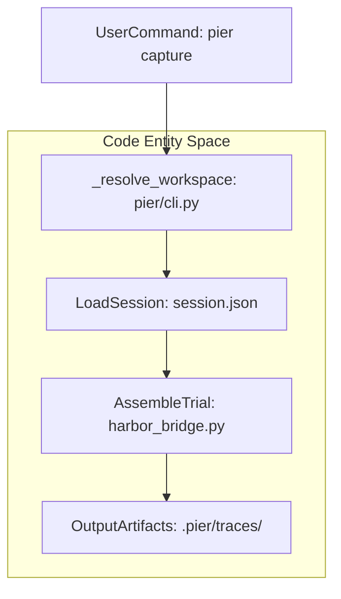
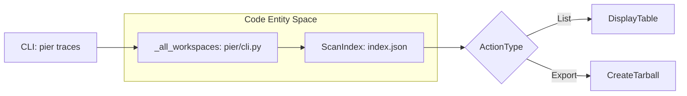

<!-- source: DeepWiki mcp.deepwiki.com · repo allenai/pier · page 2.3 Trace, View and Summarize Commands · fetched 2026-10-26 -->

# Trace, View and Summarize Commands

Relevant source files

The following files were used as context for generating this wiki page:

- [pier/cli.py](pier/cli.py)
- [pier/harbor_bridge.py](pier/harbor_bridge.py)

## Purpose and Scope

This leaf page details the implementation and data flow for the trace management, visualization, and summarization command group in `pier`. These commands (`capture`, `traces`, `view`, and `summarize`) allow developers and coding agents to inspect workspace execution histories, export trace tarballs, launch interactive web dashboards for trial trajectories, and generate AI-driven summaries of trial results via Harbor's underlying summarizer integration.

Sources: `[pier/cli.py:4-13](), [pier/harbor_bridge.py:1-21]()`

---

## 2.3.1 Trajectory Capture (`pier capture`)

The `pier capture` command extracts and packages the agent's execution trajectory, session metadata, and trial results associated with the active workspace. It bridges runtime state maintained inside the container or host mode session into structured artifacts stored under the workspace `.pier` directory or Harbor trial directories.

During execution, logs and terminal interactions are recorded (often via `script(1)` tee capture mechanisms). `capture` gathers these streams, pairs them with `session.json` metadata `[pier/cli.py:54-61]()`, and prepares them for export or visualization.

Sources: `[pier/cli.py:54-61](), [pier/harbor_bridge.py:1-21]()`

---

## 2.3.2 Trace Management and Export (`pier traces`)

The `pier traces` command group provides utilities to list locally available captured traces or export them into portable tarballs (`.tar.gz`). This is critical for sharing debugging logs, submitting agent benchmark results, or archiving runs.

### Key Operations
- **Listing**: Scans registered workspace indexes `[pier/cli.py:75-99]()` and local trace storage to display session IDs, timestamps, tasks, and status summaries.
- **Exporting**: Compresses trial trajectories, logs, configuration files (`config.json`), and results (`result.json`) into a single archive tarball for external distribution.

Sources: `[pier/cli.py:75-99](), [pier/cli.py:150-172]()`

---

## 2.3.3 Web Dashboard Visualization (`pier view`)

The `pier view` command launches an interactive web dashboard for inspecting trial trajectories. By interfacing with Harbor's visualization layers through `pier/harbor_bridge.py`, it renders step-by-step agent actions, tool calls, terminal outputs, and reward metrics in a browser interface.

The command resolves the active workspace context `[pier/cli.py:110-135]()`, locates the corresponding Harbor trial directory, and spins up the viewing server.

Sources: `[pier/cli.py:110-135](), [pier/harbor_bridge.py:1-21]()`

---

## 2.3.4 AI Summarization (`pier summarize`)

The `pier summarize` command invokes the Harbor summarizer subsystem to produce an automated natural-language summary of trial outcomes, error analyses, and agent performance metrics. 

### Data Flow
1. Resolves the current workspace and loads `session.json` `[pier/cli.py:65-73]()`.
2. Locates the trial results and trajectory artifacts.
3. Passes trajectory payloads to the Harbor summarizer bridge.
4. Outputs the generated markdown summary to the terminal or saves it within the workspace artifacts.

Sources: `[pier/cli.py:65-73](), [pier/harbor_bridge.py:1-21]()`

---

