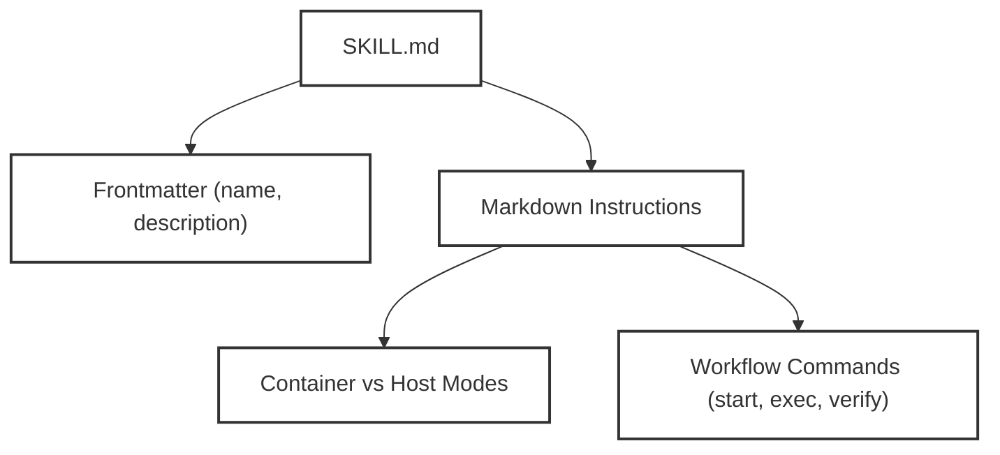
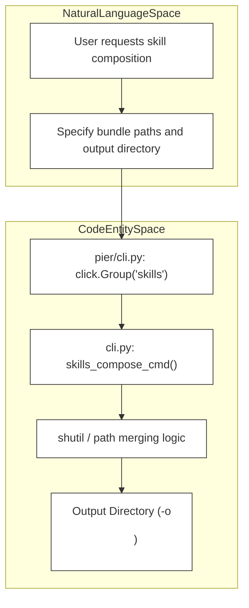
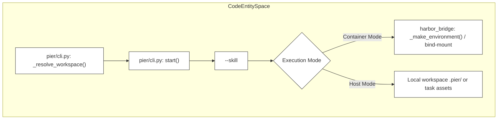

<!-- source: DeepWiki mcp.deepwiki.com · repo allenai/pier · page 2.4 Skills Management · fetched 2026-10-26 -->

# Skills Management

Relevant source files

The following files were used as context for generating this wiki page:

- [pier/SKILL.md](pier/SKILL.md)
- [pier/cli.py](pier/cli.py)

## Purpose and Scope

Skills Management within `pier` enables the packaging, composition, and injection of reusable task capabilities and agent instructions into coding agent environments. Skill bundles are directory structures containing metadata and instructions (such as `SKILL.md`) that can be merged using composition commands and injected into either containerized or host-mode workspaces during session initialization.

Sources: `[pier/cli.py:14-17](), [pier/SKILL.md:1-83]()`

---

## 1. Skill Bundles and `SKILL.md` Structure

A skill bundle represents an encapsulated set of instructions or capabilities for coding agents. At the root of a skill bundle or task directory, `SKILL.md` defines frontmatter metadata (`name`, `description`) alongside markdown documentation detailing usage patterns, commands, and workflows.

*   **Frontmatter**: Contains metadata parsed by agent registries or discovery mechanisms (`name`, `description`) [pier/SKILL.md:1-4]().
*   **Body**: Outlines instructions, installation commands, operating modes (container vs. host), and workflow steps [pier/SKILL.md:6-83]().
*   **Task Integration**: In `pier`, task assets like instructions, context directories, skills, and examples are bundled together and mirrored into local workspaces or container environments [pier/SKILL.md:21]().

*Figure 1: Skill bundle structure mapping metadata and documentation content.*

Sources: `[pier/SKILL.md:1-83]()`

---

## 2. Composing Skills (`pier skills compose`)

The `pier` CLI provides commands for managing and merging skill bundles. Specifically, `pier skills compose` merges multiple skill bundles into a single output directory, allowing complex agent capabilities to be constructed dynamically from modular components [pier/cli.py:15]().

*   **Command Definition**: `pier skills compose -o <dir> <bundles>...` merges specified source skill bundles into the target directory `dir` [pier/cli.py:15]().
*   **Host Installation**: `pier skills` installs task skills directly in host mode for native agent consumption [pier/cli.py:14]().

*Figure 2: Bridging natural language composition requests to code execution in `pier/cli.py`.*

Sources: `[pier/cli.py:14-15]()`

---

## 3. Injection into Container and Host Agents

When initializing a workspace using `pier start`, skill bundles can be injected into the agent configuration via the `--skill <path>` flag [pier/cli.py:16](). Depending on the execution mode, these skills are mounted or copied into the container or host agent's context path.

*   **Container Mode**: Task files, including injected skills, are streamed or bind-mounted into the Docker container runtime. The container environment isolates the execution while sharing the local workspace [pier/SKILL.md:18]().
*   **Host Mode**: Skills are made available locally within the workspace directory structure (`.pier/` or task assets), allowing native tools and host-installed agents to access them directly without Docker virtualization [pier/SKILL.md:19]().

*Figure 3: Data flow for skill injection during workspace startup (`pier start`).*

Sources: `[pier/cli.py:16](), [pier/SKILL.md:18-21]()`

---

