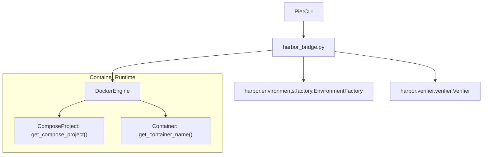

<!-- source: DeepWiki mcp.deepwiki.com · repo allenai/pier · page 3 Harbor Bridge and Container Runtime · fetched 2026-10-26 -->

# Harbor Bridge and Container Runtime

<details>
<summary>Relevant source files</summary>

The following files were used as context for generating this wiki page:

- [pier/harbor_bridge.py](pier/harbor_bridge.py)

</details>


This page provides an architectural overview of `pier/harbor_bridge.py`, the isolation layer that encapsulates all interactions between Pier and the underlying [Harbor](https://github.com/allenai/harbor) workspace environment and Docker container runtimes [pier/harbor_bridge.py:1-5](). 

As a parent page, this document outlines high-level responsibilities such as container lifecycle management, compose patching, agent configuration, result assembly, and environment variable handling. Detailed technical specifications are delegated to dedicated child pages.

Sources: `pier/harbor_bridge.py:1-21`

---

## Architecture and Bridge Overview

Pier acts as an interactive workspace manager, delegating heavy container orchestration, task building, and trial execution to Harbor. To maintain decoupling, `pier/harbor_bridge.py` serves as the sole adapter importing Harbor modules. 


*Figure 1: Bridge architecture mapping Pier commands to Harbor components and Docker entities.*

Sources: `pier/harbor_bridge.py:1-21`, `pier/harbor_bridge.py:45-62`

---

## 3.1. Environment Lifecycle and Compose Overrides

The container and environment lifecycle is managed through dynamic Docker compose configuration, workdir extraction, and bind-mount orchestration. Pier inspects target task Dockerfiles to determine work directories [pier/harbor_bridge.py:107-116] and injects custom overrides to secure session metadata.

For full details on `_make_environment()`, compose path patching, `docker-compose-pier.json` generation, mounts, ports, `.pier` tmpfs hiding, and `WORKDIR` parsing, see [Environment Lifecycle and Compose Overrides](#3.1).

Sources: `pier/harbor_bridge.py:107-202`

---

## 3.2. Agent Installation and Log Capture

Pier supports running various coding agents inside containerized or host environments. It handles agent bootstrapping, config directory environment variables (such as `CLAUDE_CONFIG_DIR` and `CODEX_HOME`), interactive session recording using `script(1)` tee capture, and post-run command execution.

For detailed documentation on the agent registry, `setup_agent()`, stream capture, and hook execution, see [Agent Installation and Log Capture](#3.2).

Sources: `pier/harbor_bridge.py:1-38`

---

## 3.3. Trial Results and Trajectory Assembly

Once an execution session completes, Pier gathers trial artifacts, trajectory logs, and verifier outputs. It uses helpers like `assemble_trial()` to parse `result.json` and `config.json`, validate against the `TrialResult` schema, track agent token usage, and establish robust fallback paths if structured logs are missing.

For deep dives into trial assembly routines, result schemas, and metrics extraction, see [Trial Results and Trajectory Assembly](#3.3).

Sources: `pier/harbor_bridge.py:1-38`

---

## 3.4. Secrets and Environment Variable Handling

Security and credential management are critical when spawning agents in shared or remote containers. Pier sanitizes and resolves environment key-values using `sanitize_env_kv()` and `resolve_env_kv()`, injects secure templated secrets into `session.json`, and supports arbitrary `.env` file ingestion.

For comprehensive coverage of environment sanitization, secrets templating, and configuration parsing, see [Secrets and Environment Variable Handling](#3.4).

Sources: `pier/harbor_bridge.py:23-38`

---

## Container Runtime Flow

The following diagram bridges the natural language concepts of task preparation and container execution to their concrete code entities within `pier/harbor_bridge.py`.

```mermaid
graph TD
  TaskDir["TaskDirectory"] -->| "get_container_workdir()" | WorkDir["ContainerWorkDir"]
  TaskDir -->| "extract_image_workdir()" | Workspace["WorkspacePath"]
  Workspace -->| "_write_mounts_compose()" | Compose["DockerComposeOverride"]
  Compose -->| "is_environment_running()" | Container["DockerContainer"]
```
*Figure 2: Execution flow from task directory structures to running Docker containers.*

Sources: `pier/harbor_bridge.py:64-158`, `pier/harbor_bridge.py:179-202`

---

