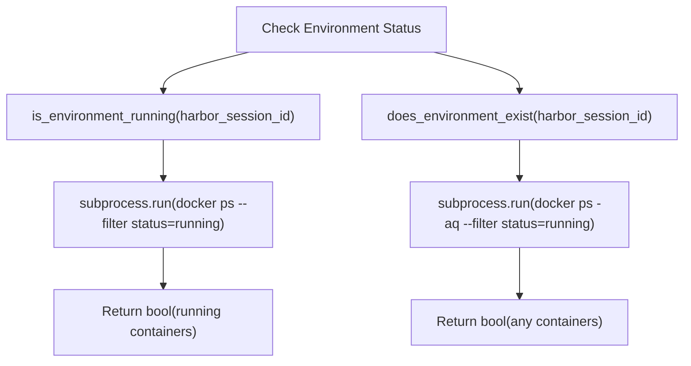
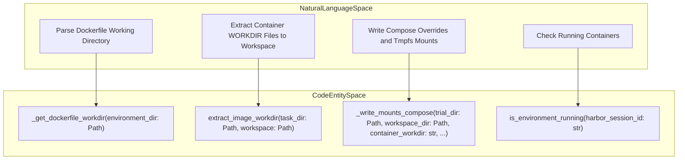

<!-- source: DeepWiki mcp.deepwiki.com · repo allenai/pier · page 3.1 Environment Lifecycle and Compose Overrides · fetched 2026-10-26 -->

# Environment Lifecycle and Compose Overrides

Relevant source files

The following files were used as context for generating this wiki page:

- [pier/harbor_bridge.py](pier/harbor_bridge.py)
- [pier/tests/test_harbor_bridge.py](pier/tests/test_harbor_bridge.py)

## Purpose and Scope

This page documents the container environment lifecycle management and Docker Compose override generation implemented in `pier/harbor_bridge.py`. It details how Pier interacts with Harbor and Docker to construct isolated environments, parse task Dockerfiles for `WORKDIR` definitions, extract initial image files into workspaces, patch Docker Compose files, hide session-private directories (`.pier`) using `tmpfs`, and expose requested host ports.

Sources: [pier/harbor_bridge.py:1-21]()

---

## 1. Container Naming and Environment Status Checks

Pier relies on Harbor's session ID conventions to map sessions to Docker Compose projects and containers. Harbor lowercases session IDs and replaces dots with dashes [pier/harbor_bridge.py:45-51](). 

The primary service container is always named using the format `{project}-main-1` [pier/harbor_bridge.py:54-62](). Pier exposes helper functions to query container and environment status:
- `get_compose_project(harbor_session_id)`: Derives the Docker Compose project string [pier/harbor_bridge.py:45-51]().
- `get_container_name(harbor_session_id)`: Returns the primary container identifier [pier/harbor_bridge.py:54-62]().
- `is_environment_running(harbor_session_id)`: Executes `docker ps` with Compose project labels to verify if containers are actively running [pier/harbor_bridge.py:64-82]().
- `does_environment_exist(harbor_session_id)`: Queries all containers (running or stopped) associated with the project label [pier/harbor_bridge.py:84-100]().

### Container Status Verification Flow

Sources: [pier/harbor_bridge.py:45-100]()

---

## 2. Dockerfile WORKDIR Parsing and Image Extraction

To determine where source code and assets reside inside the container, Pier parses the task's `Dockerfile` to locate the container working directory [pier/harbor_bridge.py:107-121]().

### `_get_dockerfile_workdir` and `extract_image_workdir`
- `_get_dockerfile_workdir(environment_dir)` reads the `Dockerfile` from the bottom up, matching case-insensitive `WORKDIR` declarations, defaulting to `/app` if absent [pier/harbor_bridge.py:107-116]().
- `extract_image_workdir(task_dir, workspace)` builds the task image (`hb__{task_dir.name}`), provisions a temporary container via `docker create`, and copies the contents of `{workdir}/.` out into the host workspace [pier/harbor_bridge.py:123-158](). This ensures the workspace is prepopulated with any files generated by `COPY`, `ADD`, or `RUN` instructions in the Dockerfile before Pier mounts or overlays its own assets [pier/harbor_bridge.py:123-130]().

Sources: [pier/harbor_bridge.py:107-158]()

---

## 3. Compose Overrides and `docker-compose-pier.json`

Harbor handles the primary workspace bind mount, but Pier applies custom overrides via `_write_mounts_compose()` to inject auxiliary settings [pier/harbor_bridge.py:179-202]().

### `_write_mounts_compose` Implementation Details
The function writes a `docker-compose-pier.json` file inside the trial directory containing:
1. **Tmpfs Hiding**: Mounts a `tmpfs` volume over `{container_workdir}/.pier` to hide Pier session data from the containerized agent [pier/harbor_bridge.py:188-200]().
2. **Bind Mounts**: Optionally includes workspace bind-mount mappings when `include_bind_mount=True` [pier/harbor_bridge.py:184-201]().
3. **Port Forwarding**: Maps host ports to container ports when a `ports` list is provided [pier/harbor_bridge.py:186-199]().
4. **Task Instruction Copying**: Copies `instruction.md` into `workspace/.task/` when a `task_dir` is supplied, allowing agents to discover tasks without exposing tests or `task.toml` [pier/harbor_bridge.py:190-196]().

Sources: [pier/harbor_bridge.py:179-202](), [pier/tests/test_harbor_bridge.py:60-154]()

---

## 4. Architectural Data Flow: Natural Language to Code Entities

The following diagram bridges natural language concepts of environment lifecycle operations to their exact code implementations in `pier/harbor_bridge.py`.

### Architecture Mapping Diagram

Sources: [pier/harbor_bridge.py:45-202]()

---

