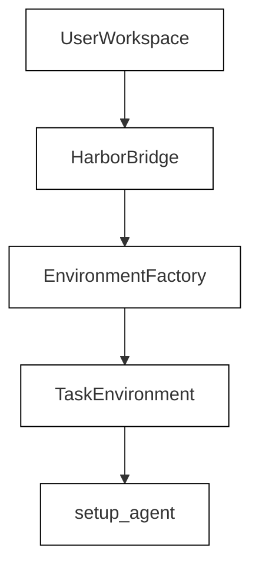
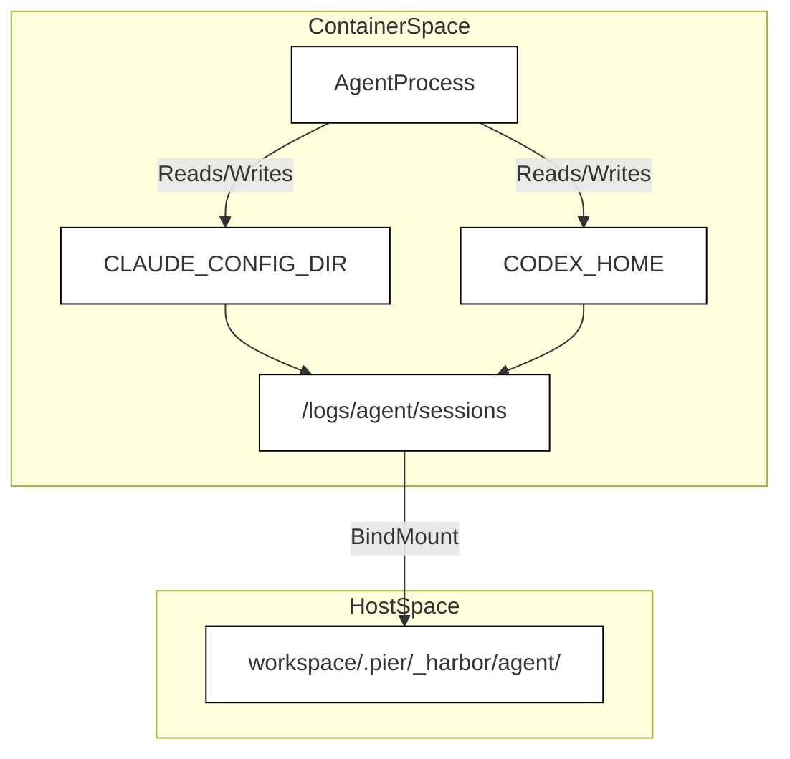
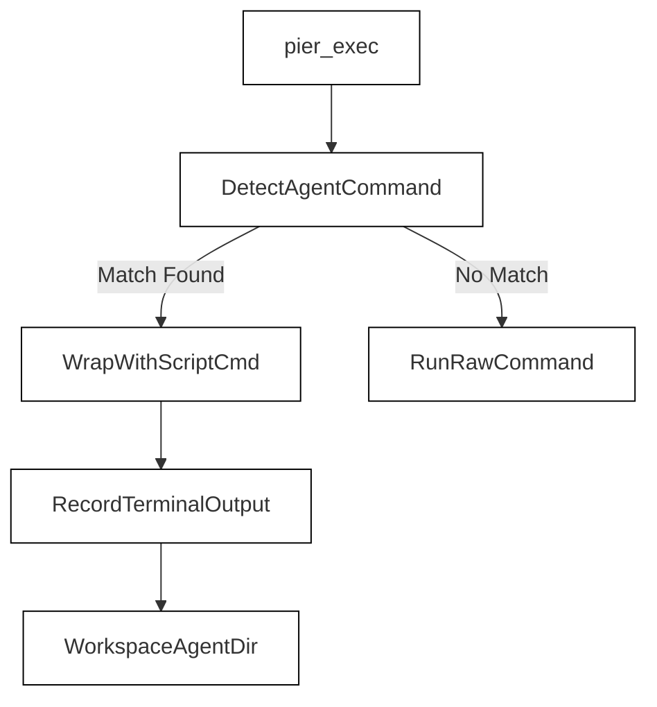

<!-- source: DeepWiki mcp.deepwiki.com · repo allenai/pier · page 3.2 Agent Installation and Log Capture · fetched 2026-10-26 -->

# Agent Installation and Log Capture

Relevant source files

The following files were used as context for generating this wiki page:

- [DEVELOPER.md](DEVELOPER.md)
- [pier/harbor_bridge.py](pier/harbor_bridge.py)
- [pier/tests/test_agent_integration.py](pier/tests/test_agent_integration.py)

## Purpose and Scope

This page details the implementation of agent installation, environment configuration, terminal recording, and artifact collection within Pier. By acting as a bridge to Harbor, Pier ensures that agent binaries, configuration states, and execution logs survive container teardowns through structured bind mounts and environment variable overrides.

Sources:
- `DEVELOPER.md:26-110`
- `pier/harbor_bridge.py:1-202`

---

## Agent Registry and Harbor Integration

Pier relies on Harbor's underlying environment and agent management abstractions to discover and install coding agents inside containers. Binary-to-agent mappings and version commands are resolved dynamically via Harbor's registry (`get_binary_agent_map()`).

*Figure 1: Agent Setup and Bridge Architecture*

Sources:
- `DEVELOPER.md:70-85`
- `pier/harbor_bridge.py:1-50`

---

## Config-Dir Environment Variables

To ensure that stateful agents (such as Claude Code and Codex) persist their session history and configuration across container runs, Pier injects specific log-capture environment variables derived from Harbor's `EnvironmentPaths`.

These variables point to paths within the container that are bind-mounted back to the host at `workspace/.pier/_harbor/agent/`.

*Figure 2: Config-Dir Environment Mapping to Code Entities*

Key environment variables handled by Pier include:
- `CLAUDE_CONFIG_DIR`: Points to session logs and project histories.
- `CODEX_HOME`: Directs Codex configuration and state storage.
- User-supplied `-e` overrides take precedence via dictionary `setdefault` patterns.

Sources:
- `DEVELOPER.md:41-45`
- `pier/tests/test_agent_integration.py:110-116`

---

## Terminal Session Recording via `script(1)` Tee Capture

When a user executes an agent via `pier exec`, Pier attempts to auto-detect the agent command by matching it against Harbor's known binary maps. If matched, the execution is wrapped using the POSIX `script(1)` utility (`script -q -c`).

*Figure 3: Execution and Tee Capture Flow*

This wrapping records full TTY behaviors (such as color codes, cursor movements, and interactive prompts) directly to a timestamped session directory:

`workspace/.pier/_harbor/agent/exec/<timestamp>/<agent-name>.txt`

Sources:
- `DEVELOPER.md:33-40`
- `pier/tests/test_agent_integration.py:99-108`

---

## Post-Run Commands and Artifact Collection

Certain agents require explicit post-run commands to serialize structured session trajectories or export logs before the container environment is torn down. Pier mirrors these behaviors after the agent exits while the container remains active:

- **Gemini CLI**: Copies temporary session files to designated trajectory targets.
- **Hermes**: Executes session export commands to generate `.jsonl` summaries.

Sources:
- `DEVELOPER.md:86-97`
- `pier/harbor_bridge.py:1-21`

---

