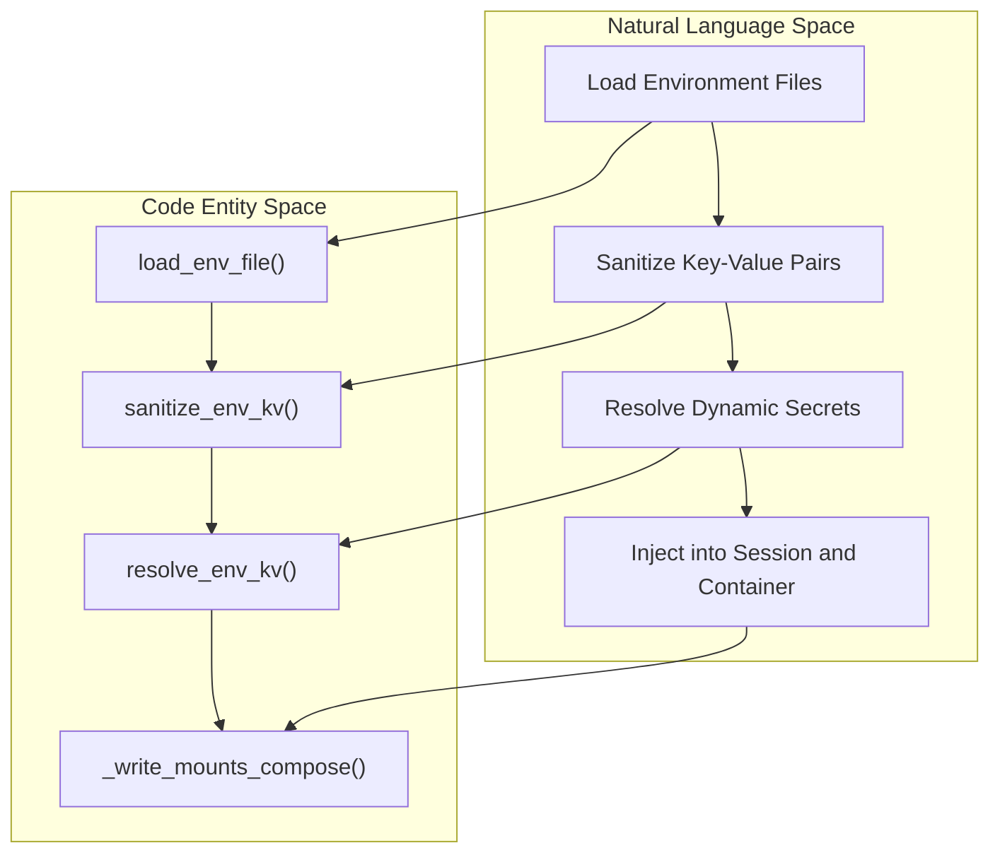
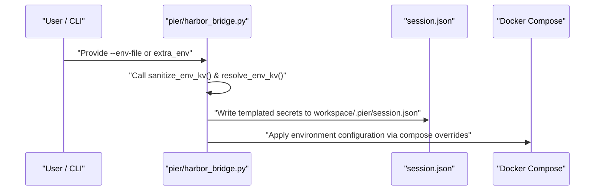

<!-- source: DeepWiki mcp.deepwiki.com · repo allenai/pier · page 3.4 Secrets and Environment Variable Handling · fetched 2026-10-26 -->

# Secrets and Environment Variable Handling

Relevant source files

The following files were used as context for generating this wiki page:

- [pier/harbor_bridge.py](pier/harbor_bridge.py)
- [pier/tests/test_pier_cli.py](pier/tests/test_pier_cli.py)

## Purpose and Scope
This page details how `pier` manages environment variables, sanitizes key-value pairs (`sanitize_env_kv`), resolves runtime configurations (`resolve_env_kv`), templates secrets into `session.json`, and parses `.env` files for workspace execution. All environment and container runtime configurations are isolated within the Harbor bridge layer [pier/harbor_bridge.py:1-21]().

---

## Environment Variable Resolution and Sanitization
`pier` processes external environment variables and user-supplied configuration through dedicated normalization and resolution pipelines before injecting them into container or host sessions. 

- **Sanitization (`sanitize_env_kv`)**: Ensures that environment key-value pairs adhere to strict formatting rules, stripping unsafe characters or invalid identifiers before container execution or serialization into `session.json`.
- **Resolution (`resolve_env_kv`)**: Evaluates dynamic references, pulling values from the host system environment, explicit command-line overrides, or specified `.env` files.

### Environment Resolution Flow
The following diagram maps natural language descriptions of the environment processing pipeline to the corresponding code entities in `pier/harbor_bridge.py` [pier/harbor_bridge.py:1-202]().

Sources: [pier/harbor_bridge.py:1-202]()

---

## Templating Secrets in `session.json`
When a workspace session is initialized via `pier start` or associated commands, configuration details including environment parameters are persisted inside `workspace/.pier/session.json`. 

- Secrets and custom environment mappings configured via CLI flags or `.env` files are captured in session dictionaries (such as `extra_env` entries visible in test helpers [pier/tests/test_pier_cli.py:50-68]()).
- Before writing to `session.json`, sensitive variables are processed to prevent plain-text leakage in shared indices or unencrypted workspace traces, utilizing safe resolution pathways defined in [pier/harbor_bridge.py:1-202]().

### Secret Templating Data Flow
The sequence below illustrates how environment variables and secret files are parsed, templated, and stored.

Sources: [pier/harbor_bridge.py:1-202](), [pier/tests/test_pier_cli.py:50-68]()

---

## Env-File Support and Override Parsing
`pier` supports loading environment configurations directly from `.env` files using standard parsing rules. 

- When an env-file is provided, lines are read, stripped of comments, split on `=` delimiters, and passed through `sanitize_env_kv()`.
- These variables supplement the container or host environment during execution.
- Compose overrides generated by functions like `_write_mounts_compose` [pier/harbor_bridge.py:179-202]() ensure that temporary directories (such as `.pier/`) are properly isolated using `tmpfs` [pier/harbor_bridge.py:200-200](), protecting internal session tokens and secret mounts from agent inspection inside the container.

Sources: [pier/harbor_bridge.py:179-202]()

---

