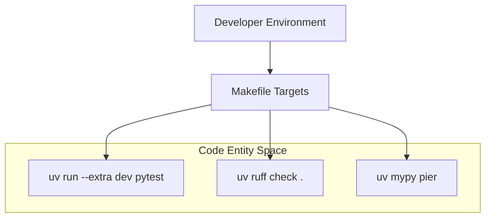
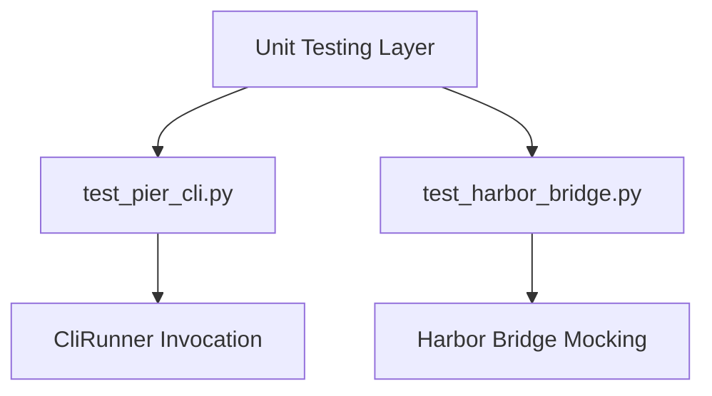
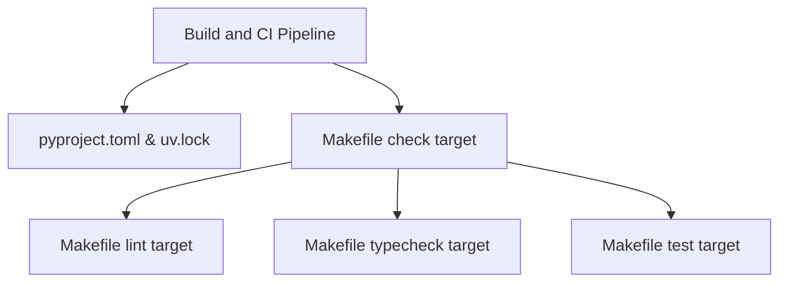

<!-- source: DeepWiki mcp.deepwiki.com · repo allenai/pier · page 4 Testing and Development Infrastructure · fetched 2026-10-26 -->

# Testing and Development Infrastructure

Relevant source files

The following files were used as context for generating this wiki page:

- [Makefile](Makefile)
- [pier/tests/__init__.py](pier/tests/__init__.py)

## Purpose and Scope
This page provides a high-level overview of the testing suites, development tooling, build pipelines, and continuous integration (CI) infrastructure used in `pier`. The codebase relies on `uv` for environment and dependency management, `pytest` for testing, `ruff` for linting and formatting, and `mypy` for static type checking, all orchestrated via a centralized `Makefile`. 

For detailed information on specific test categories or build configurations, refer to the following child pages:
- Unit testing patterns and fixtures: [Unit Test Suites](#4.1)
- Containerized and agent integration tests: [Docker and Agent Integration Tests](#4.2)
- Packaging, dependency locking, and CI pipelines: [Build, Tooling and CI](#4.3)

Sources: [Makefile:1-20]()

---

## 4.1 Unit Test Suites
Unit tests validate core CLI behaviors and internal Harbor bridge orchestration logic without necessarily requiring a live Docker daemon or external agent binaries. These tests typically leverage `typer.testing.CliRunner` for CLI invocation checks and mock external Harbor interactions via fixtures.

For detailed breakdowns of test patterns, mocking strategies, and test layout, see [Unit Test Suites](#4.1).

Sources: [Makefile:5-7]()

---

## 4.2 Docker and Agent Integration Tests
Integration tests verify end-to-end container lifecycles, volume mounts, agent configuration injections, and execution verifications. These tests are isolated using specific pytest markers (such as `docker_integration`) and can be enabled via environment variables like `PIER_RUN_DOCKER_INTEGRATION`, `PIER_TEST_IMAGE`, and `PIER_TEST_AGENTS`.

For setup instructions, container requirements, and test marker details, see [Docker and Agent Integration Tests](#4.2).

Sources: [Makefile:5-7]()

---

## 4.3 Build, Tooling and CI
Development workflows and CI checks are standardized using standard Python packaging definitions (`pyproject.toml`), dependency locking (`uv.lock`), pre-commit hooks, and GitHub Actions matrices. The project root `Makefile` exposes standardized developer entrypoints for executing tests, linters, formatters, and typecheckers in a unified manner.

For details on packaging metadata, tool configurations, and CI workflow definitions, see [Build, Tooling and CI](#4.3).

Sources: [Makefile:1-20]()

---

