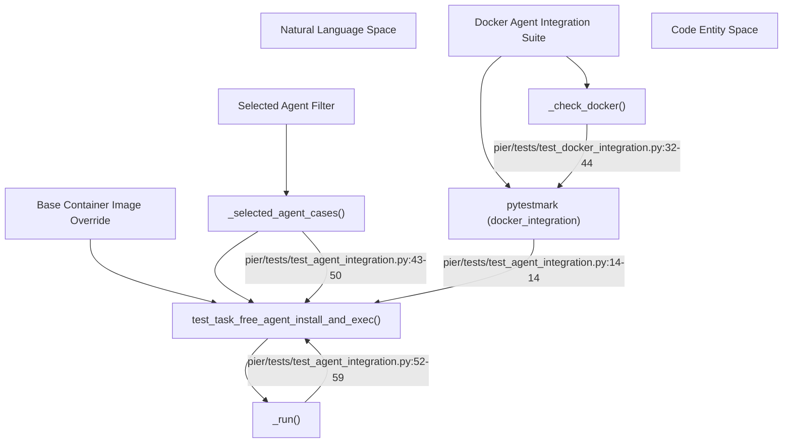
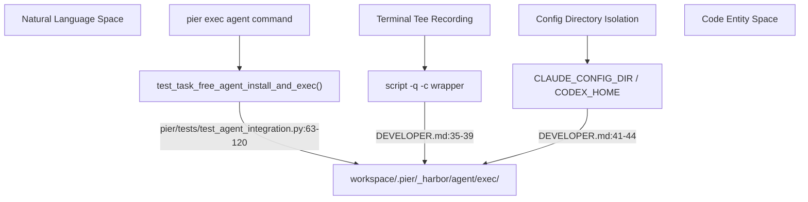

<!-- source: DeepWiki mcp.deepwiki.com · repo allenai/pier · page 4.2 Docker and Agent Integration Tests · fetched 2026-10-26 -->

# Docker and Agent Integration Tests

Relevant source files

The following files were used as context for generating this wiki page:

- [DEVELOPER.md](DEVELOPER.md)
- [pier/tests/test_agent_integration.py](pier/tests/test_agent_integration.py)
- [pier/tests/test_docker_integration.py](pier/tests/test_docker_integration.py)

This page documents the architecture, execution flow, environment variables, and test harness implementation for Pier's Docker-backed integration test suites (`pier/tests/test_docker_integration.py` and `pier/tests/test_agent_integration.py`). These tests validate the end-to-end container lifecycle, bind-mount synchronization, agent execution, script-based tee log capture, and verifier reward generation.

---

## Integration Test Environment and Skip Criteria

Both integration suites depend on a working Docker daemon and are separated from unit tests to avoid requiring container runtimes in standard CI pipelines. 

For general container tests (`test_docker_integration.py`), availability is checked dynamically via `_check_docker()`, which executes `docker info` with a timeout [pier/tests/test_docker_integration.py:32-44](). The test module applies `pytestmark` to skip execution on Windows platforms or when Docker is unreachable [pier/tests/test_docker_integration.py:47-52]().

For agent integration tests (`test_agent_integration.py`), execution requires the explicit environment variable `PIER_RUN_DOCKER_INTEGRATION=1` in addition to checking for `docker` on the system path using `shutil.which("docker")` [pier/tests/test_agent_integration.py:14-27]().

Sources: [pier/tests/test_docker_integration.py:29-52](), [pier/tests/test_agent_integration.py:14-27]()

---

## Parameterization and Test Agents

The agent integration suite (`test_agent_integration.py`) defines a representative matrix of coding agents in `ALL_AGENT_CASES`:
* `claude-code` (`claude`) — exercises the Claude-specific interactive setup path and config directory mapping.
* `codex` (`codex`) — exercises NVM-installed CLIs.
* `gemini-cli` (`gemini`) — exercises NVM-installed CLIs and post-run artifact collection.
* `kimi-cli` (`kimi`) — exercises `~/.local/bin` installations on plain base images.

[pier/tests/test_agent_integration.py:29-40]()

Users can filter which agents are tested by supplying a comma-separated list to the `PIER_TEST_AGENTS` environment variable, parsed by `_selected_agent_cases()` [pier/tests/test_agent_integration.py:43-50](). The base container image can also be overridden using `PIER_TEST_IMAGE` (defaulting to `ubuntu:24.04`) [pier/tests/test_agent_integration.py:30-30]().

Sources: [pier/tests/test_agent_integration.py:29-50]()

---

## Diagram 1: Integration Test Execution & Environment Routing

The following diagram bridges natural language configuration controls to the underlying Python test functions and shell execution commands.

Sources: [pier/tests/test_docker_integration.py:32-52](), [pier/tests/test_agent_integration.py:14-60]()

---

## Fixture Infrastructure and Container Lifecycles

`test_docker_integration.py` establishes standard testing fixtures:
* `runner`: Instantiates a `click.testing.CliRunner()` instance for invoking CLI commands [pier/tests/test_docker_integration.py:60-64]().
* `index_path`: Temporarily overrides `pier.cli.INDEX_PATH` with a localized `index.json` under `tmp_path` [pier/tests/test_docker_integration.py:68-71]().
* `task_dir`: Generates a minimal task definition including a `task.toml` metadata file, `instruction.md`, an `environment/Dockerfile` with a marker file (`.image-marker`), a skill bundle under `environment/skills/greet/SKILL.md`, and a verifier script (`tests/test.sh`) that inspects `/app/hello.txt` to write rewards to `/logs/verifier/reward.txt` [pier/tests/test_docker_integration.py:75-110]().

Container teardown and container name resolution are handled by helper utilities `_cleanup_container()` and `_get_container_name()`, which read `session.json` to locate the active Harbor session ID (`harbor_session_id`) and invoke `stop_environment()` [pier/tests/test_docker_integration.py:118-136](). Workspaces are initialized via `_start_workspace()` executing `pier start` [pier/tests/test_docker_integration.py:138-146]().

Sources: [pier/tests/test_docker_integration.py:60-146]()

---

## End-to-End Container & Verifier Checks

The `TestContainerLifecycle` suite exercises core container operations:
1. **Instruction Readability**: Asserts that `instruction.md` is correctly mounted and readable at `/app/.task/instruction.md` inside the running container, verifying file status and discoverability via `find` [pier/tests/test_docker_integration.py:156-195]().
2. **Workspace Synchronization**: Confirms that files created on the host workspace (or generated during image build via `RUN echo 'image built' > /app/.image-marker`) synchronize properly across the bind-mount boundary [pier/tests/test_docker_integration.py:199-214]().

Sources: [pier/tests/test_docker_integration.py:98-110](), [pier/tests/test_docker_integration.py:153-198]()

---

## Agent Install, Execution, and Log Capture Smoke Tests

`test_task_free_agent_install_and_exec()` runs task-free container sessions with requested agent configurations (`--agent <name> -f`) [pier/tests/test_agent_integration.py:63-83](). The test verifies:
* Session metadata records the correct agent list and image name in `workspace/.pier/session.json` [pier/tests/test_agent_integration.py:88-91]().
* The agent CLI responds successfully to version probes executed via `pier exec` [pier/tests/test_agent_integration.py:92-97]().
* Output is tee'd via `script(1)` to `.pier/_harbor/agent/exec/<timestamp>/<agent>.txt` [pier/tests/test_agent_integration.py:99-108]().
* Log-capture environment variables (such as `CLAUDE_CONFIG_DIR`) are injected into the container environment pointing to `/logs/agent/` [pier/tests/test_agent_integration.py:110-116]().

Sources: [pier/tests/test_agent_integration.py:63-119]()

---

## Diagram 2: Agent Log Capture & Container Bridge

The diagram below connects agent execution primitives and log storage paths in the codebase to their corresponding system architecture roles.

Sources: [pier/tests/test_agent_integration.py:63-119](), [DEVELOPER.md:26-62]()

---

