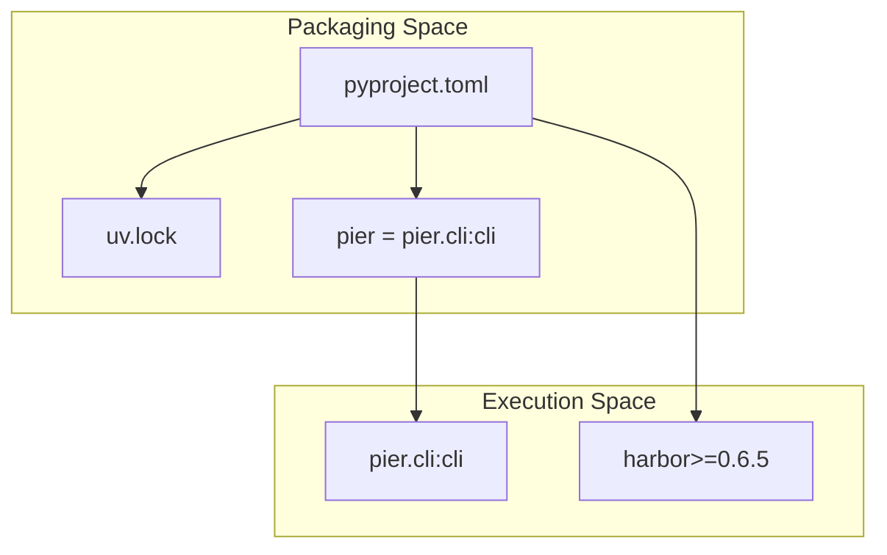
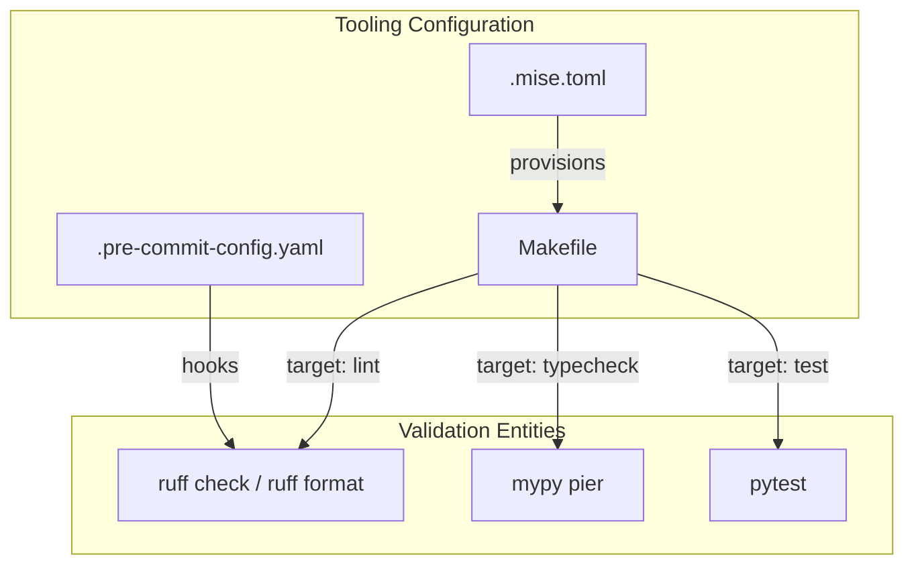
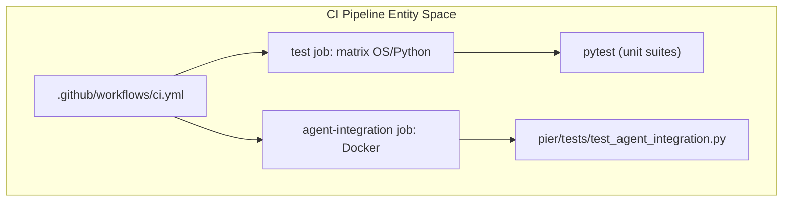

<!-- source: DeepWiki mcp.deepwiki.com · repo allenai/pier · page 4.3 Build, Tooling and CI · fetched 2026-10-26 -->

# Build, Tooling and CI

<details>
<summary>Relevant source files</summary>

The following files were used as context for generating this wiki page:

- [.github/workflows/ci.yml](.github/workflows/ci.yml)
- [.gitignore](.gitignore)
- [.mise.toml](.mise.toml)
- [.pre-commit-config.yaml](.pre-commit-config.yaml)
- [LICENSE](LICENSE)
- [Makefile](Makefile)
- [pyproject.toml](pyproject.toml)
- [uv.lock](uv.lock)

</details>


## Purpose and Scope
This page covers the packaging structure, dependency management, development workflows, local tooling automation, and Continuous Integration (CI) pipelines for the `pier` codebase. It details how the project is defined in `pyproject.toml`, locked via `uv.lock`, automated through `Makefile` and `mise`, validated via `pre-commit` and `ruff`/`mypy`, and tested across platforms and container runtimes using GitHub Actions.

---

## 4.3.1 Packaging, Entrypoints, and Dependencies

The `pier` project relies on modern Python packaging standards defined in `pyproject.toml` and deterministic dependency resolution via `uv.lock`.

### Build System and Project Metadata
The build system uses standard `setuptools` with `setuptools.build_meta` [pyproject.toml:1-3](). The project metadata specifies Python `>=3.12` and primary runtime dependencies including `click` and `harbor>=0.6.5` [pyproject.toml:5-12](). 

Optional development dependencies are grouped under the `dev` extra, incorporating testing, linting, type checking, and pre-commit hooks [pyproject.toml:14-20]().

### Console Scripts and Entrypoints
The package defines a console script entry point mapping the `pier` command to the Click CLI group `pier.cli:cli` [pyproject.toml:22-23]():
```toml
[project.scripts]
pier = "pier.cli:cli"
```

### Type Checking and Mypy Overrides
Static type checking is configured via `mypy`. Because external libraries like `harbor` may lack inline type annotations or stub files, `pyproject.toml` includes module-level overrides to ignore missing imports for `harbor` and its submodules [pyproject.toml:38-42]().


*Figure: Packaging structure bridging metadata configuration to runtime CLI entrypoints.*

Sources: `pyproject.toml` [pyproject.toml:1-42](), `uv.lock` [uv.lock:1-11]()

---

## 4.3.2 Development Tooling and Makefile Targets

Local development orchestration is streamlined through a `Makefile`, `mise`, and `pre-commit`.

### Makefile Automation
The `Makefile` defines standard development targets using `uv run --extra dev` (`UV := uv run --extra dev`) [Makefile:1-3]():
- `make test`: Executes the pytest suite across discovered test paths [Makefile:5-7]().
- `make lint`: Runs `ruff check` and checks code formatting without modifications [Makefile:8-11]().
- `make format`: Automatically fixes lint errors and formats code via `ruff` [Makefile:12-15]().
- `make typecheck`: Runs `mypy` against the `pier` package [Makefile:16-18]().
- `make check`: Concurrently executes linting, type checking, and testing via parallel make jobs [Makefile:19-20]().

### Environment Provisioning with Mise
Local environments are managed using `.mise.toml`, which pins Python to `3.14`, locks `uv` to the latest version, configures a local `.venv` virtual environment path, and establishes the `.uv-cache` directory [.mise.toml:1-7]().

### Pre-commit Hooks
Code hygiene is enforced prior to commits using `.pre-commit-config.yaml`, which runs the `ruff` linter (with automatic fixing enabled) and `ruff-format` formatter [.pre-commit-config.yaml:1-7]().


*Figure: Development tooling and validation workflow.*

Sources: `Makefile` [Makefile:1-20](), `.mise.toml` [.mise.toml:1-7](), `.pre-commit-config.yaml` [.pre-commit-config.yaml:1-7]()

---

## 4.3.3 Continuous Integration (CI) and GitHub Actions Matrix

Continuous integration is defined in `.github/workflows/ci.yml` and consists of two primary jobs: `test` and `agent-integration`.

### Test Job and OS/Python Matrix
The `test` job executes across a matrix of operating systems and Python versions [.github/workflows/ci.yml:8-15]():
- **Operating Systems**: `ubuntu-latest`, `windows-latest` [.github/workflows/ci.yml:10-18]().
- **Python Versions**: `3.12`, `3.13`, `3.14` (with Windows targeting `3.14`) [.github/workflows/ci.yml:15-18]().

Steps include checking out the repository, setting up `uv` and Python, running pytest with dev extras (`uv run --extra dev pytest -rs`), and executing `make lint` and `make typecheck` on Linux with Python 3.14 [.github/workflows/ci.yml:19-28]().

### Agent Integration Job
The `agent-integration` job runs on `ubuntu-latest` with a 45-minute timeout [.github/workflows/ci.yml:29-31](). It exercises containerized agent workflows using a matrix of representative coding agents [.github/workflows/ci.yml:32-39]():
- `claude-code`: Validates Pier's Claude-specific interactive setup path [.github/workflows/ci.yml:36]().
- `codex` & `gemini-cli`: Validates NVM-installed CLI families [.github/workflows/ci.yml:37]().
- `kimi-cli`: Validates `~/.local/bin` installations on clean base images [.github/workflows/ci.yml:38]().

The job executes `pier/tests/test_agent_integration.py` with environment variables enabling Docker integration checks (`PIER_RUN_DOCKER_INTEGRATION="1"`, `PIER_TEST_IMAGE="ubuntu:24.04"`) [.github/workflows/ci.yml:47-51]().


*Figure: GitHub Actions workflow structure and test job execution.*

Sources: `.github/workflows/ci.yml` [.github/workflows/ci.yml:1-51]()

---

