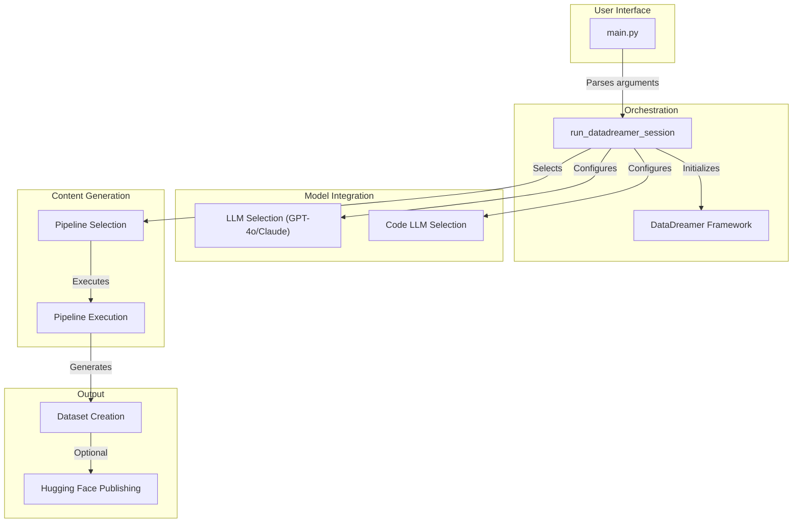
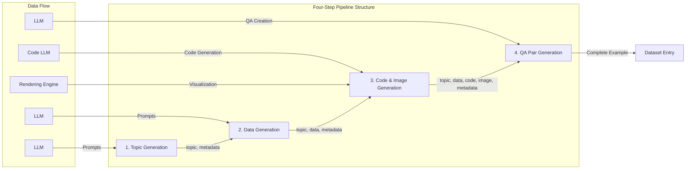
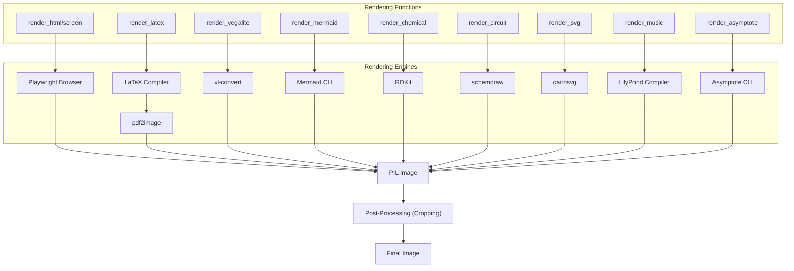
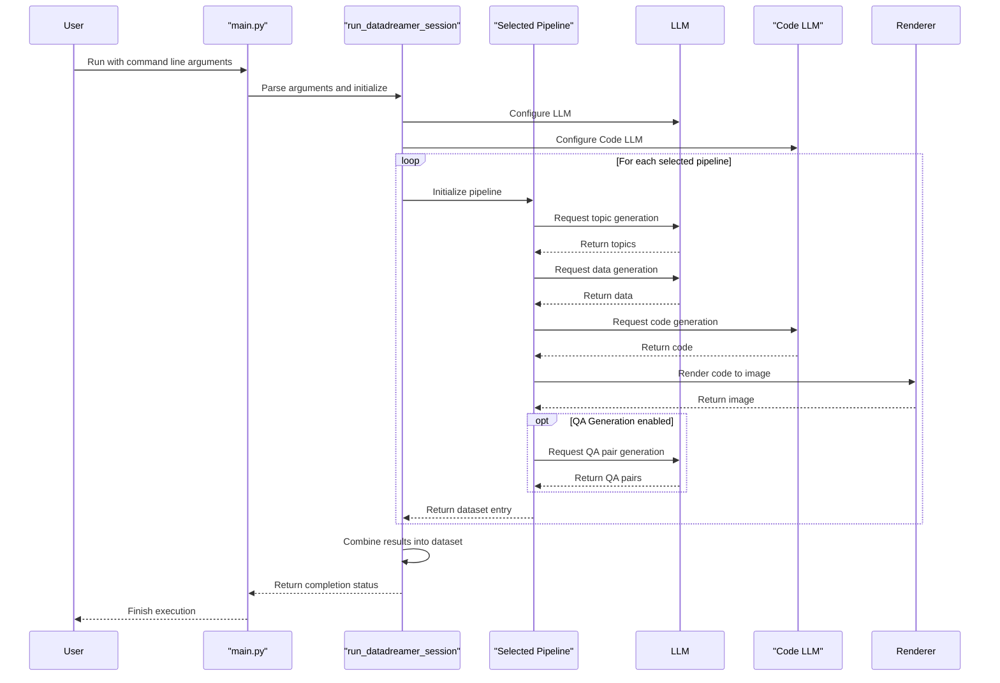

<!-- source: DeepWiki mcp.deepwiki.com · repo allenai/pixmo-docs · page 1 Overview · fetched 2026-10-26 -->

# Overview

<details>
<summary>Relevant source files</summary>

The following files were used as context for generating this wiki page:

- [LICENSE](LICENSE)
- [README.md](README.md)
- [main.py](main.py)

</details>


PixMo-Docs is a framework for generating synthetic datasets of text-rich images used to train multimodal models. It provides a comprehensive system for creating diverse visualizations including charts, tables, documents, diagrams, circuits, and specialized graphics. This document introduces the purpose, architecture, and key components of the PixMo-Docs repository. For specific setup instructions, see [Getting Started](#2).

## Purpose and Scope

The PixMo-Docs repository was created to generate several important datasets:
- **PixMo-Docs**: Used to train the [Molmo](https://arxiv.org/abs/2409.17146) model
- **CoSyn-400K**: An expanded version with improved pipelines and more document types
- **CoSyn-point**: A specialized dataset focusing on pointing tasks

These datasets contain synthetic text-rich images that help multimodal models learn to understand and reason about visual content containing textual information.

Sources: [README.md:1-3]()

## System Architecture Overview

The PixMo-Docs system follows a modular architecture organized around pipelines that generate different types of visual content. The system combines large language models (LLMs) with specialized rendering engines to create diverse, high-quality visuals.



Sources: [main.py:1-14](), [README.md:49-62]()

## Pipeline Structure

Each pipeline in PixMo-Docs follows a similar four-step structure to generate content:



Sources: [README.md:65-109]()

## Pipeline Categories

PixMo-Docs includes 25 pipelines organized into 8 categories, each specialized for different types of visual content:

| Category | Description | Key Pipelines |
|----------|-------------|---------------|
| **Chart** | Generates various chart visualizations | MatplotlibChartPipeline, PlotlyChartPipeline, VegaLiteChartPipeline, LaTeXChartPipeline, HTMLChartPipeline |
| **Table** | Creates tabular data visualizations | LaTeXTablePipeline, MatplotlibTablePipeline, PlotlyTablePipeline, HTMLTablePipeline |
| **Document** | Produces formatted text documents | LaTeXDocumentPipeline, HTMLDocumentPipeline, DOCXDocumentPipeline |
| **Diagram** | Generates flowcharts, trees, etc. | GraphvizDiagramPipeline, MermaidDiagramPipeline, LaTeXDiagramPipeline |
| **Circuit** | Creates electrical circuit diagrams | SchemDrawCircuitPipeline, LaTeXCircuitPipeline |
| **Specialized Graphics** | Produces domain-specific visuals | DALLEImagePipeline, RdkitChemicalPipeline, LaTeXMathPipeline, LilyPondMusicPipeline, SVGGraphicPipeline, AsymptoteGraphicPipeline |
| **Web Screens** | Renders HTML-based layouts | HTMLScreenPipeline |
| **Pointing** | Creates documents with structured points | HTMLDocumentPointPipeline |

Sources: [README.md:66-108]()

## Rendering System

PixMo-Docs includes a comprehensive rendering system that converts various data formats into images:



Sources: [README.md:21-46]()

## LLM Integration

PixMo-Docs integrates with state-of-the-art language models to generate content:

| LLM | Default Usage | Configuration |
|-----|---------------|--------------|
| GPT-4o | Primary LLM for general content | Set with `-l` or `--llm` |
| Claude Sonnet | Default for code generation | Set with `-c` or `--code_llm` |

Different LLMs are used for different stages of the pipeline, with specialized models handling code generation tasks.

Sources: [main.py:29-42]()

## Command Line Usage

The primary entry point for PixMo-Docs is the `main.py` script, which accepts various arguments to control dataset generation:

```
python main.py -p "{PIPELINE}" -t "{TYPE_OF_DATA}" -n {NUMBER_OF_SAMPLES} -m "{NAME_OF_DATASET}"
```

Key parameters include:
- `-p/--pipelines`: Pipelines to run (comma-separated)
- `-t/--types`: Types of visualizations to generate
- `-n/--num`: Number of visualizations to generate per pipeline
- `-m/--name`: Name of the dataset
- `-l/--llm`: Language model to use (default: gpt-4o)
- `-c/--code_llm`: Language model for code generation (default: claude-sonnet)
- `-q/--qa`: Whether to generate question-answer pairs (default: True)

Sources: [main.py:13-119](), [README.md:49-63]()

## Workflow Example

The following diagram illustrates a typical workflow for generating a dataset with PixMo-Docs:



Sources: [main.py:1-14](), [README.md:49-63]()

## Related Resources

For more information about the datasets generated by PixMo-Docs, refer to the following papers:
- Yang, Y., et al. (2025). Scaling Text-Rich Image Understanding via Code-Guided Synthetic Multimodal Data Generation.
- Deitke, M., et al. (2024). Molmo and pixmo: Open weights and open data for state-of-the-art multimodal models.

Sources: [README.md:113-132]()

For more detailed information about specific components, please refer to the following pages:
- [Getting Started](#2) for setup and basic usage
- [System Architecture](#3) for in-depth architecture details
- [Pipeline Categories](#4) for specific pipeline documentation
- [LLM Integration](#6) for details on language model integration

---

