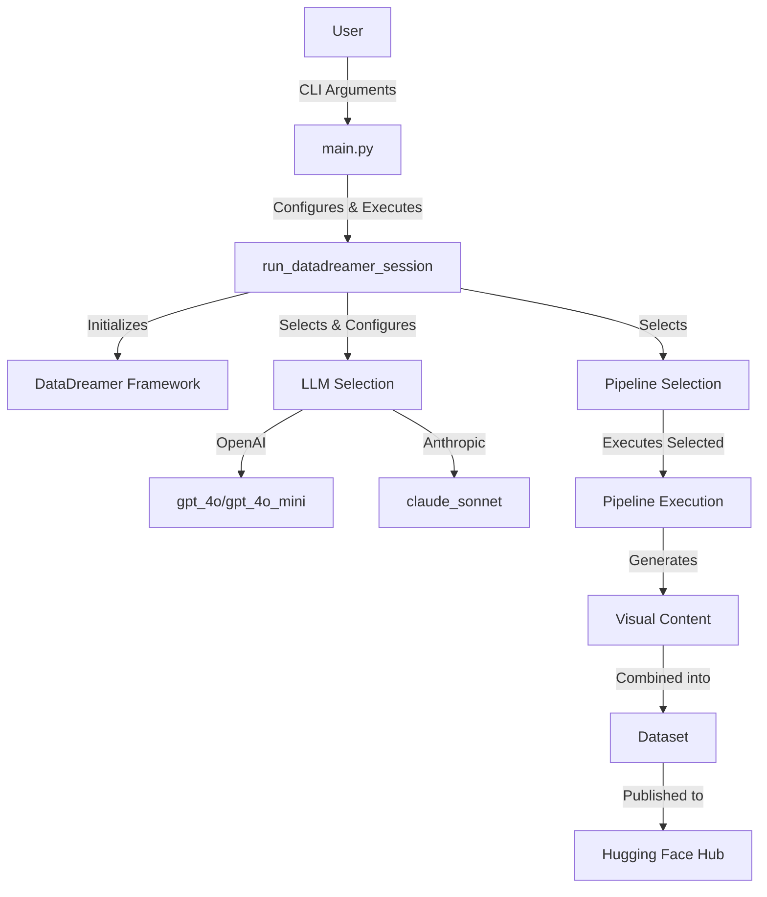
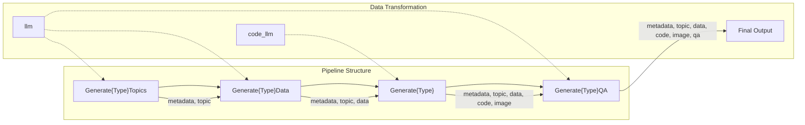
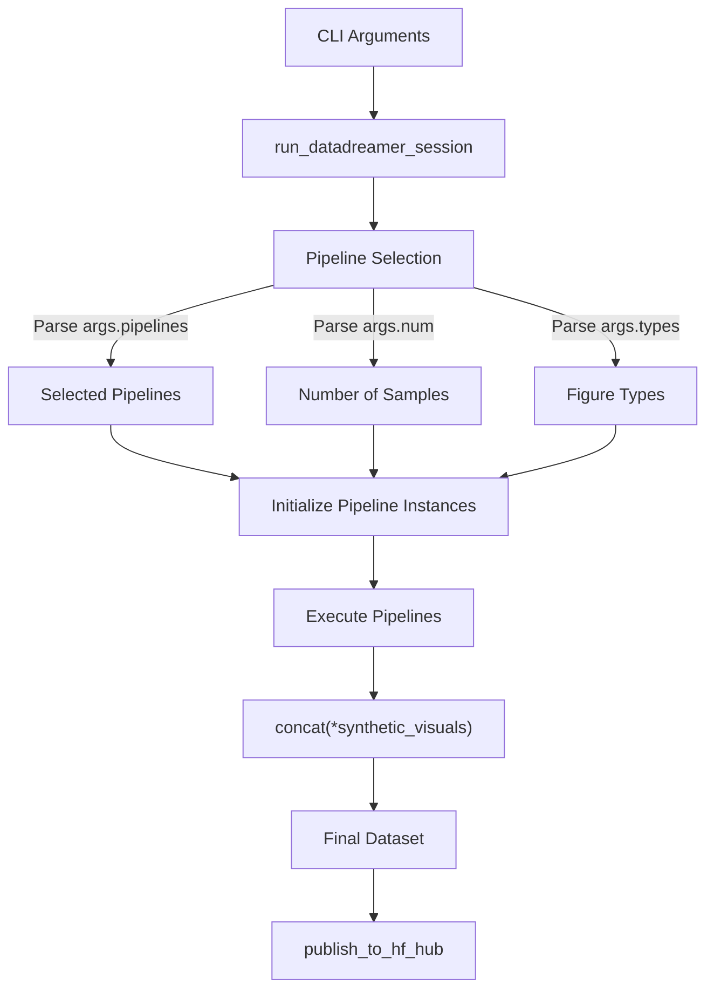
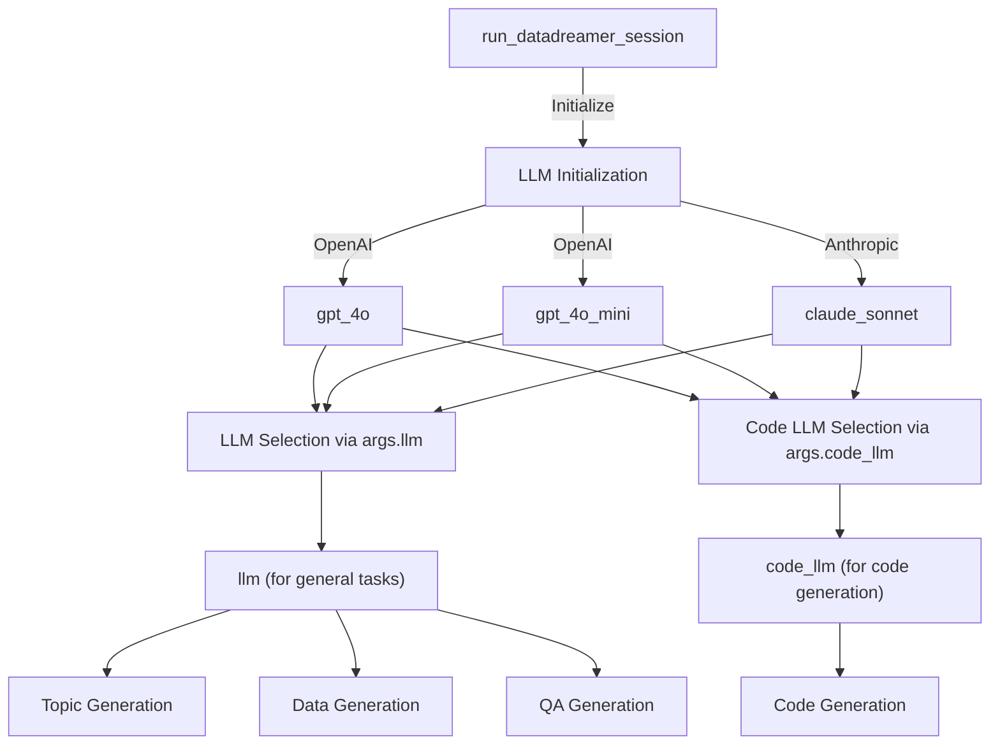
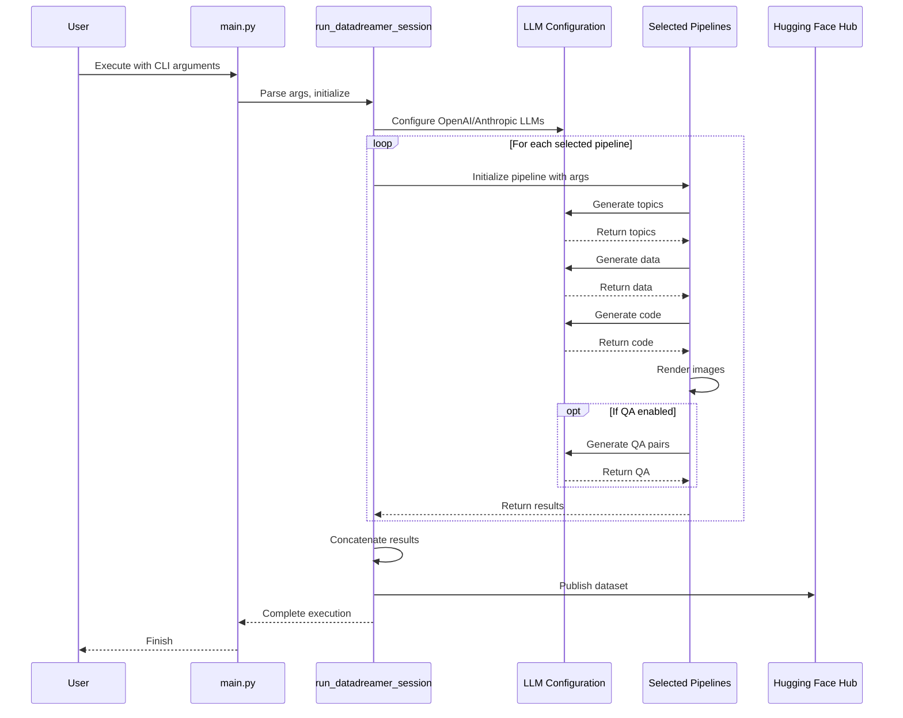

<!-- source: DeepWiki mcp.deepwiki.com · repo allenai/pixmo-docs · page 3 System Architecture · fetched 2026-10-26 -->

# System Architecture

Relevant source files

The following files were used as context for generating this wiki page:

- [LICENSE](LICENSE)
- [README.md](README.md)
- [pipeline/__init__.py](pipeline/__init__.py)
- [pipeline/all_pipelines.py](pipeline/all_pipelines.py)

## Purpose and Scope

This document describes the high-level architecture of the PixMo-Docs framework, which generates synthetic datasets of text-rich images for training multimodal models like Molmo. It outlines the core components, pipeline system, rendering capabilities, and data flow throughout the system. For information about the DataDreamer orchestration implementation details, see [DataDreamer Session](#3.1). For details about the rendering system implementation, see [Rendering System](#3.2).

## High-Level Architecture Overview

PixMo-Docs follows a modular architecture with several key components that work together to generate diverse visual content:

Sources:
- [pipeline/all_pipelines.py:42-148]()
- [pipeline/__init__.py:1-4]()

The system architecture centers around the `run_datadreamer_session` function, which orchestrates the entire generation process. It initializes the DataDreamer framework, configures LLMs, selects and executes pipelines, and publishes the generated dataset to Hugging Face Hub.

## Pipeline System

The framework consists of 25 pipelines organized into 8 categories, each specializing in generating different types of text-rich images:

| Category | Pipelines | Purpose |
|----------|-----------|---------|
| **Charts** | MatplotlibChartPipeline, PlotlyChartPipeline, VegaLiteChartPipeline, LaTeXChartPipeline, HTMLChartPipeline | Generate various chart types using different visualization libraries |
| **Tables** | LaTeXTablePipeline, MatplotlibTablePipeline, PlotlyTablePipeline, HTMLTablePipeline | Generate tabular data visualizations |
| **Documents** | LaTeXDocumentPipeline, HTMLDocumentPipeline, DOCXDocumentPipeline | Generate document formats with rich text and layout |
| **Diagrams** | GraphvizDiagramPipeline, MermaidDiagramPipeline, LaTeXDiagramPipeline | Generate flowcharts, sequence diagrams, etc. |
| **Circuits** | SchemDrawCircuitPipeline, LaTeXCircuitPipeline | Generate electrical circuit diagrams |
| **Specialized Graphics** | DALLEImagePipeline, RdkitChemicalPipeline, LaTeXMathPipeline, LilyPondMusicPipeline, SVGGraphicPipeline, AsymptoteGraphicPipeline | Generate domain-specific visualizations |
| **Web Screens** | HTMLScreenPipeline | Create webpage layouts and UI mockups |
| **Pointing** | HTMLDocumentPointPipeline | Generate documents with point references |

Sources:
- [pipeline/all_pipelines.py:76-102]()
- [README.md:66-108]()

### Pipeline Structure

Most pipelines follow a consistent 4-step structure:

The typical pipeline steps are:

1. **Topic Generation**: Generates domain-specific topics based on user-requested figure types
2. **Data Generation**: Creates appropriate data structures for the generated topics
3. **Code Generation & Rendering**: Generates code to visualize the data and renders it to an image
4. **QA Generation (optional)**: Creates question-answer pairs about the content

Each step inherits from a `SuperStep` class and has well-defined inputs and outputs, creating a structured data flow through the pipeline.

Sources:
- [pipeline/all_pipelines.py:120-135]()

## Pipeline Selection and Execution

The `run_datadreamer_session` function handles pipeline selection and execution based on user-provided arguments:

The pipeline selection process translates user input (pipeline names, figure types, and sample counts) into concrete pipeline instances that are executed sequentially. The results from all pipelines are concatenated using DataDreamer's `concat` function before being published to Hugging Face Hub.

Sources:
- [pipeline/all_pipelines.py:103-147]()

## LLM Integration

The system integrates with two LLM providers:

1. **OpenAI**: GPT-4o and GPT-4o mini
2. **Anthropic**: Claude Sonnet (version claude-3-7-sonnet-20250219)

These LLMs serve different functions within the pipeline:

The system allows separate selection of LLMs for general tasks and code generation tasks, providing flexibility to leverage the strengths of different models. The selected LLMs are passed to each pipeline during initialization.

Sources:
- [pipeline/all_pipelines.py:50-73]()
- [pipeline/all_pipelines.py:123-125]()

## End-to-End Data Generation Flow

The complete end-to-end process follows this sequence:

This workflow demonstrates how user input is transformed into a published dataset through a series of well-defined steps. The modular design allows for easy extension with new pipelines and visualization types.

Sources:
- [pipeline/all_pipelines.py:42-148]()
- [README.md:49-63]()

## System Requirements and Dependencies

The system relies on various external dependencies for rendering different types of content:

| Renderer | Required For | Installation |
|----------|--------------|-------------|
| LaTeX | Documents, diagrams, math, circuits | System-specific package manager |
| Mermaid CLI | Mermaid diagrams | npm install -g @mermaid-js/mermaid-cli |
| Playwright | HTML rendering, web screens | pip install playwright; playwright install |
| RDKit | Chemical structures | Included in requirements.txt |
| LilyPond | Music notation | System-specific package manager |
| Asymptote | Technical graphics | System-specific package manager |
| CairoSVG | SVG rendering | pip install cairosvg<=2.7.1 |

Each pipeline uses one or more of these renderers to convert the generated code into visual images. The specific renderer used depends on the pipeline type and the desired output format.

Sources:
- [README.md:22-47]()

---

