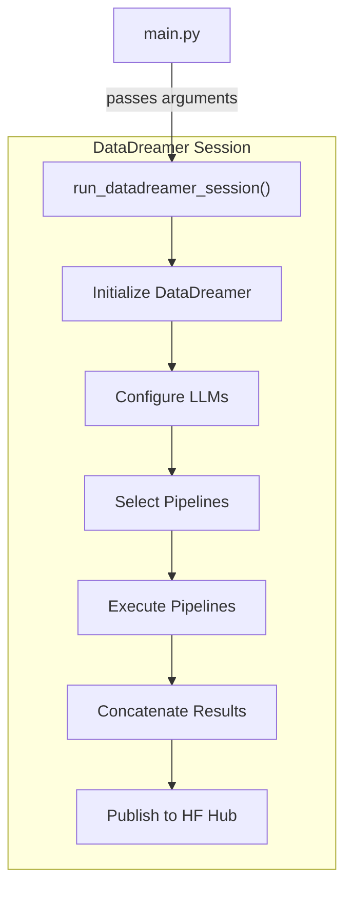
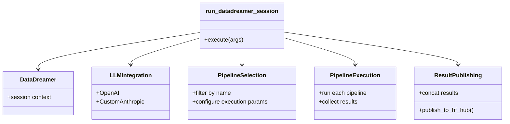
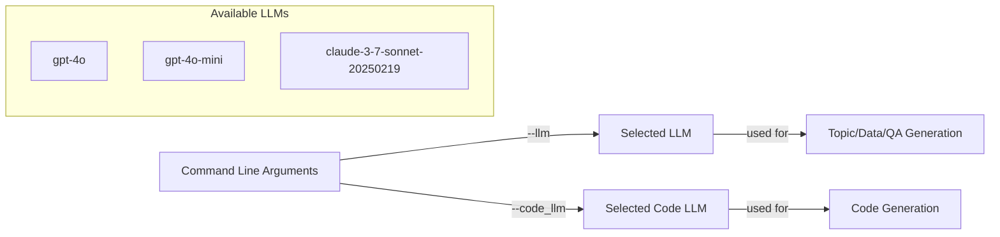
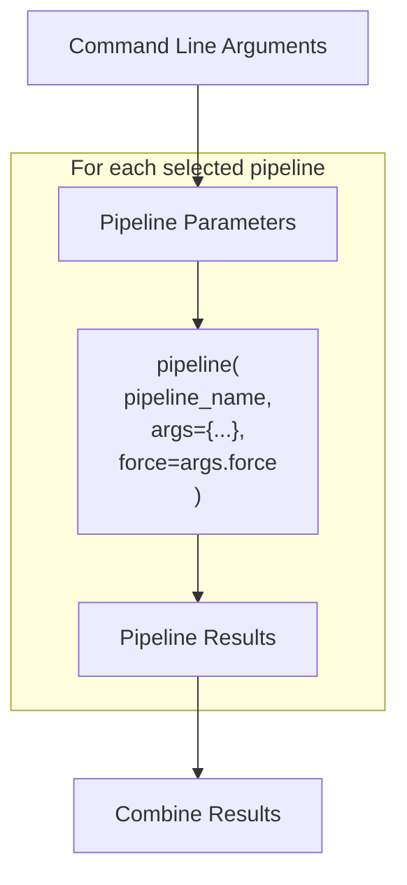
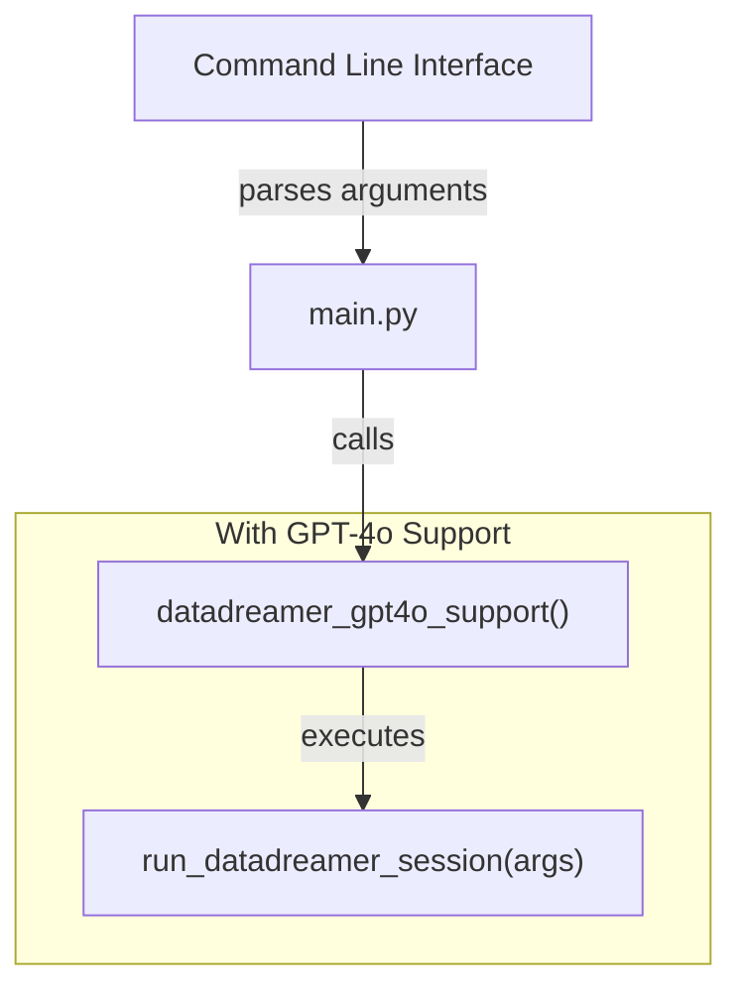
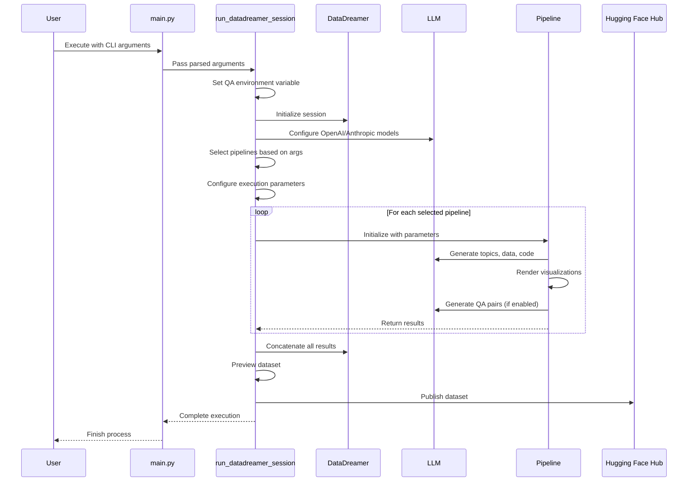

<!-- source: DeepWiki mcp.deepwiki.com · repo allenai/pixmo-docs · page 3.1 DataDreamer Session · fetched 2026-10-26 -->

# DataDreamer Session

<details>
<summary>Relevant source files</summary>

The following files were used as context for generating this wiki page:

- [main.py](main.py)
- [pipeline/all_pipelines.py](pipeline/all_pipelines.py)

</details>


This document details the DataDreamer Session component, which serves as the central orchestration mechanism for the PixMo-Docs system. The DataDreamer Session manages the selection, configuration, and execution of various rendering pipelines to generate synthetic datasets of text-rich images. For information about the specific rendering utilities used by these pipelines, see [Rendering System](#3.2).

## Purpose and Role

The DataDreamer Session acts as the bridge between user input (provided as command-line arguments) and the execution of pipelines that generate synthetic visual content. It initializes the DataDreamer framework, configures LLMs, selects and runs pipelines, and publishes the resulting dataset to Hugging Face Hub.



Sources: [pipeline/all_pipelines.py:42-147](), [main.py:8-10]()

## Function Overview

The `run_datadreamer_session` function is implemented in `all_pipelines.py` and serves as the main entry point for the data generation process. It handles the entire pipeline execution lifecycle, from initialization to result publication.



Sources: [pipeline/all_pipelines.py:42-147]()

## Key Components

### Environment Setup

The function begins by setting an environment variable that controls whether question-answer pairs should be generated:

```python
if args.qa:
    os.environ["GENERATE_QA"] = "true"
else:
    os.environ["GENERATE_QA"] = "false"
```

This environment variable is used by pipeline steps to determine whether to include QA generation.

Sources: [pipeline/all_pipelines.py:43-46]()

### DataDreamer Initialization

The function initializes a DataDreamer session with a specified output directory:

```python
with DataDreamer("./session_output"):
    # Session code follows...
```

This creates a context for executing steps and managing their outputs in the DataDreamer framework.

Sources: [pipeline/all_pipelines.py:48]()

### LLM Configuration

The function configures language models for text generation and code generation:

| LLM Type | Available Options | Purpose |
|----------|-------------------|---------|
| General LLM | GPT-4o, GPT-4o-mini, Claude Sonnet | Used for generating topics, data, and QA pairs |
| Code LLM | GPT-4o, GPT-4o-mini, Claude Sonnet | Specialized for generating code for visualization |

The function initializes these models with appropriate API keys and system prompts:



Sources: [pipeline/all_pipelines.py:50-73]()

### Pipeline Selection

The function contains a dictionary mapping pipeline names to their respective classes. It filters this dictionary based on the pipelines specified in the command-line arguments:

```python
pipelines = {
    "Generate Matplotlib Charts": MatplotlibChartPipeline,
    # Other pipelines...
}
pipelines = {
    k: v
    for k, v in pipelines.items()
    if v.__name__ in [p.strip() for p in args.pipelines.split(",")]
}
```

This allows users to select which pipelines to run by providing a comma-separated list of pipeline class names.

Sources: [pipeline/all_pipelines.py:76-107]()

### Execution Configuration

The function determines how many visualizations to generate per pipeline and which figure types to include:

```python
# Choose how many visualizes per pipeline
if "," in args.num:
    nums = [int(n.strip()) for n in args.num.strip(",")]
    assert len(nums) == len(pipelines)
else:
    nums = [int(args.num)] * len(pipelines)

# Get figure types
figure_types = [figure_type.strip() for figure_type in args.types.split(",")]
```

This flexible configuration allows users to specify different numbers of visualizations for each pipeline or a uniform count across all pipelines.

Sources: [pipeline/all_pipelines.py:109-117]()

### Pipeline Execution

The function runs each selected pipeline with the specified parameters:



Each pipeline is initialized with:
- A descriptive name
- Arguments including the LLMs, batch sizes, number of visualizations, seed, figure types, and QA flag
- A force flag to control regeneration behavior

Sources: [pipeline/all_pipelines.py:120-136]()

### Result Aggregation and Publication

After all pipelines have been executed, the function:
1. Combines the results using the `concat` function from DataDreamer
2. Previews the first 5 rows of the dataset
3. Publishes the dataset to the Hugging Face Hub

```python
# Combine results from each pipeline
scifi_dataset = concat(
    *synthetic_visuals, name="Combine results from all pipelines"
)

# Preview n rows of the dataset
print(scifi_dataset.head(n=5))

# Push to HuggingFace Hub
scifi_dataset.publish_to_hf_hub(args.name, private=True)
```

Sources: [pipeline/all_pipelines.py:139-147]()

## Command Line Integration

The `run_datadreamer_session` function is called from `main.py`, which parses command-line arguments and passes them to the function:



The main function wraps the DataDreamer session execution with the `datadreamer_gpt4o_support` context manager, which provides additional functionality for working with GPT-4o.

Sources: [main.py:8-10]()

## Parameters and Configuration Options

The DataDreamer Session accepts the following parameters through the `args` object:

| Parameter | Description | Default | Source |
|-----------|-------------|---------|--------|
| `openai_api_key` | API key for OpenAI services | Environment variable | [main.py:15-21]() |
| `anthropic_api_key` | API key for Anthropic services | Environment variable | [main.py:22-28]() |
| `llm` | LLM to use for general text generation | gpt-4o | [main.py:29-35]() |
| `code_llm` | LLM to use for code generation | claude-sonnet | [main.py:36-42]() |
| `pipelines` | Comma-separated list of pipeline class names | MatplotlibChartPipeline | [main.py:43-49]() |
| `num` | Number of visualizations per pipeline | 1 | [main.py:50-56]() |
| `seed` | Random seed for generation | 42 | [main.py:57-63]() |
| `batch_size` | Parallel requests to LLM | 24 | [main.py:64-70]() |
| `code_batch_size` | Parallel requests to code LLM | 24 | [main.py:71-77]() |
| `force` | Whether to force regeneration | False | [main.py:78-84]() |
| `name` | Dataset name on Hugging Face | scifi | [main.py:85-91]() |
| `types` | Types of visualizations to generate | bar chart | [main.py:92-98]() |
| `qa` | Whether to generate QA pairs | True | [main.py:99-105]() |

Sources: [main.py:14-105]()

## Execution Flow

The complete execution flow of the DataDreamer Session can be summarized as follows:



Sources: [pipeline/all_pipelines.py:42-147](), [main.py:8-10]()

This detailed flow shows how the DataDreamer Session manages the entire process from user input to dataset publication, coordinating between different components of the system.

---

