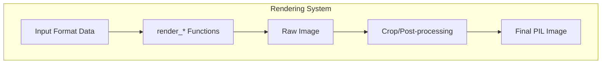
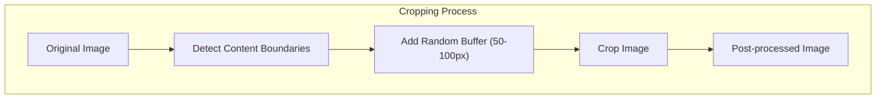
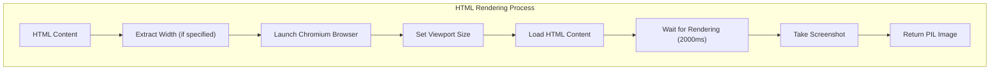
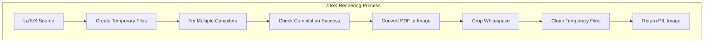
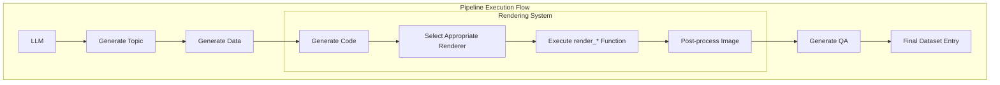
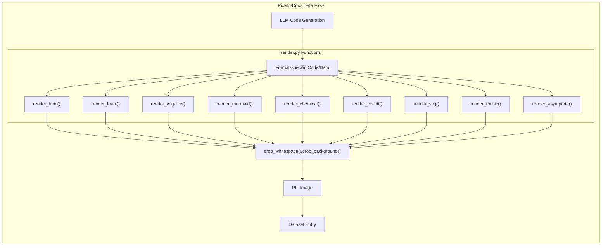

<!-- source: DeepWiki mcp.deepwiki.com · repo allenai/pixmo-docs · page 3.2 Rendering System · fetched 2026-10-26 -->

# Rendering System

Relevant source files

The following files were used as context for generating this wiki page:

- [pipeline/utils/render.py](pipeline/utils/render.py)

The Rendering System in PixMo-Docs provides a collection of utility functions that convert various data formats into standardized images. These utilities serve as the core rendering engine behind all pipeline types, handling everything from HTML and LaTeX documents to specialized formats like chemical structures and music notation. The system produces consistent PIL Image outputs that can be included in the synthetic datasets.

For information about how these rendering functions are used within pipeline execution, see [DataDreamer Session](#3.1).

## Overview

The rendering system is designed with modularity in mind, with each `render_*` function following a similar pattern:

1. Accept specialized format data as input (HTML, LaTeX, SMILES, etc.)
2. Process the input using appropriate libraries or external tools
3. Return a standardized PIL Image object
4. Optionally apply post-processing like whitespace cropping

Sources: [pipeline/utils/render.py:1-408]()

## Core Utility Functions

The rendering system includes two primary utility functions for image post-processing:

### Whitespace and Background Cropping

These functions automatically trim excess space from rendered images, with configurable padding:

- `crop_whitespace(image)`: Crops an image by detecting non-white pixels, with a random buffer of 50-100 pixels
- `crop_background(image)`: Similar to `crop_whitespace` but works with any background color (detected from the top-left pixel)

Sources: [pipeline/utils/render.py:16-75]()

## Rendering Implementations

The system provides implementations for various data formats, each with its own specialized renderer:

### HTML and Screen Rendering

For web content rendering:

- `render_html(html, full_page, random_width)`: Renders HTML content using Playwright's Chromium browser
- `render_screen(html, full_page, random_width)`: Similar to `render_html` but optimized for screen-like dimensions

Both functions support automatic width detection and random sizing to generate diverse outputs.

Sources: [pipeline/utils/render.py:78-153]()

### LaTeX Rendering

For mathematical and scientific content:

- `render_latex(latex_source)`: Converts LaTeX source to images via PDF compilation
  - Tries multiple compilers (pdflatex, xelatex, lualatex) for maximum compatibility
  - Uses pdf2image to convert PDF output to PIL Image

Sources: [pipeline/utils/render.py:156-205]()

### Data Visualization Rendering

For charts and data visualizations:

- `render_vegalite(vegalite_json)`: Renders VegaLite JSON specifications to images using vl-convert
  - Applies random scaling (1.5x, 2x, 2.5x, or 3x) for variety

Sources: [pipeline/utils/render.py:208-211]()

### Diagram Rendering

For diagram code:

- `render_mermaid(mermaid_code)`: Renders Mermaid diagrams using the Mermaid CLI
  - Uses random scaling (2x or 3x) for better image quality

Sources: [pipeline/utils/render.py:214-240]()

### Chemical Structure Rendering

For chemistry-related content:

- `render_chemical(smiles, dpi)`: Renders chemical structures from SMILES notation
  - Uses RDKit to convert SMILES strings to structured molecules
  - Supports atom indices, stereo annotations, and colorization
  - Applies random styling for diverse outputs

Sources: [pipeline/utils/render.py:243-299]()

### Circuit Diagram Rendering

For electrical engineering diagrams:

- `render_circuit(circuit)`: Renders circuit diagrams created with SchemDraw
  - Applies random DPI settings (100-300) for image quality variation

Sources: [pipeline/utils/render.py:345-364]()

### SVG Rendering

For vector graphics:

- `render_svg(svg_string)`: Converts SVG strings to PNG images using CairoSVG
  - Uses random DPI settings (150-300) for detail variation

Sources: [pipeline/utils/render.py:367-372]()

### Music Notation Rendering

For musical scores:

- `render_music(lilypound_code)`: Renders LilyPond music notation to images
  - Invokes LilyPond compiler to generate PNG output
  - Applies background cropping for cleaner results

Sources: [pipeline/utils/render.py:302-342]()

### Asymptote Graphics Rendering

For mathematical diagrams:

- `render_asymptote(asymptote_code)`: Renders Asymptote graphics code to images
  - Uses random resolution settings (3-6) for detail variation

Sources: [pipeline/utils/render.py:375-408]()

## Rendering Flow in the Pipeline System

The rendering system integrates with the pipeline architecture as the final step in visualization generation. Each pipeline uses one or more rendering functions to convert generated code into images:

Sources: [pipeline/utils/render.py:1-408]()

## Dependencies and External Tools

The rendering system relies on various external tools and libraries:

| Renderer | External Dependencies | Python Libraries |
|----------|----------------------|------------------|
| HTML/Screen | Chromium (via Playwright) | playwright |
| LaTeX | pdflatex, xelatex, lualatex | pdf2image |
| VegaLite | None | vl_convert |
| Mermaid | Mermaid CLI (mmdc) | None |
| Chemical | None | rdkit |
| Circuit | None | schemdraw |
| SVG | None | cairosvg |
| Music | LilyPond compiler | None |
| Asymptote | Asymptote CLI (asy) | None |

Each renderer handles the complexities of interacting with these dependencies, providing a clean interface for the rest of the system.

Sources: [pipeline/utils/render.py:1-15]()

## Integration Within the PixMo-Docs System

The rendering system sits between the code generation step and the final dataset output:

This system architecture ensures that all generated content, regardless of its original format, is consistently rendered into high-quality images suitable for training multimodal models.

Sources: [pipeline/utils/render.py:1-408]()

---

