<!-- source: DeepWiki mcp.deepwiki.com · repo allenai/pixmo-docs · page 4 Pipeline Categories · fetched 2026-10-26 -->

# Pipeline Categories

Relevant source files

The following files were used as context for generating this wiki page:

- [LICENSE](LICENSE)
- [README.md](README.md)
- [pipeline/all_pipelines.py](pipeline/all_pipelines.py)

## Purpose and Scope

This document provides a comprehensive overview of the pipeline categories in the PixMo-Docs system. These pipelines are the core mechanisms for generating synthetic text-rich images used to train multimodal models like Molmo. The document covers all 25 pipelines organized into 8 main categories, explaining their purposes, technologies, and characteristics. For details on how these pipelines are executed in the overall system, see [System Architecture](#3) and [DataDreamer Session](#3.1).

Sources: [README.md:65-109]()

## Pipeline Category Overview

The PixMo-Docs system organizes its 25 pipelines into 8 distinct categories, each specialized for generating specific types of text-rich visual content. Each pipeline uses a particular renderer or programming language to generate the synthetic data.

```mermaid
graph TD
    subgraph "Pipeline Categories"
        P["All Pipelines"] --> C["Chart Pipelines"]
        P --> T["Table Pipelines"]
        P --> D["Document Pipelines"]
        P --> DG["Diagram Pipelines"]
        P --> CR["Circuit Pipelines"]
        P --> S["Specialized Graphics Pipelines"]
        P --> W["Web Screen Pipelines"]
        P --> PT["Pointing Pipelines"]
    end
    
    subgraph "Pipeline Implementation"
        C --> |"implements"| C1["MatplotlibChartPipeline"]
        C --> |"implements"| C2["PlotlyChartPipeline"]
        C --> |"implements"| C3["VegaLiteChartPipeline"]
        C --> |"implements"| C4["LaTeXChartPipeline"]
        C --> |"implements"| C5["HTMLChartPipeline"]
        
        T --> |"implements"| T1["LaTeXTablePipeline"]
        T --> |"implements"| T2["MatplotlibTablePipeline"]
        T --> |"implements"| T3["PlotlyTablePipeline"]
        T --> |"implements"| T4["HTMLTablePipeline"]
        
        D --> |"implements"| D1["LaTeXDocumentPipeline"]
        D --> |"implements"| D2["HTMLDocumentPipeline"]
        D --> |"implements"| D3["DOCXDocumentPipeline"]
        
        DG --> |"implements"| DG1["GraphvizDiagramPipeline"]
        DG --> |"implements"| DG2["MermaidDiagramPipeline"]
        DG --> |"implements"| DG3["LaTeXDiagramPipeline"]
        
        CR --> |"implements"| CR1["SchemDrawCircuitPipeline"]
        CR --> |"implements"| CR2["LaTeXCircuitPipeline"]
        
        S --> |"implements"| S1["DALLEImagePipeline"]
        S --> |"implements"| S2["RdkitChemicalPipeline"]
        S --> |"implements"| S3["LaTeXMathPipeline"]
        S --> |"implements"| S4["LilyPondMusicPipeline"]
        S --> |"implements"| S5["SVGGraphicPipeline"]
        S --> |"implements"| S6["AsymptoteGraphicPipeline"]
        
        W --> |"implements"| W1["HTMLScreenPipeline"]
        
        PT --> |"implements"| PT1["HTMLDocumentPointPipeline"]
    end
```

Sources: [README.md:66-109](), [pipeline/all_pipelines.py:9-40]()

## Pipeline Selection and Execution

In the PixMo-Docs system, pipelines are selected and executed via the `run_datadreamer_session` function. This function initializes the DataDreamer framework, configures the selected LLMs, and executes the chosen pipelines based on the command-line arguments.

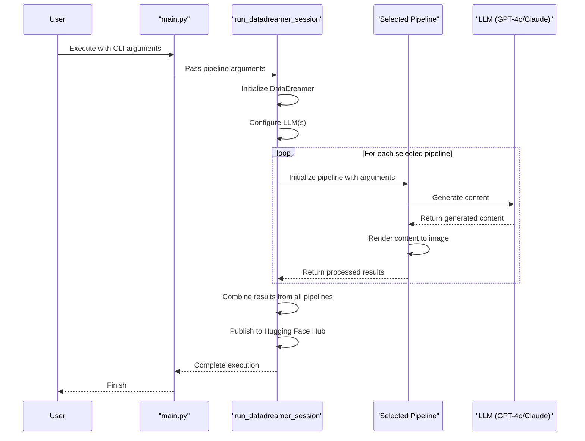

Sources: [pipeline/all_pipelines.py:42-147]()

## 1. Chart Pipelines

Chart pipelines generate various types of data visualizations like bar charts, line charts, scatter plots, and more complex chart types.

| Pipeline | Technology | Capabilities | Limitations |
|----------|------------|--------------|-------------|
| MatplotlibChartPipeline | Matplotlib | Wide range of chart types with detailed customization | Python-based, requires script execution |
| PlotlyChartPipeline | Plotly | Interactive charts with rich features | Complex structure for simple charts |
| VegaLiteChartPipeline | Vega-Lite | Declarative JSON-based grammar of graphics | Requires vl-convert for rendering |
| LaTeXChartPipeline | TikZ/LaTeX | Precise vector graphics | Limited to simpler chart types |
| HTMLChartPipeline | HTML/CSS | Browser-rendered charts | Limited to basic chart types |

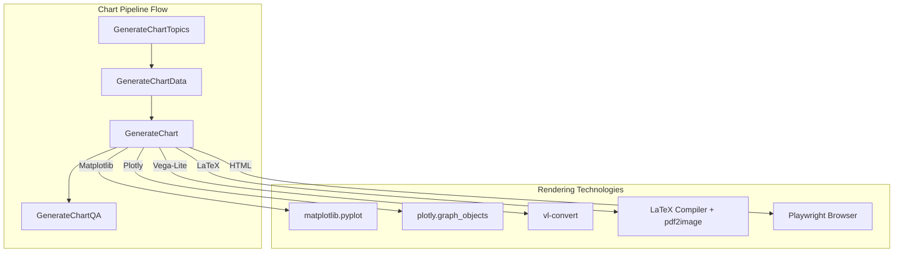

Sources: [README.md:69-74](), [pipeline/all_pipelines.py:9-14](), [pipeline/all_pipelines.py:77-81]()

## 2. Table Pipelines

Table pipelines are specialized for generating tabular data visualizations with various formatting options and complexity levels.

| Pipeline | Technology | Capabilities | Limitations |
|----------|------------|--------------|-------------|
| LaTeXTablePipeline | LaTeX | Complex table structures with precise formatting | Requires LaTeX compiler |
| MatplotlibTablePipeline | Matplotlib | Tables rendered within figures | Limited formatting options |
| PlotlyTablePipeline | Plotly | Simple tabular data | Best for single-header tables |
| HTMLTablePipeline | HTML/CSS | Style-rich tables | Best for simpler table structures |

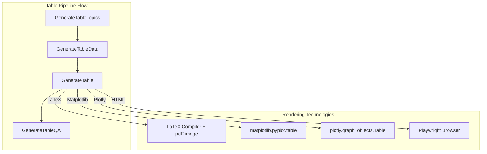

Sources: [README.md:76-80](), [pipeline/all_pipelines.py:16-19](), [pipeline/all_pipelines.py:82-85]()

## 3. Document Pipelines

Document pipelines generate multi-page or complex layout text documents with various formatting and structure.

| Pipeline | Technology | Capabilities | Limitations |
|----------|------------|--------------|-------------|
| LaTeXDocumentPipeline | LaTeX | Professional documents with complex formatting | Requires LaTeX compiler |
| HTMLDocumentPipeline | HTML/CSS | Web-style documents with diverse styles | Browser-dependent rendering |
| DOCXDocumentPipeline | docx | Microsoft Word-compatible documents | Limited formatting compared to LaTeX |

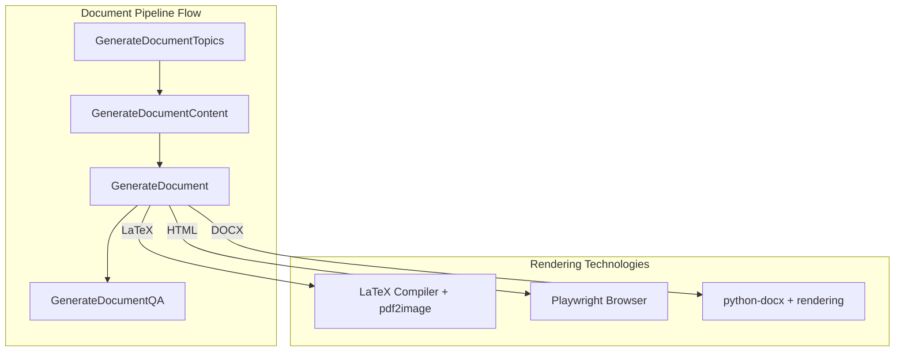

Sources: [README.md:82-85](), [pipeline/all_pipelines.py:20-22](), [pipeline/all_pipelines.py:86-88]()

## 4. Diagram Pipelines

Diagram pipelines produce various types of schematic visualizations like flowcharts, entity-relationship diagrams, trees, and other structured representations.

| Pipeline | Technology | Capabilities | Limitations |
|----------|------------|--------------|-------------|
| GraphvizDiagramPipeline | Graphviz | Directed graphs, trees, networks | Limited stylistic options |
| MermaidDiagramPipeline | Mermaid | Flowcharts, sequence diagrams, gantt charts | Simpler syntax but fewer features than Graphviz |
| LaTeXDiagramPipeline | TikZ/LaTeX | Precise control over diagram layout | Steeper learning curve |

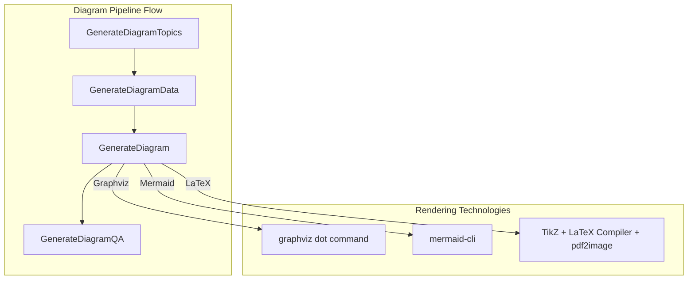

Sources: [README.md:87-90](), [pipeline/all_pipelines.py:24-26](), [pipeline/all_pipelines.py:89-91]()

## 5. Circuit Pipelines

Circuit pipelines are specialized for generating electrical and electronic circuit diagrams with appropriate symbols and connections.

| Pipeline | Technology | Capabilities | Limitations |
|----------|------------|--------------|-------------|
| SchemDrawCircuitPipeline | SchemDraw | Python-based electrical circuit diagrams | Limited to specific circuit types |
| LaTeXCircuitPipeline | TikZ/CircuiTikZ | Precise control over circuit layout | Requires LaTeX knowledge |

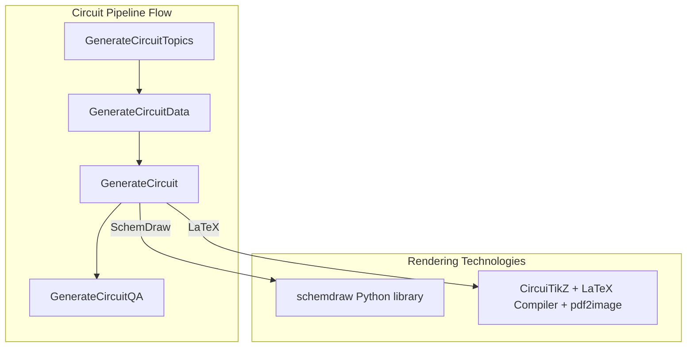

Sources: [README.md:92-94](), [pipeline/all_pipelines.py:33-34](), [pipeline/all_pipelines.py:96-97]()

## 6. Specialized Graphics Pipelines

Specialized graphics pipelines generate domain-specific visualizations that don't fit into other categories, including AI-generated images, chemical structures, mathematical expressions, music notation, and vector graphics.

| Pipeline | Technology | Capabilities | Limitations |
|----------|------------|--------------|-------------|
| DALLEImagePipeline | DALL·E API | AI-generated images from text prompts | Requires OpenAI API access |
| RdkitChemicalPipeline | RDKit | Chemical structure diagrams | Limited to chemical notation |
| LaTeXMathPipeline | LaTeX math | Mathematical expressions and equations | Requires LaTeX compiler |
| LilyPondMusicPipeline | LilyPond | Music notation and sheet music | Requires LilyPond compiler |
| SVGGraphicPipeline | SVG | Vector graphics in web-standard format | Limited to SVG capabilities |
| AsymptoteGraphicPipeline | Asymptote | Technical vector graphics | Requires Asymptote compiler |

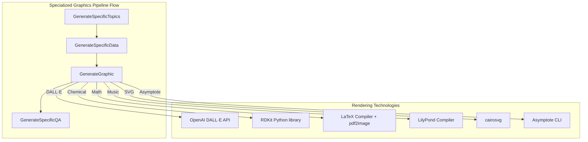

Sources: [README.md:96-102](), [pipeline/all_pipelines.py:28-32](), [pipeline/all_pipelines.py:35-37](), [pipeline/all_pipelines.py:92-95](), [pipeline/all_pipelines.py:98-99]()

## 7. Web Screen Pipelines

Web screen pipelines generate realistic screenshots of web interfaces and applications.

| Pipeline | Technology | Capabilities | Limitations |
|----------|------------|--------------|-------------|
| HTMLScreenPipeline | HTML/CSS/Playwright | Complete web screen layouts | Requires Playwright and Chrome/Chromium |

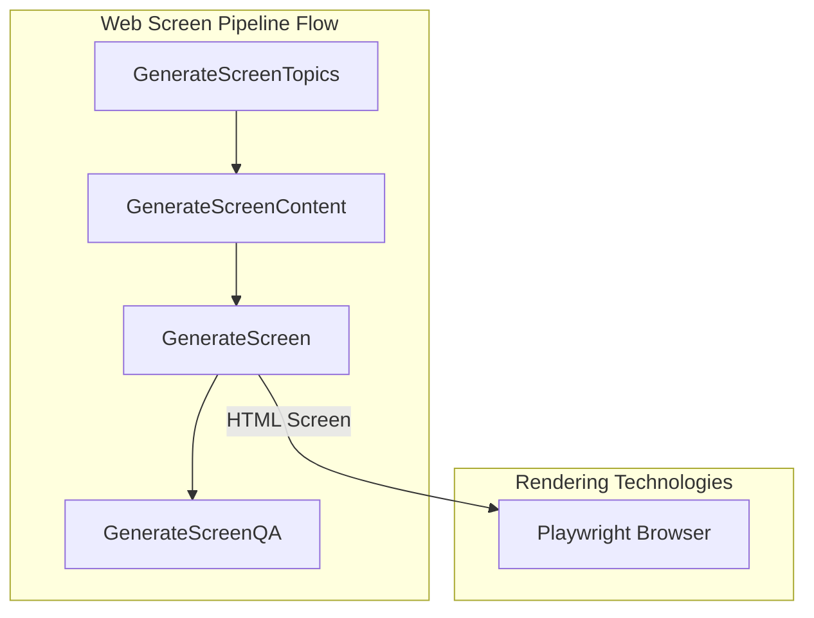

Sources: [README.md:104-105](), [pipeline/all_pipelines.py:40](), [pipeline/all_pipelines.py:101]()

## 8. Pointing Pipelines

Pointing pipelines generate documents with structured point references, useful for training models on reference resolution tasks.

| Pipeline | Technology | Capabilities | Limitations |
|----------|------------|--------------|-------------|
| HTMLDocumentPointPipeline | HTML/CSS | Documents with structured point references | Limited to HTML-based pointing |

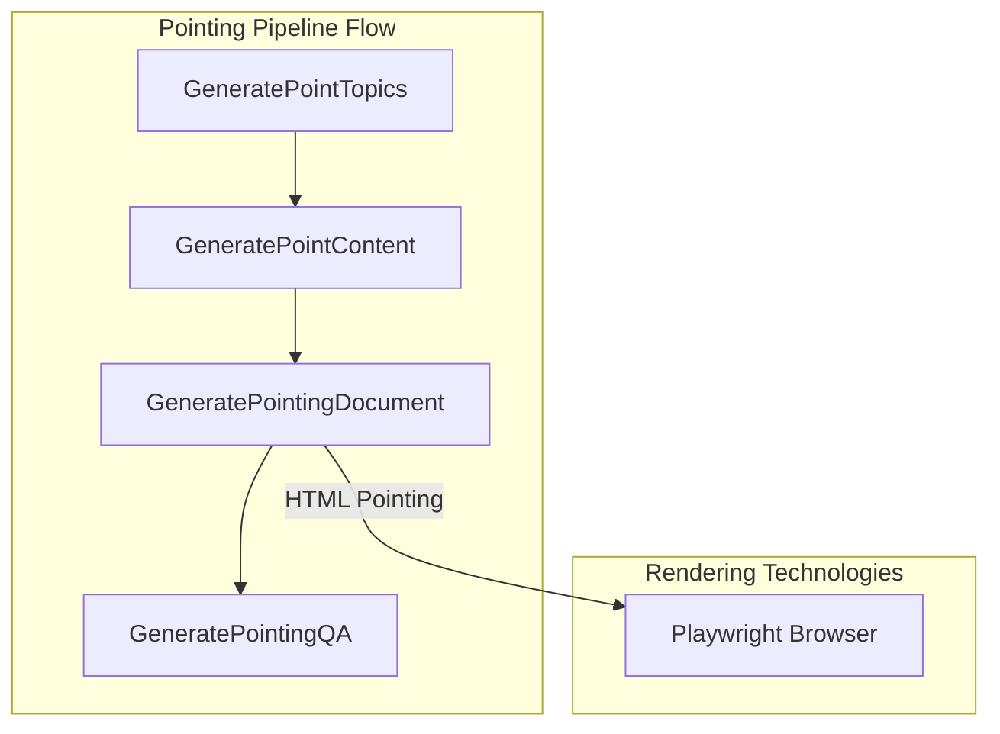

Sources: [README.md:108-109](), [pipeline/all_pipelines.py:39](), [pipeline/all_pipelines.py:100]()

## Pipeline Integration in System Architecture

The pipelines are executed as part of the overall data generation flow, which is managed by the `run_datadreamer_session` function. This function orchestrates the creation of synthetic data by selecting and configuring the appropriate pipelines based on user input.

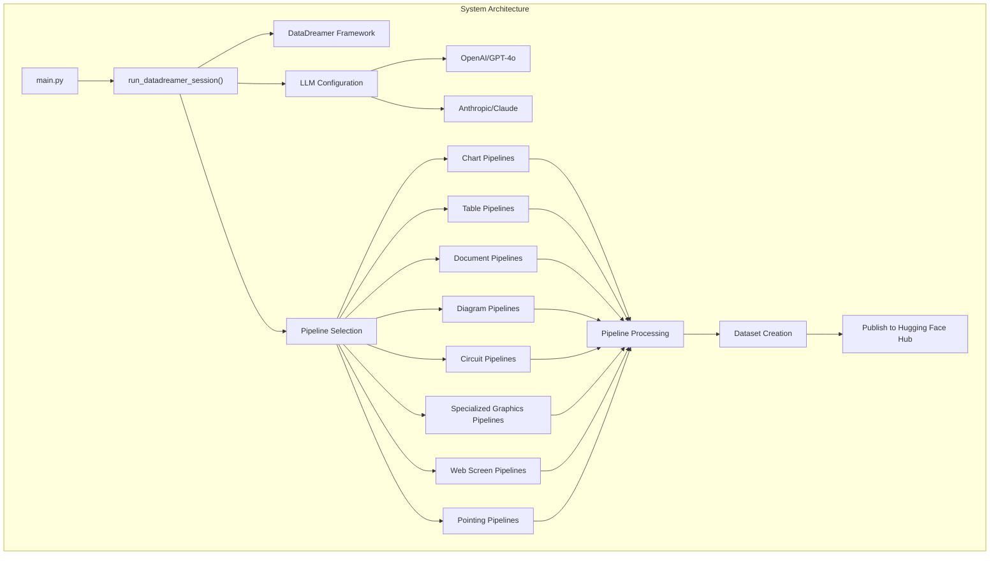

Sources: [pipeline/all_pipelines.py:42-147]()

## Common Pipeline Structure

Most pipelines in the system follow a similar four-step structure, which ensures consistency across different pipeline categories while allowing for specialized implementation details.

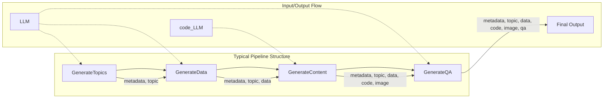

This structure illustrates how each pipeline processes data through sequential steps:
1. Topic generation
2. Data preparation based on topics
3. Content generation (code + image rendering)
4. Question-answer pair generation (optional)

Sources: [pipeline/all_pipelines.py:119-134]()

## Conclusion

The Pipeline Categories in PixMo-Docs provide a flexible and extensible framework for generating a wide variety of text-rich images for training multimodal models. Each pipeline category specializes in a particular type of visual content, and the system architecture ensures that these pipelines can be easily selected, configured, and executed to generate synthetic datasets. For more details on how to execute these pipelines from the command line, see [Command Line Usage](#7).

---

