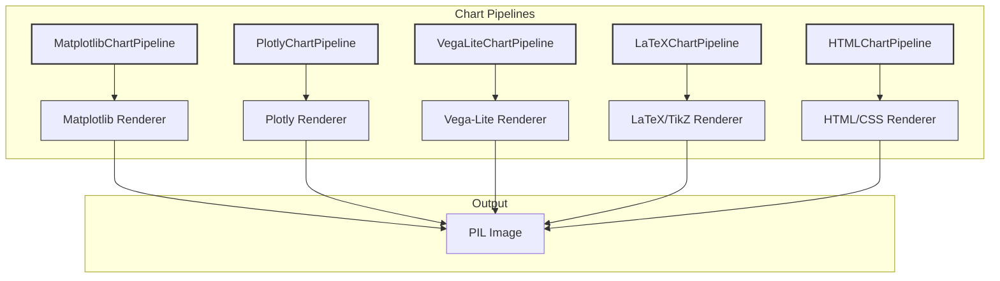
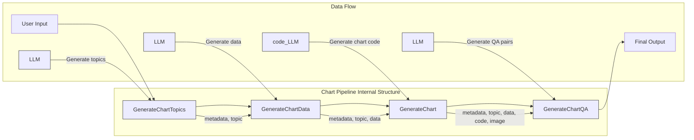
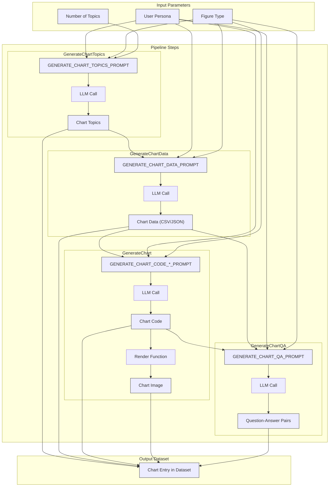

<!-- source: DeepWiki mcp.deepwiki.com · repo allenai/pixmo-docs · page 4.1 Chart Pipelines · fetched 2026-10-26 -->

# Chart Pipelines

<details>
<summary>Relevant source files</summary>

The following files were used as context for generating this wiki page:

- [LICENSE](LICENSE)
- [README.md](README.md)
- [pipeline/prompts/chart_prompts.py](pipeline/prompts/chart_prompts.py)

</details>


## Purpose and Scope

This document details the chart generation pipelines in the PixMo-Docs system. Chart Pipelines are responsible for generating visual representations of data in various formats using different rendering technologies. These pipelines create synthetic dataset images for training multimodal models like Molmo.

For information about other types of visualizations, see the following related pages:
- [Table Pipelines](#4.2)
- [Diagram Pipelines](#4.3)
- [Specialized Graphics Pipelines](#4.4)

Sources: [README.md:69-74]()

## Chart Pipeline Types

The PixMo-Docs system supports five distinct Chart Pipeline implementations, each using a different rendering technology:



Each pipeline specializes in generating charts with different capabilities:

| Pipeline | Renderer | Strengths | Limitations |
|----------|----------|-----------|-------------|
| MatplotlibChartPipeline | Matplotlib | Highly customizable, extensive gallery of chart types | Python-based, less interactive |
| PlotlyChartPipeline | Plotly | Interactive charts, modern aesthetics | More complex for basic charts |
| VegaLiteChartPipeline | Vega-Lite | Declarative JSON syntax, visualization grammar | JSON-based, limited to web rendering |
| LaTeXChartPipeline | TikZ | Publication-quality, precise control | Only works for simple charts, requires LaTeX |
| HTMLChartPipeline | HTML/CSS | Web standard, widely compatible | Only works for simple charts |

Sources: [README.md:69-74]()

## Chart Pipeline Architecture

The chart pipelines follow a common 4-step process that converts prompts into final chart images with associated metadata:



Each step in the pipeline serves a specific purpose:

1. **Topic Generation**: Creates chart topics based on user-provided parameters and persona
2. **Data Generation**: Produces structured data relevant to the topic
3. **Chart Generation**: Creates visualization code and renders the image
4. **QA Generation**: Creates question-answer pairs about the chart content

Sources: [pipeline/prompts/chart_prompts.py:1-379]()

## Chart Generation Process

### Step 1: Topic Generation

The first step generates chart topics using the `GENERATE_CHART_TOPICS_PROMPT`. The prompt takes:
- User persona (e.g., "data scientist", "business analyst")
- Number of topics to generate
- Figure type (e.g., "bar chart", "line chart")

The LLM returns diverse topics suitable for visualization with the specified chart type.

Sources: [pipeline/prompts/chart_prompts.py:6-16]()

### Step 2: Data Generation

The second step creates structured data for the chosen topic using the `GENERATE_CHART_DATA_PROMPT` or `GENERATE_CHART_DATA_JSON_PROMPT`. The prompt takes:
- User persona
- Selected topic
- Figure type

The LLM returns data in CSV or JSON format that is appropriate for the chart type.

Sources: [pipeline/prompts/chart_prompts.py:21-46]()

### Step 3: Chart Generation

The third step generates the chart code and renders it as an image. This step uses specialized prompts based on the rendering technology:

| Renderer | Prompt Constant | Input Format | Output Format |
|----------|----------------|--------------|---------------|
| Matplotlib | GENERATE_CHART_CODE_MATPLOTLIB_PROMPT | CSV (DataFrame) | Python code |
| Plotly | GENERATE_CHART_CODE_PLOTLY_PROMPT | CSV (DataFrame) | Python code |
| Vega-Lite | GENERATE_CHART_CODE_VEGALITE_PROMPT | JSON | Vega-Lite JSON |
| LaTeX | GENERATE_CHART_CODE_LATEX_PROMPT | CSV | LaTeX code |
| HTML | GENERATE_CHART_CODE_HTML_PROMPT | JSON | HTML/CSS code |

Each prompt instructs the LLM to generate code that:
1. Imports necessary libraries
2. Creates a `generate_plot` function (for Python-based renderers)
3. Formats the data appropriately
4. Applies styling and customizations
5. Renders and returns the chart as a PIL Image

Sources: [pipeline/prompts/chart_prompts.py:131-268]()

### Step 4: QA Generation

The final step generates question-answer pairs about the chart using the `GENERATE_CHART_QA_PROMPT` or other specialized QA prompts. The prompt takes:
- User persona
- Topic
- Figure type
- Data used to generate the chart
- Code that generated the chart

The LLM returns QA pairs that:
1. Vary in complexity (basic to complex reasoning)
2. Cover different question types (short-answer, multiple-choice, yes/no, summary)
3. Include explanations for answers
4. Are formatted for easy parsing

Sources: [pipeline/prompts/chart_prompts.py:51-88](), [pipeline/prompts/chart_prompts.py:302-379]()

## Chart Type Support Matrix

Different chart pipelines support various chart types with varying degrees of capability:

| Chart Type | Matplotlib | Plotly | Vega-Lite | LaTeX | HTML |
|------------|:----------:|:------:|:---------:|:-----:|:----:|
| Bar Chart | ✓ | ✓ | ✓ | ✓ | ✓ |
| Line Chart | ✓ | ✓ | ✓ | ✓ | ✓ |
| Scatter Plot | ✓ | ✓ | ✓ | ✓ | ✓ |
| Pie Chart | ✓ | ✓ | ✓ | ✓ | ✓ |
| Box Plot | ✓ | ✓ | ✓ | ✗ | ✗ |
| Histogram | ✓ | ✓ | ✓ | ✗ | ✗ |
| Heatmap | ✓ | ✓ | ✓ | ✗ | ✗ |
| 3D Plots | ✓ | ✓ | ✗ | ✗ | ✗ |
| Interactive | ✗ | ✓* | ✓* | ✗ | ✗ |
| Custom Styling | ✓ | ✓ | ✓ | ✓ | ✓ |

*Note: Though Plotly and Vega-Lite support interactivity, the final output is a static image.

Sources: [README.md:69-74]()

## Chart Pipeline Data Flow

The following diagram illustrates how data flows through the chart generation system:



Sources: [pipeline/prompts/chart_prompts.py:1-379]()

## Usage Examples

To generate charts using the command line interface:

```bash
python main.py -p "MatplotlibChartPipeline" -t "bar chart" -n 5 -m "matplotlib_bar_charts"
```

This command will:
1. Use the MatplotlibChartPipeline
2. Generate 5 bar charts
3. Save the results with the name "matplotlib_bar_charts"

You can generate multiple chart types using comma-separated values:

```bash
python main.py -p "MatplotlibChartPipeline,PlotlyChartPipeline" -t "line chart,scatter plot" -n 10 -m "mixed_charts"
```

See [Command Line Usage](#7) for more detailed information on available arguments.

Sources: [README.md:49-59]()

## QA Generation Support

Chart pipelines support different types of question generation to create rich training data:

| Question Type | Description | Example |
|---------------|-------------|---------|
| Basic | Visual elements, titles, axes | "What is the title of the chart?" |
| Visual | Properties of graphical marks | "What color is the bar for Category A?" |
| Compositional | Multi-step operations | "What is the average of the top three values?" |
| Comparison | Relationships between elements | "Which category has the highest value?" |
| Data Retrieval | Specific values | "What is the value for 2023?" |
| Reasoning | Multi-step logic | "If trend continues, what will the value be next year?" |
| Yes/No | Binary questions | "Is Category A greater than Category B?" |
| Multiple-choice | Selection from options | "Which is true about the chart? A) ... B) ... C) ..." |

See [QA Generation](#5) for more information on how QA pairs are generated.

Sources: [pipeline/prompts/chart_prompts.py:302-341]()

---

