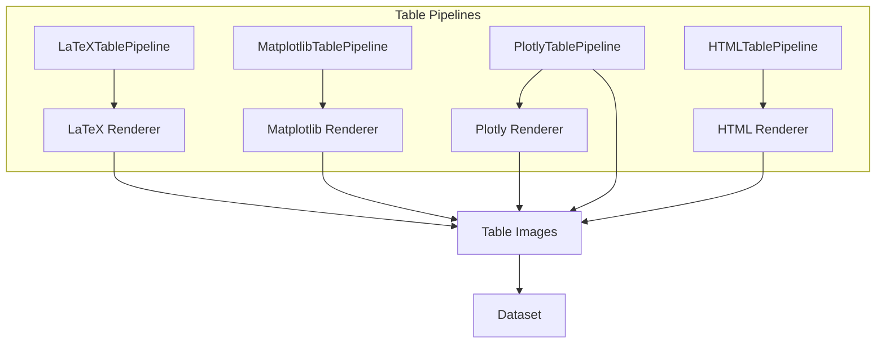
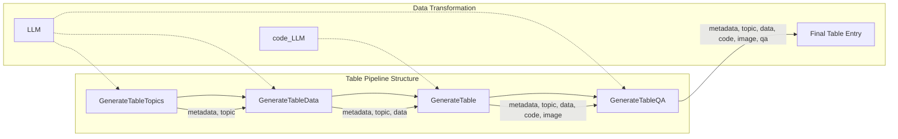
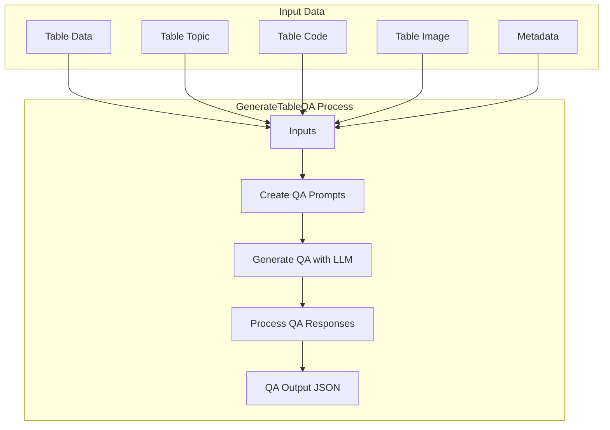
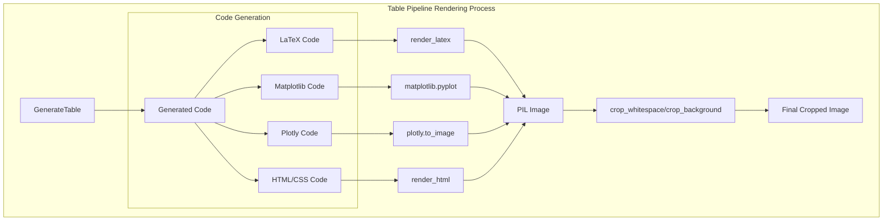

<!-- source: DeepWiki mcp.deepwiki.com · repo allenai/pixmo-docs · page 4.2 Table Pipelines · fetched 2026-10-26 -->

# Table Pipelines

<details>
<summary>Relevant source files</summary>

The following files were used as context for generating this wiki page:

- [LICENSE](LICENSE)
- [README.md](README.md)
- [pipeline/html_table_pipeline/generate_qa.py](pipeline/html_table_pipeline/generate_qa.py)
- [pipeline/latex_table_pipeline/generate_qa.py](pipeline/latex_table_pipeline/generate_qa.py)
- [pipeline/plotly_table_pipeline/generate_qa.py](pipeline/plotly_table_pipeline/generate_qa.py)

</details>


## Purpose

Table Pipelines generate synthetic datasets of tabular information rendered as images using different technologies. These pipelines create tables with varying levels of complexity and visual styles, which are then used to train multimodal models like Molmo. This document covers the four table pipeline implementations provided in the PixMo-Docs system, their capabilities, internal structure, and rendering processes.

For information about other visual elements like charts, see [Chart Pipelines](#4.1) or diagrams, see [Diagram Pipelines](#4.3).

## Overview of Table Pipelines

The PixMo-Docs system includes four different table pipeline implementations, each using a different rendering technology:



Sources: README.md:77-80

Each pipeline has distinct capabilities and limitations:

| Pipeline | Technology | Capabilities | Best For |
|----------|------------|--------------|----------|
| LaTeXTablePipeline | LaTeX | Complex structures, precise formatting, academic styling | Scientific tables, complex multi-level tables |
| MatplotlibTablePipeline | Matplotlib | Tables within figures, integration with plot features | Data visualization tables, tables with visual elements |
| PlotlyTablePipeline | Plotly | Simple tabular formats, interactive features (when viewed in compatible viewers) | Single-header tables, basic data views |
| HTMLTablePipeline | HTML/CSS | Web-style tables, custom styling | Web content tables, simple structures |

Sources: README.md:77-80

## Pipeline Internal Structure

All table pipelines follow a common four-step structure that transforms topics into final rendered table images with question-answer pairs:



Sources: pipeline/html_table_pipeline/generate_qa.py, pipeline/latex_table_pipeline/generate_qa.py, pipeline/plotly_table_pipeline/generate_qa.py

Each step inherits from `SuperStep` class in the DataDreamer framework and performs a specific transformation in the pipeline:

1. **GenerateTableTopics**: Creates table topics based on domain and requirements
2. **GenerateTableData**: Generates structured data based on the topic
3. **GenerateTable**: Produces rendering code (LaTeX, HTML, Python) and renders it into an image
4. **GenerateTableQA**: Creates question-answer pairs about the table content

## QA Generation Process

The question-answer generation step is consistent across all table pipelines. It takes the generated table along with its topic, data, and code to create relevant QA pairs:



Sources: pipeline/html_table_pipeline/generate_qa.py:31-106, pipeline/latex_table_pipeline/generate_qa.py:31-106, pipeline/plotly_table_pipeline/generate_qa.py:31-106

The QA generation follows these steps:
1. Combines all input data (metadata, topic, data, code, image)
2. Creates prompts using the `GENERATE_TABLE_QA_PROMPT` template
3. Sends prompts to the configured LLM
4. Processes responses into structured QA JSON format with questions, answers, and explanations

## Rendering Technology Integration

Each table pipeline connects to a specific rendering technology, which transforms the generated code into visual table images:



Sources: README.md:77-80

## Example Usage

To generate tables using any of the table pipelines, use the main script with the appropriate pipeline name:

For LaTeX tables:
```bash
python main.py -p "LaTeXTablePipeline" -n 10 -m "latex_tables" -t "financial data"
```

For Matplotlib tables:
```bash
python main.py -p "MatplotlibTablePipeline" -n 10 -m "mpl_tables" -t "scientific results"
```

For multiple table types:
```bash
python main.py -p "LaTeXTablePipeline,HTMLTablePipeline" -n 5 -m "mixed_tables" -t "population statistics"
```

Sources: README.md:52-59

## Technical Considerations

When choosing between table pipelines, consider these factors:

1. **LaTeXTablePipeline**: Requires LaTeX installation but provides the most professional-looking tables for academic or scientific purposes.

2. **MatplotlibTablePipeline**: Good for tables that are part of data visualizations or need to be integrated with charts.

3. **PlotlyTablePipeline** and **HTMLTablePipeline**: Simpler options for basic tabular data with fewer formatting requirements.

All table pipelines support QA generation using the same underlying process, making them consistent for training multimodal models regardless of the rendering technology used.

---

