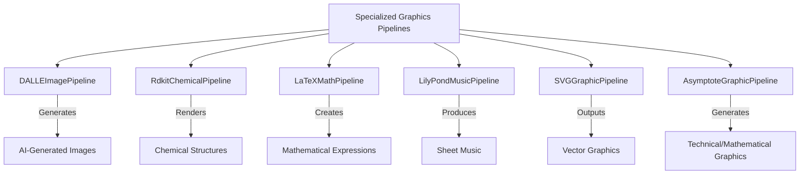
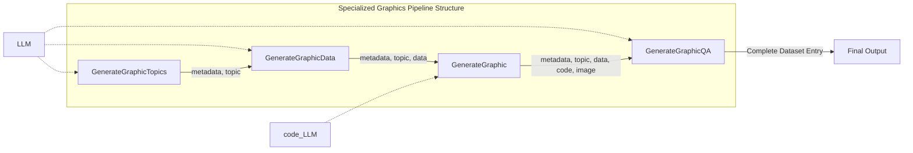
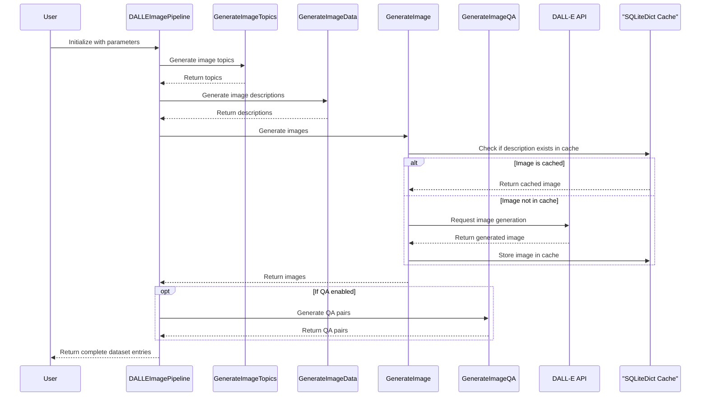
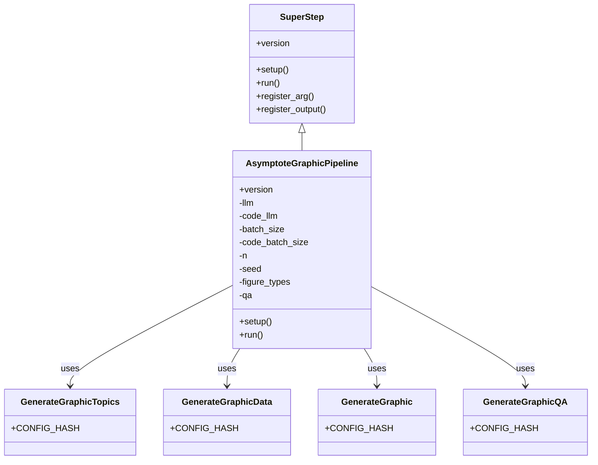
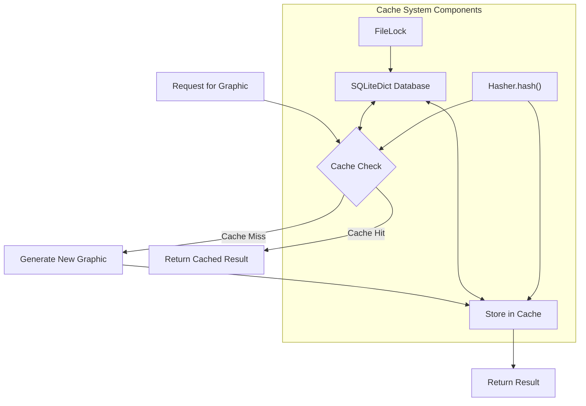
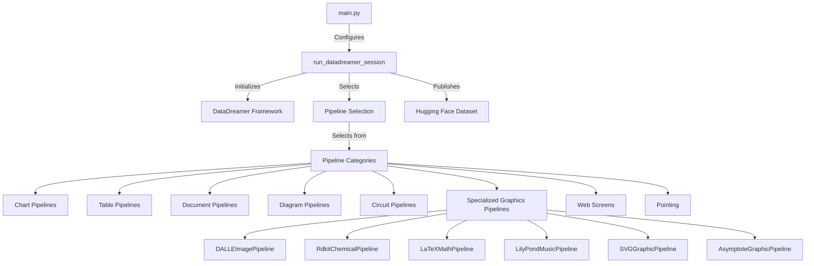

<!-- source: DeepWiki mcp.deepwiki.com · repo allenai/pixmo-docs · page 4.4 Specialized Graphics Pipelines · fetched 2026-10-26 -->

# Specialized Graphics Pipelines

<details>
<summary>Relevant source files</summary>

The following files were used as context for generating this wiki page:

- [LICENSE](LICENSE)
- [README.md](README.md)
- [pipeline/asymptote_graphic_pipeline/__init__.py](pipeline/asymptote_graphic_pipeline/__init__.py)
- [pipeline/asymptote_graphic_pipeline/pipeline.py](pipeline/asymptote_graphic_pipeline/pipeline.py)
- [pipeline/dalle_image_pipeline/__init__.py](pipeline/dalle_image_pipeline/__init__.py)
- [pipeline/dalle_image_pipeline/dalle_helper.py](pipeline/dalle_image_pipeline/dalle_helper.py)

</details>


## Introduction

The Specialized Graphics Pipelines category encompasses pipelines designed to generate specific types of visual content that don't fit into the standard chart, table, document, diagram, or circuit categories. These pipelines produce diverse visual elements ranging from AI-generated images to chemical structures, mathematical expressions, musical notation, vector graphics, and technical mathematical illustrations.

Specialized Graphics Pipelines complement other pipeline categories in the PixMo-Docs framework (for information about other pipeline categories, see [Pipeline Categories](#4)). While other pipelines focus on common data visualization formats, these specialized pipelines extend the system's capabilities to more niche but important visual domains.

Sources: [README.md:96-102]()

## Pipeline Overview

The Specialized Graphics category includes six distinct pipelines, each targeting a specific type of visual content:



Sources: [README.md:96-102]()

## Common Pipeline Structure

Like other pipelines in the PixMo-Docs framework, the Specialized Graphics Pipelines follow a consistent four-step structure:



Sources: [pipeline/asymptote_graphic_pipeline/pipeline.py:10-105]()

Each pipeline inherits from the `SuperStep` class and implements the following components:

1. **Topic Generation**: Creates relevant topics for the specific graphic type
2. **Data Generation**: Develops the necessary data structure based on the topic
3. **Graphic Generation**: Produces the code and resulting image
4. **QA Generation**: Optionally generates questions and answers about the graphic

This structure enables consistent processing across different specialized renderers while accommodating their unique requirements.

Sources: [pipeline/asymptote_graphic_pipeline/pipeline.py:34-95]()

## Individual Pipelines

### DALLEImagePipeline

The `DALLEImagePipeline` generates images using OpenAI's DALL-E models, producing AI-generated images based on textual descriptions.



The pipeline includes robust error handling with retry logic for API-related errors, and caches results to avoid regenerating identical images. It uses the OpenAI API with configurable parameters for image generation.

Sources: [pipeline/dalle_image_pipeline/dalle_helper.py:23-82]()

### RdkitChemicalPipeline

The `RdkitChemicalPipeline` uses RDKit to render chemical structure diagrams based on SMILES (Simplified Molecular Input Line Entry System) notation or other chemical descriptors.

### LaTeXMathPipeline

The `LaTeXMathPipeline` generates mathematical expressions using LaTeX, rendering complex equations and mathematical notations with precise typesetting.

### LilyPondMusicPipeline

The `LilyPondMusicPipeline` creates sheet music visualizations using LilyPond, a specialized music engraving program capable of producing publication-quality musical notation.

### SVGGraphicPipeline

The `SVGGraphicPipeline` creates vector graphics using the SVG (Scalable Vector Graphics) format, enabling resolution-independent graphics with precise control over visual elements.

### AsymptoteGraphicPipeline

The `AsymptoteGraphicPipeline` uses Asymptote to generate mathematical and technical graphics, producing precise vector graphics with 3D capabilities.



Sources: [pipeline/asymptote_graphic_pipeline/pipeline.py:10-105]()

## Implementation Details

### Caching Mechanism

The specialized graphics pipelines, particularly the `DALLEImagePipeline`, implement caching to improve efficiency and reduce API calls or computation for repeated requests. The caching system uses:

- **SQLiteDict**: For persistent storage of generated content
- **FileLock**: To prevent concurrent access issues in multi-process environments
- **Content Hashing**: To create unique keys for storage and retrieval



Sources: [pipeline/dalle_image_pipeline/dalle_helper.py:69-82]()

### Error Handling

Specialized graphics pipelines, especially those relying on external APIs like the `DALLEImagePipeline`, implement robust error handling using tenacity's retry decorators:

- Retry on specific error types (API rate limits, server errors, connection issues)
- Exponential backoff strategy with configurable parameters
- Maximum retry attempts to prevent indefinite retries

This approach ensures resilience when dealing with external services or complex rendering processes.

Sources: [pipeline/dalle_image_pipeline/dalle_helper.py:42-65]()

## Usage Guide

To use Specialized Graphics Pipelines, you can configure them via the main CLI interface:

```
python main.py -p "PipelineName" -n NumberOfSamples -m "DatasetName" -t "GraphicType"
```

Examples:
- `python main.py -p "DALLEImagePipeline" -n 5 -m "dalle_samples" -t "landscape"`
- `python main.py -p "LaTeXMathPipeline" -n 10 -m "math_equations" -t "differential equations"`

The `-p` parameter specifies which pipeline to use, `-n` controls the number of samples to generate, `-m` sets the dataset name, and `-t` specifies the type of graphic to generate.

Some pipelines require specific system dependencies:
- LaTeXMathPipeline: Requires LaTeX installation
- LilyPondMusicPipeline: Requires LilyPond installation
- AsymptoteGraphicPipeline: Requires Asymptote installation
- SVGGraphicPipeline: Requires CairoSVG (`pip install cairosvg<=2.7.1`)

Sources: [README.md:49-63]()

## Integration with Overall System

Specialized Graphics Pipelines integrate into the PixMo-Docs framework as one of the eight pipeline categories:



Each specialized graphics pipeline contributes to the diversity of the generated datasets, providing unique visual content types that complement the more standard visualization formats. This diversity is essential for training comprehensive multimodal models like Molmo, which need to understand a wide range of visual information.

Sources: [README.md:66-108]()

---

