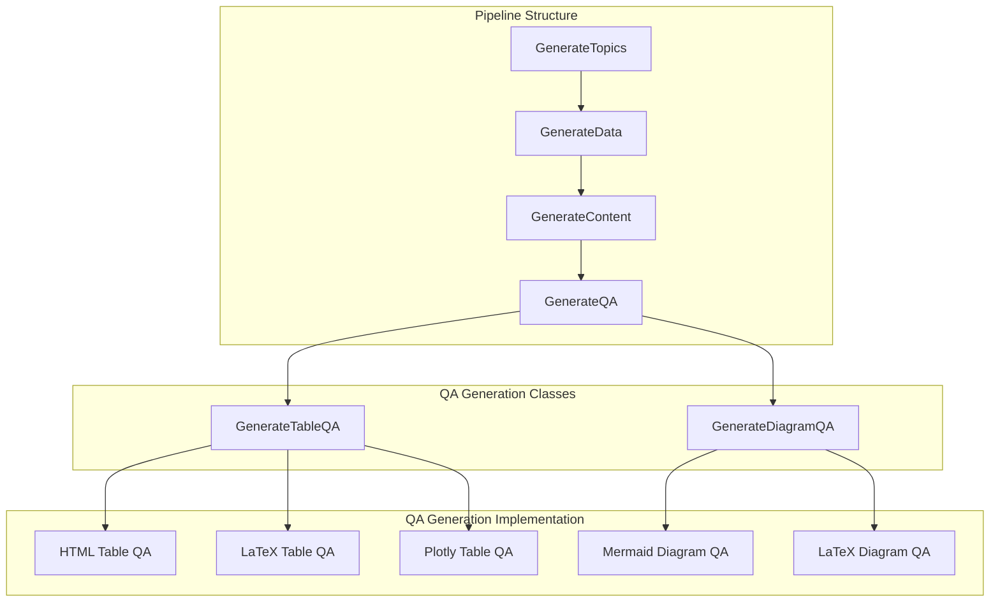
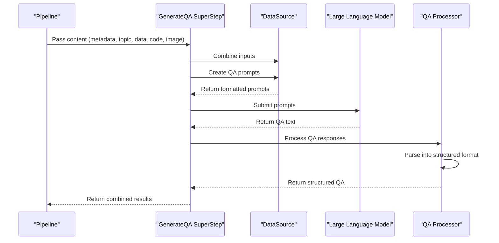
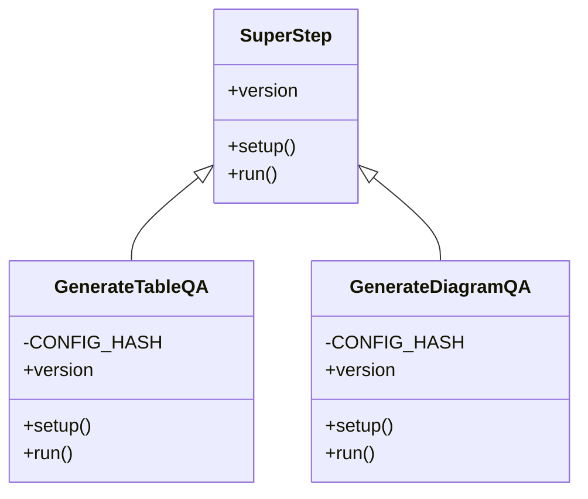
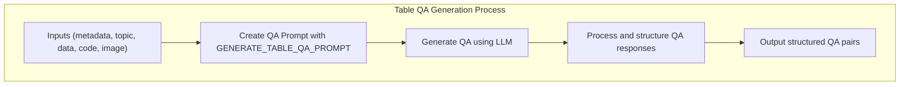
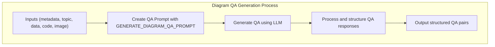
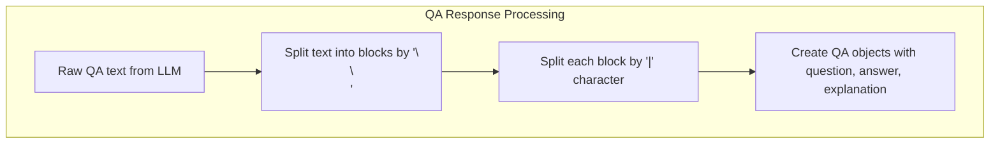
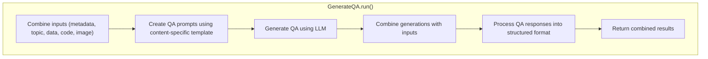

<!-- source: DeepWiki mcp.deepwiki.com · repo allenai/pixmo-docs · page 5 QA Generation · fetched 2026-10-26 -->

# QA Generation

<details>
<summary>Relevant source files</summary>

The following files were used as context for generating this wiki page:

- [pipeline/html_table_pipeline/generate_qa.py](pipeline/html_table_pipeline/generate_qa.py)
- [pipeline/latex_diagram_pipeline/generate_qa.py](pipeline/latex_diagram_pipeline/generate_qa.py)
- [pipeline/latex_table_pipeline/generate_qa.py](pipeline/latex_table_pipeline/generate_qa.py)
- [pipeline/mermaid_diagram_pipeline/generate_qa.py](pipeline/mermaid_diagram_pipeline/generate_qa.py)
- [pipeline/plotly_table_pipeline/generate_qa.py](pipeline/plotly_table_pipeline/generate_qa.py)

</details>


## Introduction

This document explains the Question-Answer (QA) generation system within the PixMo-Docs framework. QA generation is the final optional step in most pipelines, producing structured question-answer pairs about the content in the generated images. These QA pairs enable evaluation of multimodal models' ability to understand and reason about the text-rich visual content.

Sources: [pipeline/html_table_pipeline/generate_qa.py:1-111](), [pipeline/latex_diagram_pipeline/generate_qa.py:1-111]()

## QA Generation Architecture

QA generation is implemented as the final stage in pipeline processing, following a consistent pattern across different content types. Each QA generation component inherits from the `SuperStep` class of the DataDreamer framework.



Sources: [pipeline/html_table_pipeline/generate_qa.py:9-29](), [pipeline/latex_diagram_pipeline/generate_qa.py:9-29](), [pipeline/mermaid_diagram_pipeline/generate_qa.py:9-29]()

## QA Generation Process

The QA generation process follows these steps:



Sources: [pipeline/html_table_pipeline/generate_qa.py:31-106](), [pipeline/mermaid_diagram_pipeline/generate_qa.py:31-106]()

## QA Generation Implementation Details

### Inputs and Outputs

All QA generation classes share common inputs and outputs:

| Inputs | Description |
|--------|-------------|
| `metadata` | The metadata used to generate the topics |
| `topic` | The topic of the content |
| `data` | The data used to generate the content |
| `code` | The code used to render the content |
| `image` | The rendered image |

| Arguments | Description |
|-----------|-------------|
| `llm` | The LLM to use for QA generation |
| `batch_size` | The batch size to use with the LLM |

| Outputs | Description |
|---------|-------------|
| All input fields | Passed through unchanged |
| `qa` | The generated question-answer pairs |

Sources: [pipeline/latex_table_pipeline/generate_qa.py:12-29](), [pipeline/plotly_table_pipeline/generate_qa.py:12-29]()

### QA Generation Class Structure



Sources: [pipeline/html_table_pipeline/generate_qa.py:9-110](), [pipeline/latex_diagram_pipeline/generate_qa.py:9-110]()

## Content-Specific QA Generation

### Table QA Generation

The table QA generation process uses the `GENERATE_TABLE_QA_PROMPT` to create question-answer pairs specific to tabular data. It handles both HTML, LaTeX, and Plotly table formats.



Sources: [pipeline/html_table_pipeline/generate_qa.py:31-106](), [pipeline/latex_table_pipeline/generate_qa.py:31-106](), [pipeline/plotly_table_pipeline/generate_qa.py:31-106]()

### Diagram QA Generation

The diagram QA generation process uses the `GENERATE_DIAGRAM_QA_PROMPT` to create question-answer pairs specific to diagrams. It handles both Mermaid and LaTeX diagram formats.



Sources: [pipeline/latex_diagram_pipeline/generate_qa.py:31-106](), [pipeline/mermaid_diagram_pipeline/generate_qa.py:31-106]()

## QA Response Processing

The QA responses from the LLM are processed into a structured format:



The format of each QA item is:
```
Question text | Answer text | Explanation text
```

After processing, each QA pair is converted into a structured object with the following fields:
- `question`: The question text
- `answer`: The answer text
- `explanation`: An explanation of the answer

Sources: [pipeline/html_table_pipeline/generate_qa.py:79-92](), [pipeline/latex_diagram_pipeline/generate_qa.py:79-92]()

## QA Output Format

The final output format for QA pairs depends on the specific pipeline implementation:

1. For some pipelines (e.g., HTML tables, LaTeX tables, Plotly tables), the QA array is serialized to a JSON string:
   ```python
   row["qa"] = json.dumps(qa)
   ```

2. For other pipelines (e.g., LaTeX diagrams, Mermaid diagrams), the QA array is kept as a native Python list:
   ```python
   row["qa"] = qa
   ```

Sources: [pipeline/html_table_pipeline/generate_qa.py:91](), [pipeline/latex_diagram_pipeline/generate_qa.py:91](), [pipeline/plotly_table_pipeline/generate_qa.py:91](), [pipeline/mermaid_diagram_pipeline/generate_qa.py:91]()

## Implementation Workflow



Sources: [pipeline/html_table_pipeline/generate_qa.py:31-106](), [pipeline/latex_diagram_pipeline/generate_qa.py:31-106]()

## Error Handling

The QA generation process includes basic error handling to log issues when QA generation fails for some rows:

```python
if combined_processed.output.num_rows < combined.output.num_rows:
    self.logger.info(
        f"Warning: Could only generate valid Q&A for {combined_processed.output.num_rows} out of {combined.output.num_rows} total rows."
    )
```

Sources: [pipeline/html_table_pipeline/generate_qa.py:100-103](), [pipeline/latex_diagram_pipeline/generate_qa.py:100-103]()

---

