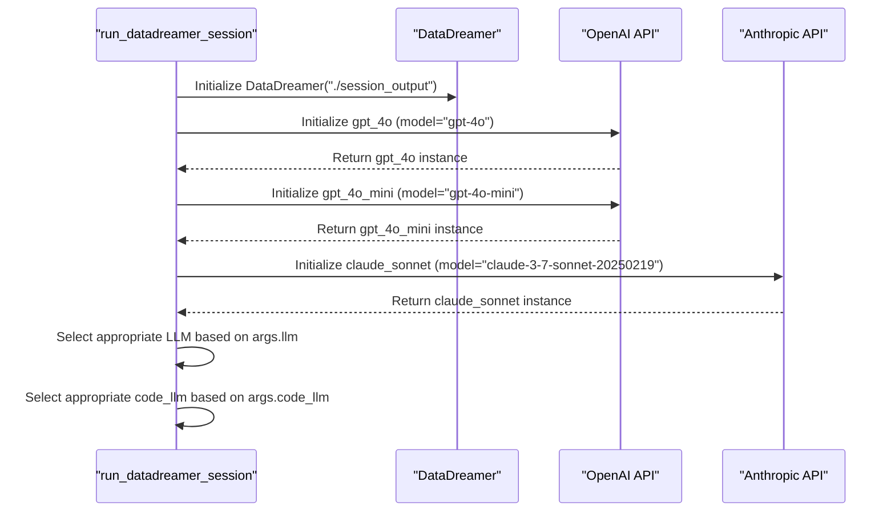
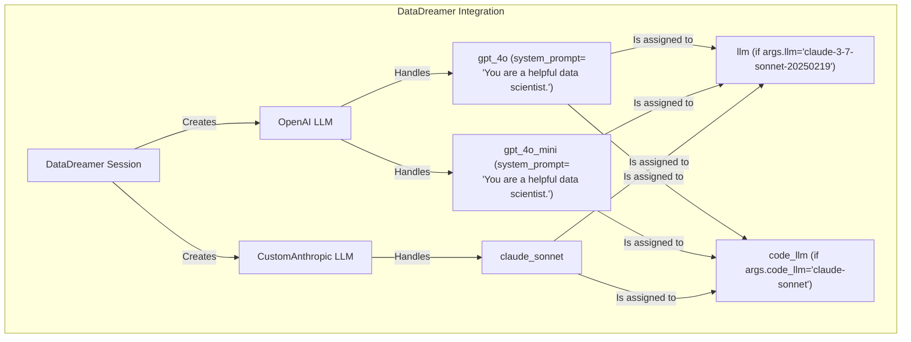
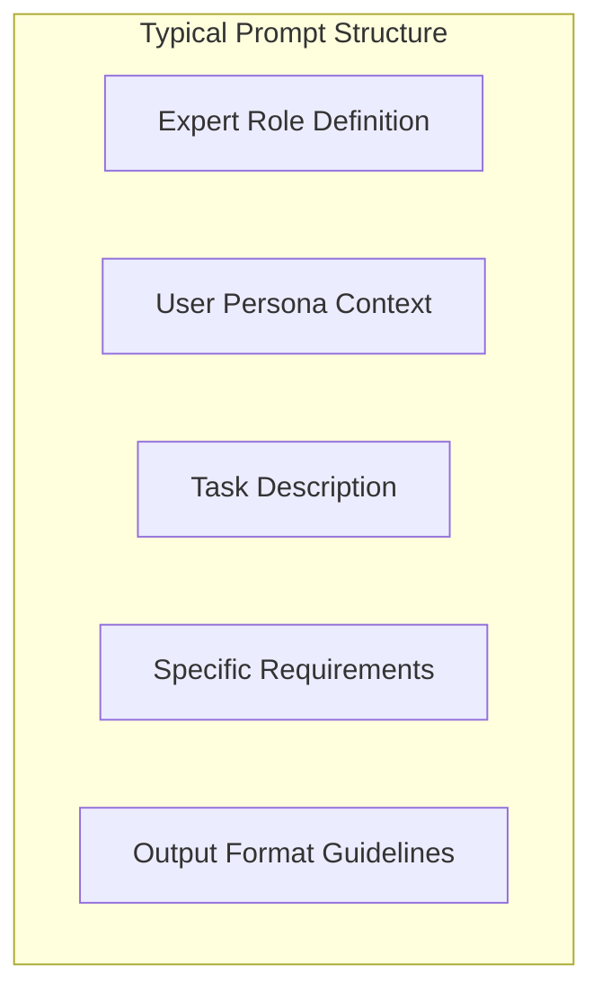
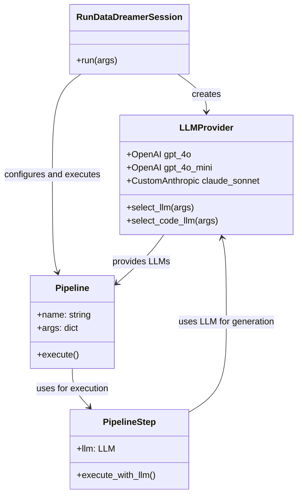

<!-- source: DeepWiki mcp.deepwiki.com · repo allenai/pixmo-docs · page 6 LLM Integration · fetched 2026-10-26 -->

# LLM Integration

Relevant source files

The following files were used as context for generating this wiki page:

- [pipeline/all_pipelines.py](pipeline/all_pipelines.py)
- [pipeline/prompts/chart_prompts.py](pipeline/prompts/chart_prompts.py)
- [pipeline/prompts/diagram_prompts.py](pipeline/prompts/diagram_prompts.py)

This document provides a comprehensive overview of how Large Language Models (LLMs) are integrated into the PixMo-Docs system. It details how LLMs are selected, configured, and utilized throughout various pipelines to generate synthetic data for text-rich images. For information about the general system architecture, see [System Architecture](#3). For details about specific pipeline categories, see [Pipeline Categories](#4).

## 1. LLM Integration Overview

The PixMo-Docs system relies heavily on LLMs to generate content for various types of visual data. LLMs serve as the foundation for the entire content generation process, handling everything from topic selection to code generation and question-answer pair creation.

```mermaid
graph TB
    subgraph "LLM Integration Architecture"
        UserInput["User Input \n(CLI Arguments)"]
        MainPy["main.py"]
        Runner["run_datadreamer_session"]
        
        subgraph "LLM Configuration"
            LLMInit["LLM Initialization"]
            OpenAI["OpenAI API \n(GPT-4o/GPT-4o-mini)"]
            Anthropic["Anthropic API \n(Claude Sonnet)"]
            LLMSelector["LLM Selection"]
            LLMProvider["Selected LLM Provider"]
        end
        
        subgraph "Pipeline Execution"
            PipelineSelector["Pipeline Selection"]
            ContentPipeline["Content Generation Pipeline"]
            
            subgraph "Pipeline Steps"
                TopicGeneration["Topic Generation"]
                DataGeneration["Data Generation"]
                CodeGeneration["Code Generation"]
                QAGeneration["QA Generation"]
            end
        end
        
        DataDreamer["DataDreamer Framework"]
        OutputDataset["Final Dataset"]
        
        UserInput --> MainPy
        MainPy --> Runner
        Runner --> DataDreamer
        Runner --> LLMInit
        
        LLMInit --> OpenAI
        LLMInit --> Anthropic
        OpenAI --> LLMSelector
        Anthropic --> LLMSelector
        LLMSelector --> LLMProvider
        
        Runner --> PipelineSelector
        PipelineSelector --> ContentPipeline
        
        LLMProvider --> TopicGeneration
        LLMProvider --> DataGeneration
        LLMProvider --> CodeGeneration
        LLMProvider --> QAGeneration
        
        TopicGeneration --> DataGeneration
        DataGeneration --> CodeGeneration
        CodeGeneration --> QAGeneration
        
        QAGeneration --> OutputDataset
    end
```

Sources: [pipeline/all_pipelines.py:42-147]()

## 2. LLM Selection and Configuration

The system supports multiple LLM providers with different models specifically chosen for their capabilities in generating high-quality text and code.

### 2.1 Supported LLM Models

PixMo-Docs supports the following LLM models:

| LLM Model | Provider | Primary Use Cases |
|-----------|----------|-------------------|
| GPT-4o    | OpenAI   | General content generation, code generation |
| GPT-4o-mini | OpenAI | Lighter-weight content generation |
| Claude-3-7-Sonnet | Anthropic | Alternative content generation, code generation |

### 2.2 LLM Initialization

LLMs are initialized in the `run_datadreamer_session` function, which creates instances for each supported model:

Sources: [pipeline/all_pipelines.py:50-73]()

The system creates two separate LLM selections:
1. A primary `llm` for general content generation
2. A specialized `code_llm` specifically for code generation tasks

These selections are controlled by command-line arguments, allowing users to specify which models to use for different aspects of content generation.

## 3. DataDreamer Integration

PixMo-Docs integrates with the DataDreamer framework to manage LLM interactions and content generation.

Sources: [pipeline/all_pipelines.py:48-73]()

### 3.1 Custom Anthropic Support

The system includes a custom wrapper for Anthropic's Claude models through the `CustomAnthropic` class to ensure compatibility with DataDreamer. This allows Claude models to be used interchangeably with OpenAI models throughout the pipeline.

Sources: [pipeline/all_pipelines.py:3]()

## 4. LLM Roles in Pipeline Flow

LLMs play crucial roles at several stages in each pipeline's execution flow. The diagram below illustrates the typical pipeline stages and how LLMs contribute to each:

```mermaid
flowchart TD
    subgraph "Pipeline Execution Flow with LLM Integration"
        direction LR
        
        subgraph "Step 1: Topic Generation"
            TopicPrompt["Topic Generation Prompt"]
            TopicLLM["Primary LLM"]
            TopicOutput["Generated Topics"]
            
            TopicPrompt -->|Input to| TopicLLM
            TopicLLM -->|Generates| TopicOutput
        end
        
        subgraph "Step 2: Data Generation"
            DataPrompt["Data Generation Prompt"]
            DataLLM["Primary LLM"]
            DataOutput["Generated Structured Data"]
            
            DataPrompt -->|Input to| DataLLM
            DataLLM -->|Generates| DataOutput
        end
        
        subgraph "Step 3: Code Generation"
            CodePrompt["Code Generation Prompt"]
            CodeLLM["Code LLM"]
            CodeOutput["Generated Rendering Code"]
            
            CodePrompt -->|Input to| CodeLLM
            CodeLLM -->|Generates| CodeOutput
        end
        
        subgraph "Step 4: QA Generation (Optional)"
            QAPrompt["QA Generation Prompt"]
            QALLM["Primary LLM"]
            QAOutput["Generated Q&A Pairs"]
            
            QAPrompt -->|Input to| QALLM
            QALLM -->|Generates| QAOutput
        end
        
        TopicOutput --> DataPrompt
        DataOutput --> CodePrompt
        CodeOutput --> QAPrompt
    end
```

Sources: [pipeline/all_pipelines.py:120-135](), [pipeline/prompts/chart_prompts.py:6-157](), [pipeline/prompts/diagram_prompts.py:6-190]()

### 4.1 LLM Responsibilities at Each Pipeline Stage

| Stage | LLM Used | Primary Responsibility | Example Prompt Types |
|-------|----------|------------------------|----------------------|
| Topic Generation | Primary LLM | Generate diverse topics for content | GENERATE_CHART_TOPICS_PROMPT, GENERATE_DIAGRAM_TOPICS_PROMPT |
| Data Generation | Primary LLM | Create structured data based on topics | GENERATE_CHART_DATA_PROMPT, GENERATE_CHART_DATA_JSON_PROMPT, GENERATE_DIAGRAM_DATA_JSON_PROMPT |
| Code Generation | Code LLM | Generate executable code to render visualizations | GENERATE_CHART_CODE_MATPLOTLIB_PROMPT, GENERATE_CHART_CODE_PLOTLY_PROMPT, GENERATE_DIAGRAM_CODE_GRAPHVIZ_PROMPT |
| QA Generation | Primary LLM | Create question-answer pairs for evaluation | GENERATE_CHART_QA_PROMPT, GENERATE_CHART_QA_SHORT_ANSWER_PROMPT, GENERATE_DIAGRAM_QA_PROMPT |

Sources: [pipeline/prompts/chart_prompts.py:1-346](), [pipeline/prompts/diagram_prompts.py:1-233]()

## 5. Prompt Design for LLM Guidance

The system uses carefully designed prompts to guide LLMs in generating appropriate content for each pipeline stage. These prompts are specialized based on:

1. Content type (chart, table, diagram, etc.)
2. Output format (CSV, JSON, code, Q&A)
3. Rendering technology (Matplotlib, Plotly, Graphviz, etc.)

### 5.1 Prompt Structure

Most prompts follow a consistent structure:

Example prompt components include:
- Expert Role: "You are an expert in data analysis and good at writing code..."
- Persona: "My persona is: {persona}"
- Task: "I need some data about {topic} which can be used to generate a {figure_type}."
- Requirements: Lists specific content/style/technical requirements
- Format: "Please provide the data in CSV format without additional text..."

Sources: [pipeline/prompts/chart_prompts.py:6-17](), [pipeline/prompts/chart_prompts.py:20-31](), [pipeline/prompts/diagram_prompts.py:6-16]()

### 5.2 Specialized Prompt Categories

The system includes specialized prompts for different content types:

1. **Topic Generation Prompts**: Guide LLMs to create diverse topics appropriate for specific visualization types
2. **Data Generation Prompts**: Direct LLMs to create structured data (CSV, JSON) for the selected topic
3. **Code Generation Prompts**: Instruct LLMs to write functional rendering code using specific technologies
4. **QA Generation Prompts**: Guide LLMs to create relevant question-answer pairs about the generated visualizations

Each category includes multiple prompt variations for different visualization technologies and output formats.

Sources: [pipeline/prompts/chart_prompts.py:6-157](), [pipeline/prompts/diagram_prompts.py:6-190]()

## 6. Pipeline Integration

LLMs are integrated into each pipeline through a consistent structure where each pipeline class receives and utilizes the LLM instances.

The LLMs are passed to each pipeline as part of the `args` dictionary, which includes:
- `llm`: Primary LLM for general content generation
- `code_llm`: Specialized LLM for code generation tasks

Sources: [pipeline/all_pipelines.py:120-136]()

## 7. Best Practices and Limitations

### 7.1 LLM Selection Guidance

- Use GPT-4o for highest quality generation when computational resources allow
- Use GPT-4o-mini for faster generation with slightly lower quality
- Consider Claude Sonnet as an alternative with different generation characteristics
- For code generation, GPT-4o typically produces more reliable and executable code

### 7.2 Known Limitations

- LLM outputs may occasionally require manual validation for correctness
- Generation quality depends on well-crafted prompts specific to each task
- Different LLMs may produce varying results for the same prompt and task

## 8. Conclusion

LLMs form the foundation of the PixMo-Docs system, enabling the generation of diverse, high-quality visualizations across multiple formats and technologies. The system's modular design allows for interchangeable LLMs while maintaining consistent pipeline execution, providing flexibility and extensibility for future enhancements.

---

