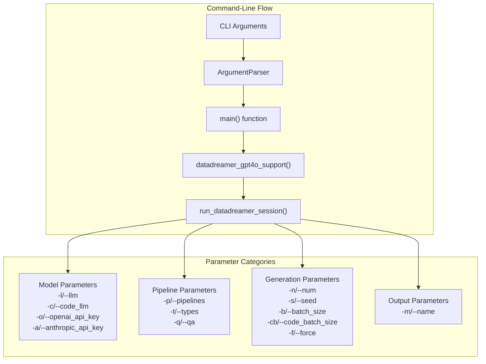
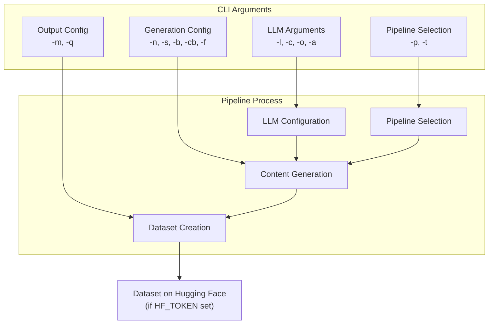
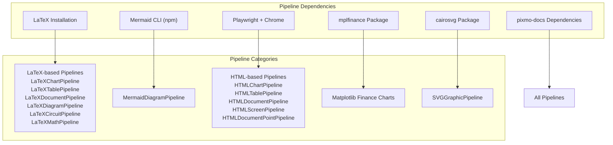

<!-- source: DeepWiki mcp.deepwiki.com · repo allenai/pixmo-docs · page 7 Command Line Usage · fetched 2026-10-26 -->

# Command Line Usage

<details>
<summary>Relevant source files</summary>

The following files were used as context for generating this wiki page:

- [LICENSE](LICENSE)
- [README.md](README.md)
- [main.py](main.py)

</details>


This document provides a comprehensive guide to the command-line interface (CLI) of the PixMo-Docs repository. It details all available arguments and provides examples for generating synthetic datasets of text-rich images using the various pipelines. For information about the system architecture and how the pipelines work internally, see [System Architecture](#3).

## Command Line Interface Overview

The `main.py` script serves as the entry point for dataset generation. When executed with appropriate arguments, it initializes the DataDreamer framework and runs the selected pipelines to generate visual content according to specified parameters.



Sources: [main.py:1-13](), [main.py:14-119]()

## Command Line Arguments

The following table provides a comprehensive list of all available command-line arguments:

| Argument | Short | Long | Type | Default | Description |
|----------|-------|------|------|---------|-------------|
| OpenAI API Key | `-o` | `--openai_api_key` | string | `OPENAI_API_KEY` env var | The OpenAI secret key for API access |
| Anthropic API Key | `-a` | `--anthropic_api_key` | string | `ANTHROPIC_API_KEY` env var | The Anthropic secret key for API access |
| LLM | `-l` | `--llm` | string | `gpt-4o` | LLM to use for most generation tasks (options: `gpt-4o` or `claude-sonnet`) |
| Code LLM | `-c` | `--code_llm` | string | `claude-sonnet` | LLM to use specifically for code generation (options: `gpt-4o` or `claude-sonnet`) |
| Pipelines | `-p` | `--pipelines` | string | `MatplotlibChartPipeline` | Comma-separated list of pipelines to run |
| Number of Samples | `-n` | `--num` | string | `1` | Number of visualizations to generate per pipeline (single number or comma-separated list) |
| Seed | `-s` | `--seed` | integer | `42` | Random seed for generation consistency |
| Batch Size | `-b` | `--batch_size` | integer | `24` | Number of requests to make to the LLM in parallel |
| Code Batch Size | `-cb` | `--code_batch_size` | integer | `24` | Number of requests to make to the code LLM in parallel |
| Force Regenerate | `-f` | `--force` | flag | `False` | Whether to force regeneration of existing content |
| Dataset Name | `-m` | `--name` | string | `scifi` | Name of the dataset to push to Hugging Face Hub |
| Visualization Types | `-t` | `--types` | string | `bar chart` | Comma-separated list of visualization types to generate |
| Generate QA | `-q` | `--qa` | boolean | `True` | Whether to generate question-answer pairs for visualizations |

Sources: [main.py:14-105]()

## Basic Usage

The minimal command to generate content requires specifying at least a pipeline, number of samples, name, and type:

```bash
python main.py -p "MatplotlibChartPipeline" -n 5 -m "matplotlib_test" -t "bar chart"
```

This command will generate 5 bar charts using the Matplotlib renderer and save them with the dataset name "matplotlib_test".

Sources: [README.md:49-59]()

## Argument Relationships and Data Flow

The following diagram illustrates how command-line arguments relate to the system components:



Sources: [main.py:8-11](), [main.py:14-119]()

## Pipeline Selection Examples

You can select multiple pipelines and visualization types by providing comma-separated values:

```bash
python main.py -p "MatplotlibChartPipeline,LaTeXTablePipeline" -t "bar chart,scatter plot,simple table" -n 5 -m "mixed_dataset"
```

This will generate:
- 5 bar charts with Matplotlib
- 5 scatter plots with Matplotlib
- 5 simple tables with LaTeX

When providing multiple pipeline types but only a single number for `-n`, that number applies to each pipeline. You can also provide specific counts per pipeline:

```bash
python main.py -p "MatplotlibChartPipeline,LaTeXTablePipeline" -t "bar chart,simple table" -n "10,5" -m "mixed_dataset"
```

This generates 10 bar charts and 5 simple tables.

Sources: [README.md:61-63]()

## Environment Variables and Prerequisites

Before running commands, ensure the following environment variables are set as needed:

```bash
export OPENAI_API_KEY=your-api-key          # Required for OpenAI models
export ANTHROPIC_API_KEY=your-api-key       # Required for Anthropic models
export HF_TOKEN=your-api-key                # Required only for Hugging Face uploads
```

Different pipelines require specific dependencies:



Sources: [README.md:14-47]()

## Advanced Command-Line Examples

### 1. Using a Different LLM

To use Claude Sonnet instead of GPT-4o for generation:

```bash
python main.py -p "MatplotlibChartPipeline" -n 5 -m "claude_charts" -t "bar chart" -l "claude-sonnet"
```

### 2. Generating Multiple Chart Types with Different Counts

```bash
python main.py -p "MatplotlibChartPipeline,PlotlyChartPipeline" -t "bar chart,line chart,scatter plot,heatmap" -n "10,5" -m "mixed_charts"
```

### 3. Disabling QA Generation

```bash
python main.py -p "LaTeXDocumentPipeline" -n 5 -m "documents_no_qa" -t "article" -q False
```

### 4. Using Different Models for General Tasks and Code Generation

```bash
python main.py -p "GraphvizDiagramPipeline" -n 10 -m "diagrams_mixed_models" -t "flowchart" -l "gpt-4o" -c "claude-sonnet"
```

### 5. Using Custom Batch Sizes

For large generations with memory constraints:

```bash
python main.py -p "MatplotlibChartPipeline" -n 100 -m "large_batch" -t "bar chart" -b 10 -cb 5
```

Sources: [main.py:14-119]()

## Common Issues and Troubleshooting

### API Key Issues

If you encounter authentication errors:
1. Ensure your API keys are correctly set as environment variables
2. Verify your API keys have appropriate permissions and sufficient credits

### Pipeline-Specific Errors

1. **LaTeX Pipelines**: Make sure LaTeX is correctly installed and accessible in your PATH
2. **Mermaid Pipelines**: Ensure the Mermaid CLI is installed correctly (`mmdc` command should be available)
3. **HTML Pipelines**: Verify Playwright is installed and browsers are properly set up

### Performance Considerations

- Adjust batch sizes (`-b` and `-cb`) based on your system capabilities and API rate limits
- For large generations, consider breaking them into smaller batches
- Set an appropriate seed (`-s`) to ensure reproducibility or to generate varied content

Sources: [README.md:22-47]()

---

