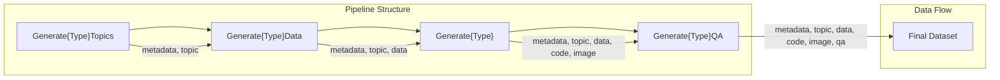
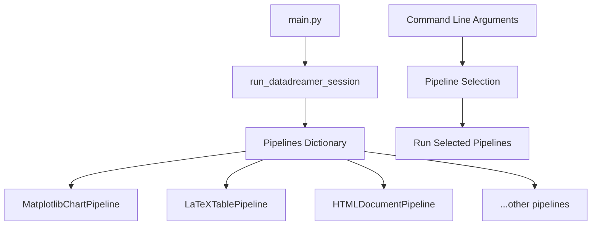
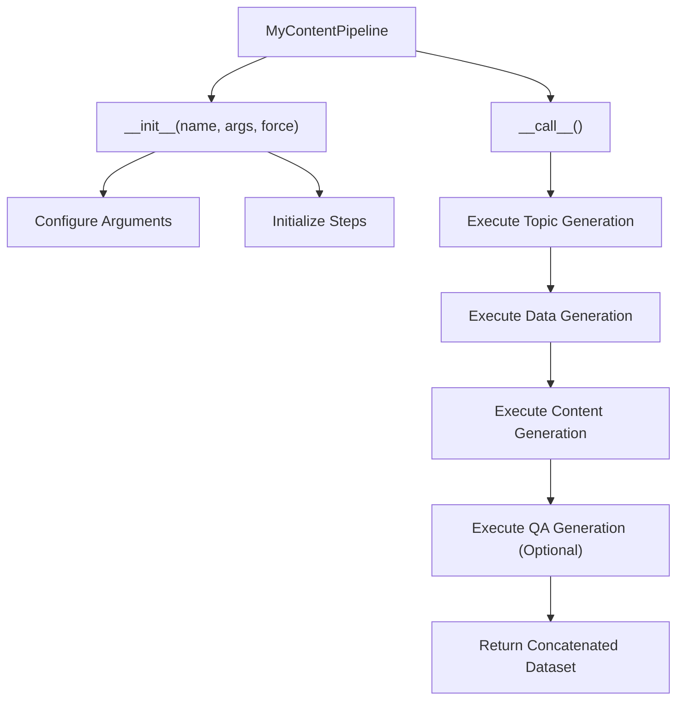
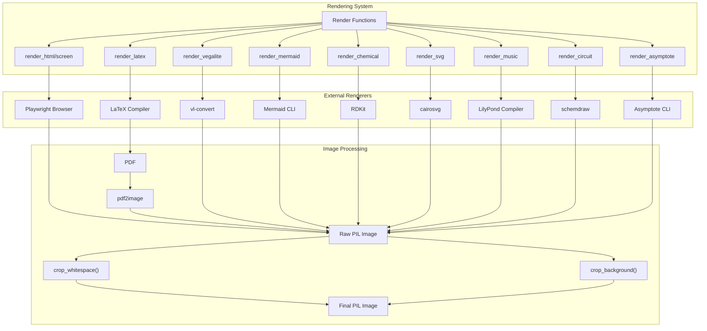
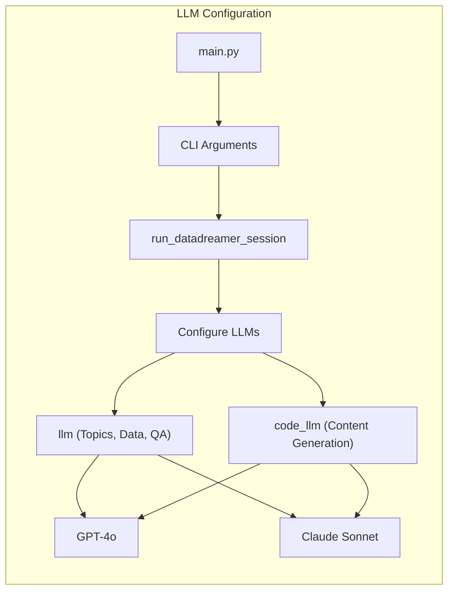

<!-- source: DeepWiki mcp.deepwiki.com · repo allenai/pixmo-docs · page 8 Development Guide · fetched 2026-10-26 -->

# Development Guide

<details>
<summary>Relevant source files</summary>

The following files were used as context for generating this wiki page:

- [.gitignore](.gitignore)
- [LICENSE](LICENSE)
- [README.md](README.md)
- [pipeline/all_pipelines.py](pipeline/all_pipelines.py)
- [pipeline/utils/render.py](pipeline/utils/render.py)

</details>


This guide provides detailed instructions for developers who want to extend the PixMo-Docs system with new pipelines or features. It covers the pipeline architecture, creating new pipelines, extending the rendering system, and working with Large Language Models (LLMs).

For information about the overall system architecture, see [System Architecture](#3).

## 1. Pipeline Architecture

The PixMo-Docs system is built around a modular pipeline architecture where each pipeline follows a consistent structure for generating different types of text-rich images.

### 1.1 Standard Pipeline Structure

Most pipelines in the system follow a 4-step structure:



Where `{Type}` is replaced with the specific content type (e.g., "Chart", "Diagram", "Table").

Sources: [pipeline/all_pipelines.py:77-101]()

### 1.2 Pipeline Registration System

All pipelines are registered in a central dictionary in the `all_pipelines.py` file, which maps user-friendly names to pipeline implementation classes:



Sources: [pipeline/all_pipelines.py:76-101]()

## 2. Creating a New Pipeline

To extend the system with a new pipeline, follow these steps:

### 2.1 Create Pipeline File and Class Structure

Create a new file in the `pipeline` directory named after your pipeline (e.g., `my_new_pipeline.py`). Follow this structure:

```python
# Structure for a new pipeline file
from .super_step import SuperStep
from datadreamer.steps import Step, concat

class GenerateMyContentTopics(SuperStep):
    # Topic generation step
    
class GenerateMyContentData(SuperStep):
    # Data generation step
    
class GenerateMyContent(SuperStep):
    # Content generation and rendering step
    
class GenerateMyContentQA(SuperStep):
    # QA pair generation step
    
class MyContentPipeline:
    def __init__(self, name, args=None, force=False):
        # Initialize pipeline parameters
        
    def __call__(self):
        # Execute pipeline steps and return dataset
```

### 2.2 Pipeline Component Implementation 

Each pipeline should implement the following components:



### 2.3 Register in all_pipelines.py

Add your pipeline to the pipelines dictionary in `all_pipelines.py`:

```python
from .my_content_pipeline import MyContentPipeline

pipelines = {
    # Existing pipelines...
    "Generate My Content": MyContentPipeline,
    # ...
}
```

Sources: [pipeline/all_pipelines.py:76-102]()

## 3. Rendering System

The rendering system provides utilities to convert various formats (HTML, LaTeX, SVG, etc.) into images.

### 3.1 Rendering Architecture



Sources: [pipeline/utils/render.py:16-408]()

### 3.2 Implementing a New Renderer

To add a new rendering capability, add a function to `pipeline/utils/render.py` that follows this pattern:

```python
def render_new_format(input_data):
    # 1. Process input_data (e.g., write to temp file)
    # 2. Use appropriate library or command-line tool to render
    # 3. Load resulting image as PIL Image
    # 4. Clean up temporary files
    # 5. Return the PIL Image (optionally cropped)
    return image
```

All renderers should:
- Handle temporary file creation and cleanup
- Convert the input format to a PIL Image object
- Apply appropriate cropping (using `crop_whitespace` or `crop_background`)

Sources: [pipeline/utils/render.py:16-76](), [pipeline/utils/render.py:156-205]()

## 4. Working with LLMs

The system uses two types of LLMs for different purposes:



### 4.1 LLM Configuration

LLMs are configured in the `run_datadreamer_session` function:

```python
# General-purpose LLM
llm = OpenAI(
    model_name="gpt-4o",
    api_key=args.openai_api_key,
    system_prompt="You are a helpful data scientist.",
)

# LLM specialized for code generation
code_llm = llm  # Can be the same or different LLM
```

Sources: [pipeline/all_pipelines.py:50-73]()

### 4.2 Using LLMs in Steps

Each pipeline step uses LLMs to generate content through DataDreamer's `Step` class:

```python
step = Step(
    llm=self.llm,
    inputs=inputs,
    outputs=outputs,
    prompt_template=prompt,
    name=name,
)
```

## 5. Best Practices

### 5.1 Pipeline Design

1. **Consistent structure**: Follow the 4-step pattern (Topics → Data → Content → QA)
2. **Clean separation**: Each step should have clear inputs and outputs
3. **Error handling**: Handle rendering failures and unexpected LLM outputs
4. **Documentation**: Document prompts and expected outputs

### 5.2 Prompting

1. **Be explicit**: Provide clear instructions to the LLM
2. **Structure**: Request structured formats (JSON) for easier parsing
3. **Examples**: Include examples in prompts for complex tasks
4. **Validation**: Validate outputs before using them

### 5.3 Performance

1. **Batch processing**: Use batch processing for efficiency
2. **Caching**: Enable DataDreamer caching to avoid redundant calls
3. **Cleanup**: Always clean up temporary files

## 6. Testing

### 6.1 Testing a New Pipeline

To test your pipeline:

```bash
python main.py -p "MyNewPipeline" -n 5 -m "test_my_pipeline"
```

This will generate 5 examples using your pipeline and save them with the name "test_my_pipeline".

### 6.2 Debugging Tips

- Check DataDreamer session outputs for errors
- Inspect intermediate outputs of each step
- Test rendering functions in isolation
- Verify LLM responses match expected formats

Sources: [README.md:50-58]()

## 7. Contributing Guidelines

### 7.1 Code Style

- Follow PEP 8 guidelines
- Use descriptive variable and function names
- Document pipeline steps with clear comments

### 7.2 Pull Request Process

1. Fork the repository
2. Create a feature branch
3. Implement and test your changes
4. Submit a pull request with a detailed description

## 8. Dependencies and External Tools

When implementing new pipelines, you may need to install additional dependencies:

- **LaTeX**: For document, math, chart, and diagram rendering
- **Mermaid CLI**: For diagram rendering (`npm install -g @mermaid-js/mermaid-cli`)
- **Playwright**: For HTML rendering (`pip install playwright && playwright install`)
- **Other specialized tools**: For specific formats (LilyPond, Asymptote, etc.)

Sources: [README.md:22-47](), [pipeline/utils/render.py:156-408]()